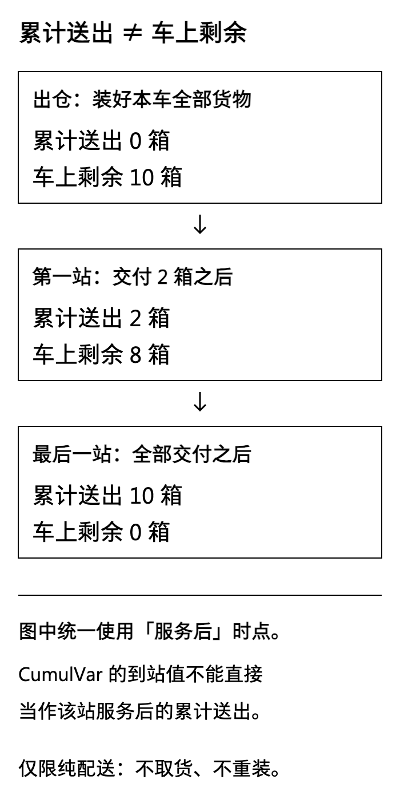
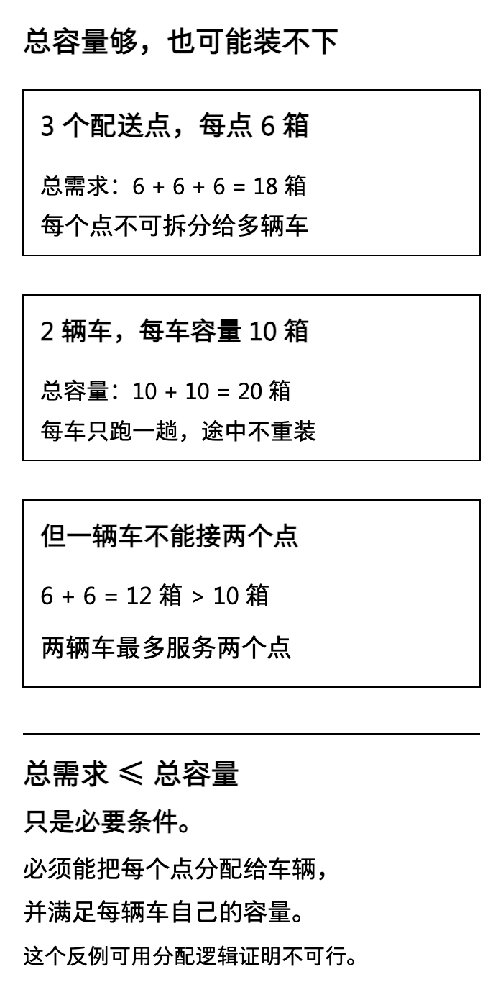
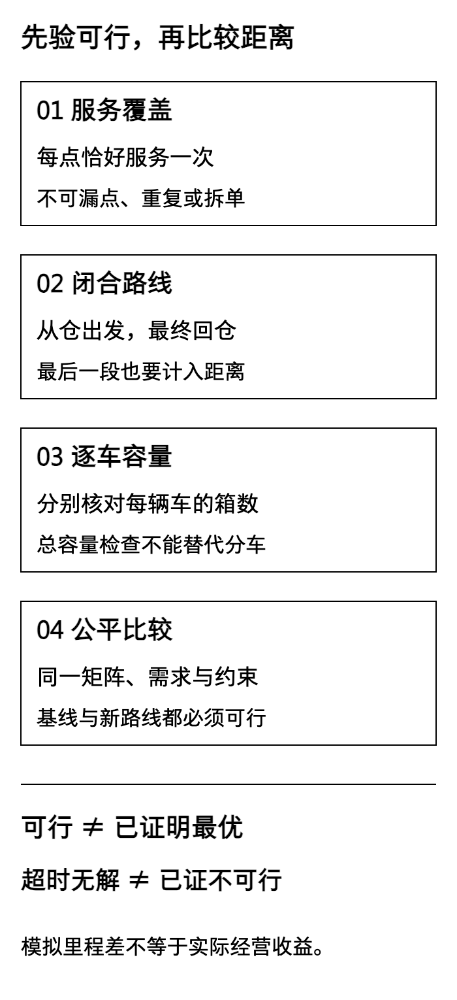

一份配送方案如果只有总公里数，很难判断能不能用。20箱货，两辆各能装12箱的车，看上去绰绰有余；可一旦把14箱分给同一辆车，另一辆还有余量，也救不了这条超载路线。

[D21](/blog/shortest-path-routing-baseline/)把两点最短路、访问顺序和分车拆开，留下两组可行的编号基线。D22不换一组更容易赢的数据，而是在同样的十点案例上加入求解器，并回答一个比“路线有没有变短”更重要的问题：**这份方案究竟满足了哪些约束，证据在哪里？**

全部企业、节点、箱数、距离和路线均为教学模拟。匿名服装案例只借用生产协同背景，不使用真实品牌、订单或收益。虚构禾味原本的2家门店、8个食材SKU、14天样本仍保留；这里的十点配送网络是独立教学扩展，不是把两店改写成十店，也不是从销量表自动生成的真实配送任务。

## 一 把问题写完整，再让求解器工作

容量约束车辆路径问题简称CVRP。它不仅安排先去哪里，还决定每个配送点交给哪辆车。本文固定以下条件：

- 0号是仓库，1—10号是配送点；每点2箱，合计20箱。
- 两辆车，各12箱容量，从0出发并返回0，每车只跑一趟。
- 每个点必须完整服务一次，不拆单、不丢点，不在途中补货或取货。
- 全部货物出发前装好，途中只卸货；目标仅为两车完整总距离最小。
- 距离为D21相同的11×11整数米矩阵，两案各自保持原样。

“箱”在这里是相同容量占用的抽象单位。现实食材箱、布卷和成衣箱未必等体积、等重量，不能因为都叫一箱就直接相加。质量、体积等限制应另设维度；本文没有建模它们，也没有时间窗、冷链或司机工时。

编号基线仍是车1走0→1→2→3→4→5→0，车2走0→6→7→8→9→10→0。每辆车初始装10箱，小于12箱，因此基线本身可行。求解器不能通过换矩阵、漏客户、增加车辆或取消回仓来制造“改善”。

## 二 容量公式只有加法，但必须说明加的是什么

用q(i)表示i号点的需求，单位箱；例如q(3)=2，意思是3号点要2箱。用Q(v)表示v号车的上限，本例Q(1)=Q(2)=12。

若一辆车分到1、2、3、4、5号点，它的初始装载量为：

```text
L = q(1)+q(2)+q(3)+q(4)+q(5)
  = 2+2+2+2+2 = 10箱
容量条件：L ≤ Q，即10 ≤ 12
```

L是该车承接的总箱数，不是全车队需求。纯配送时，出发最多、越送越少，所以整条路线需求和不超过容量，就能保证途中也不超载。这个推论依赖“只卸不装”；取送混合时，必须逐站计算装入与卸出，不能照搬。

送完第一站后，已服务2箱、车上剩8箱；第二站后已服务4箱、车上剩6箱。用C表示**某站服务完成后**累计送出的箱数，用R表示同一时点车上剩余箱数，则：

```text
R = L - C
第一站后：8 = 10 - 2
第五站后：0 = 10 - 10
```

每个字母先给含义和单位，公式才可读。不要把从0增长到10的累计数画成配送车上剩余货物，否则图形和业务方向正好相反。

[](images/d22-01_load.png)

## 三 需求回调不是预测模型，容量维度不是装车记录

需求回调可以理解为一个查表函数：求解器问“这个节点要多少”，它就返回固定需求。它不训练销量模型，也不预测未来箱数。

实现时还有两种编号：业务节点编号和求解器内部索引。车的起点、终点可能在内部有不同索引，因此先用`manager.IndexToNode`转换，再查需求数组，不能直接拿内部索引当客户ID。

容量维度为路线上的累计需求设置边界。本实验采用从0开始、需求非负、松弛量为0的构造。这里松弛量为0，是不允许在累计递推中凭空增加一个自由量；它不是给车辆增加“可超载余量”。车辆容量数组逐车传入，不把24箱车队总量当成每车上限。

还有一个容易错一站的细节：如果回调返回**离开节点**的需求，节点处的`CumulVar`对应到达该点时、尚未计入该点需求的累计值。例如到达第一站是0，服务完才是2。本文的服务后载荷表会显式加上当前点需求；不会直接把`CumulVar`贴上“卸货后累计”的标签。

Google的[Capacity Constraints官方示例](https://developers.google.com/optimization/routing/cvrp)用取货来解释增长的累计量，也说明同类容量构造可用于纯配送。读它时，应把“约束如何生效”和“货物实际上怎样移动”分开。先运行示例核对接口，再替换本文案例数据，而不是照搬示例的车辆数和单位。

## 四 总容量够，仍然可能没有可行分配

再造一个独立反例：三个客户各要6箱，两辆车各能装10箱，不拆单、每车一趟、不回仓重装。

```text
总需求：6+6+6 = 18箱
总容量：10+10 = 20箱
但是同一辆车若承接两个客户：6+6 = 12箱 > 10箱
```

每辆车最多承接一个客户，两辆车最多服务两个客户，还有第三个客户无车可送。这就是不可行的直接证明。总需求不超过总容量是必要条件，但不是充分条件：“必要”是做得到时必然满足；“充分”是满足它就保证做得到。18≤20没有保证货物能够分装进两辆车。

[](images/d22-02_counterexample.png)

如果放开拆单、增加趟次或第三辆车，可能出现方案，但那已经是另一个问题。业务人员可以讨论这些选择，实验程序不能默默替业务改规则。

## 五 实际结果：先独立验收，再谈距离

本次使用OR-Tools 9.14.6206、Python 3.12.13，首解策略PATH_CHEAPEST_ARC，局部搜索GREEDY_DESCENT，搜索时间上限10秒，保存的两案例原始状态均为1。状态用于记录本次求解，不替代独立检查，更不是最优性证明。

<div role="region" tabindex="0" aria-label="两案例同约束基线与求解结果，可横向滚动" style="overflow-x:auto;max-width:100%;margin:28px 0">
<table id="d22-results" style="min-width:650px;width:100%;max-width:none;display:table;margin:0;white-space:nowrap"><thead><tr><th>模拟案例</th><th>编号基线</th><th>本次求解距离</th><th>距离减少</th><th>每车初始载荷／容量</th></tr></thead><tbody>
<tr><td>禾味十点扩展</td><td>20000米</td><td>20000米</td><td>0米</td><td>10箱／12箱</td></tr>
<tr><td>匿名服装十点扩展</td><td>28000米</td><td>28000米</td><td>0米</td><td>10箱／12箱</td></tr>
</tbody></table></div>

保存的禾味路线是0→1→2→5→4→3→0，以及0→6→7→10→9→8→0；服装路线是0→5→4→3→2→1→0，以及0→6→10→9→8→7→0。两案各车都承接5个点、初始10箱，独立检查均通过。

**这次没有距离改善。** 路线顺序变了，总距离没有变。编号基线并不因为简单就一定差；我们也不换一组“算法容易赢”的输入。实验证据支持的是：容量求解接口跑通、输出可独立复核，尚不支持降本。两案矩阵不同，20公里与28公里不能互相相减当作策略效果。


求解器输出的每条路线还要交给另一个检查器。检查器不信任求解器显示的总距离和装载量，而是重新读取原始矩阵、需求和容量，核对：起终点都是0；1—10号各出现一次；没有内部回仓重装；每车箱数不超上限；逐段距离含最后回仓。

距离手算也不能省略。用d(i,j)表示从i到j的米数，对四节点闭环0→1→2→3→0，总距离是d(0,1)+d(1,2)+d(2,3)+d(3,0)。四个地点对应四段，不是三个，最后一段就是常被漏掉的回仓。禾味矩阵中这四段为2000、1000、1000、4000米，相加为8000米。实践包用四点独立夹具调用正式检查器，结果与这份手算逐项比对。

即使比基线短，也只能写“在这份相同模拟输入和约束下，找到了一条更短的可行路线”。它不是现实降本：装卸、等待、车辆固定费、油耗及通行费用没有进入目标，更没有真实调度验证。

## 六 三种结论，不能混为一句“优化成功”

**找到可行解**：通过所有已声明约束检查，但可能还有更短的路线。

**证明最优**：需要证明不存在更好的可行解。一个求解器返回成功状态、一张漂亮路线图，或者多跑几秒，都不自动构成这种证明。本文不声称全局最优。

**没有返回路线**：可能是输入错误、时间耗尽、搜索未找到，也可能确实不可行。必须保留状态和配置，不能把None翻译成“业务无解”。前述三点反例能称不可行，依据的是装载的数学论证，不只是空返回。

搜索限制与状态的含义见[OR-Tools Routing Options](https://developers.google.com/optimization/routing/routing_options)。限时运行受机器与版本影响，读者重跑不承诺路线逐字相同。可核验的是输入、约束、路线的独立复算及本次保存证据，而不是“每次五秒都走同一条路”。

[](images/d22-03_checks.png)

## 七 两类业务，不能只换一个名称

禾味食材配送中，容量合格只是第一道门。冻品与常温货能否同车、门店何时收货、卸货需要多久，都可能使一条短路线不可执行。本文十点案例仅演示分配与访问，不把各点2箱解释成真实备货需求。

匿名服装企业中，物料交接还受齐套、质检放行与工序衔接影响。路线把布料“送到”某个交接点，不代表生产线已经可以开工；布卷、辅料箱、裁片包也不能不经换算当作等容量单位。有先取裁片再送加工的任务，就需要取送先后关系，而非本篇的纯配送模型。

共同结论不是“同一个算法适合所有行业”，而是产品必须把服务对象、可发运状态、计量单位和允许动作翻译成模型约束，再给每条约束配检查。算法没有读取的条件，不能因为页面显示绿色就被视为满足。

## 八 复现、作业与下一步

- [D22模拟输入、真实求解记录、代码与测试](/downloads/d22-capacity-routing-practice.zip)
- [完整文章Markdown与配图](/downloads/d22-capacity-routing-article.zip)
- [黑白配图源文件及重绘工具](/downloads/d22-capacity-routing-images.zip)

Python 3.10及以上可仅用标准库核验已保存的公开路线，不需要安装求解器：

```bash
python -m unittest -v
python run.py
```

若要重新搜索，建议Python 3.12，新建虚拟环境后安装实践包的锁定依赖，并将结果写到新目录，避免覆盖本次证据：

```bash
python -m venv .venv
# 激活虚拟环境后运行，具体命令见README
python -m pip install -r requirements-lock.txt
python run.py --solve --output-dir new-run
```

`run.py`默认复算保存路线，不伪装成新一次搜索；`--solve`才真实调用OR-Tools。包内还保留官方示例源码、许可与实际终端输出。重跑官方示例按README单独执行，不把官方四车输入与本文两车结果混在一起。

计划D22的核心练习为阅读20分钟、建模20分钟、实践65分钟、验收和记录15分钟。阅读限于官方CVRP的数据、需求回调、容量维度和输出；不必一天学完所有路径算法。按以下三条验收自己的作业：

1. 从原始矩阵手算一个四节点闭环，含回仓，结果与程序相同。
2. 修改一条路线造成漏点、重复或超载，独立检查器必须报错，不能继续给“节省率”。
3. 用自己的话区分服务前累计、服务后累计和车上剩余；解释为什么总容量够仍可能不可行。

原计划本日积累80—150字证据卡，用于D24《配送路线更短为什么仍然不能用》；本篇是将该学习主题另行整理的完整博文，不要求读者把文章写作再塞进120分钟。下一步D23才在四个配送点上加入时间窗和卸货时长。今天先把容量检查做可靠，不提前把一个容量可行解包装成完整派车系统。
