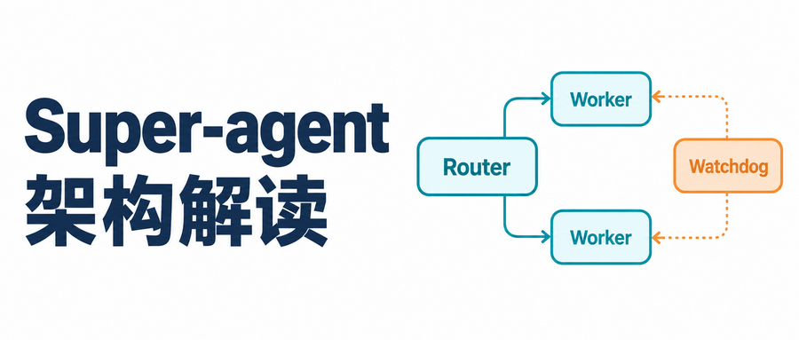
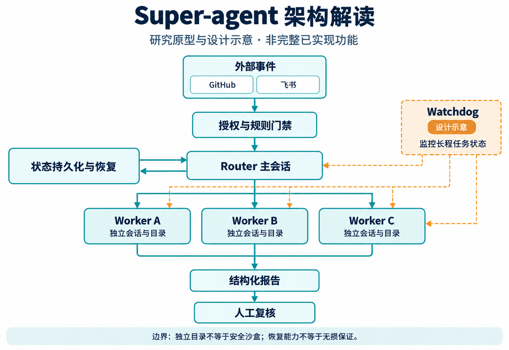
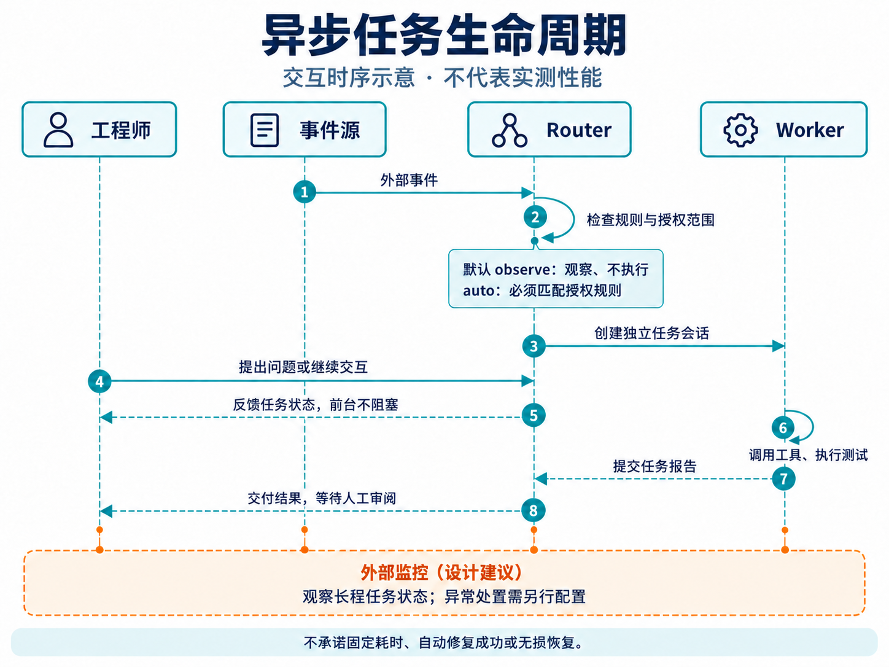
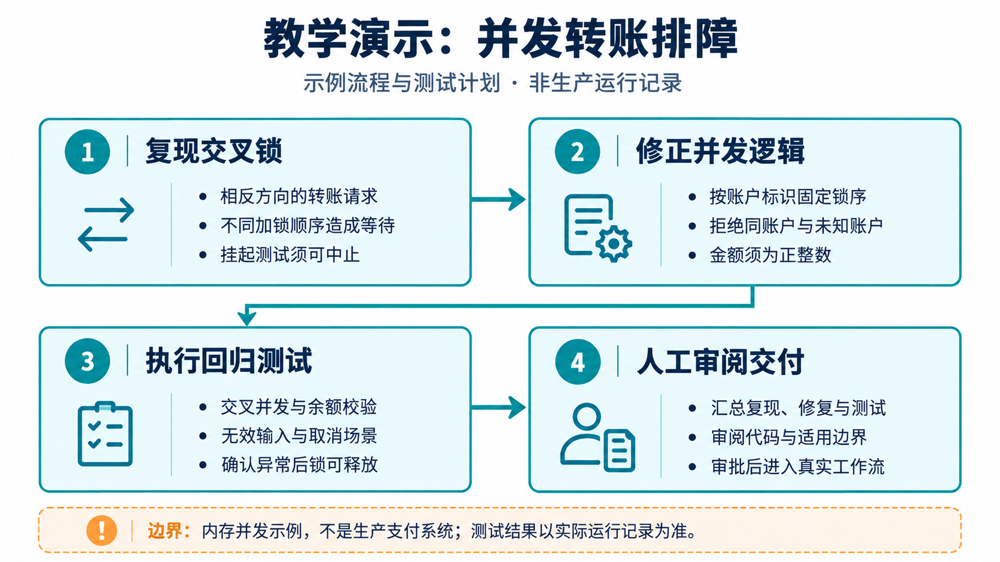

> **开源项目仓库**：[`deepseek-ai/dsh-superagent-prototype`](https://github.com/deepseek-ai/dsh-superagent-prototype)  
> **底层技术底座**：DeepSeek Harness (`dsh`) / Cordis 插件架构  
> **本文主线**：分层协作、异步交互、事件驱动与长程恢复；看门狗部分为设计讨论  


**阅读边界**：本文是架构解读，不是技术报告的逐字完整译文。官方仓库说明，公开代码是研究原型，并非正式 DeepSeek 产品或生产就绪软件；公开版本、内部版本与设计报告不能混为一谈，部分设计尚未实现。下文区分可查证的原型行为、作者的工程解释和第三部分的教学演示。核查依据见文末；本次未取得可逐段核对的官方报告全文。[官方说明](https://github.com/deepseek-ai/dsh-superagent-prototype)

---

## 第一部分：架构理念与公开原型概览

### 1.1 引言与背景：人类注意力的瓶颈

在过去的一段时间里，大语言模型（LLM）在复杂推理、长上下文理解和外部工具调用能力上取得了突破性进展。AI Agent 在处理单点代码编写、单元测试补充以及自动化 Bug 修复等孤立任务时，对人类工程师实时干预的需求已经显著降低。在 SWE-bench 等行业基准评测中，Agent 展现出了令人惊艳的单点突破能力。

然而，当我们将这些能力投入高强度的工业级日常研发时，一个全新的瓶颈浮出水面：**随着任务数量增长，“人类工程师的注意力与认知带宽（Human Attention Bottleneck）”也会成为重要制约。**

在真实的软件工程世界中，任务是异步、交织且并发发生的。如果每一个 Agent 实例都必须依赖人类工程师在对话框前实时盯盘、手动下发指令、人肉审查每一步工具输出，那么工程师很快就会被海量碎片的会话上下文淹没。要让 AI 真正释放出下一阶段的生产力，必须突破以“人”为单一调度中心的瓶颈，构建具备长效持久性与多任务自主协同能力的 Super-agent。

---

### 1.2 单会话（Session-based）模式的致命局限

一种常见交互形态是**围绕单会话组织工作（Session-based）**。不同工具已有后台任务、恢复等能力，以下讨论的是缺乏这些机制时的局限，而非对所有产品的断言。该模式在面对工业级复杂协作时暴露了三大结构性缺陷：

1. **会话碎片化与上下文割裂（Session Isolation）**
   * 每一个会话都是相互独立的逻辑孤岛。当工程师需要并行排查 3 个仓库的 Bug、跟踪 2 个 PR 的评审反馈时，必须在多个会话窗口之间反复横跳。
   * 并行会话越多，上下文切换和跟进成本通常越高；这里不设定普适的“人脑并发上限”。人类无形中充当了上下文的“人肉搬运工”，极大消耗了心智带宽。
2. **同步阻塞式交互（Synchronous Blocking）**
   * 简化的串行 ReAct（Reasoning + Acting）流程可以表示为：用户提问 → 模型思考 → 发起工具调用 → 等待工具执行结束 → 模型输出回复。
   * 当工具涉及编译大型项目、运行全量回归单测、拉取庞大镜像等长时耗时操作时，若未实现异步交互，前端就可能长时间等待。工程师要么被迫枯坐，要么切换到其他工作导致心流被打断。
3. **环境脆弱与长程中断（No Persistence）**
   * 单会话通常与本地进程或瞬时连接强绑定。笔记本电脑合盖、本地终端异常断连、SSH 会话超时，可能导致依附这些连接或进程的长任务中断。
   * 内存中的状态、临时变量及上下文一旦丢失，若无持久化和恢复机制，就难以接续。

---

### 1.3 Super-agent 的四大核心支柱

可以用以下四个目标理解 Super-agent 的设计方向；它们不是公开原型对所有环境的能力保证：

* **连续性（Continuity）**：跨环境无缝接续。用户能够在即时通讯软件（IM，如 Slack、飞书）、代码托管平台（GitHub PR/Issue 评论）、Web 控制台及本地终端之间，与同一个数字实体保持上下文连贯的协作。
* **高效率（Efficiency）**：多任务真实并行。底层具备异步调度与工作池能力，能够同时处理多个复杂的代码排查与修改任务，前后台解耦，互不干扰。
* **主动性（Proactivity）**：环境感知与推测执行。持续监听外部事件流，在无人显式 `@` 或输入命令的情况下，自发识别潜在的缺陷、性能瓶颈与协作阻塞，并在后台提前开展前置分析。
* **持久性（Persistence）**：全天候在线与故障自愈。系统脱离单次交互的生命周期限制，具备状态持久化能力；引入看门狗机制，尝试识别停滞并恢复任务；恢复能力取决于状态记录、工具与部署方式。

---

### 1.4 系统架构五大模块详解

为了同时支撑人的交互与后台任务，可以从分层调度、事件授权、异步执行、状态管理和故障处理五个角度理解系统。图中是解读示意，不代表所有设计都已在公开原型中实现。

[](images/mermaid_architecture.png)

#### 模块一：Router 与 Worker 双层分级架构
1. **Router 层（主会话）**：作为路由和协调入口，处理候选任务、关联已有工作，组织需要人关注的结果；不是所有消息都应成为新任务。
2. **Worker 层（执行会话）**：公开原型为每个 Ticket 建立独立 session 与工作目录，承担检索、修改和测试等具体工作。普通进度留在任务中，问题与结果按规则转交，减少对人的打扰。

**独立目录不等于容器沙盒。** 官方执行文档明确：Worker 命令以操作者的 OS 用户身份运行且无需逐次批准，目录及命令包装器不是安全边界。需要隔离时，部署者必须额外配置并验证隔离环境，不能从“双层架构”推导出安全保证。[执行文档](https://github.com/deepseek-ai/dsh-superagent-prototype/blob/main/docs/003-execution.md)

#### 模块二：事件驱动机制与授权门禁
公开原型接入 GitHub 与可选的飞书，外部消息进入 Trigger、评估和 Ticket 流程。可以将其理解为“先进行权限与规则筛选，再判断是否值得行动”，但不应虚构过滤比例，也不必假定评估一定使用小模型。

* **规则先于行动**：允许名单、接收范围和 Mandate（任务授权范围）由宿主管理，聊天内容本身不能扩大权限。
* **主动执行不是默认无条件监听后行动**：推断候选默认处于 `observe` 模式，只记录判断；切换到 `auto` 后仍需评估并匹配启用的规则。
* **Thread 订阅绑定**：相关后续消息可进入已有任务。订阅提供上下文，不自动增加权限；超出范围的请求要交回路由处理。[授权文档](https://github.com/deepseek-ai/dsh-superagent-prototype/blob/main/docs/002-authorization.md)

#### 模块三：面向人类的交互与异步 ReAct 循环
在一个工作会话中，思考与调用工具仍需要有序衔接，但耗时工具不必锁住全部交互。公开原型的 Router 和 Worker preset 会将超过 5 秒的前台 shell 命令转为后台任务，使会话能在后续步骤接收消息。

从用户体验看，可以用这样的**示意回复**理解非阻塞协作：
> “排查已启动，结果就绪后汇报；你可以继续安排其他工作。”

**推测执行（Speculative Execution）**强调在获得明确提问之前，依据获授权的环境线索开展前置工作。它应以规则、成本和权限为边界，不能把群聊中的任意一句话都当作自动修改代码的许可。

#### 模块四：计算与持久状态分离
原型以 DeepSeek Harness (`dsh`) bundle 形式运行，并通过插件组织能力。工程上，插件生命周期与持久状态需要分别设计：组件可替换，不代表业务副作用可以任意撤销，也不意味着零停机。

官方文档描述了 session、目录、订阅、待处理消息及已存储工作的恢复。宿主重启会结束正在运行的后台工作，中断的 Assignment 会带恢复说明重新开始；执行体需核对目录、Git 历史和远端状态，避免重复外部操作。**这不是运行中进程的快照迁移，也没有数秒无损恢复的保证。**

#### 模块五：看门狗与异常恢复的设计边界
独立监控有助于发现挂起命令、反复失败和异常资源消耗，这是长程 Agent 值得考虑的工程手段。外部指标只能提供线索：没有日志可能只是正常等待，重复调用也不一定是失控；目标漂移尤其不能靠 CPU 或日志间隔可靠判断。

公开原型可核实的机制包括后台工作的时间上限、失败重试、人工介入状态和宿主重启恢复；本文不将“独立进程监控所有容器、自动杀进程并回滚 Git、Token 速率熔断”写成已核实的产品能力。若自行实现 Watchdog，应限定中止对象、保留诊断证据，并在重试前检查副作用，必要时请人决策。

---

### 1.5 公开原型的用途与验证边界

官方说明该代码源于团队日常开发，但公开版本经过适配，不能用它反推内部部署的全部能力。仓库描述的典型路径是：获授权的请求进入任务，执行体在自己的会话和目录中工作，再在原对话中回复，例如提交供审阅的 PR；Web 面板展示需要人工介入的事项。

这为 Issue 复现、修复与评审跟进提供了实现参考。本文未核实到可支撑“交互切换与等待开销降低 60%”的官方实验数据，因此不报告这一性能数字，也不把后文教学案例当作 DeepSeek 内部生产实测。

---

### 1.6 开放性挑战与未来研究方向

尽管该原型架构展示了强大的工程潜力，但要实现完全泛化的自主协作系统，仍存在以下亟待突破的技术挑战：
1. **超长周期记忆一致性（Long-term Memory Consistency）**：在跨越数月乃至更长的时间维度下，如何确保海量结构化与非结构化知识在更新过程中不发生冲突与幻觉。
2. **多 Agent 协同与协商协议（A2A Communication Protocol）**：分布式异构智能体之间如何进行标准化的权限授权、契约签订与任务交接。
3. **安全防线与沙盒逃逸防范（Security & Isolation Boundaries）**：防范恶意间接 Prompt 注入攻击（Indirect Prompt Injection），防止长程驻留 Agent 在无人看管时因指令劫持而泄露敏感凭证或破坏宿主机环境。

---

## 第二部分：核心架构深度解读与系统工程洞察

### 2.1 架构范式跃迁：从“前台对话玩具”到“后台分布式守护进程”

部分基于 LLM 的智能体开发容易陷入“Prompt 工程视角”——即认为只要模型够聪明、System Prompt 写得够长，Agent 就能处理好一切。

然而 DeepSeek 在 `dsh-superagent-prototype` 中体现出的核心洞察是：**单靠大模型解决不了系统级可靠性问题；必须引入成熟的分布式操作系统工程思想。**
* 仅围绕前台 `CLI/REPL` 组织的交互容易将人绑定在单个任务上；
* Super-agent 的工程思路是将事件接入、任务调度、状态存储与交互分离；Watchdog 等外部监督可作为配套设计，但这并不意味着公开原型已是完整的分布式操作系统。

---

### 2.2 为什么注意力成本推动 Router-Worker 双层设计？

在多任务并发场景中，如果每个 Agent 实例都直接给人类发消息，工程师的屏幕每分钟都会被海量工具调用细节（例如 `“正在读取 package.json”、“正在执行 npm run test:unit”`）刷屏。这不仅造成严重的注意分散，还使得人不得不承担复杂的跨任务裁决。

通过 **Router-Worker** 架构：
* **Router** 承担了“贴身技术主管（Tech Lead）”的角色：过滤噪音、控制汇报颗粒度、保护人类专注力；
* **Worker** 则是“机房里的自动化工蜂”：在各自的执行会话和目录中工作，只把最终的排查结果以最小必要形式呈递上来。

---

### 2.3 异步 ReAct 与推测执行的生命周期

用一个简化的串行 ReAct 流程作对照：
```text
Input → Think → Tool Exec (Blocking) → Think → Output
```

Super-agent 的**异步 ReAct 循环**打破了这一线性约束，其人机协同关系可以用下方概念时序图说明：

[](images/mermaid_sequence.png)

图中的 `observe` 规则指从事件推断出的主动任务候选；不表示所有显式且已授权的请求都不执行。

结合时序图，关键变化是将人的消息与后台任务解耦：
1. **事件感知**：接收配置范围内的 GitHub 或飞书事件；
2. **规则授权**：决定忽略、关联已有任务或开展获授权的前置排查；
3. **异步执行**：将耗时工作放到执行会话，人的后续消息不必等待整个任务完成；
4. **异常处理**：依据超时、失败结果和恢复记录重试或请求人工介入；图中的外部监控是设计建议；
5. **成果交付**：汇总补丁、验证范围与仍待判断的问题，不用流水日志代替结论。

### 2.4 看门狗（Watchdog）：长程运行的外部监督

如果一个 Agent 拥有写代码、跑 Bash、改配置的权限并在后台长效运行，必须考虑故障与越界风险。

常见故障模式包括：
* **Stall（挂起）**：命令等待交互输入，或在异步事件循环中使用不当的同步阻塞锁；
* **Loop（循环）**：反复修改、测试、还原，却没有获得新的证据；
* **Drift（目标漂移）**：为了修复小问题而扩展到未经授权的重构。

外部监督的价值是提供另一条发现异常的路径，而不是保证“无死角”。超时必须结合任务预期解释；自动回滚前要确认不会丢失别人的工作；终止进程也无法撤销已经发送的消息或提交的远端操作。更稳妥的策略是保留证据、限定重试次数和权限范围，无法判断时明确请求人工介入。第三部分将用教学情境解释这一思路，不将它冒充真实运行记录。

---

## 第三部分：端到端教学案例拆解（Python 并发示例）

为了理解这类架构的协作方式，下面构造一个 **Python 内存账户并发转账** 教学情境。人物、群聊、任务编号、监控介入与交付对话均为演示，不是 DeepSeek 生产案例或真实 PR 记录。代码只涉及单进程、单事件循环内存数据，不用于真实资金、库存或数据库事务。

### 3.1 教学案例全流程泳道图

下图将教学情境中的授权接单、复现、修复和人工审阅串联起来；外部监控处置仅作设计示意：

[](images/case_walkthrough.png)

---

### 3.2 场景起因：群聊报障与静默立项

**示意时间点**：周四下午 15:30  
**发生场景**：在项目研发的 IM 交流群中，QA 压测工程师发了一条消息：
> *“@所有人 压测环境出现异常！高并发账户间互转/库存调拨时偶现卡死超时，触发 `asyncio.TimeoutError`，怀疑出现死锁，压测流水号追踪 ID 为 `#TASK-PY-98721`，相关同学看下代码！（教学消息）”*

此时模块的负责研发正在开周会，无法立即进入终端排查。

#### 假设团队已授权此类排查且启用自动接单，系统可以这样响应：
1. **两段式过滤流水线触发**：
   * **规则过滤层**：正则匹配到 `TimeoutError` 关键词以及流水号格式 `#TASK-PY-98721`，判定为高置信度缺陷事件，放行进入意图门禁；
   * **LLM 意图门禁**：决策模型分析群聊上下文，判断可能存在 Python 并发问题，尚需代码和测试确认，指明了流水号，具备立项排查价值。
2. **静默立项与上下文隔离**：
   * Router 并未在群里水消息，而是在后台创建了演示任务 `task-py-98721`，启动执行会话与工作目录；是否使用隔离容器取决于部署配置。

---

### 3.3 缺陷代码与 Python 并发复现单测

设想 Worker 检索到以下内存账户逻辑；这里用最小示例保留交叉加锁缺陷：

```python
# inventory_service.py (存在死锁缺陷的代码)
import asyncio
from typing import Dict

class AccountInventoryService:
    def __init__(self):
        # 两个账户的独立异步锁
        self.locks: Dict[str, asyncio.Lock] = {
            "account_A": asyncio.Lock(),
            "account_B": asyncio.Lock()
        }
        self.balances: Dict[str, int] = {
            "account_A": 1000,
            "account_B": 1000
        }

    async def transfer_funds(self, from_acc: str, to_acc: str, amount: int):
        """
        存在死锁隐患的资金调拨：加锁顺序依赖调用传参，交叉转账时造成交叉死锁！
        """
        # 先锁源账户
        async with self.locks[from_acc]:
            await asyncio.sleep(0.01)  # 模拟网络与数据库 I/O 延迟
            # 再锁目标账户
            async with self.locks[to_acc]:
                if self.balances[from_acc] >= amount:
                    self.balances[from_acc] -= amount
                    self.balances[to_acc] += amount
                    return True
                return False
```

#### 并发复现测试示例
可编写如下 `test_deadlock_reproduce.py`。这一段需要 `pytest` 和 `pytest-asyncio`；与下文已运行的标准库回归测试分开：

```python
# test_deadlock_reproduce.py
import pytest
import asyncio
from inventory_service import AccountInventoryService

@pytest.mark.asyncio
async def test_concurrent_transfer_deadlock():
    service = AccountInventoryService()
    
    # 构造交叉并发请求：A->B 与 B->A 同时发生
    task1 = asyncio.create_task(service.transfer_funds("account_A", "account_B", 50))
    task2 = asyncio.create_task(service.transfer_funds("account_B", "account_A", 30))
    
    # 事件循环正常调度时，以 2 秒超时观察交叉等待
    with pytest.raises(asyncio.TimeoutError):
        await asyncio.wait_for(asyncio.gather(task1, task2), timeout=2.0)
    
    print("\n[Demo] 捕获预期超时，请结合锁获取路径判断原因。")
```

此测试以超时作为交叉等待的复现信号；超时本身不能证明所有超时都源于死锁。原稿没有提供实际运行记录，这一段保留为教学脚本，未计入下文已运行的回归测试。

---

### 3.4 看门狗捕获卡死（Stall）与注入纠偏策略

设想排查时又误用了 `threading.Lock()`：若一个协程持锁后让出控制权，另一个协程同步阻塞等待同一把锁，整个事件循环就可能被卡住。此时同一事件循环内的超时机制也可能无法及时执行，需要独立进程监控或人工中止测试。

这只是说明外部监控的作用，不是公开原型发生过的日志。合理的处置是先保存诊断信息，终止指定测试进程，再检查未提交修改；不能无条件回滚整个目录。可以向执行体给出这样的**示意纠偏建议**：
> “避免在异步事件循环中阻塞等待同步锁。检查资源获取顺序，并覆盖同账户、无效金额和取消路径。”

### 3.5 锁排序修复与可复现回归测试

对于这个单事件循环示例，**全局锁排序（Lock Ordering）**可避免两个不同账户交叉获取锁造成循环等待。还需拒绝同账户请求，以免重复获取同一把非重入锁，并校验金额与账户。这里没有使用 CAS。

```python
"""Teaching example only: one process, one event loop, in-memory balances."""
import asyncio


class SafeAccountInventoryService:
    def __init__(self):
        self.balances = {"account_A": 1000, "account_B": 1000}
        self.locks = {key: asyncio.Lock() for key in self.balances}

    async def transfer_funds_safe(self, from_acc: str, to_acc: str, amount: int):
        if type(amount) is not int or amount <= 0:
            raise ValueError("amount must be a positive integer")
        if from_acc not in self.balances or to_acc not in self.balances:
            raise ValueError("unknown account")
        if from_acc == to_acc:
            raise ValueError("source and destination must differ")
        first_key, second_key = sorted((from_acc, to_acc))
        async with self.locks[first_key]:
            await asyncio.sleep(0)  # Allow interleaving in the demonstration.
            async with self.locks[second_key]:
                if self.balances[from_acc] < amount:
                    return False
                # No await between the two writes in this toy event-loop model.
                self.balances[from_acc] -= amount
                self.balances[to_acc] += amount
                return True
```

这段代码只在单进程、单事件循环、账户集合固定且所有写入都遵守相同锁协议的前提下说明锁排序。两次余额更新之间不包含 `await`；生产系统仍需要数据库事务、幂等、鉴权、审计与跨进程并发控制。它不是支付服务实现，也没有证明任意业务代码都不会死锁。[Python 锁语义](https://docs.python.org/3/library/asyncio-sync.html#lock)

#### 本文实际运行的测试

可选下载：[Python 锁排序示例与测试包（ZIP）](/downloads/deepseek-superagent-lock-ordering-practice.zip)，包含实现代码、测试代码、说明和本次运行输出。配套代码使用 Python 标准库，不需要 Pytest 插件；解压后进入目录运行：

```bash
python -m unittest -v
```

本次编辑在 Python 3.12.14 环境执行了 **7 个测试方法，全部通过**：正常转账、200 个交叉并发调用、余额不足、同账户拒绝、非法金额、未知账户，以及取消等待后释放已持有的锁。测试代码含多组子用例；这里不将其包装为“100 轮生产压测”，也不把本地运行耗时当性能指标。本次测试输出收录于上述下载包。

#### 成果交付的示意

若将这类验证集成进 Agent 工作流，面向工程师的报告应包含：

> **教学交付示例**：原逻辑可能因交叉锁顺序形成循环等待；示例修复统一锁顺序，并拒绝同账户和无效金额。配套有限范围测试通过，仍需按实际数据库与部署模型审查。补丁可提交为草稿 PR，等待人工评审；本文没有创建真实 PR，也没有真实生产验收记录。

工程师应检查修改范围和验证证据，而不是仅凭“全部通过”的一句话批准合并。分层协作的目标是减少不必要的跟进，把人的注意力留给边界、风险和验收决策；具体节省多少时间，需要另行测量。

---

## 第四部分：总结与开发者启示

DeepSeek 的 `dsh-superagent-prototype` 为 Agent 系统设计提供了可讨论的工程启示：

1. **从 Prompt 工程转向系统设计**：模型能力之外，还需要路由解耦、事件管理、状态恢复和权限控制。具体是否引入容器、外部监控或自动回滚，应由部署风险与可验证性决定。
2. **异步化有助于降低等待成本**：将阻塞的同步等待转化为非阻塞的异步状态机与推测执行，有助于让人把注意力从会话跟进转向关键决策。
3. **安全与隔离是走向生产的第一前置条件**：目录隔离不是安全隔离，看门狗也不是完整安全机制。部署前应确认最小权限、运行隔离、外部操作授权和人工停止路径，而不是把研究原型直接用于高风险环境。

---

> **代码与规范声明**：
> * 本文对应代码原型参考开源仓库：[`deepseek-ai/dsh-superagent-prototype`](https://github.com/deepseek-ai/dsh-superagent-prototype) 与 DeepSeek Harness 运行时体系。
> * **风险提示**：在本地宿主机直接赋予 Agent 无沙盒保护的 Bash/终端写入权限存在严重安全隐患，应结合威胁模型选择并验证容器或更强隔离方案，同时限制凭证与网络权限；单靠采用某一种工具并不保证安全。


## 参考资料与核查范围

以下为本文核查的第一手资料（2026 年 11 月 1 日，北京时间）：

- [官方仓库 README](https://github.com/deepseek-ai/dsh-superagent-prototype)：研究原型定位，以及公开版本与内部版本、设计报告的区别。
- [授权模型](https://github.com/deepseek-ai/dsh-superagent-prototype/blob/main/docs/002-authorization.md)：允许名单、Mandate、`observe` / `auto` 与主动规则。
- [执行与恢复](https://github.com/deepseek-ai/dsh-superagent-prototype/blob/main/docs/003-execution.md)：会话与目录、后台任务、重启恢复及非安全边界说明。
- [架构实现](https://github.com/deepseek-ai/dsh-superagent-prototype/blob/main/docs/007-architecture.md)：Runtime、Engine、Store 与执行适配器的职责。
- [DeepSeek Harness 官方介绍](https://www.deepseek.com/en/harness/)：Cordis 插件架构与 Harness 的关系。
- [Python asyncio 同步原语](https://docs.python.org/3/library/asyncio-sync.html)：锁的等待与释放语义。

图示是本文的解释性绘制；第三部分为作者教学示例。公开原型可能继续变化，具体部署请核对当时版本的文档与代码。
