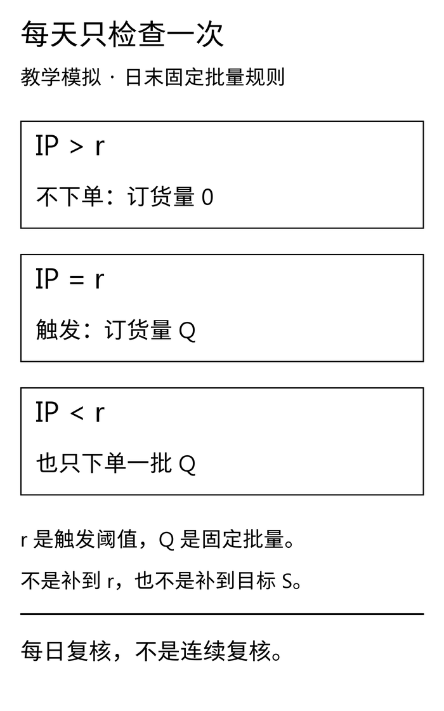
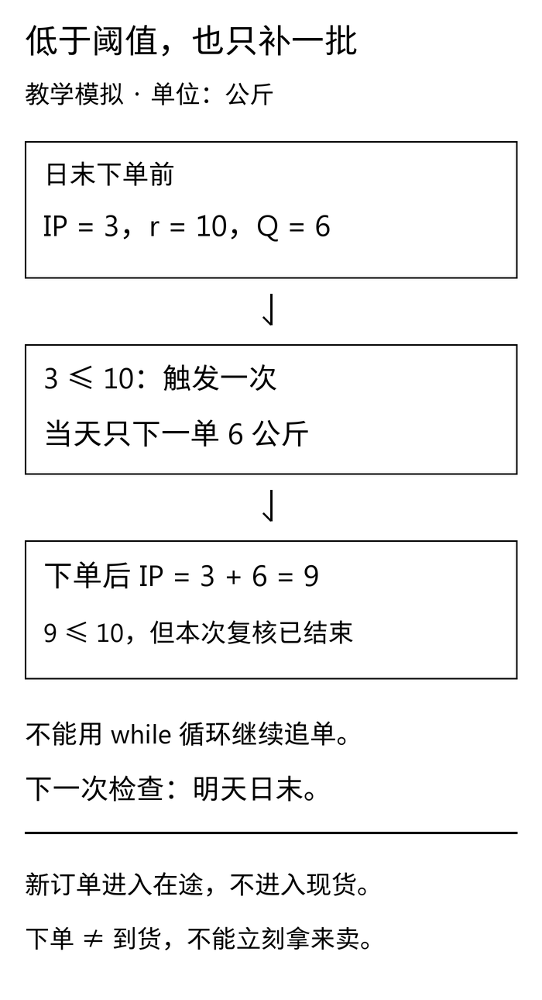
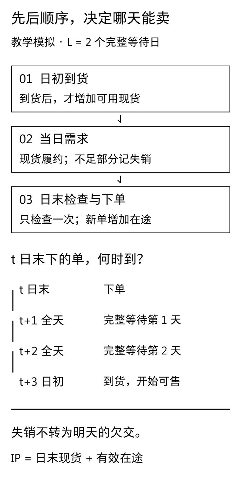

禾味A店关门时，SKU01的库存位置刚好降到10公斤。今天定的规则是“阈值10，每次补6”。店员问：“刚好等于10也补吗？补完还不到阈值，又怎么办？”

这两个问题不解决，同一张参数表就能跑出两种采购结果。有人把小于写成小于等于，有人不断循环补到超过阈值，还有人下完单就把货加进现货。代码都能运行，执行的却已经不是同一条规则。

[D15](/blog/inventory-position-event-timing/)先把可用现货、有效在途和到货顺序分开。本篇保留那张底账，只替换日末的决策动作：**库存位置不高于阈值r时，订一批固定Q；高于r时不订。每天最多一单。**

## 一 两个参数，回答两个问题

**本文所有案例、需求、数量、参数和订单均为教学模拟，不对应真实企业品牌、项目规则或经营收益。** 禾味仍是虚构的两店、八食材SKU连锁，本篇只回放A店SKU01，另外15条店×SKU组合没有生成或评估。匿名服装案例另用一个虚构单SKU库存沙盘，以件为单位，不能和公斤相加，也不能直接映射成生产排程。

把规则写完整：

```text
每天日末，完成当天到货与需求记账后：
若 IP ≤ r：新增一张数量为 Q 的订单
若 IP > r：不下单
同一实体 × SKU × 日，最多一张新增订单
```

- **r，补货阈值。** 回答“检查时，库存位置降到什么程度就触发”。
- **Q，固定批量。** 回答“每次触发后，新增多少”。Q必须大于0。
- **IP，库存位置。** 沿用D15，本例没有预留，且采用失销口径，所以 `IP＝可用现货OH＋有效在途OO`，欠交始终为0。

这里的r是数量，不是复核周期。教材有时用s表示同一个阈值；后续讲周期复核时的R则是时间，不能混用。Q也不是D15的目标S。D15算 `max(0, S－IP)`，订单量随IP变化；本篇每次只下固定Q，不保证订后IP到达某个目标。

MIT《Logistics Systems》第11讲，第5页区分复核方式，第6页给出固定批量阈值规则，第9页解释阈值与提前期需求及缓冲的联系。其第6页放在连续复核框架下；**本文加上“日末才检查、每天最多一单”的离散约束，不直接套用连续模型的服务水平结论。** [讲义原文](https://ocw.mit.edu/courses/esd-260j-logistics-systems-fall-2006/8b53c45fd26ffff706d815131e8d177e_lect11.pdf#page=5)

[](images/d16-01_rule.png)

## 二 等号与阈值下穿，不能藏在实现细节里

设r＝10公斤、Q＝6公斤。三个最小用例应该先于长回放写下来：

```text
IP = 11：订 0
IP = 10：订 6，订后 IP = 16
IP =  3：订 6，订后 IP =  9
```

第二行专门检查等号：`IP < r`会漏掉恰好等于阈值的订单。

第三行更重要。一次需求可能把IP从阈值上方直接压到很低的位置，这叫阈值下穿。例如需求发生前IP为12公斤，现货足够履约9公斤，需求发生后IP就是3公斤。日末检查只订6公斤，订后IP为9公斤，仍没有超过10。

**这一天到此为止，不能再订第二批。** 明天日末再按当时的状态检查。若写成 `while IP <= r`，就会继续订第二个6公斤，直到IP变成15；若写成“补到r＋Q”，则会订13公斤。两者都擅自改变了本篇规则。

[](images/d16-02_one-batch.png)

这不是说“一天一单”永远更合理。真实业务可以允许多批、合单或最低起订量，但需要把规则另行定义、冻结和验证。不能为了让曲线看起来平稳，在运行中悄悄改策略。

还有一个失销模型特有的细节：IP下降的是**实际履约量**，不是所有原始需求。若现货不足，未满足部分已经离开，不再作为欠交扣库存。不能先按全部需求减少IP，随后又将现货截到0，否则状态口径不同步。

## 三 先排时间，再把订单塞进队列

本篇沿用D15的日内顺序与提前期定义：

1. **日初到货。** 当天到期订单从在途移出，同量加入可用现货，假设足量、准时且立即可用。
2. **当日需求。** 履约量取需求与可用现货的较小值，剩余需求记作当天失销。
3. **日末检查与下单。** 用需求发生后的现货、未到货的有效在途计算IP；触发时将一张Q订单加入在途。

L表示下单后完整等待的日数。**L＝2时，t日末下单，经过t＋1、t＋2两个完整等待日，t＋3日初到货。** L＝0也是次日日初到，不是当天倒流回日初。初始在途已有单独约定的到货日，不把它们当成第1日才新下的订单。

[](images/d16-03_timing.png)

在这个约定里，当天到货发生在需求之前，可以用于当天履约；当天新单发生在需求之后，不能挽回今天的失销。库存位置足够高，也可能因为货还在路上而发生缺货。单看IP，不足以判断未来每一天能卖多少。

## 四 禾味七日手算：只改Q，不换需求路径

两组都从D15同一个起点出发：第1日日初到货前现货12公斤，初始在途8公斤在第2日初到；L＝2。需求依次为7、9、8、4、5、6、3公斤，合计42公斤。A组r＝10、Q＝6，B组r＝10、Q＝12。参数是提前固定的教学设定，没有通过这七天择优，也没有拟合安全库存。

第1日两组都一样：12公斤满足7公斤需求，剩5公斤；初始在途8公斤还没到，下单前IP＝13，大于10，所以不下单。这里若只看货架上的5公斤，就会错误触发。

第2日初8公斤到货，现货变成13公斤，在途相应清零；满足9公斤需求后剩4公斤，下单前IP＝4。A组订6公斤，B组订12公斤，两笔订单都在第5日初才到。

下面两表全部数量均为公斤。“在途”和“IP”都取日末下单前，订单到货日仅列当天新增订单，没有下单时记“无”。手机端可在表格内左右滑动。

### A组：r＝10，Q＝6

<div role="region" tabindex="0" aria-label="禾味Q6七日台账，单位公斤，可横向滚动" style="overflow-x:auto;max-width:100%;margin:28px 0">
<table style="min-width:780px;width:100%;max-width:none;display:table;margin:0;white-space:nowrap">
<thead><tr><th scope="col">日</th><th scope="col">日初到货</th><th scope="col">需求</th><th scope="col">履约</th><th scope="col">失销</th><th scope="col">日末现货</th><th scope="col">在途</th><th scope="col">IP</th><th scope="col">新单</th><th scope="col">新单到货日</th></tr></thead><tbody>
<tr><td>1</td><td>0</td><td>7</td><td>7</td><td>0</td><td>5</td><td>8</td><td>13</td><td>0</td><td>无</td></tr>
<tr><td>2</td><td>8</td><td>9</td><td>9</td><td>0</td><td>4</td><td>0</td><td>4</td><td>6</td><td>5</td></tr>
<tr><td>3</td><td>0</td><td>8</td><td>4</td><td>4</td><td>0</td><td>6</td><td>6</td><td>6</td><td>6</td></tr>
<tr><td>4</td><td>0</td><td>4</td><td>0</td><td>4</td><td>0</td><td>12</td><td>12</td><td>0</td><td>无</td></tr>
<tr><td>5</td><td>6</td><td>5</td><td>5</td><td>0</td><td>1</td><td>6</td><td>7</td><td>6</td><td>8</td></tr>
<tr><td>6</td><td>6</td><td>6</td><td>6</td><td>0</td><td>1</td><td>6</td><td>7</td><td>6</td><td>9</td></tr>
<tr><td>7</td><td>0</td><td>3</td><td>1</td><td>2</td><td>0</td><td>12</td><td>12</td><td>0</td><td>无</td></tr>
</tbody></table>
</div>

### B组：r＝10，Q＝12

<div role="region" tabindex="0" aria-label="禾味Q12七日台账，单位公斤，可横向滚动" style="overflow-x:auto;max-width:100%;margin:28px 0">
<table style="min-width:780px;width:100%;max-width:none;display:table;margin:0;white-space:nowrap">
<thead><tr><th scope="col">日</th><th scope="col">日初到货</th><th scope="col">需求</th><th scope="col">履约</th><th scope="col">失销</th><th scope="col">日末现货</th><th scope="col">在途</th><th scope="col">IP</th><th scope="col">新单</th><th scope="col">新单到货日</th></tr></thead><tbody>
<tr><td>1</td><td>0</td><td>7</td><td>7</td><td>0</td><td>5</td><td>8</td><td>13</td><td>0</td><td>无</td></tr>
<tr><td>2</td><td>8</td><td>9</td><td>9</td><td>0</td><td>4</td><td>0</td><td>4</td><td>12</td><td>5</td></tr>
<tr><td>3</td><td>0</td><td>8</td><td>4</td><td>4</td><td>0</td><td>12</td><td>12</td><td>0</td><td>无</td></tr>
<tr><td>4</td><td>0</td><td>4</td><td>0</td><td>4</td><td>0</td><td>12</td><td>12</td><td>0</td><td>无</td></tr>
<tr><td>5</td><td>12</td><td>5</td><td>5</td><td>0</td><td>7</td><td>0</td><td>7</td><td>12</td><td>8</td></tr>
<tr><td>6</td><td>0</td><td>6</td><td>6</td><td>0</td><td>1</td><td>12</td><td>13</td><td>0</td><td>无</td></tr>
<tr><td>7</td><td>0</td><td>3</td><td>1</td><td>2</td><td>0</td><td>12</td><td>12</td><td>0</td><td>无</td></tr>
</tbody></table>
</div>

第2日A组订后IP为10，恰好等于阈值，也不会再补一单。第3日A组只有4公斤现货，却收到8公斤需求，于是履约4、失销4，仍在途的6公斤只能等第5日到。日末IP＝6，再下一单6，第6日初到货。B组第3日已有12公斤在途，IP＝12，因此不下单，但同样无法用这笔在途挽回当天失销。

第4日，两组都没有现货、没有到货，当天4公斤需求全部失销。IP却都是12，大于阈值，所以两组仍不下单。**“今天缺货”与“日末触发补货”不是同一条件。** 改成缺货就下单，是另一条策略。

七日合计，两组都履约32公斤、失销10公斤、新下24公斤订单，期末现货0公斤、在途12公斤。A组下4单，B组下2单；第5日末现货分别为1与7公斤，到货节奏不同。这条短路径没有显示“大批量必然减少失销”，也不能把订单次数减少直接换算成成本节省。

两组现货守恒均为 `12＋20－32＝0`，在途守恒均为 `8＋24－20＝12`。A组尾部是第8、9日初各到6公斤；B组是第8日初到12公斤。第7日窗口结束时，它们仍属于有效在途，不能删掉，也不能算成已经收货。

D15的目标库存位置规则在同一路径上得到过另一组结果，但本篇没有借此挑“获胜策略”。这里只用两组固定Q观察动作如何改变，长期表现留待冻结评估口径后的专门比较。

## 五 匿名服装：同一条规则，也要先划清业务对象

服装生产协同可能同时出现采购、在制、完工、验收和客户承诺。哪一段能进入有效在途，何时成为可用现货，必须先和业务核对。本文没有真实企业的批量、质检、产能或延期履约规则，不替它们作任何假设性结论。

这里沿用D15的另一条模拟路径：现货6件，初始订单4件于第1日初到货，L＝1；七日需求为5、8、4、7、3、6、2件。只把它看作一个独立库存节点，设r＝8件，分别试算Q＝6与Q＝12件。缺货仍按教学失销口径，不代表服装订单的真实处理方式。

两组七日结果同为需求35件、履约32件、失销3件、新下36件，期末现货2件、在途12件。Q＝6时下6单，Q＝12时下3单。现货守恒为 `6＋28－32＝2`，在途守恒为 `4＋36－28＝12`。Q＝6的尾部订单在第8、9日初各到6件；Q＝12的尾单在第8日初到12件。

这些相同的总数只描述这条给定路径。它们既不能证明两种Q长期等价，也不能证明真实工厂应按6件或12件采购。逐日差异和订单明细保留在实践包中，不用一个汇总数把它们抹平。

接入真实场景前，应逐项补齐：

- 批量Q的单位究竟是件、箱还是某种尺码组合，包装换算是否明确？
- 到货日代表物流到厂、验收通过还是可分配日期？尚不可用的货不能提前进入OH。
- 补货单、工单与完工预计是否重复代表同一批货？在途不能重复累计。
- 缺货究竟是失销、延后交付还是部分取消？选择欠交模型就必须把后续履约、取消与承诺一并建模。
- 系统重试或人工再次点击，会不会把同一天的建议落成两张订单？

最后一项尤其容易被忽视。`order_qr`是纯函数，同一个IP调用两次仍会返回两次Q；它不能单独保证防重。本篇模拟器按唯一日期逐日运行，每天只调用一次策略。真实系统还需要实体、SKU、决策日、策略版本等稳定标识，以及幂等写入与并发控制。本文没有连接采购系统，也不宣称完成了生产级防重。

## 六 r和Q怎么来，先不要跳到“最优”

阈值的常见思路是提前期需求加缓冲。但把一个连续复核公式的L代入这份日末检查代码，不能自动获得同样的服务保证。检查间隔可能产生下穿，每日一单可能限制追补，事件时点和失销口径也会改变轨迹。要估参数，先把这些条件写进策略卡，再用适合的数据和目标验证。

本篇只完成机制校验，不做参数搜索、不估收益，不加入报损、保质期、资金占用或生产优化效果。七日手算沿用的是已经公开的教学需求；它不是未见测试集。

若后续比较策略，应先明确指标与单位，在开发或验证数据上确定规则与参数，再冻结配置，最后才运行未见测试。不能看过最终测试的失销量后回来调r或Q，也不能换一条更好看的需求轨迹。**本篇没有读取D9封存数据，没有运行最后28天测试，也不推进D20的最终评估。**

实践包将这次规则、两条输入轨迹和四组参数固定为一个版本，记录冻结回执与哈希。哈希核验用于发现文件漂移，不会把教学参数变成经过经营验证的参数，更不是不可篡改的外部认证。

## 七 下载复算，再故意改错一处

下载[D16固定批量实践包](/downloads/d16-fixed-batch-practice.zip)，用Python 3.10或以上解压，在包内运行：

```bash
python -m unittest -v
python run.py
```

计算与测试只依赖标准库。包内含原始需求、冻结参数与策略卡、四组逐日台账、订单事件、期末仍在途明细、汇总和文件校验信息。运行脚本按自身目录定位，不需要完整博客仓库；同样输入得到同样输出。修改输入或冻结参数后不能冒充已发布版本，应另建实验记录。

先检查三个层次：

1. **策略边界。** IP大于r不订，等于r要订，低于r也只订Q；订后仍低于阈值不能循环追单。
2. **状态与时间。** 到货先于当天需求，新增订单不增加当天现货；到货从OO移出，失销不留下欠交；未来需求被扰动后，已发生日前的决策不变。
3. **证据与交付。** 需求＝履约＋失销，期初现货＋窗口内到货－履约＝期末现货，期初在途＋窗口内新单－窗口内到货＝期末在途。第7日之后才到的订单必须留在队列。

单元测试还检查输入数量、单位、日期与订单标识，拒绝不支持或不合法的数据。测试通过说明这些已设计边界得到覆盖，不说明所有业务规则已经齐全。

另附[文章Markdown与配图](/downloads/d16-fixed-batch-article.zip)、[黑白配图与独立重绘脚本](/downloads/d16-fixed-batch-images.zip)。计算包不要求绘图依赖，图包说明字体与渲染环境；中文技术图也提供可编辑SVG和手机宽度预览。

本篇留给下一步的不是“推荐买多少”，而是一条能复述、能手算、能故意攻击的规则：什么时候看库存，看到什么值触发，一次下多少，以及这批货从哪一天开始可用。先把这几件事统一，后面的策略比较才有共同的起点。
