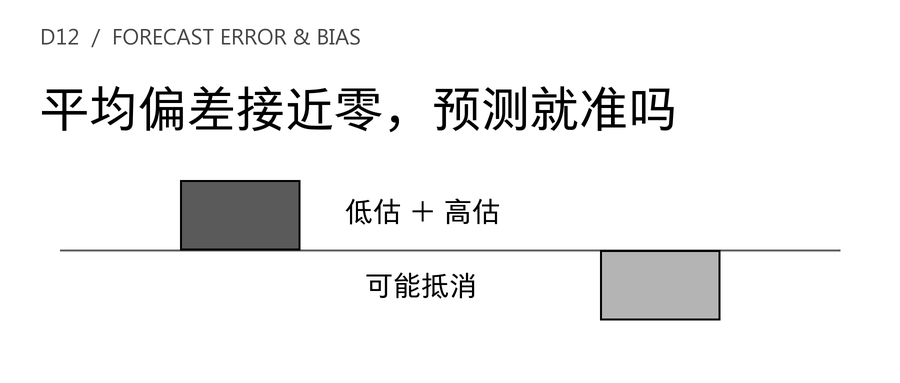
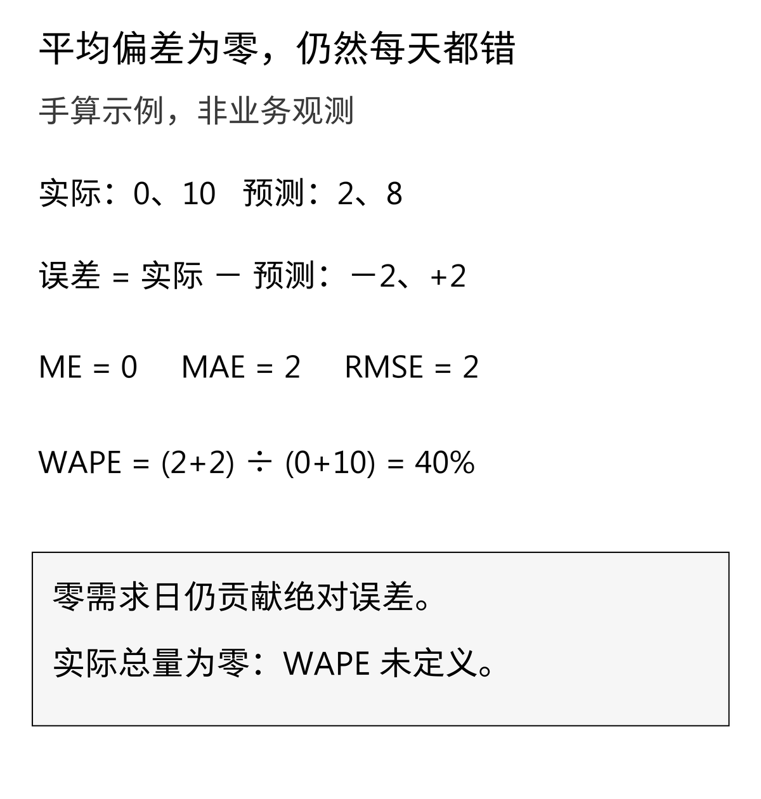
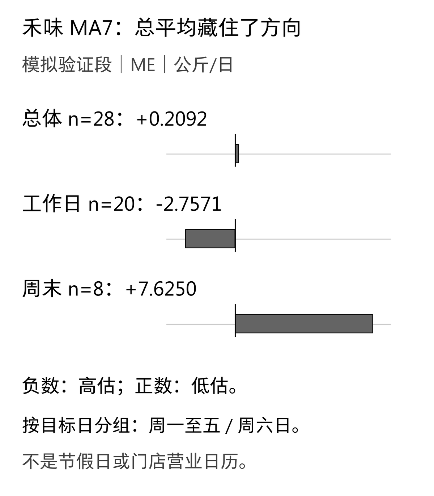
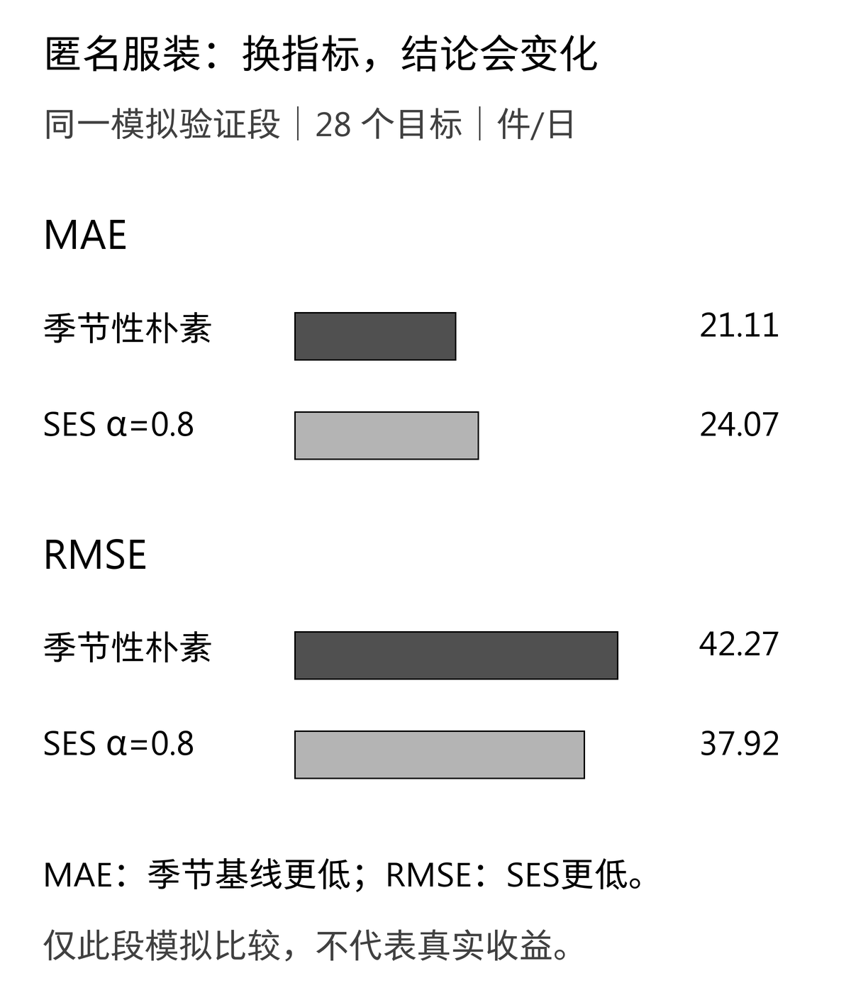
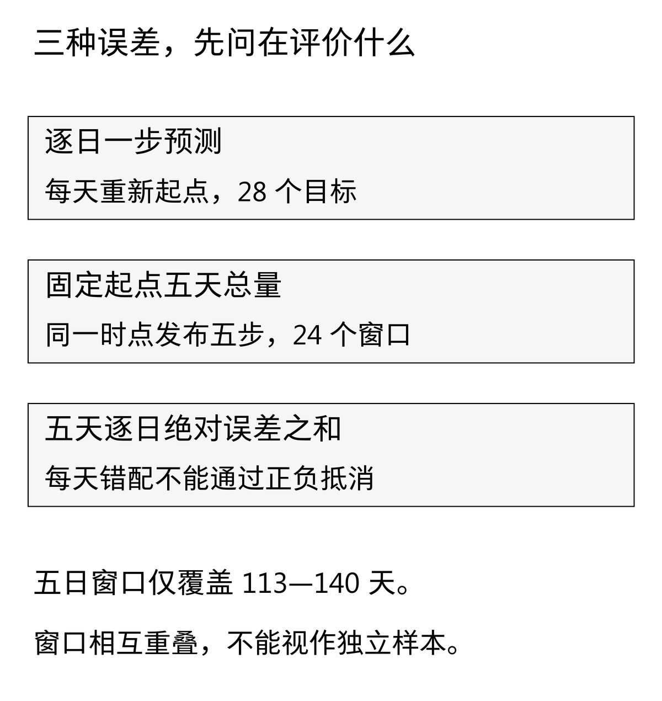

一份需求预测报表显示，MA7在28天验证段的平均偏差（ME）约为+0.21公斤/日。拆开日期再看，工作日预测偏高，周末预测偏低。两种现象可以同时成立：报表把不同日子的高估与低估抵消了。

[D11的简单指数平滑](/blog/simple-exponential-smoothing-demand-forecast/)比较了参数如何影响预测。今天不增加新模型，而是把已有模型放在同一张评分表里，问三个更具体的问题：**通常错多少，是否有较大的偏离，以及有没有持续偏向某个方向。**

这三个问题不能由一个“准确率”代答。下面沿用禾味与匿名服装的模拟序列，先手算，再检查总体与工作日、周末的误差。计算还会出现一个真实的指标分歧：同一段服装验证数据里，季节性朴素的MAE低于SES，但RMSE反而更高。

## 一 先固定比较对象，避免表格整齐、口径错位

**案例与数据均为教学模拟。** 禾味是虚构的2店、8食材SKU餐饮连锁，本篇只评价A店SKU01，单位为公斤/日；匿名服装案例评价终端订单需求，单位为件/日，不是工厂排产量。日期、订单数量与活动均为模拟，不对应真实品牌、项目或实测收益。两条序列分别评价，不混加单位。

预测练习沿用D9的180天模拟序列；本篇直接复制D11已核验的前140天开发CSV，不重新生成数据。前112天是初始历史，第113—140天是验证段，对应2026年7月27日至8月23日。原第141—180天不在本篇实践包中，也不读取或重新评分。D9已经展示过原测试段汇总，不能再将其称作从未触碰的盲测。

七个候选全部保留：周期7的季节性朴素；窗口3、7、14的移动平均；α为0.2、0.5、0.8的简单指数平滑。SES仍用首个观测初始化；没有为了本篇排名重新搜索参数，也没有只展示某一家方法最好的参数。

所有候选都在第112天日终预测第113天，再在获得第113天实际值后预测第114天，以此类推。**目标日相同，起点相同，可见历史截止时间相同。** 每个候选得到28个提前一天的预测。工作日指目标日期的周一至周五，共20天；周末指周六、周日，共8天，不作法定节假日或调休调整。

这是模拟需求完全可见、没有缺货截断的练习。若真实数据只有销量，先核对缺货时的需求是否可见；指标函数不能把没记录到的需求补回来。

## 二 四个指标，分别回答什么问题

约定每个目标的预测误差为：

```text
e = 实际需求 − 预测需求
```

正数表示低估，负数表示高估。符号没有行业唯一约定，因此跨系统交换报表时必须写清，不能看到“偏差为正”就自动解释成备多。

对同一组n个目标，本文使用：

```text
ME   = Σe / n
MAE  = Σ|e| / n
RMSE = √(Σe² / n)
WAPE = Σ|e| / Σ实际需求       （本文实际需求非负）
```

ME是带方向的平均误差；MAE是平均绝对误差；RMSE先平方再平均、最后开根，对较大的偏离赋予更大影响。三者与需求使用相同单位。WAPE没有物理单位，程序保存比例，展示时乘100变成百分数。公式及预测误差与拟合残差的区分，可参照[FPP3第5.8节](https://otexts.com/fpp3/toolbox.html#forecast-errors)。本篇只给提前发布的预测评分，不给当天已经看过实际值的平滑水平评分。

取手算例子，实际为[0,10]，预测为[2,8]：误差是[−2,+2]，所以ME＝0、MAE＝2、RMSE＝2，WAPE＝(2＋2)÷(0＋10)＝40%。两天都预测错了，但ME正好为零。

[](images/d12-01_manual.png)

**样本ME接近零，只能说这组误差的净方向接近零，不能证明模型在未来统计无偏，更不能证明准确。** 即便一个预测方法在统计意义上无偏，也仍可能有很大的误差波动。“无偏”和“准确”不是同一个要求。

MAE与RMSE也不总给出相同排序。例如同样四天实际都是10，方案A每天预测7，误差都是3；方案B预测10、10、10、2，误差是0、0、0、8。A的MAE和RMSE都是3；B的MAE为2，但RMSE为4。B通常更贴近，却有一次更大的失误。

这不是让我们临时挑一个能使喜欢的模型获胜的指标，而是提醒先确定业务损失如何形成。RMSE较低表示整组平方误差更小，不保证最大单次误差更小；MAE、RMSE也都把同样幅度的高估与低估对称计分，不能直接表达缺货与积压的不同代价。

## 三 WAPE有用，但不是绕过零需求的万能“准确率”

在手算例子里，第一个实际值为零，仍应保留它造成的2个单位误差。MAPE逐期除以实际值，这一天会遇到零分母；WAPE先汇总绝对误差和实际需求，只要整个组的实际总量大于零，就能计算。不能把零日删掉后声称指标没变，也不能将零日的百分比误差直接记成0%。

如果实际为[0,0]、预测为[2,0]，MAE仍为1，ME为−1，RMSE为√2；**WAPE未定义**。即使预测也为[0,0]，WAPE仍是0÷0，不能当成0%。实践包返回`null`并记录`undefined_zero_actual_sum`；不会偷偷加一个很小的ε。WAPE也可能超过100%，所以“100%减WAPE”不宜直接命名为一般意义上的预测准确率。

还有一个便于审表的恒等式：在**同一案例、同一组目标、相同权重**且实际均值大于零时，WAPE＝MAE÷平均实际需求。分母对所有模型相同，因此WAPE和MAE的模型排序必然一致。若同一张表里两者排序反转，应先检查目标行、缺失处理或权重是否变了。

跨月份、跨SKU或跨分组时，分母会变。需求规模增长就可能让WAPE下降，而绝对误差没有变小。Hyndman对[WAPE的讨论](https://robjhyndman.com/hyndsight/wape.html)特别提醒了这类随趋势变化的分母问题。本篇将WAPE用作固定验证目标上的描述性比例，不把它当作跨期、跨业务可直接比较的稳定能力分数。

## 四 禾味案例：总体ME接近零，周末仍可能持续低估

下面的总体表覆盖同样28个目标。ME、MAE、RMSE单位均为公斤/日，WAPE为百分数；各行实际需求合计相同，为738公斤。展示四位小数，完整精度见下载包。

手机端可左右滑动表格，查看完整指标。

<div role="region" tabindex="0" aria-label="禾味总体验证误差表（可横向滚动）" style="overflow-x:auto;max-width:100%;margin:28px 0">
<table style="min-width:700px;width:100%;max-width:none;display:table;margin:0;white-space:nowrap">
<thead><tr><th scope="col">方法</th><th scope="col">分组</th><th scope="col">n</th><th scope="col">ME</th><th scope="col">MAE</th><th scope="col">RMSE</th><th scope="col">WAPE</th></tr></thead>
<tbody>
<tr><td style="white-space:nowrap;text-align:left">季节性朴素7</td><td style="white-space:nowrap;text-align:left">总体</td><td style="white-space:nowrap;text-align:right">28</td><td style="white-space:nowrap;text-align:right">0.2143</td><td style="white-space:nowrap;text-align:right">1.7857</td><td style="white-space:nowrap;text-align:right">2.2678</td><td style="white-space:nowrap;text-align:right">6.7751%</td></tr>
<tr><td style="white-space:nowrap;text-align:left">MA3</td><td style="white-space:nowrap;text-align:left">总体</td><td style="white-space:nowrap;text-align:right">28</td><td style="white-space:nowrap;text-align:right">0.1429</td><td style="white-space:nowrap;text-align:right">6.7143</td><td style="white-space:nowrap;text-align:right">7.8189</td><td style="white-space:nowrap;text-align:right">25.4743%</td></tr>
<tr><td style="white-space:nowrap;text-align:left">MA7</td><td style="white-space:nowrap;text-align:left">总体</td><td style="white-space:nowrap;text-align:right">28</td><td style="white-space:nowrap;text-align:right">0.2092</td><td style="white-space:nowrap;text-align:right">5.3214</td><td style="white-space:nowrap;text-align:right">5.9375</td><td style="white-space:nowrap;text-align:right">20.1897%</td></tr>
<tr><td style="white-space:nowrap;text-align:left">MA14</td><td style="white-space:nowrap;text-align:left">总体</td><td style="white-space:nowrap;text-align:right">28</td><td style="white-space:nowrap;text-align:right">0.1403</td><td style="white-space:nowrap;text-align:right">5.3852</td><td style="white-space:nowrap;text-align:right">5.9835</td><td style="white-space:nowrap;text-align:right">20.4317%</td></tr>
<tr><td style="white-space:nowrap;text-align:left">SES α=0.2</td><td style="white-space:nowrap;text-align:left">总体</td><td style="white-space:nowrap;text-align:right">28</td><td style="white-space:nowrap;text-align:right">0.1642</td><td style="white-space:nowrap;text-align:right">5.5652</td><td style="white-space:nowrap;text-align:right">6.4153</td><td style="white-space:nowrap;text-align:right">21.1145%</td></tr>
<tr><td style="white-space:nowrap;text-align:left">SES α=0.5</td><td style="white-space:nowrap;text-align:left">总体</td><td style="white-space:nowrap;text-align:right">28</td><td style="white-space:nowrap;text-align:right">0.1411</td><td style="white-space:nowrap;text-align:right">5.3391</td><td style="white-space:nowrap;text-align:right">6.6390</td><td style="white-space:nowrap;text-align:right">20.2569%</td></tr>
<tr><td style="white-space:nowrap;text-align:left">SES α=0.8</td><td style="white-space:nowrap;text-align:left">总体</td><td style="white-space:nowrap;text-align:right">28</td><td style="white-space:nowrap;text-align:right">0.1120</td><td style="white-space:nowrap;text-align:right">4.8633</td><td style="white-space:nowrap;text-align:right">6.4049</td><td style="white-space:nowrap;text-align:right">18.4517%</td></tr>
</tbody>
</table>
</div>

只看ME，MA7的0.2092似乎与季节性朴素的0.2143差不多；但MAE分别为5.3214和1.7857公斤/日，两者日常偏离程度明显不同。把ME小数点后多写几位，也弥补不了指标含义上的差别。

进一步按目标日期分组：工作日20天的实际合计467公斤，周末8天合计271公斤。下表保留全部七个候选，避免只展示支持结论的分组。

手机端可左右滑动表格，查看完整指标。

<div role="region" tabindex="0" aria-label="禾味工作日与周末验证误差表（可横向滚动）" style="overflow-x:auto;max-width:100%;margin:28px 0">
<table style="min-width:700px;width:100%;max-width:none;display:table;margin:0;white-space:nowrap">
<thead><tr><th scope="col">方法</th><th scope="col">分组</th><th scope="col">n</th><th scope="col">ME</th><th scope="col">MAE</th><th scope="col">RMSE</th><th scope="col">WAPE</th></tr></thead>
<tbody>
<tr><td style="white-space:nowrap;text-align:left">季节性朴素7</td><td style="white-space:nowrap;text-align:left">工作日</td><td style="white-space:nowrap;text-align:right">20</td><td style="white-space:nowrap;text-align:right">0.1500</td><td style="white-space:nowrap;text-align:right">1.6500</td><td style="white-space:nowrap;text-align:right">2.1794</td><td style="white-space:nowrap;text-align:right">7.0664%</td></tr>
<tr><td style="white-space:nowrap;text-align:left">季节性朴素7</td><td style="white-space:nowrap;text-align:left">周末</td><td style="white-space:nowrap;text-align:right">8</td><td style="white-space:nowrap;text-align:right">0.3750</td><td style="white-space:nowrap;text-align:right">2.1250</td><td style="white-space:nowrap;text-align:right">2.4749</td><td style="white-space:nowrap;text-align:right">6.2731%</td></tr>
<tr><td style="white-space:nowrap;text-align:left">MA3</td><td style="white-space:nowrap;text-align:left">工作日</td><td style="white-space:nowrap;text-align:right">20</td><td style="white-space:nowrap;text-align:right">-2.2667</td><td style="white-space:nowrap;text-align:right">6.9333</td><td style="white-space:nowrap;text-align:right">7.9260</td><td style="white-space:nowrap;text-align:right">29.6931%</td></tr>
<tr><td style="white-space:nowrap;text-align:left">MA3</td><td style="white-space:nowrap;text-align:left">周末</td><td style="white-space:nowrap;text-align:right">8</td><td style="white-space:nowrap;text-align:right">6.1667</td><td style="white-space:nowrap;text-align:right">6.1667</td><td style="white-space:nowrap;text-align:right">7.5443</td><td style="white-space:nowrap;text-align:right">18.2042%</td></tr>
<tr><td style="white-space:nowrap;text-align:left">MA7</td><td style="white-space:nowrap;text-align:left">工作日</td><td style="white-space:nowrap;text-align:right">20</td><td style="white-space:nowrap;text-align:right">-2.7571</td><td style="white-space:nowrap;text-align:right">4.4000</td><td style="white-space:nowrap;text-align:right">4.8794</td><td style="white-space:nowrap;text-align:right">18.8437%</td></tr>
<tr><td style="white-space:nowrap;text-align:left">MA7</td><td style="white-space:nowrap;text-align:left">周末</td><td style="white-space:nowrap;text-align:right">8</td><td style="white-space:nowrap;text-align:right">7.6250</td><td style="white-space:nowrap;text-align:right">7.6250</td><td style="white-space:nowrap;text-align:right">7.9919</td><td style="white-space:nowrap;text-align:right">22.5092%</td></tr>
<tr><td style="white-space:nowrap;text-align:left">MA14</td><td style="white-space:nowrap;text-align:left">工作日</td><td style="white-space:nowrap;text-align:right">20</td><td style="white-space:nowrap;text-align:right">-2.8607</td><td style="white-space:nowrap;text-align:right">4.4821</td><td style="white-space:nowrap;text-align:right">4.9477</td><td style="white-space:nowrap;text-align:right">19.1955%</td></tr>
<tr><td style="white-space:nowrap;text-align:left">MA14</td><td style="white-space:nowrap;text-align:left">周末</td><td style="white-space:nowrap;text-align:right">8</td><td style="white-space:nowrap;text-align:right">7.6429</td><td style="white-space:nowrap;text-align:right">7.6429</td><td style="white-space:nowrap;text-align:right">8.0067</td><td style="white-space:nowrap;text-align:right">22.5619%</td></tr>
<tr><td style="white-space:nowrap;text-align:left">SES α=0.2</td><td style="white-space:nowrap;text-align:left">工作日</td><td style="white-space:nowrap;text-align:right">20</td><td style="white-space:nowrap;text-align:right">-2.6202</td><td style="white-space:nowrap;text-align:right">4.9411</td><td style="white-space:nowrap;text-align:right">5.7714</td><td style="white-space:nowrap;text-align:right">21.1612%</td></tr>
<tr><td style="white-space:nowrap;text-align:left">SES α=0.2</td><td style="white-space:nowrap;text-align:left">周末</td><td style="white-space:nowrap;text-align:right">8</td><td style="white-space:nowrap;text-align:right">7.1253</td><td style="white-space:nowrap;text-align:right">7.1253</td><td style="white-space:nowrap;text-align:right">7.7958</td><td style="white-space:nowrap;text-align:right">21.0342%</td></tr>
<tr><td style="white-space:nowrap;text-align:left">SES α=0.5</td><td style="white-space:nowrap;text-align:left">工作日</td><td style="white-space:nowrap;text-align:right">20</td><td style="white-space:nowrap;text-align:right">-1.7567</td><td style="white-space:nowrap;text-align:right">5.3843</td><td style="white-space:nowrap;text-align:right">6.6933</td><td style="white-space:nowrap;text-align:right">23.0589%</td></tr>
<tr><td style="white-space:nowrap;text-align:left">SES α=0.5</td><td style="white-space:nowrap;text-align:left">周末</td><td style="white-space:nowrap;text-align:right">8</td><td style="white-space:nowrap;text-align:right">4.8857</td><td style="white-space:nowrap;text-align:right">5.2263</td><td style="white-space:nowrap;text-align:right">6.5010</td><td style="white-space:nowrap;text-align:right">15.4282%</td></tr>
<tr><td style="white-space:nowrap;text-align:left">SES α=0.8</td><td style="white-space:nowrap;text-align:left">工作日</td><td style="white-space:nowrap;text-align:right">20</td><td style="white-space:nowrap;text-align:right">-0.7656</td><td style="white-space:nowrap;text-align:right">4.9363</td><td style="white-space:nowrap;text-align:right">6.7831</td><td style="white-space:nowrap;text-align:right">21.1405%</td></tr>
<tr><td style="white-space:nowrap;text-align:left">SES α=0.8</td><td style="white-space:nowrap;text-align:left">周末</td><td style="white-space:nowrap;text-align:right">8</td><td style="white-space:nowrap;text-align:right">2.3061</td><td style="white-space:nowrap;text-align:right">4.6809</td><td style="white-space:nowrap;text-align:right">5.3434</td><td style="white-space:nowrap;text-align:right">13.8182%</td></tr>
</tbody>
</table>
</div>

MA7在工作日的ME为−2.7571，表示平均高估；周末为+7.6250，表示平均低估。按样本数合并：(20×−2.7571＋8×7.6250)÷28，回到约+0.2092。总体接近零，正是两个方向相互抵消的结果。

[](images/d12-02_hewei.png)

禾味模拟序列有稳定星期差异，单一移动平均水平不能显式区分周六与周一。这给出了当前误差结构的一种机制解释，却不意味着所有真实门店都应使用星期基线。在这28天里，季节性朴素的总体MAE和RMSE均最低；它在工作日、周末的相应指标也更低，这是此段模拟验证的结论。

如果把ME直接当“需要加多少安全库存”，同样会越界。库存位置、在途量、保质期、到货时间和服务要求尚未进入模型；每日需求预测误差不能直接转换成采购量或收益。

## 五 匿名服装案例：最低MAE不等于最低RMSE

服装总体表仍有28个相同目标，实际订单合计3374件。ME、MAE、RMSE单位为件/日。

手机端可左右滑动表格，查看完整指标。

<div role="region" tabindex="0" aria-label="匿名服装总体验证误差表（可横向滚动）" style="overflow-x:auto;max-width:100%;margin:28px 0">
<table style="min-width:700px;width:100%;max-width:none;display:table;margin:0;white-space:nowrap">
<thead><tr><th scope="col">方法</th><th scope="col">分组</th><th scope="col">n</th><th scope="col">ME</th><th scope="col">MAE</th><th scope="col">RMSE</th><th scope="col">WAPE</th></tr></thead>
<tbody>
<tr><td style="white-space:nowrap;text-align:left">季节性朴素7</td><td style="white-space:nowrap;text-align:left">总体</td><td style="white-space:nowrap;text-align:right">28</td><td style="white-space:nowrap;text-align:right">0.6071</td><td style="white-space:nowrap;text-align:right">21.1071</td><td style="white-space:nowrap;text-align:right">42.2717</td><td style="white-space:nowrap;text-align:right">17.5163%</td></tr>
<tr><td style="white-space:nowrap;text-align:left">MA3</td><td style="white-space:nowrap;text-align:left">总体</td><td style="white-space:nowrap;text-align:right">28</td><td style="white-space:nowrap;text-align:right">0.1667</td><td style="white-space:nowrap;text-align:right">35.5238</td><td style="white-space:nowrap;text-align:right">47.8544</td><td style="white-space:nowrap;text-align:right">29.4803%</td></tr>
<tr><td style="white-space:nowrap;text-align:left">MA7</td><td style="white-space:nowrap;text-align:left">总体</td><td style="white-space:nowrap;text-align:right">28</td><td style="white-space:nowrap;text-align:right">0.3163</td><td style="white-space:nowrap;text-align:right">30.1531</td><td style="white-space:nowrap;text-align:right">41.4708</td><td style="white-space:nowrap;text-align:right">25.0233%</td></tr>
<tr><td style="white-space:nowrap;text-align:left">MA14</td><td style="white-space:nowrap;text-align:left">总体</td><td style="white-space:nowrap;text-align:right">28</td><td style="white-space:nowrap;text-align:right">0.7245</td><td style="white-space:nowrap;text-align:right">30.2143</td><td style="white-space:nowrap;text-align:right">41.0821</td><td style="white-space:nowrap;text-align:right">25.0741%</td></tr>
<tr><td style="white-space:nowrap;text-align:left">SES α=0.2</td><td style="white-space:nowrap;text-align:left">总体</td><td style="white-space:nowrap;text-align:right">28</td><td style="white-space:nowrap;text-align:right">0.5517</td><td style="white-space:nowrap;text-align:right">30.8933</td><td style="white-space:nowrap;text-align:right">41.0226</td><td style="white-space:nowrap;text-align:right">25.6376%</td></tr>
<tr><td style="white-space:nowrap;text-align:left">SES α=0.5</td><td style="white-space:nowrap;text-align:left">总体</td><td style="white-space:nowrap;text-align:right">28</td><td style="white-space:nowrap;text-align:right">0.1639</td><td style="white-space:nowrap;text-align:right">28.4215</td><td style="white-space:nowrap;text-align:right">40.4326</td><td style="white-space:nowrap;text-align:right">23.5863%</td></tr>
<tr><td style="white-space:nowrap;text-align:left">SES α=0.8</td><td style="white-space:nowrap;text-align:left">总体</td><td style="white-space:nowrap;text-align:right">28</td><td style="white-space:nowrap;text-align:right">0.1144</td><td style="white-space:nowrap;text-align:right">24.0696</td><td style="white-space:nowrap;text-align:right">37.9167</td><td style="white-space:nowrap;text-align:right">19.9748%</td></tr>
</tbody>
</table>
</div>

季节性朴素的MAE为21.1071，低于SES α＝0.8的24.0696；但它的RMSE为42.2717，高于SES α＝0.8的37.9167。相应WAPE为17.5163%和19.9748%，仍与MAE同序，没有出现WAPE独立“投另一票”的情况。

[](images/d12-03_apparel.png)

第118—120天每天增加90件的模拟活动已经写在原序列中。季节性朴素会在下一周复制对应位置，SES则按新观测调整水平。两者可能把误差集中在不同日子，所以绝对误差和平方误差的汇总给出不同排序。RMSE只能说明整组平方误差，不能据此断言SES压住了最坏的一天，更不能将这一次活动推成行业普遍规律。

分组后，工作日20天合计2054件，周末8天合计1320件：

手机端可左右滑动表格，查看完整指标。

<div role="region" tabindex="0" aria-label="匿名服装工作日与周末验证误差表（可横向滚动）" style="overflow-x:auto;max-width:100%;margin:28px 0">
<table style="min-width:700px;width:100%;max-width:none;display:table;margin:0;white-space:nowrap">
<thead><tr><th scope="col">方法</th><th scope="col">分组</th><th scope="col">n</th><th scope="col">ME</th><th scope="col">MAE</th><th scope="col">RMSE</th><th scope="col">WAPE</th></tr></thead>
<tbody>
<tr><td style="white-space:nowrap;text-align:left">季节性朴素7</td><td style="white-space:nowrap;text-align:left">工作日</td><td style="white-space:nowrap;text-align:right">20</td><td style="white-space:nowrap;text-align:right">0.7000</td><td style="white-space:nowrap;text-align:right">10.4000</td><td style="white-space:nowrap;text-align:right">28.0660</td><td style="white-space:nowrap;text-align:right">10.1266%</td></tr>
<tr><td style="white-space:nowrap;text-align:left">季节性朴素7</td><td style="white-space:nowrap;text-align:left">周末</td><td style="white-space:nowrap;text-align:right">8</td><td style="white-space:nowrap;text-align:right">0.3750</td><td style="white-space:nowrap;text-align:right">47.8750</td><td style="white-space:nowrap;text-align:right">65.4590</td><td style="white-space:nowrap;text-align:right">29.0152%</td></tr>
<tr><td style="white-space:nowrap;text-align:left">MA3</td><td style="white-space:nowrap;text-align:left">工作日</td><td style="white-space:nowrap;text-align:right">20</td><td style="white-space:nowrap;text-align:right">-19.6000</td><td style="white-space:nowrap;text-align:right">29.9000</td><td style="white-space:nowrap;text-align:right">40.2720</td><td style="white-space:nowrap;text-align:right">29.1139%</td></tr>
<tr><td style="white-space:nowrap;text-align:left">MA3</td><td style="white-space:nowrap;text-align:left">周末</td><td style="white-space:nowrap;text-align:right">8</td><td style="white-space:nowrap;text-align:right">49.5833</td><td style="white-space:nowrap;text-align:right">49.5833</td><td style="white-space:nowrap;text-align:right">62.9332</td><td style="white-space:nowrap;text-align:right">30.0505%</td></tr>
<tr><td style="white-space:nowrap;text-align:left">MA7</td><td style="white-space:nowrap;text-align:left">工作日</td><td style="white-space:nowrap;text-align:right">20</td><td style="white-space:nowrap;text-align:right">-17.4000</td><td style="white-space:nowrap;text-align:right">24.1571</td><td style="white-space:nowrap;text-align:right">28.5260</td><td style="white-space:nowrap;text-align:right">23.5220%</td></tr>
<tr><td style="white-space:nowrap;text-align:left">MA7</td><td style="white-space:nowrap;text-align:left">周末</td><td style="white-space:nowrap;text-align:right">8</td><td style="white-space:nowrap;text-align:right">44.6071</td><td style="white-space:nowrap;text-align:right">45.1429</td><td style="white-space:nowrap;text-align:right">63.1273</td><td style="white-space:nowrap;text-align:right">27.3593%</td></tr>
<tr><td style="white-space:nowrap;text-align:left">MA14</td><td style="white-space:nowrap;text-align:left">工作日</td><td style="white-space:nowrap;text-align:right">20</td><td style="white-space:nowrap;text-align:right">-17.0107</td><td style="white-space:nowrap;text-align:right">24.2750</td><td style="white-space:nowrap;text-align:right">27.3671</td><td style="white-space:nowrap;text-align:right">23.6368%</td></tr>
<tr><td style="white-space:nowrap;text-align:left">MA14</td><td style="white-space:nowrap;text-align:left">周末</td><td style="white-space:nowrap;text-align:right">8</td><td style="white-space:nowrap;text-align:right">45.0625</td><td style="white-space:nowrap;text-align:right">45.0625</td><td style="white-space:nowrap;text-align:right">63.5193</td><td style="white-space:nowrap;text-align:right">27.3106%</td></tr>
<tr><td style="white-space:nowrap;text-align:left">SES α=0.2</td><td style="white-space:nowrap;text-align:left">工作日</td><td style="white-space:nowrap;text-align:right">20</td><td style="white-space:nowrap;text-align:right">-17.9250</td><td style="white-space:nowrap;text-align:right">24.5533</td><td style="white-space:nowrap;text-align:right">28.2409</td><td style="white-space:nowrap;text-align:right">23.9078%</td></tr>
<tr><td style="white-space:nowrap;text-align:left">SES α=0.2</td><td style="white-space:nowrap;text-align:left">周末</td><td style="white-space:nowrap;text-align:right">8</td><td style="white-space:nowrap;text-align:right">46.7434</td><td style="white-space:nowrap;text-align:right">46.7434</td><td style="white-space:nowrap;text-align:right">62.4189</td><td style="white-space:nowrap;text-align:right">28.3293%</td></tr>
<tr><td style="white-space:nowrap;text-align:left">SES α=0.5</td><td style="white-space:nowrap;text-align:left">工作日</td><td style="white-space:nowrap;text-align:right">20</td><td style="white-space:nowrap;text-align:right">-16.0972</td><td style="white-space:nowrap;text-align:right">23.4634</td><td style="white-space:nowrap;text-align:right">31.9440</td><td style="white-space:nowrap;text-align:right">22.8465%</td></tr>
<tr><td style="white-space:nowrap;text-align:left">SES α=0.5</td><td style="white-space:nowrap;text-align:left">周末</td><td style="white-space:nowrap;text-align:right">8</td><td style="white-space:nowrap;text-align:right">40.8167</td><td style="white-space:nowrap;text-align:right">40.8167</td><td style="white-space:nowrap;text-align:right">56.3093</td><td style="white-space:nowrap;text-align:right">24.7374%</td></tr>
<tr><td style="white-space:nowrap;text-align:left">SES α=0.8</td><td style="white-space:nowrap;text-align:left">工作日</td><td style="white-space:nowrap;text-align:right">20</td><td style="white-space:nowrap;text-align:right">-11.3001</td><td style="white-space:nowrap;text-align:right">20.8681</td><td style="white-space:nowrap;text-align:right">31.7956</td><td style="white-space:nowrap;text-align:right">20.3194%</td></tr>
<tr><td style="white-space:nowrap;text-align:left">SES α=0.8</td><td style="white-space:nowrap;text-align:left">周末</td><td style="white-space:nowrap;text-align:right">8</td><td style="white-space:nowrap;text-align:right">28.6505</td><td style="white-space:nowrap;text-align:right">32.0735</td><td style="white-space:nowrap;text-align:right">50.0447</td><td style="white-space:nowrap;text-align:right">19.4385%</td></tr>
</tbody>
</table>
</div>

季节性朴素的工作日MAE为10.4000，周末却为47.8750；SES α＝0.8的相应值为20.8681与32.0735。也就是说，季节性朴素总体MAE更低，并不意味着每一组都更低。周末只有8个目标且包含活动扰动，不能把这些差异写成稳定的因果结论。

这些是终端订单预测的误差，不是生产部门交付误差。面料到货、产能、工艺与交期约束还需要单独处理。真实选型应先约定业务目标，再在后续时序验证中检查结论能否保持；本篇没有冻结最终模型，也没有宣称真实收益。

## 六 分组和五天窗口，最容易悄悄改掉评分问题

总体MAE不是工作日MAE与周末MAE的简单平均，而是按20与8加权；ME同理。总体RMSE应先合并两组的平方误差，再开根。总体WAPE则合并分子和分母：

```text
总体WAPE = (工作日绝对误差合计 + 周末绝对误差合计)
         ÷ (工作日实际合计 + 周末实际合计)
```

若一组实际总量为零，它的组内WAPE未定义，但其绝对误差仍必须进入总体分子。直接平均两个百分比会丢掉这层含义。公斤与件没有共同总量，两个案例更不能合成一个总体WAPE。

D10、D11还保留了五天总量任务：每个起点一次发布未来五天，最早窗口为113—117天，最晚为136—140天，共24个。这与逐日更新的28个一步目标是不同问题。

同一个固定起点下，五天合计误差为Σ实际−Σ预测，合计绝对误差为|Σe|；五个逐日绝对误差之和则是Σ|e|。前者允许窗口内正负抵消，后者记录每天错配。拿[−2,+2,0,0,0]举例，合计绝对误差为0，逐日绝对误差之和却为4。

[](images/d12-04_horizons.png)

实践包保留全部固定起点五日预测供核查，但本文主表只评价逐日一步目标。不能把五个不同日期修订过的一步预测拼起来，冒充第一个起点就发出的五日预测。24个窗口相互重叠，不能宣称24次独立实验；若另算窗口WAPE，分母应为24个窗口各自实际合计的和，它含重复覆盖，绝不是不重复的销量总额。

## 七 先让代码经得起反例，再解释模型优劣

[D12误差与偏差实践包](/downloads/d12-forecast-errors-practice.zip)只需Python 3.10或以上，计算与测试不依赖第三方库。解压后运行：

```bash
python -m unittest -v
python run.py
```

`metrics.py`实现四指标；`run.py`保证目标日期、起点、案例和单位一致。指标函数按位置配对，因此拒绝空数组、长度不同、非有限值等异常；日期与实体对齐由生成预测的入口负责，不能只靠两个数组恰好一样长。零需求合法，缺测不是零。计算使用浮点数：先稳定求和再除以样本数，避免极小误差逐项除法后消失；聚合和或最终指标溢出、非零指标下溢成零时明确报错，不返回伪造的零误差。正常浮点舍入仍然存在。

结果包括392条单日预测、42行指标、336个固定起点五日窗口，以及完整精度汇总和手算预期。每条预测保留起点、目标日、实际值、预测值和带符号误差；每行指标保留样本数、实际合计与绝对误差合计。`source_manifest.json`保存两份开发CSV的固定SHA-256，运行前先核验，运行编号为`D12-v2-validation-113-140`。

测试除了手算，还用独立的分数算术和SES几何权重展开核对全部预测与分组指标；把未来数据替换为无效内容，确认原起点预测不变。另检验零分母、异常输入、分组汇总及MAE／RMSE排名反转。有效输入下还可核对|ME|≤MAE≤RMSE；这是一条算术检查，不是业务验收标准。

可另下载[文章Markdown与配图](/downloads/d12-forecast-errors-article.zip)、[黑白配图及重绘脚本](/downloads/d12-forecast-errors-images.zip)。图形重绘需要Pillow、fontTools与Noto简体中文字体；预测和指标计算本身仍只用标准库。手机表格可横向滚动，图中细节有原图入口。

这次最值得留下的证据不是“某个指标最低”，而是：禾味MA7的总体偏差掩盖了工作日高估与周末低估；服装基线与SES在MAE、RMSE下出现不同排序。下一步的滚动回测应检查这些现象是否跨时段保持，同时保留原来的信息边界。
