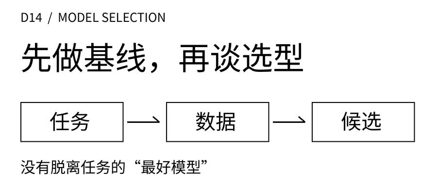
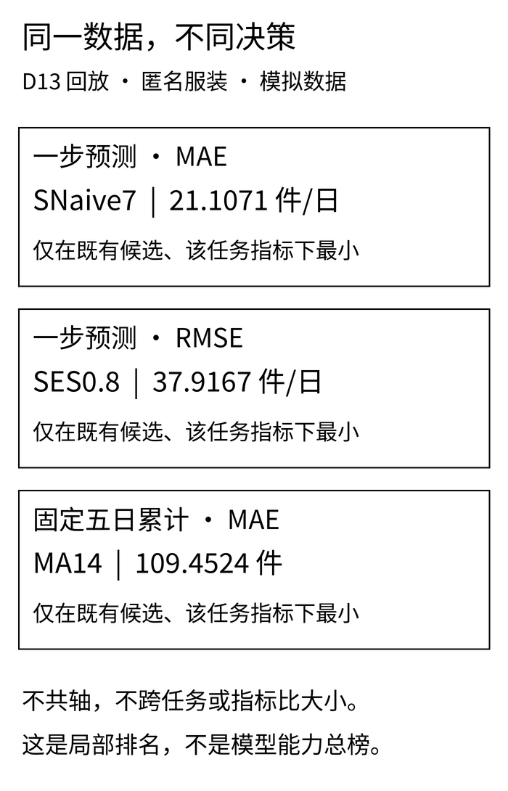
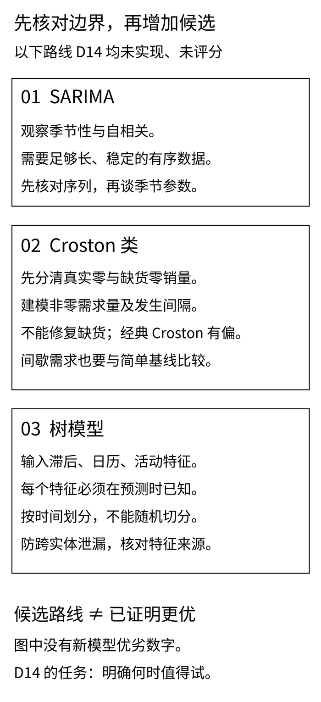

匿名服装案例已经有三个“第一名”：按每天的平均绝对误差看，是季节性朴素；对大偏差更敏感的RMSE看，变成了指数平滑；若一次决定未来五天的总量，MA14又排在前面。

这不是谁算错了。三张成绩单问的是不同问题。如果此时直接问“下一步是不是该上树模型”，我们甚至还没决定要改善哪一张成绩单。

D9到D13已经走过基线、移动平均、简单指数平滑、误差指标和滚动回测。D14把它们收拢成一条选型顺序：**先确定预测服务什么决定，核对数据与信息边界，再看简单方法留下什么缺口。** 本篇不新增复杂模型实现，也不宣布某种模型普遍适合餐饮或服装。

## 一 先把两个问题写完整

**本文案例、日期、数量和可能使用的演示单号均为教学模拟，不对应真实品牌、项目、经营记录或收益。** 禾味是虚构的两店、八食材SKU连锁，主实验仍只计算A店SKU01，单位公斤/日；其余15条店×SKU序列未生成、未评估。匿名服装生产协同案例预测的是终端订单需求，单位件/日，不是工厂排产量。

第一周的14天样本用于认识业务字段和指标。预测阶段的180天需求是D9另行生成的合成序列，不是把14天库存台账拼长，也不是后来补采的真实历史。

同一预测对象可以服务两种决定：

- 禾味每天复核次日用量，需要一步预测，并关注星期差异。若讨论未来五天总用量，还必须保留每天分布，否则总量相同也可能先缺货、后报损。
- 服装协同若讨论未来五天的订单压力，需要在同一个起点发出的五步预测。之后再根据物料、产能、交期与已接订单制定计划，不能把预测件数直接当成生产指令。

主实验假定需求完全可见，没有缺货、休店或缺测，当日记录在日终全部到达。现实若有取消订单、延迟入账或缺货截断，先重新定义目标与记录可用时间。换一个模型名称，不能补齐这些定义。

## 二 这次能复核什么，不能证明什么

180天沿用112／28／40的时间分块：第1—112天是初始历史，第113—140天是验证，第141—180天是原测试。本次实践包只读取前140天开发CSV，字节与D13一致，不包含最后40天标签，也没有重新评分入口。

**验证段已经反复查看，原测试汇总也已在D9公开。本篇是教学开发回放，不是新盲测。** 不因结果不好更换生成种子、活动位置或候选参数，也不把旧测试再拿来选型。D9的历史测试记录可在[原文及其实践包](/blog/seasonal-naive-demand-forecast/)追溯；这里不把那份基线测试当成七个候选的共同测试，更不补出并不存在的复杂模型成绩。

复核范围保持不变：

- 七个候选：季节性朴素SNaive7，MA3、MA7、MA14，以及SES α＝0.2、0.5、0.8。MA表示最近k天均值；SES表示简单指数平滑，用第一个观测初始化。
- 一步：起点112—139，目标113—140，共28天。得到新观测后可以更新历史，参数不变。
- 固定五日：起点112—135，共24个窗口，目标从113—117到136—140。每次五个预测一起发出，中途不改；137—141跨块，不进入验证。
- 五日累计：先合计同一起点的五个实际值和五个预测，再计算误差。不能把五次逐日修订的一步预测拼成一份“提前五天”的成绩。

24个窗口彼此重叠，不是24次独立实验；服装第118—120天的同一场模拟活动会进入多个窗口。本文不据此算显著性，也不把相邻窗口当成多场活动证明。

这套时序约束对应[FPP3第5章的准确性评价与滚动起点评价](https://otexts.com/fpp3/toolbox.html)。它能防止把起点之后的信息带回预测，却不能消除反复查看验证集造成的选择偏差。哈希和冻结文件也只能证明文件版本，不能证明作者从未看过结果。

## 三 读成绩单之前，先读列名

误差沿用“实际−预测”：正值表示低估。ME保留方向；MAE把每次误差取绝对值再平均；RMSE先平方、平均，再开方，对少数大偏差更敏感。平均偏差接近零可能只是高估与低估互相抵消。

下面不是另一次调参，而是把D13已有候选在相同日期上的结果重新核对。只展示决定选型讨论的列，完整28行ME、MAE、RMSE和WAPE在实践包中。一步指标单位为公斤/日或件/日，五日累计指标单位为公斤或件，不能把两个任务的数字直接比大小。

### 禾味：先保留能表达星期差异的基线

| 方法 | 一步MAE（公斤/日） | 五日累计MAE（公斤） |
| --- | ---: | ---: |
| SNaive7 | 1.7857 | 3.2917 |
| MA3 | 6.7143 | 24.7083 |
| MA7 | 5.3214 | 9.3750 |
| MA14 | 5.3852 | 9.1518 |
| SES0.2 | 5.5652 | 13.9983 |
| SES0.5 | 5.3391 | 23.2535 |
| SES0.8 | 4.8633 | 31.4695 |

在这段模拟数据里，SNaive7的两类MAE各自最低。生成器本来就给禾味设置了稳定星期效应，所以这个结果是对机制的演示，不是对整个餐饮行业的抽样结论。

MA和SES在同一固定起点内给未来五天相同的水平，无法表达周六与周一的差异。可以据此提出“是否需要保留星期结构”的假设，但尚不能推出“SARIMA一定更好”。本篇没有拟合SARIMA。

### 匿名服装：三种评价，三个不同答案

手机端可在表格内左右滑动。

<div role="region" tabindex="0" aria-label="服装三种评价的完整候选结果（可横向滚动）" style="overflow-x:auto;max-width:100%;margin:28px 0">
<table style="min-width:680px;width:100%;max-width:none;display:table;margin:0;white-space:nowrap">
<thead><tr><th scope="col">方法</th><th scope="col">一步MAE（件/日）</th><th scope="col">一步RMSE（件/日）</th><th scope="col">五日累计MAE（件）</th></tr></thead>
<tbody>
<tr><td>SNaive7</td><td>21.1071</td><td>42.2717</td><td>115.8750</td></tr>
<tr><td>MA3</td><td>35.5238</td><td>47.8544</td><td>169.2361</td></tr>
<tr><td>MA7</td><td>30.1531</td><td>41.4708</td><td>120.1964</td></tr>
<tr><td>MA14</td><td>30.2143</td><td>41.0821</td><td>109.4524</td></tr>
<tr><td>SES0.2</td><td>30.8933</td><td>41.0226</td><td>119.3056</td></tr>
<tr><td>SES0.5</td><td>28.4215</td><td>40.4326</td><td>155.9761</td></tr>
<tr><td>SES0.8</td><td>24.0696</td><td>37.9167</td><td>191.1509</td></tr>
</tbody>
</table>
</div>

一步MAE最低是SNaive7，21.1071；同一组28天若按RMSE看，最低是SES0.8，37.9167。不是两者各自找了一段有利日期，而是对误差的计价方式变了。

固定五日累计MAE最低则是MA14，109.4524件，SNaive7为115.8750件。两者相差6.4226件，是这24个重叠窗口里平均绝对误差的差值，不是少缺6.4226件、少生产6.4226件或节约某个金额。

[](images/d14-01_ranking-boundaries.png)

选型前应先写下主任务和主指标，保留其他指标作诊断。不能看完表格后，一会儿用MAE、一会儿用RMSE，直到想要的模型成为第一。这里展示排名变化，是承认不同评价会改变答案，不是重新宣布一个“全能赢家”。

## 四 一页选型卡：先问缺什么，再问换什么

下列三类都是后续候选路线，不是本月必须完成的模型实现，也没有进入上面的成绩表。共同门槛是：同一目标、同一信息截止点、同一预测长度、同一评价规则，并保留简单基线。

### SARIMA：当历史的相邻关系与季节关系值得继续建模

SARIMA在ARIMA的基础上加入季节部分，用有序历史中的依赖关系描述变化；理解它要先过平稳性、差分和自相关这几道概念关。这里不展开新公式。原理入口见[FPP3第9章，特别是9.9季节ARIMA](https://otexts.com/fpp3/arima.html#seasonal-arima-models)。

放回禾味案例，下一步的问题可以是：扣掉简单星期规律后，误差是否仍呈可重复结构？数据是否覆盖足够多的相关周期，规律是否在时间上稳定？“有112天”不是自动合格线，周期长度、模型复杂度、缺测与结构变化都会影响可用证据。

如果突然开新店、改营业时段或遭遇新活动，仅靠重复历史关系未必能适应。也要防止术语混淆：ARIMA中的MA是误差项的移动平均结构，不是本文MA7那种把最近七天需求求均值。本篇尚未完成残差诊断、阶数选择或滚动比较，所以只记录候选理由，不写性能判断。

### Croston类：先确认零确实是没有需求

间歇需求是许多时段为零，偶尔出现非零需求。经典Croston分别平滑非零需求量与发生间隔，再形成平均需求率；它不是精确预报“下一笔一定在哪天到来”的日历。经典方法存在偏差，变体也需要单独比较，见[FPP3第13章13.2](https://otexts.com/fpp3/practical.html#time-series-of-counts)。

对匿名服装的慢动销物料，或禾味某个低频食材，这可能是值得研究的方向。但本篇没有生成和评估这些额外序列，不能把业务背景当成已完成实验。

更不能把缺货后的零销量当作真实零需求。[D13的独立反例](/blog/rolling-backtest-stockout-censoring/)中，禾味模拟真实需求35公斤、可售上限0公斤，销量也为0；休店与缺测则另存状态。Croston类不会自动恢复这些看不见的需求。先查开业、可售与观测记录，再讨论间隔；本篇不把缺货反例混入无缺货主实验。

### 树模型：有特征不等于预测时有特征

树模型可以结合历史滞后值、星期与活动等特征。关键不是表格里有没有这一列，而是预测起点能否取得它。[scikit-learn官方时序特征示例](https://scikit-learn.org/stable/auto_examples/applications/plot_time_series_lagged_features.html)也展示了随机打乱划分可能给出过于乐观的结果。

在服装协同中，活动计划若已在起点前确认，可以作为候选信息；活动结束后的真实成交、最终取消量、后来修订的活动标签则不能回填成当时已知。未来天气实测与起点时可得的天气预报也不是同一个特征版本。

固定五日预测还有一处易漏边界：预测第t＋5天时，直接填写第t＋4天的真实需求作为“昨日销量”仍是偷看未来。必须预先决定逐步递推还是按步长分别建模，并让特征计算服从同一起点的信息截止。本篇没有实现这些策略。

若将两店八SKU一起训练，还要核对单位、实体分组、特征聚合与时间切分。训练折里的填补和编码只能用该折当时可得的数据；不能随机拆行后，让另一门店未来日期的统计值或目标编码进入过去。若目标是预测从未见过的新店，还需另设实体留出评价，不能用老店成绩替代。

[](images/d14-02_selection-cards.png)

## 五 从“误差更小”到“可以用于决策”，还缺一段证据

对于禾味，预测五日总用量后，仍要知道现有可用库存、到货时间、最小起订量与保质期。对于匿名服装，订单需求之后还隔着取消规则、物料清单、在制品、产能和交期。这些条件决定高估与低估各自造成什么后果。

因此，MAE下降不能直接换算成库存下降、缺货率下降或成本节约。若业务关心缺货与报损的不对称代价，应提前写清损失与约束，再评价计划策略；不是事后挑一个漂亮的预测指标替代业务验证。本次没有成本模型、库存策略仿真、置信区间或真实线上试验，这些均为待验证项。

后续若要正式比较新路线，可以按下面的顺序登记：

1. 写下对象、单位、起点、预测长度与主指标，明确哪些标签可观测，哪些受缺货截断。
2. 在开发数据内确定特征、候选范围、调参规则及更新方式，保存每个起点的版本与输入可用时间。
3. 冻结后用另外取得、此前未用于设计或选参的后续时序数据评价。原来已曝光的40天不能恢复成新的盲测。
4. 完整报告预定区间的逐日误差，并单列完整落在区间内的五日窗口；允许吸收已发生历史，不允许看完测试结果回头改候选再称独立检验。
5. 若需要改规则，记录原因与版本，把这次结果降为开发证据，下一轮再准备独立评价。另行验证库存、交期与成本后，才能讨论业务使用。

合成数据可以检查计算、暴露错误和教学演示。即便新生成另一批模拟数据，也只能检验约定生成机制下的表现，不会自动变成真实经营效果。

## 六 读者怎样复算这份选型证据

下载[D14模型选型实践包](/downloads/d14-model-selection-practice.zip)，使用Python 3.10或以上。在解压目录执行：

```bash
python -m unittest -v
python run.py
```

计算和测试只依赖标准库。包内保留两份开发CSV、固定候选、逐起点预测、窗口合计、完整指标与选型边界卡；输入版本有SHA-256，输出不写运行时钟。它复算既有规则，不搜索新参数，不实现SARIMA、Croston类或树模型，也不重新读取原测试标签。

防泄漏测试主动扰动起点后的数据，要求已发出的预测不变；新观测进入历史之后，允许下一起点的状态更新。独立算术核对和跨块窗口检查用于发现实现错误，不把“测试通过”写成“模型对业务有效”。实践包的README列出字段、输入契约和复核方法，数值按浮点计算，正文只显示四位小数。

另附[文章Markdown与配图](/downloads/d14-model-selection-article.zip)、[黑白配图及重绘脚本](/downloads/d14-model-selection-images.zip)。计算实验不需要绘图库；配图的单独依赖与字体路径见重绘说明。

D14的结论不是一张模型排行榜。禾味暂时留下能解释星期结构的基线，服装暂时留下按决策长度分开的成绩单；三条复杂模型路线都先写明需要补齐的证据。能够说清“这个结果回答了什么、还有什么没有验证”，才有资格把下一步模型比较做得更复杂。
