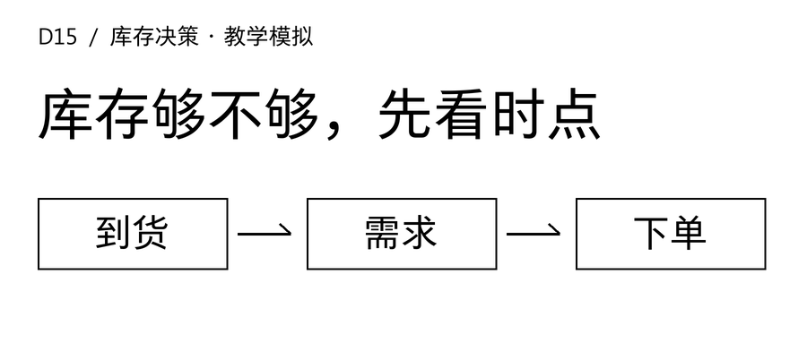
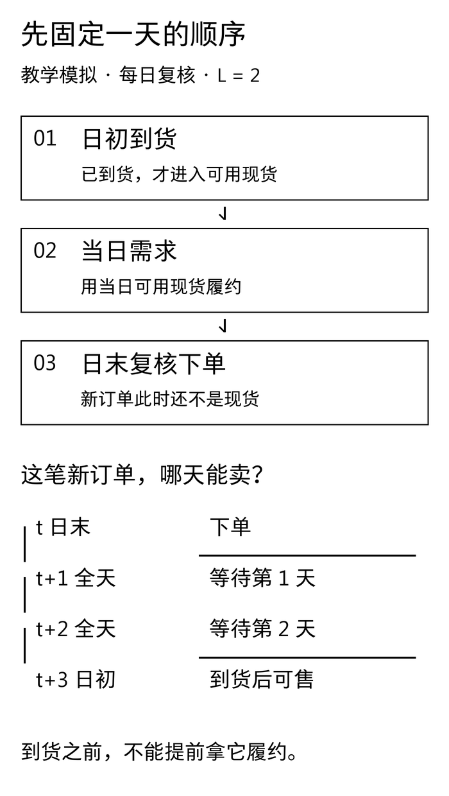
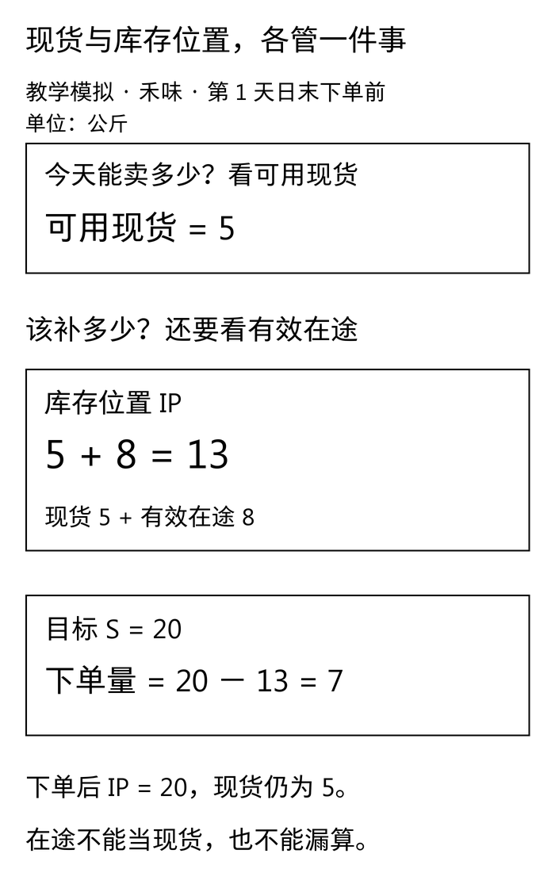
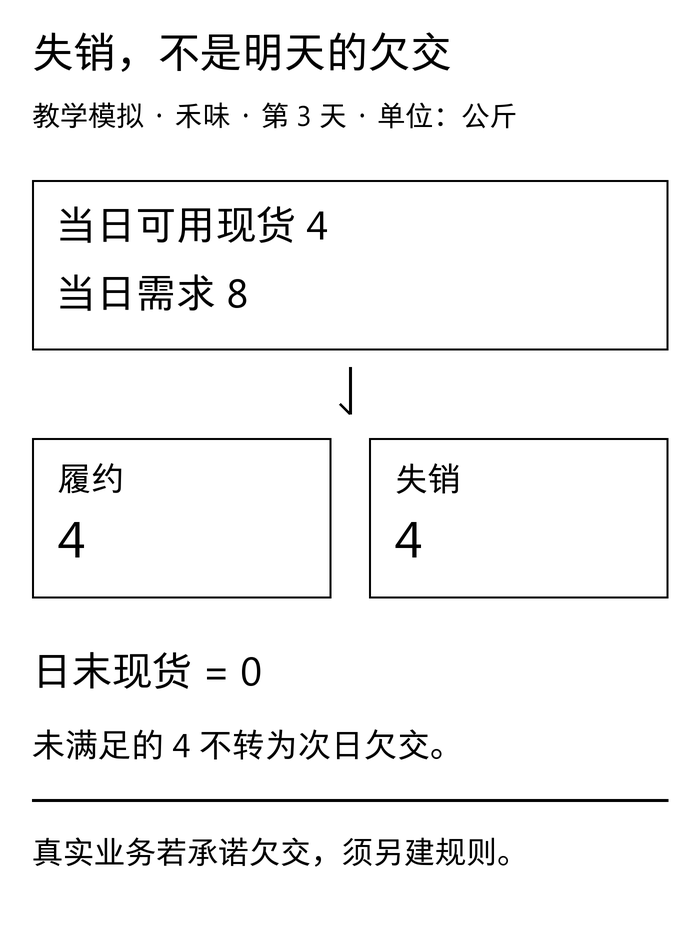

禾味A店关门时，SKU01只剩5公斤。店员说：“目标是20公斤，那就补15公斤。”采购翻了一下单据：“还有8公斤明早到，是不是只补7公斤？”

两个人看的是同一盘库存，却少了一张共同的时间表。只盯货架会重复补货；把明早的货算成今天能卖的货，又会掩盖缺货。

[D14](/blog/forecast-model-selection-boundaries/)停在一个边界：预测误差更小，还不能推出库存更少、缺货更低。D15开始补上中间这段计算，先让一笔货在正确的日子、以正确的身份进入台账。

## 一 今天能用多少，和这次要补多少，是两个问题

**本文案例、日期、数量和单号均为教学模拟，不对应真实品牌、订单、项目或经营收益。** 禾味仍是虚构的两店、八食材SKU连锁，本篇只模拟A店SKU01；另外15条店×SKU组合没有生成或评估。匿名服装案例只保留生产协同的业务背景，另建一个以件为单位的单SKU库存沙盘。

本篇新建两份各7日的小样本，用于逐步手算，不接续D9的180日需求，也不读取原测试段。两种单位分别计算，公斤和件不相加。模拟器知道每一天的真实需求；现实只有销量时，不能假装已经观测到全部失销需求。

先给三个状态起好名字：

- **可用现货OH**：已经到货、通过本例验收、能够满足当前需求的数量。质检冻结、报废、不可销售库存不在里面。本例不另设预留量。
- **有效在途OO**：已确认、尚未到货的补货订单余额。必须能追到订单号、数量和预计到货日。计划草稿、已取消数量不属于它。
- **真实欠交BO**：已经承诺但尚未履约、后面仍须补交的需求。顾客已经放弃购买的失销，不属于欠交。

在这套不重复扣减的口径下，常见库存位置写成 `IP＝OH＋OO－BO`。MITx《Supply Chain Fundamentals》的[库存管理概念手册](https://courses.edx.org/assets/courseware/v1/dc37f5a930a43b8fe98c21a2b18c59ff/asset-v1%3AMITx%2BCTL.SC1x_3%2B1T2017%2Btype%40asset%2Bblock%40KeyConcept_SC1x_V2.pdf)给出了现货、在途与欠交的这一关系。它是一种补货状态汇总，不能直接回答每一天是否有货可用。

字段落地时要再核对：如果WMS的“可用”已经扣除了同一批客户预留，不能又把那批数量作为欠交扣一次。若订单仍未到承诺交期，也不能只因尚未发货就全叫“逾期欠交”。状态名称、责任与扣减规则必须由业务确认。

本篇主仿真选择**失销口径**：当天没满足的需求当天离开，不转入下一日，因此始终 `BO＝0`，库存位置简化为 `IP＝OH＋OO`。这是一项教学假设，不是对餐饮或服装真实履约规则的判断。

## 二 先固定一天的顺序，再讨论提前期

每天严格执行三步：

1. **日初到货。** 到期的订单从在途队列移出，同量加入可用现货。本例假定足量、准时到达且立即可用。
2. **当日需求。** 用当前现货履约；超出现货的部分记为失销，现货不能变成负数。
3. **日末复核并下单。** 按需求发生后的现货和仍未到货的订单计算库存位置，再决定新增订单；新单只加入在途，不能反过来满足今天的需求。

本篇把 `L` 定义成“下单后完整等待的日数”，到货日固定为 `下单日＋L＋1`。因此，**L＝2时，t日末下单，经过t＋1、t＋2两个完整等待日，t＋3日初到货。** 例子里的第1日末订单在第4日初到货，不在第3日。

这是一套离散时间记账约定，不是说供应商口头承诺的“两天交期”必然如此。有的系统日初下单，有的系统把下单日记作第一天；接入前要把供应商时间戳映射到事件顺序，不能只看一个数字2。本约定中L＝0也是次日日初到，不支持当天日末下单、当天日初到货。

[](images/d15-01_event-timing.png)

以日末下单前为观察点，记当日可用量为 `A_t`、需求为 `D_t`、履约量为 `F_t`、失销量为 `U_t`，本例可逐行计算：

```text
A_t = 上一日末现货 + 当日日初到货
F_t = min(A_t, D_t)
U_t = D_t - F_t
OH_t = A_t - F_t
IP_t（下单前）= OH_t + 当日到货移出后的在途余额
Q_t = max(0, S - IP_t)
IP_t（下单后）= IP_t + Q_t
```

`S`是目标库存位置；这里固定禾味为20公斤，只为让算例容易核对，没有从预测误差拟合它，也不把它称作最优库存或安全库存。若原有IP超过S，订单量为0，不自动退货。固定目标策略在失销、正提前期条件下不一定最优，本篇只验证状态转移，不做策略优劣比较。

## 三 禾味七日台账：第3日为什么有16公斤在途还缺货

模拟起点是第1日日初到货之前：可用现货12公斤，另有一笔8公斤的已确认订单，已于第0日之前下达，约定第2日初到货。新增订单都按L＝2计算，目标S＝20公斤。第1日至第7日的需求依次为7、9、8、4、5、6、3公斤。

先手算第1日：12公斤满足7公斤需求，剩5公斤；8公斤仍在途，所以下单前IP为13公斤，只需补7公斤。新单到货日为第4日，下单后IP为20公斤。

[](images/d15-02_inventory-position.png)

下面所有数量单位均为公斤。“在途”与“IP”两列均取**日末下单前**，不含当日新单。手机端可在表格内左右滑动。

<div role="region" tabindex="0" aria-label="禾味七日库存台账，单位公斤，可横向滚动" style="overflow-x:auto;max-width:100%;margin:28px 0">
<table style="min-width:780px;width:100%;max-width:none;display:table;margin:0;white-space:nowrap">
<thead><tr><th scope="col">日</th><th scope="col">日初到货</th><th scope="col">需求</th><th scope="col">履约</th><th scope="col">失销</th><th scope="col">日末现货</th><th scope="col">在途</th><th scope="col">IP</th><th scope="col">新单</th><th scope="col">新单到货日</th></tr></thead>
<tbody>
<tr><td>1</td><td>0</td><td>7</td><td>7</td><td>0</td><td>5</td><td>8</td><td>13</td><td>7</td><td>4</td></tr>
<tr><td>2</td><td>8</td><td>9</td><td>9</td><td>0</td><td>4</td><td>7</td><td>11</td><td>9</td><td>5</td></tr>
<tr><td>3</td><td>0</td><td>8</td><td>4</td><td>4</td><td>0</td><td>16</td><td>16</td><td>4</td><td>6</td></tr>
<tr><td>4</td><td>7</td><td>4</td><td>4</td><td>0</td><td>3</td><td>13</td><td>16</td><td>4</td><td>7</td></tr>
<tr><td>5</td><td>9</td><td>5</td><td>5</td><td>0</td><td>7</td><td>8</td><td>15</td><td>5</td><td>8</td></tr>
<tr><td>6</td><td>4</td><td>6</td><td>6</td><td>0</td><td>5</td><td>9</td><td>14</td><td>6</td><td>9</td></tr>
<tr><td>7</td><td>4</td><td>3</td><td>3</td><td>0</td><td>6</td><td>11</td><td>17</td><td>3</td><td>10</td></tr>
</tbody></table>
</div>

第3日最能暴露问题：日初没有到货，手上只有4公斤，遇到8公斤需求，就履约4公斤、失销4公斤。那16公斤在途分别在第4、5日到，今天用不上。**总库存位置有数，不代表到货之前不会断货。** 即使本例每天补单后IP都是20公斤，时间分布也仍会造成缺口。

第3日末按失销口径只补4公斤。如果把已经离开的4公斤需求又记成欠交，就会错误地算出 `IP＝0＋16－4＝12`，再下8公斤。多出来的4公斤来自记账口径混用，不是有证据的新需求。如果业务确实接受延期交付，就应改成完整的欠交模型，后续到货要优先处理什么、取消如何冲销都需定义，不能只在这条公式上减一下。

[](images/d15-03_lost-sales.png)

还有两个很容易藏进代码的小错误：

- **只看现货补到20。** 第1日会下15公斤，忽略了在途8公斤；下单后的真实IP变成28公斤。
- **收货后忘记移出在途。** 第2日的8公斤既进入现货，又留在OO中，形成双计。收货只是货物身份变换，不能凭空增加库存位置。

七日合计需求42公斤、履约38公斤、失销4公斤。现货守恒为 `12＋32－38＝6`，对应期初现货、窗口内到货、履约和期末现货；在途守恒为 `8＋38－32＝14`。第7日末还在途的14公斤，将在第8、9、10日分别到5、6、3公斤，不能在观察窗口结束时删掉，也不能当作窗口内已到货。

这些数只是检查台账是否自洽。没有设置成本、报损或策略对照，因此不能从“失销4公斤”推导节省了多少钱，也不把这7天的履约比例写成门店长期服务水平。

## 四 匿名服装：先知道一件货处在哪个阶段

服装生产协同的困难往往不止是数量。在一个真实项目里，同样写着“20件”的记录，可能是终端需求、已确认成品采购、已下达工单、在制品，也可能只是计划建议。它们的可用时间与责任不同，不能全部塞进OO。

本文不知道真实项目的接单、取消、延期履约、在制品转成品与产能规则，因此不把任何一种规则写成企业事实。实践包里的匿名服装序列只是另一个单SKU、以件为单位的失销库存沙盘，与禾味分开运行；这份沙盘从6件现货开始，第1日初另到4件；L＝1、S＝12件，七日需求为5、8、4、7、3、6、2件。计算得到需求35件、履约32件、失销3件，期末现货4件、在途8件。参数与原始文件逐项对应。它验证同一套状态计算可以在不同数量级下保持守恒，**不把终端需求预测件数直接转成工厂排产指令。**

真实接入时，至少先回答四个问题：

1. 哪种记录才算已确认的补货订单？是成品采购单、调拨单还是生产完工入库？一个订单是否在多张表里重复出现？
2. 到货之后能否立即发货？如果还要质检、分码或入库，预计到达日与预计可用日必须分开。
3. 缺货后客户是离开、等待还是取消一部分？分别怎样记录已承诺未交、失销和撤销，不能从销量反推全部需求。
4. 现货是否已经扣掉其他订单的预留？同一承诺是否还被BO或预测目标计入，避免两次扣减或两次需求覆盖。

例如，采购订单计划100件、已经验收40件，OO只能保留尚未验收且仍有效的余额，不能把订单原量100件继续加在40件现货旁边。但“剩余60件何时到、是否可能取消”没有证据时，不能替它编一个到货日。本文模拟器不处理部分交付、取消、延期、质量隔离、跨仓调拨或物料清单；遇到这些业务，需要扩展事件与测试，不能用现有通过结果作覆盖证明。

## 五 想让这张表进入系统，先守住哪些边界

每一条库存流转至少需要实体、SKU、单位、数量、事件发生时点、记录可用时点和稳定的事件或订单标识。本文CSV以日序号代替真实时间戳，默认日末前该日记录全部到达；这是为了看清时序，不代表现实数据天然准时。

一张订单表还要保留预计到货日与余额。相同的IP，可能由“明天到10件”或“十天后到10件”组成，短期缺货风险完全不同。汇总IP用于当前规则的补货计算，到货队列用于逐日判断可用量；二者不能互相替代。

本篇采用三个核对层次：

- **输入契约。** 实体和单位一致、日序连续、数量有限且非负、订单标识唯一、到货日在合法范围内。明确不支持的事件拒绝输入，不能悄悄忽略。
- **日内状态。** 日初只接收当天到期订单；库存不为负；需求等于履约加失销；下单量不得进入当日履约。今天的下单不读取明天的真实需求。
- **跨日守恒。** 现货、在途分别核对；到货在两边一增一减；窗口外未到货继续留在队列。下单前和下单后两个IP都输出，防止拿错快照。

请特别区分“能复现”与“能用于经营”。固定输入的SHA-256能说明文件是否改变，单元测试能抓住已设计的错误；它们不能证明供应商会准时、失销能被完整观测，或目标20公斤适合门店。

## 六 自己复算，再故意把它算错

下载[D15库存位置实践包](/downloads/d15-inventory-position-practice.zip)，用Python 3.10或以上解压运行：

```bash
python -m unittest -v
python run.py
```

计算和测试只用标准库。包内有两份原始七日需求、参数、逐日台账、订单事件、期末未到货明细和汇总，README解释每个字段与模拟范围。运行定位相对脚本目录，不依赖仓库其他实验。输出不写运行时钟；同样输入会得到相同结果。原始需求是外部给定的模拟轨迹，不因库存不足而把后续需求改小。

测试会专门攻击“提前一天到货”“失销再扣成欠交”“收货不减在途”“只按现货补货”等错误，并扰动未来需求，核对已发生日前的决策不变。测试期末余额时，也检查第8日至第10日待到货仍然存在。读者修改参数是在做另一次沙盘，不是更新已发布结果的证据。

另附[文章Markdown与配图](/downloads/d15-inventory-position-article.zip)、[黑白配图与重绘脚本](/downloads/d15-inventory-position-images.zip)。图的字体、依赖和预览核对方法在图包说明中；图包与计算包分开使用，复算数字不需要安装绘图库。

D15到这里先完成一件朴素的事：今天卖出去的货、路上未到的货和今天新下的单，各自只出现一次，也只在该出现的时点出现。下一步讨论补货参数、需求不确定性或成本时，才有一张可以追溯的底账。
