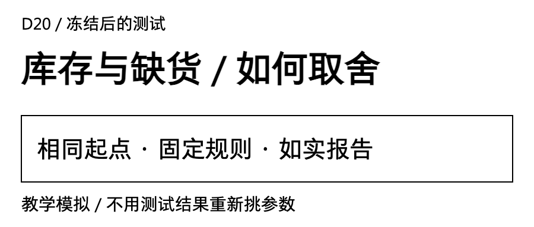
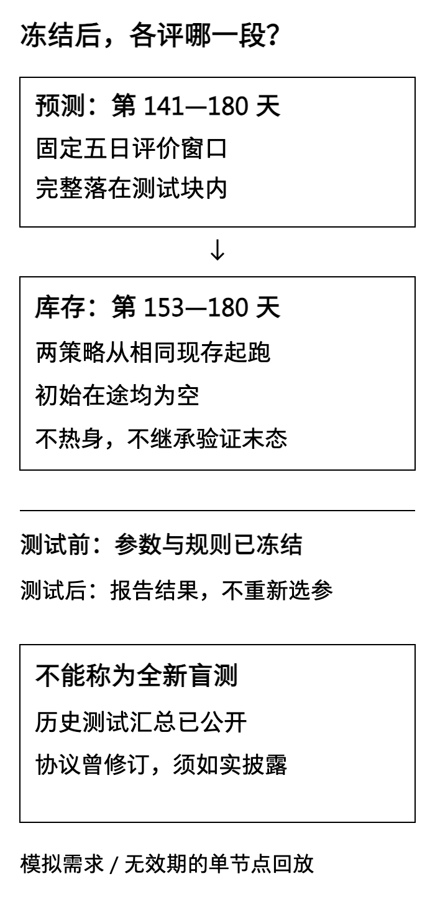
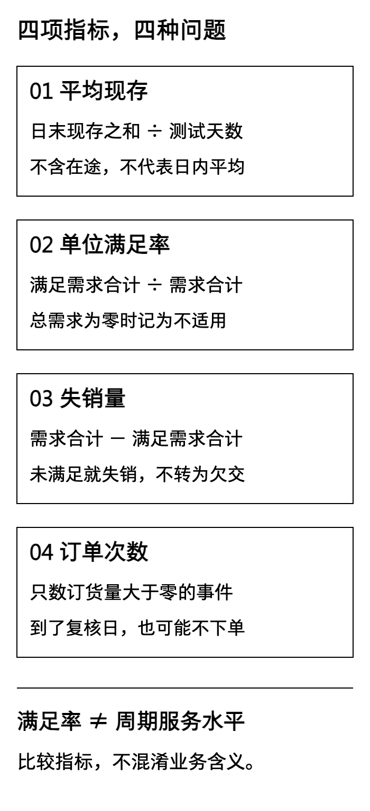
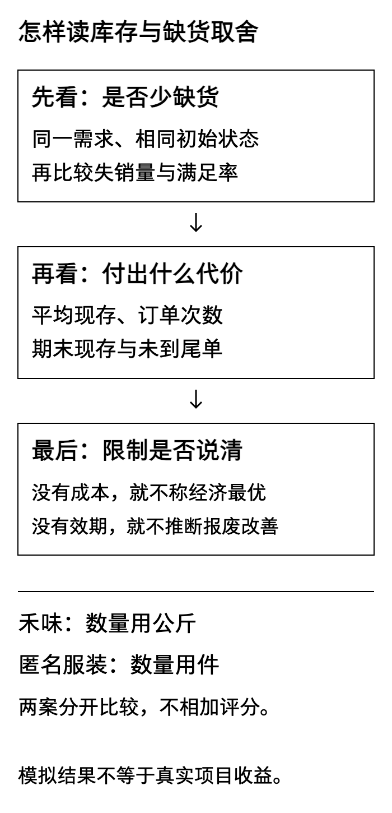
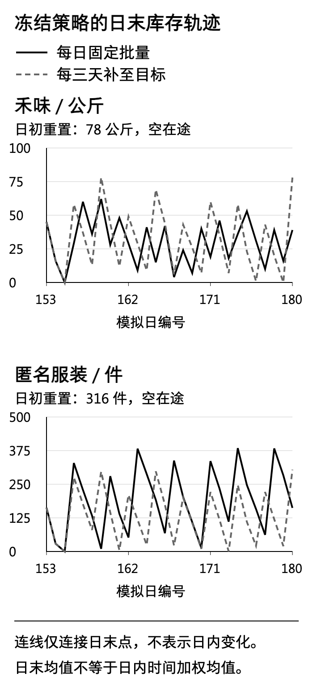

验证时，禾味的两种策略都没有失销。正式按冻结配置换一段需求，每日复核失销5公斤，定期复核失销8公斤。这个变化很适合拿来检验一个学习习惯：看到结果不够漂亮时，能不能先保留它，而不是重新挑参数。

[D19](/blog/inventory-validation-policy-freeze/)已在开发验证段比较小网格，冻结了两案、两类策略共四套配置。今天只执行这些配置，回答《两种补货策略如何权衡库存与缺货》。**所有企业场景、需求、订单与数量都是教学模拟，不对应真实客户或实际收益。**

## 一 先交代这次测试能够证明什么

禾味是虚构的2店、8个食材SKU连锁，本篇仍只回放A店SKU01这一条公斤需求；没有把其他15条店货组合虚构成已经测试。匿名服装企业案例是单个成品库存节点，单位为件。成品回货、验收与销售之间的协同背景用于解释业务，实验不接生产系统，不生成真实采购或派车指令。

完整需求仍是180天：1—112天训练、113—140天验证、141—180天预测测试。库存使用最后28天，即第153—180天。读者不能把“预测测试40天”与“库存评分28天”当成同一窗口，也不能把禾味退回首周的14天小样本来算这次结果。

**这是一项延续实验，不是一份全新盲测。** D9原测试汇总已经公开，D19开发数据也多次使用；D19首轮验证后，还将未来库存测试计划从“先热身再评分”修订为“第153日同态直接起跑”。这些事实已在D19 v2协议说明。今天按这个已公开版本执行，不重跑D9的finalize，不覆盖旧成绩，不因为结果改变Q、z、初始状态或评分起点。

原始测试CSV的哈希与既有回执核验一致。文件哈希能帮助发现内容漂移，不能让已看过的信息重新变成未知，也不是独立可信的事前注册证明。以下结果可以证明这套代码按明确规则得到什么，不能证明长期服务概率、因果收益或经济最优。

[](images/d20-01_boundary.png)

## 二 四套配置不动，公平条件也不动

两策略在同一案例使用相同原始需求、现存与在途。第153日初，禾味重置为78公斤现存，服装316件，均无初始在途。**不继承验证末库存，不运行第141—152日库存热身。** 因此启动日的缺口也算进结果，不因不好看而删除。

每日固定批量策略每天日末看一次库存位置IP，IP＝现存＋有效在途。失销当天离开，不转成欠交。IP不超过阈值s时，只下一单固定批量Q；否则不订。定期策略每3天复核一次，在第153、156……180日末，把IP补到目标S，非复核日不临时下单。

冻结参数为：

- 禾味每日：Q＝52，z＝1；周期：R＝3，z＝1。
- 服装每日：Q＝422，z＝0；周期：R＝3，z＝2。
- 两案L＝2，按“日初到货→当日需求→日末复核下单”执行。第t日末下单，在第t＋3日初到货。
- 每日阈值s＝向上取整［未来3天预测合计＋z×训练期3天累计误差尺度］；周期目标S＝向上取整［未来5天预测合计＋z×训练期5天累计误差尺度］。

z只是缓冲倍数，不是95%服务水平。训练误差尺度用RMS，即累计误差平方的平均值再开平方；它包含偏差，不是去均值后的标准差。详细计算和3天、5天保护期推导见D19，今天不重新估它。

预测器固定为周期7的季节性朴素法。每日日末只看截至当天已经观察到的原始需求，再发出未来预测。预测可以逐日更新，**冻结规则不等于冻结每一天的预测数值**。第153日末可以使用届时已发生的141—152日需求，但不把某策略的实际销量、库存或失销反过来喂给预测器。

这里假设缺货时仍能完整观察需求。在现实门店，销量可能被缺货截断；服装订单也可能延迟录入。若只能看见销量，必须先处理观测问题，不能照抄本实验的预测输入。

## 三 四项指标，先把分母说清楚

我们不把四个数字揉成一个“综合提升率”。先逐项读：

```text
订单次数 = 测试期内订货量大于0的事件数
平均日末现存 = 28个日末现存数量之和 ÷ 28
单位满足率 = 测试期累计履约量 ÷ 累计原始需求量
失销量 = 累计原始需求量 − 累计履约量
```

订单次数不是到货次数、配送车次，也不是打开复核窗口的次数。平均现存不含在途，也不是日内按时间加权的平均库存。满足率必须先加总履约与需求再相除，不能把每天的百分比直接平均；总需求为0时记为不适用。

例如禾味每日策略履约715公斤，总需求720公斤，满足率为715÷720≈99.31%，失销为720−715＝5公斤。99.31%不是“有99.31%的补货周期不会缺货”，也不是每一天都能满足99.31%的需求。

[](images/d20-02_metrics.png)

## 四 禾味：少下五次单，但多失销三公斤

两种策略面对同样720公斤需求。表中的平均现存与满足率只在显示时舍入，源文件保留计算值。

<div role="region" tabindex="0" aria-label="四组测试指标，可横向滚动" style="overflow-x:auto;max-width:100%;margin:28px 0">
<table id="d20-results" style="min-width:650px;width:100%;max-width:none;display:table;margin:0;white-space:nowrap"><thead><tr><th>案例／单位</th><th>策略</th><th>需求</th><th>履约</th><th>失销</th><th>平均日末现存</th><th>单位满足率</th><th>订单次数</th></tr></thead><tbody>
<tr><td>禾味／公斤</td><td>每日</td><td>720</td><td>715</td><td>5</td><td>30.07</td><td>99.31%</td><td>15</td></tr>
<tr><td>禾味／公斤</td><td>周期</td><td>720</td><td>712</td><td>8</td><td>32.50</td><td>98.89%</td><td>10</td></tr>
<tr><td>服装／件</td><td>每日</td><td>3173</td><td>3108</td><td>65</td><td>189.89</td><td>97.95%</td><td>8</td></tr>
<tr><td>服装／件</td><td>周期</td><td>3173</td><td>3104</td><td>69</td><td>132.68</td><td>97.83%</td><td>10</td></tr>
</tbody></table></div>

禾味的每日策略平均日末现存约30.07公斤，周期策略32.50公斤；每日策略失销5公斤，周期策略8公斤。与此同时，每日策略下15次单，周期策略下10次单。每日策略在现存与失销上较低，周期策略在下单次数上较低，没有哪一行在所有指标上都占优。

少5次订单不能直接换算成5次运费，更不能凭空写出节约金额。供应商可能合并发运，门店可能共车配送；还缺货值、每单处理费、持有成本、缺货损失和实际合同口径。

### 看三天流水，比盯一个百分比更容易发现问题

每日策略第153日初有78公斤，需求33，日末剩45；此时IP＝45，触发订52公斤，第156日初才到。第154日需求29，剩16；加上52在途，IP＝68，恰好等于当天阈值68，于是再订52公斤。

到第155日，现货16公斤、需求21公斤，履约16、失销5。日末虽然现货为0，但已有104公斤在途，超过当天阈值78，不再下单。**在途能影响下一次订货，却不能提前拿来履约。** 第156日收到第一笔52公斤，才恢复可用供给。

周期策略在第155日也失销5公斤，另外在第179日失销3公斤。因此两组共同的5公斤来自这一冷启动条件，策略间的额外差距是3公斤，不能把8公斤全说成周期复核造成。

这5公斤不能事后归咎于程序“不会救急”再插一笔紧急单。当前政策本来没有紧急补货，初始在途又为空。若业务需要启动备货或应急渠道，可以另立开发实验，但不能在本轮结果出来后修改同一份冻结测试。

禾味期末每日现存39、在途104；周期现存78、在途64。现存与在途分别守恒：

```text
每日现存：78 + 676到货 − 715履约 = 39
每日在途：0 + 780下单 − 676到货 = 104
周期现存：78 + 712到货 − 712履约 = 78
周期在途：0 + 776下单 − 712到货 = 64
```

期末在途仍是未来供给承诺，不能因为第180日结束就抹去。也不能把这些未来到货提前计入平均现存，制造更好看的服务表现。

## 五 匿名服装：少失销四件，多占用约五十七件

服装两策略总需求同为3173件。每日固定批量履约3108、失销65，平均日末现存189.89件；周期策略履约3104、失销69，平均132.68件。两者满足率约97.95%与97.83%，差约0.13个百分点，不是“提升0.13%的利润”。

两组在第155日都失销65件；周期策略还在第173日失销4件。这次冷启动缺口占了失销的大部分，不能把每日策略的65件和周期策略的69件全归为复核方式差异。

每日策略少失销4件，却多占用约57.21件平均日末现存，同时订单8次而非10次。这与D19验证里的差距很不一样：当时每日策略少失销200件、平均现存高约45.43件。不能把验证段差值当成固定收益搬到后续需求，更不能用现在只差4件就否定当时流水。

四套配置是各策略内按开发规则选出，并非在测试里二次选冠军。这里也没有显著性检验；只有两案各一条有限需求路径，不用小数位数制造结论确定性。

两策略都下单3376件，实际到货却分别2954和3092件，因为订单时间不同，期末仍在路上的数量不同。每日期末现存162、在途422；周期现存304、在途284。平均现存和期末现存回答不同问题：周期策略平均现存更低，但测试末日的现存更高。

```text
每日现存：316 + 2954 − 3108 = 162
每日在途：0 + 3376 − 2954 = 422
周期现存：316 + 3092 − 3104 = 304
周期在途：0 + 3376 − 3092 = 284
```

在服装协同业务中，一笔外协回货可能先处于运输、待验状态，验收后才成为可用成品；采购单、交接单和验收单还可能指向同一批供给。接入前须先去重并明确“可用”时点。本实验假设到期供给准时、足量、合格，没有真的清洗这些业务单据。

失销模型也不代表服装合同允许欠交消失。若订单必须延期履约，就应建立欠交队列、优先级及逾期指标，重新设计实验。本结果不含BOM齐套、工序能力、良率、返工和换线，不推导排产收益。

[](images/d20-03_tradeoff.png)

[](images/d20-04_inventory-curves.png)

## 六 预测误差相同，库存结果为什么不同

两策略使用同一个预测器，但补货动作不同。预测偏差可以改变阈值，批量决定一次补多少，复核日决定什么时候有机会下单，到货时间决定哪一天能兑现；因此预测准确率并不单独决定服务表现。

为与原计划对齐，本包另外报告第141—180天40个一步预测，以及36个完整五天累计窗口。五天起点从第140日末到175日末，目标分别为141—145到176—180，没有跨块取标签，也不借未来真实需求修订固定起点预测。

<div role="region" tabindex="0" aria-label="冻结季节性朴素预测误差，可横向滚动" style="overflow-x:auto;max-width:100%;margin:28px 0">
<table id="d20-forecast" style="min-width:650px;width:100%;max-width:none;display:table;margin:0;white-space:nowrap"><thead><tr><th>案例／单位</th><th>目标</th><th>窗口数</th><th>MAE</th><th>ME</th></tr></thead><tbody>
<tr><td>禾味／公斤</td><td>1天</td><td>40</td><td>2.1750</td><td>0.0250</td></tr>
<tr><td>禾味／公斤</td><td>5天</td><td>36</td><td>4.1111</td><td>0.1667</td></tr>
<tr><td>服装／件</td><td>1天</td><td>40</td><td>2.9250</td><td>0.3750</td></tr>
<tr><td>服装／件</td><td>5天</td><td>36</td><td>5.9167</td><td>2.1389</td></tr>
</tbody></table></div>

MAE表示绝对误差的平均值，例如误差−3和4，MAE＝(3＋4)÷2＝3.5。ME是带符号误差平均，本篇符号为“实际减预测”，正值表示平均低估。五天行评分的是**五天累计实际与累计预测之差**，不是把40天单日误差切成几段后直接平均。窗口重叠，不能当作36次独立实验。

两策略共享同一预测误差表，却有不同库存、失销与订单数。写产品结论时，应该把预测评估与补货评估分开，而不是“MAE小，所以采购一定更省”。本次没有比较其他预测模型，也不依据测试成绩改换模型。

## 七 把结果写成可以追查的结论

可以写：“在这28天模拟需求与冻结初态下，禾味周期策略少5次下单、多3公斤失销；服装每日策略少4件失销、平均现存多约57.21件。”

不能写：“算法保证99%服务水平”“为企业降低库存成本”“安全库存减少报废”。这些表述分别缺长期概率验证、成本口径和效期模型。

禾味真实易腐补货还需要批次、到期日、预计消耗、报损、库存容量和到货可用性。服装需要齐套、产能、质检和交期承诺。先把最小回放做对，并不等于已经具备上线自动采购的条件。

若想降低现存或减少订单，可以把本轮发现记为下一轮假设，再用新的开发与评估安排验证。不要在本次测试数据上继续搜索后，仍把新参数叫作原来的“冻结结果”。

## 八 下载与验收：让读者重算，而不是相信截图

- [D20模拟数据与可复现实验包](/downloads/d20-inventory-test-practice.zip)
- [完整文章Markdown与配图](/downloads/d20-inventory-test-article.zip)
- [黑白配图源文件与重绘工具](/downloads/d20-inventory-test-images.zip)

使用Python 3.10或以上，仅需标准库，在实践包目录运行：

```bash
python -m unittest -v
python run.py
```

包内保留D19冻结证据、开发及测试输入、逐日台账、订单事件、期末在途、验证与测试对照和预测窗口明细。重算不得自动覆盖固定基线或把修改后的文件登记成原证据。测试覆盖守恒、等号触发、到货时序、未来信息、销量独立、零需求、尾单、冻结参数与输入完整性。

验收时至少回答三个问题：每一条结论能否找到对应流水？不改参数重复运行能否一致？期末尚未到货的订单是否仍然保留？

参考复习范围沿用原学习计划O4：[MIT OpenCourseWare Logistics Systems库存讲义](https://ocw.mit.edu/courses/esd-260j-logistics-systems-fall-2006/pages/lecture-notes/)，其中[第11讲](https://ocw.mit.edu/courses/esd-260j-logistics-systems-fall-2006/resources/lect11/)帮助区分随机需求、安全库存与服务口径。今天不增加新模型；本文的离散事件和统计约定以公开实践包为准。

本篇完成的是一套能够复算、能够解释限制的教学比较。下一步进入配送问题时，也要继续把“有一个结果”与“结果可行、比较公平、能否执行”分别检查。
