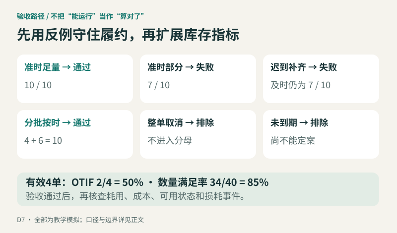
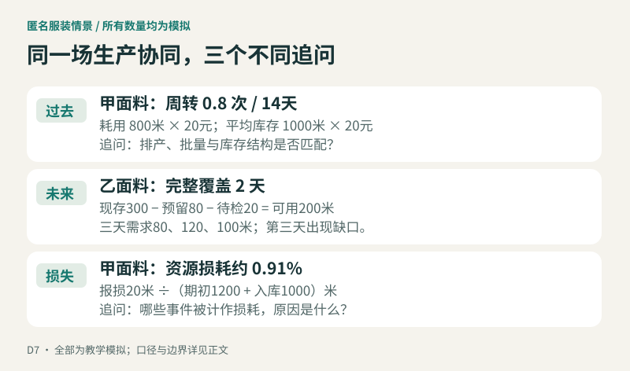
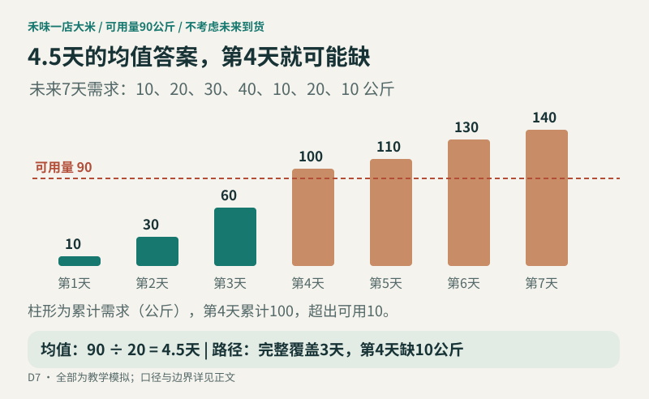
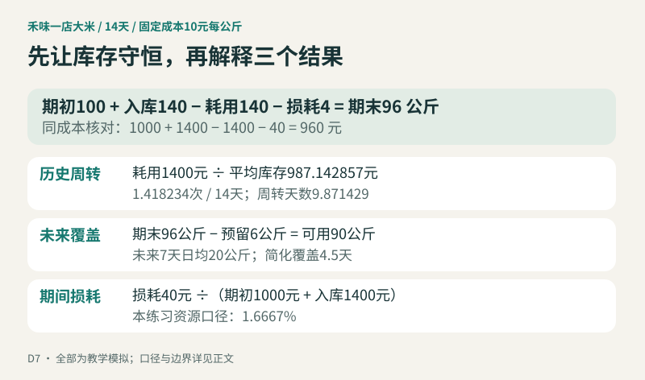

生产协同会上，采购说面料已经收齐，车间说还在等一批关键颜色，仓库却说库位已经不够了。三句话可能同时成立。

原因很朴素：交货是否兑现承诺、过去的物料消耗有多快、未来几天有没有料用，观察的不是同一件事。把它们压成一个“供应链健康分”，往往会丢掉真正影响决定的信息。

[D6已经把履约口径落实到SQL](/blog/sql-supply-chain-metrics-boundary-tests/)。D7往前走一步：先确认查询能经受反例，再决定库存指标还需要补什么数据。今天的目标不是多做三个百分比，而是能解释每个结果从哪里来、在哪些情况下不能使用。

> 本文所有订单、数量、时间与计算结果均为教学模拟。服装案例采用匿名生产协同场景，不对应任何真实企业或项目。禾味为虚构餐饮连锁，包含2家门店、8个食材SKU，观察期为2026年10月17日至30日，共14天；这是独立实验，不是前文数据的真实延续。未来需求是人工给定情景，未训练预测模型，不代表预测能力、经营收益或真实改善。

## 一 先验收旧指标，别急着给新指标取名字

“晚一点最后也收齐了，为什么还算失败？”如果这个问题没有约定，新报表上线后仍会反复争论。

履约评价要保留两个事实：承诺时刻前交了多少，以及后来一共交了多少。前者用于本次按时足量评价，后者用于追踪未完成事项。后到的货可以关闭交付缺口，不能改写此前是否守约。

本练习固定业务时区UTC+08:00，以合格验收时刻判断及时性；恰好等于承诺时刻算按时。纳入承诺时间落在观察期、截至统计截止已到期的有效订单，整单取消和未到期单不进入分母。统计截止为10月30日23:59（模拟中此后当天无业务事件），观察期为10月17日00:00至10月31日00:00，不含右端点。分批验收先回到订单行汇总，及时量逐行封顶，再判断整单是否所有有效行都足量。

为了让错误更容易显形，六个手工测试各用一张单、一个商品行，订货量均为10公斤；它们是独立的履约夹具，不冒充下面库存台账的入库来源。

| 测试情景 | 承诺前合格量 | 后续补齐 | 预期及时计入量 | 预期整单结果 |
|---|---:|---:|---:|---|
| 准时足量 | 10 | 0 | 10 | 通过 |
| 准时部分 | 7 | 0 | 7 | 不通过 |
| 迟到补齐 | 7 | 3 | 7 | 不通过 |
| 分批按时到齐 | 4＋6 | 0 | 10 | 通过 |
| 整单取消 | 有记录也不参加 | — | 不适用 | 排除 |
| 未到期 | 尚不能定案 | — | 不适用 | 排除 |

有效样本只有4单，因此OTIF应为2÷4＝50%，同SKU数量满足率应为34÷40＝85%。不能拿6单做分母，也不能把迟到补齐改成达标。实践包同时输出预期和实际，并用断言比较；这比单纯展示一个“通过”标志更容易复核。

六类测试刻意很小，方便手算；它们不等于覆盖全部真实订单。多商品行整单判定仍须保证一行不达标即整单失败，不能让另一个SKU的超额量补缺；接口漏传、承诺版本变更和部分取消也不能靠这六行证明已被解决。



## 二 服装案例：按时交齐之后，仍可能同时积压和缺料

设一家匿名服装生产协同企业，为两个款式组织面料采购、裁剪与成衣交付。以下数字为讲解而设置，并非真实项目复盘。

款式甲的常规色面料采购单要求1000米按时合格验收，供应方按约交齐。采购履约达标，但并不说明这1000米马上会被使用：车间可能仍在切换款式，或者下游排产发生了变化。

另一个款式乙需要某种关键色面料。统计时点账面还有300米，其中80米已经分配给另一张生产任务，20米处于待检状态。未重复扣减的前提下，这张任务当前可支配的只有200米。接下来三天的排产需求分别为80、120、100米，则前两天累计需要200米，第三天就没有剩余量可用。账面库存看起来不少，可用库存却只覆盖两天完整需求。

与此同时，甲面料过去14天实际领用800米，固定单价20元/米；14个日末库存快照的平均数量为1000米。耗用成本16000元，平均库存成本20000元，期间周转为0.8次，周转天数为14÷0.8＝17.5天。这个数字描述过去的消耗速度，不是在承诺“未来17.5天不会停工”。

再看损耗：期初甲面料1200米、期间合格入库1000米、实际领用800米、已确认报损20米，则期末应为1380米，满足1200＋1000－800－20＝1380。按本篇选定的资源基数，损耗成本400元除以期初与入库成本44000元，约为0.91%。领用800米与报损20米必须分开记，否则把损耗也混进耗用分子，会让周转看起来更快。

这组情景中的平均库存1000米是另行给定的每日观测均值，并不是由1200和1380两个端点推出来的。只有端点时，得到的1290米只是另一种近似，不能悄悄替换成同一口径。实际生产中，库存先消耗、后集中到货，期间均值低于两个端点并不矛盾；但正式计算仍需要那14条可核对的快照。

三个指标将会引出不同的追问。甲面料周转慢，要看排产、批量与库存结构；乙面料覆盖短，要看可用状态和后续到货时点；甲面料出现报损，要查原因、责任与处理记录。这些追问有联系，却不能由一个比率代替另一个。



## 三 六张基础表能证明什么，还不能证明什么

第一周已有门店、SKU、订单、订单行、验收、库存快照六张表。它们适合解释订了什么、验收了多少、某个时点有多少库存，却还没有完整描述物料怎样被消耗。

| 已有数据 | 能支持的观察 | 新指标仍缺什么 |
|---|---|---|
| 门店与SKU | 店、物料、基础单位 | 一致估值成本及有效期 |
| 订单与订单行 | 订货承诺、计划数量 | 实际耗用；订货量不是需求量 |
| 合格验收 | 确认收到的数量 | 与入库台账一致的成本及过账关系 |
| 固定时点库存 | 当时的实物数量 | 完整日序列、可用状态、预留与冻结 |
| 六表整体 | 履约与固定时点状态 | 未来需求情景或预测、损耗事件及原因 |

库存从100降到80，并不能直接推出损耗20：中间可能领用了30、收货10，也可能发生调拨、退货或盘点调整。只有净变化，没有事件分类，就没有足够证据识别损耗。

因此，D7的基础要求是写清三张卡并手算。本文额外补一套明确标记为模拟的库存流水、成本和未来需求，用于验证公式；这些新增数据不意味着原六表突然具备了真实业务中缺少的能力。

## 四 历史周转：先让耗用与库存使用同一把尺子

本练习采用：

```text
期间周转次数 = 期间实际耗用成本 ÷ 期间平均库存成本
周转天数     = 期间天数 ÷ 期间周转次数
平均库存成本 = 每日固定时点库存成本之和 ÷ 有效观察日数
```

分子是耗用成本，不是采购额，也不是销售收入。分母与分子必须使用同一组织、物料范围、期间和估值基础；不同SKU的公斤、升、个不能直接相加，成本金额可在统一币种、统一估值政策后汇总。[SAP的库存周转说明](https://help.sap.com/saphelp_scm700_ehp02/helpdata/en/86/4a7053bbe77c1ee10000000a174cb4/content.htm?no_cache=true)同样以耗用价值与平均估值库存的关系解释这一指标。

禾味实验固定每个SKU的教学单价，不模拟价格变动、先进先出或移动加权成本。14天每天23:59观察一次，所有当日业务事件都发生在该快照之前。每日采样仍是期间平均库存的近似，不是连续时间积分，更不是全天可用性的证明。

以一店大米为例，单位公斤，固定成本10元/公斤：期初100，每日合格入库10、实际耗用10，第7天与第14天分别报损2。于是前6天日末库存均为100，接下来7天均为98，最后一天为96。

```text
平均库存数量 = (6×100 + 7×98 + 1×96) ÷ 14 = 98.714286 公斤
平均库存成本 = 987.142857 元
14天耗用成本 = 14×10×10 = 1400 元
期间周转     = 1400 ÷ 987.142857 ≈ 1.418234 次
周转天数     = 14 ÷ 1.418234 ≈ 9.871429 天
```

这里必须用14天，不能直接拿365除以14天的周转次数。若要年化，须另列假设；短期样本有季节性时，机械年化很容易造成误读。

只用期初与期末均值，会得到98公斤、周转天数9.8天，与完整日快照结果不同。差异虽小，口径变化仍要披露。漏掉一天快照时，本练习阻断该序列的正式结果，不悄悄改用13天均值，也不把缺失当零。

若平均库存为零，周转次数不适用；若平均库存为正而耗用为零，周转次数为0，但周转天数不适用。不能把“不适用”显示成0天，给人一种库存周转极快的错觉。

## 五 未来覆盖：4.5天的均值答案，为什么第4天就会缺

在10月30日日末，大米实物96公斤，其中6公斤已预留给本次情景范围以外的用途，无其他冻结，因此本次可用量为90公斤。未来情景需求不包含这6公斤，避免扣了预留、又在需求里重复计算。

接下来7个自然日的需求情景为10、20、30、40、10、20、10公斤，合计140公斤，日均20公斤。简化覆盖天数为：

```text
当前可用量 ÷ 未来指定窗口日均需求 = 90 ÷ 20 = 4.5 天
```

这个值是在均匀消耗假设下表达库存规模。实际按给定逐日路径看，前三天累计需求60公斤，第四天累计100公斤，90公斤只能完整支持3天，第四天缺10公斤。若额外假设第四天均匀消耗，可以说覆盖到第3.75天；没有小时级需求分布，不能把这个小数当作准确缺货时刻。



覆盖口径必须写出需求窗口、日历、需求来源和可用量边界。[Oracle对平均日需求的说明](https://docs.oracle.com/en/cloud/saas/supply-chain-and-manufacturing/26b/faurp/how-average-daily-demand-is-calculated-in-oracle-replenishment-planning.html)区分历史与预测基础，并明确日历及窗口会影响分母。本文选择未来7个自然日，只做给定情景计算，不能把过去14天的日均耗用偷偷当成未来预测。

在途不计入当前可用库存。如果要评价“算上到货能撑多久”，应按到货发生日加入逐日余额，同时说明交期的不确定性；把全部在途立即加到分子，会掩盖到货前的缺口。本例不模拟未来到货、效期、替代品或新损耗。

未来日均需求为0时，简化覆盖返回不适用，并注明“给定窗口无需求”，不写无限保障；缺失需求不能填零。库存足以覆盖全部7天时，只能报告“至少覆盖该7天窗口”，不能凭窗口外没有数据推断还能支撑多久。负库存、负需求或预留超过现存，本例均视为异常阻断。

## 六 损耗：先说明分母是哪一批资源

本练习选用：

```text
损耗率 = 期间已确认损耗成本 ÷ (期初库存成本 + 期间合格验收入库成本)
```

这表示观察期可供使用资源中，已经确认损失的成本占比。它是本练习的选择，不是所有企业统一的财务或运营标准；以销售额、领用量或加工投入量为分母，回答的是其他问题，不能直接比较。

一店大米14天报损共4公斤，损耗成本40元；期初成本1000元，期间入库成本1400元，因此损耗率为40÷2400＝1.6667%。期末数量核对为100＋140－140－4＝96公斤；成本也满足1000＋1400－1400－40＝960元。



这里把耗用和损耗作为互斥的事件，已经进入报损的数量不再进入耗用。真实生产里，正常工艺耗损、异常报废、盘亏和质量拒收未必采用同一规则，需要先明确分类；尚未验收成为库存的拒收量，不能随手塞进本例库存损耗分子。

模拟中没有调拨、退货与估值调整，故守恒式很短。现实增加了这些事件，就要增加相应项；账对不上时先查流水，不用“其他损耗”把差额补平。资源分母为零时返回不适用；零损耗、正资源分母才是0%。

## 七 把验收结果留在文件里，而不只留在文章里

[下载D7可复算实践包](/downloads/d7-inventory-validation-practice.zip)。包内包含生成规则、CSV数据、SQL、运行入口和断言测试。使用Python 3标准库即可运行，不需要账号、生产凭证或外部接口。

```bash
unzip d7-inventory-validation-practice.zip
cd practice
python run.py
python -m unittest -v
```

基础盘面是2店×8食材×14天，共224个固定时点快照。公斤、升、个分别保留；本文详细手算一店大米，不把各食材的数量相加。六类履约测试和库存台账各自有清楚的来源边界，测试夹具中的收货不进入库存流水。

复核时，先看六类履约结果是否与预期逐项相等，再核对每日库存守恒、快照完整性与成本一致性，最后检查本文三组数值。还可以刻意删掉一个快照、把需求改为空值、把可用预留改得比现存更大：系统应拒绝给出看似正常的结果，而不是继续输出漂亮的小数。

今天留下的结论很具体：履约查询要经得起反例；周转要有真实耗用与一致成本；覆盖要有可用状态和明确的未来需求窗口；损耗要有独立事件与事先选定的资源分母。条件不足时，把缺口写出来，比把指标硬算出来更有价值。

### 阅读与实践边界

D7学习计划将《数据中台》PDF第179—184页与《DAMA学习笔记》第12章列为阅读线索，主题分别涉及定义一致性与指标管理。本文依据已核对的计划及其附录确定练习口径，没有把未直接核读的书籍页面当作原文引用。外部概念核对使用上文链接的官方资料；全部数值结果来自本文模拟或随附实践包，不能视为真实经营证据。
