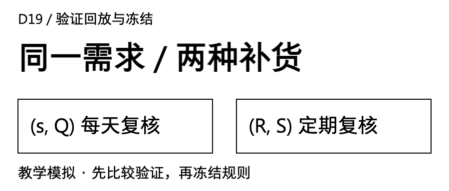
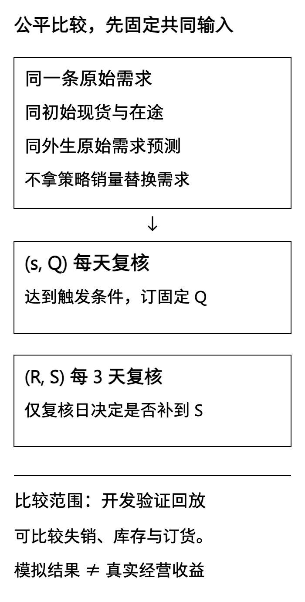
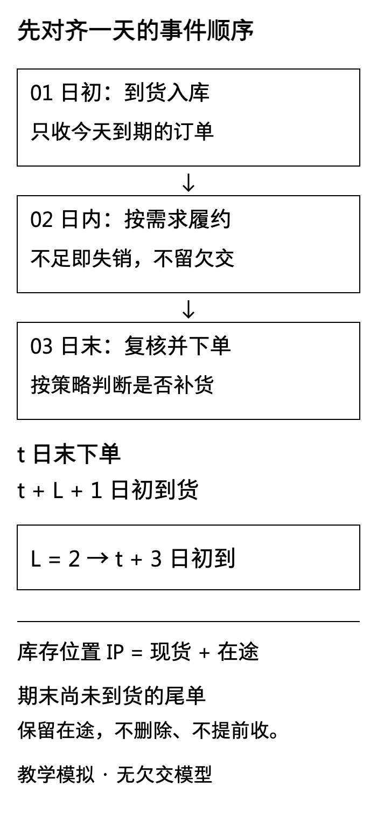
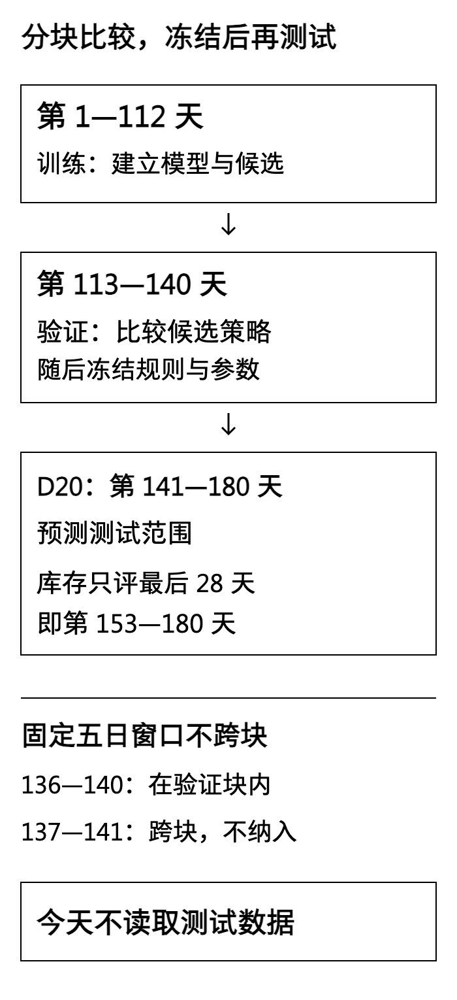

禾味采购想减少下单次数，门店希望每天都有货。匿名服装企业的销售希望少漏单，仓库却看到月底剩下了一大批成品。只报“满足率提高了”，回答不了这些人各自面对的问题。

[D16](/blog/fixed-batch-reorder-threshold/)讲了固定批量，[D17](/blog/periodic-review-order-up-to/)讲了定期补至目标，[D18](/blog/safety-stock-service-level/)拆开了安全库存与服务水平。今天把两种策略放回同一条需求路径，逐日记账，**先检查比较是否公平，再按写好的规则挑参数，最后冻结。**

这篇交付开发验证结果。D20才执行冻结后的测试，今天不提前打开测试标签。

## 一 先把比较的起点摆平

**本文的企业、门店、需求、日期、参数和订单全部为教学模拟，不对应真实客户、项目规则或经营收益。** 禾味是虚构的2店、8个食材SKU连锁，本篇只计算A店SKU01，单位为公斤；另外15条店×SKU组合没有生成或评估。匿名服装案例只计算一个成品库存节点，单位为件，不把面料米数、裁片数或工单产量混进来。

两案沿用D13实践包的两份140行开发CSV，来源与哈希保存在包内。完整计划仍为180天：1—112天训练，113—140天验证，141—180天留待D20。验证对应2026年7月27日至8月23日。这里不读取D9的sealed，不重跑其原测试结果。

这段验证数据已经在前几篇公开使用，D9也曾公布原测试段汇总，因此**不能把今天的验证或明天的延续实验包装为一份全新盲测**。今天能解决的是时序、复算和规则冻结，不能抹去历史上的信息暴露。

公平比较至少固定四件事：

- **需求路径相同。** 每个案例的九组候选面对同样28天原始需求。
- **初始状态相同。** 禾味现存78公斤、服装316件，初始在途均为空。初始现存为训练日均需求乘3后向上取整，不按某个候选的表现另给库存。
- **信息与预测器相同。** 固定使用周期7的季节性朴素法，以当日已经观察到的原始需求更新，不能把某个策略造成的实际销量反馈给预测器。
- **时间与统计窗口相同。** 都从第113日初开始，到第140日末结束，28天全部计分，不临时删掉表现差的启动日。

这里假设当天原始需求在日末完整可见。现实中缺货会截断销量，需求记录还可能延迟；若拿不到未满足需求，就必须先解决[D13讨论的观测问题](/blog/rolling-backtest-stockout-censoring/)，不能直接把这个模拟器接到销量表上。

[](images/d19-02_fair-comparison.png)

## 二 把一天拆开，先让七天的账对上

统一顺序为：**日初到货 → 当日需求与履约 → 日末复核下单。** L表示下单后的完整等待日数。t日末下单，t＋L＋1日初到货；L＝2时，第2日末下的单第5日初才能用。

本篇使用失销模型。需求没被即时满足，缺口当天离开，不进入欠交队列。设OH为现存、OO为有效在途，日末复核前的库存位置IP＝OH＋OO。每一步只需要加减和取较小值：

```text
当天可用 = 期初现存 + 当天到货
履约量 = min(当天可用, 原始需求)
失销量 = 原始需求 − 履约量
期末现存 = 期初现存 + 到货 − 履约量
期末在途 = 期初在途 + 新订单 − 到货
```

订单下达时只增加在途，不增加现货。失销也不能先从需求扣一次，再作为欠交从IP扣一次。

先看一条与主验证独立的禾味七日教学路径：需求为7、9、8、4、5、6、3公斤。初始现存12公斤，另有8公斤第2日初到货。每日复核，固定阈值s＝10、批量Q＝6，IP≤10时订一次6公斤；不是不断补单直到IP大于s。

<div role="region" tabindex="0" aria-label="禾味七日手算台账，单位公斤，可横向滚动" style="overflow-x:auto;max-width:100%;margin:28px 0">
<table id="d19-manual" style="min-width:650px;width:100%;max-width:none;display:table;margin:0;white-space:nowrap">
<thead><tr><th>日</th><th>期初现存</th><th>到货</th><th>需求</th><th>履约</th><th>失销</th><th>期末现存</th><th>下单</th><th>期末在途</th></tr></thead>
<tbody>
<tr><td>1</td><td>12</td><td>0</td><td>7</td><td>7</td><td>0</td><td>5</td><td>0</td><td>8</td></tr>
<tr><td>2</td><td>5</td><td>8</td><td>9</td><td>9</td><td>0</td><td>4</td><td>6</td><td>6</td></tr>
<tr><td>3</td><td>4</td><td>0</td><td>8</td><td>4</td><td>4</td><td>0</td><td>6</td><td>12</td></tr>
<tr><td>4</td><td>0</td><td>0</td><td>4</td><td>0</td><td>4</td><td>0</td><td>0</td><td>12</td></tr>
<tr><td>5</td><td>0</td><td>6</td><td>5</td><td>5</td><td>0</td><td>1</td><td>6</td><td>12</td></tr>
<tr><td>6</td><td>1</td><td>6</td><td>6</td><td>6</td><td>0</td><td>1</td><td>6</td><td>12</td></tr>
<tr><td>7</td><td>1</td><td>0</td><td>3</td><td>1</td><td>2</td><td>0</td><td>0</td><td>12</td></tr>
</tbody></table>
</div>

第3日只剩4公斤，面对8公斤需求，履约4、失销4。日末OH＝0、OO＝6，所以IP＝6，再订6。第4日虽然仍缺货，已有12在途，IP高于10，当天不再订。这个结果不一定令人满意，但它忠实执行了事前规则，不能看到缺货就悄悄加紧急单。

七天合计需求42、履约32、失销10，现存守恒为12＋20－32＝0。在途守恒为8＋24－20＝12；这12公斤在第8、9日分别到货，不能因为表格到第7日结束就删除。实践包还保留两案、两策略共四份独立七日手算核对，不用它们选参数。

[](images/d19-01_timing.png)

## 三 参数不多，也要先写清它保护哪几天

主验证的阈值随预测更新，不再使用七日手算里的常数10和20。冻结的是**预测规则、误差尺度和参数**，不是让未来每一天都套同一个需求总量。

### 每日固定批量：检查s，触发后只订一个Q

每天日末计算未来三天的预测合计，加一份缓冲，再向上取整：

```text
s(t) = ceil[未来3天预测合计 + z × scale3]
若 IP(t) ≤ s(t)，订货量 q(t) = Q；否则 q(t) = 0
```

ceil表示向上取到整数，例如51.2变成52。这里每日只复核一次，不是库存每动一下就能立刻补货的连续监控。若t日末未触发，要等到t＋1日末再次决策，届时新单在t＋4日初才到，所以阈值采用L＋1＝3天的离散复核保护长度。这个结构不是对所有(s,Q)系统通用的最优订货点公式。

### 周期补至目标：先过复核日这道门

固定R＝3，在第113、116、119……140日末复核。其他日即使IP很低，也不临时下单。复核时：

```text
S(t) = ceil[未来5天预测合计 + z × scale5]
q(t) = max[0, S(t) − IP(t)]
```

本次订单t＋3日初到，下一次复核在t＋3日末，下一次订单t＋6日初才到。站在t日末，目标要覆盖t＋1到t＋5这五天，所以保护期为R＋L＝5。不能只算两天，也不能把下一批已可用的t＋6再重复算进去。

两类策略的预测都来自最近已观察的七天。以未来五天为例，在同一日末一次性发出五个数，中间不偷用随后到达的新观测。第二天可以发布新版本，但不能倒改昨天已经下的单。

### 缓冲尺度只从训练段计算

对训练段内每个起点，先预测未来H天，再用这H天实际合计减预测合计，得到累计误差E。把所有E平方，求平均，再开平方，就是本篇的scaleH：

```text
E(t,H) = 未来H天实际合计 − 当时发出的H天预测合计
scaleH = √[(E1² + E2² + … + En²) / n]
```

例如两次累计误差为−3和4，尺度为√[(9＋16)÷2]≈3.54。这叫**累计误差的均方根RMS**，包含偏差，不是去掉均值后的样本标准差。z＝0、1、2在这里仅表示不加、加一份、加两份训练误差尺度，不能直接翻译成95%或其他正态服务保证。

训练起点从第7日末开始。H＝3时最晚起点109，共103个窗口；H＝5时最晚107，共101个窗口。所有实际目标都在第112日及以前，重叠窗口也不当作独立样本。

禾味的scale3≈5.1436公斤、scale5≈6.5688公斤，累计误差均值分别约0.1650、0.3168公斤。服装分别为5.6706、7.7511件，误差均值为1.3592、2.3366件。正均值表示训练里总体偏低估。这里不声称加缓冲就消除了偏差，尤其不能保证训练期的小波动能覆盖验证期的突增。

每案每日策略只有2个Q×3个z，共6组；周期策略固定R＝3，仅3个z，共3组。Q按训练日均的2倍、4倍向上取整：禾味52、103公斤；服装211、422件。公斤整单位也是本次沙盘的精度约定，不是企业采购包装或MOQ。

## 四 排名之前，先决定怎样比较

候选与排序规则写入protocol.json。每个案例、每类策略分别保留一组配置，顺序是：

1. 全28天失销合计少的在前。
2. 失销相同，比较28个日末现存的平均值，较小的在前。
3. 再相同，非零订单次数较少的在前。
4. 仍相同，以参数JSON的固定字典序打破平局。

这是一个明确的教学偏好：先少失销，再少占用现货。没有货值、持有成本、下单成本和失销损失，**不能称为经济最优**。若业务愿意容忍一定缺口换取更低库存，应重新制定开发实验，而不是看完这张表临时改“冠军”的标准。

平均库存使用日末现存之和÷28，是一个离散时点指标，不是日内时间加权库存，也不含在途。数量满足率＝全28天履约合计÷原始需求合计；总需求为0时为N/A。订单次数只数q＞0，不把“打开了复核窗口但没下单”算成一单。本篇不计算周期服务概率，更不把需求满足率或预测误差改名为服务概率。

## 五 禾味：少下四次单，够不够成为采购理由

九组候选全部公开。表中“日”表示每日固定批量，“周”表示每3天补至目标；数量单位均为公斤，平均值四舍五入至两位，排名使用未舍入值。

<div role="region" tabindex="0" aria-label="D19 hewei验证参数表，可横向滚动" style="overflow-x:auto;max-width:100%;margin:28px 0">
<table id="d19-hewei" style="min-width:630px;width:100%;max-width:none;display:table;margin:0;white-space:nowrap">
<thead><tr><th>策略</th><th>z</th><th>失销</th><th>平均日末现存</th><th>订单次数</th><th>末现存</th><th>末在途</th></tr></thead><tbody>
<tr><td>日 / Q52</td><td>0</td><td>4</td><td>24.64</td><td>14</td><td>20</td><td>52</td></tr>
<tr><td>日 / Q103</td><td>0</td><td>0</td><td>53.00</td><td>8</td><td>61</td><td>103</td></tr>
<tr><td>日 / Q52</td><td>1</td><td>0</td><td>34.07</td><td>14</td><td>16</td><td>52</td></tr>
<tr><td>日 / Q103</td><td>1</td><td>0</td><td>60.36</td><td>8</td><td>61</td><td>103</td></tr>
<tr><td>日 / Q52</td><td>2</td><td>0</td><td>35.93</td><td>15</td><td>16</td><td>104</td></tr>
<tr><td>日 / Q103</td><td>2</td><td>0</td><td>60.36</td><td>8</td><td>61</td><td>103</td></tr>
<tr><td>周 / R3</td><td>0</td><td>12</td><td>29.14</td><td>10</td><td>44</td><td>72</td></tr>
<tr><td>周 / R3</td><td>1</td><td>0</td><td>34.11</td><td>10</td><td>45</td><td>78</td></tr>
<tr><td>周 / R3</td><td>2</td><td>0</td><td>40.36</td><td>10</td><td>52</td><td>78</td></tr>
</tbody></table>
</div>

按既定规则，每日策略留下Q＝52、z＝1；周期策略留下R＝3、z＝1。两者28天需求都是738公斤，失销都是0。平均日末现存分别为34.0714和34.1071公斤，差约0.036公斤，小到不应被包装成显著业务优势；订单次数分别14和10。

周期策略少下4次单，却不能直接写“节省4次配送费”。订单可能合并配送，合同可能按车、按重或按批收费，本篇都没有这些信息。两者末现存分别16和45公斤，在途52和78公斤，也提醒我们：**相同平均现存，不代表期末承诺和下一段状态相同。**

每日策略守恒为78＋676－738＝16，在途为0＋728－676＝52；周期策略为78＋705－738＝45，在途为0＋783－705＝78。把尾单扔掉，既破坏守恒，也会使某些参数看上去少订了货。

禾味的生鲜场景还应关心保质期、批次、报损和配送容量。但本篇不加这些功能，表中的库存无法直接换算成可销售库存天数或节约金额。

## 六 匿名服装：小网格里最靠前，也可能仍然缺货

服装协同里，同一批成品可能同时出现在采购单、外协回货和验收记录中。业务接口应先按供给去重，明确验收完成才进入可用现存，未到的有效供给才进入在途。**今天的模拟器假设这一步已经做好**，并没有从真实系统抽取或清洗订单。

服装九组候选的需求均为3374件，初始现存均316件、在途均0：

<div role="region" tabindex="0" aria-label="D19 apparel验证参数表，可横向滚动" style="overflow-x:auto;max-width:100%;margin:28px 0">
<table id="d19-apparel" style="min-width:630px;width:100%;max-width:none;display:table;margin:0;white-space:nowrap">
<thead><tr><th>策略</th><th>z</th><th>失销</th><th>平均日末现存</th><th>订单次数</th><th>末现存</th><th>末在途</th></tr></thead><tbody>
<tr><td>日 / Q211</td><td>0</td><td>180</td><td>114.68</td><td>15</td><td>76</td><td>211</td></tr>
<tr><td>日 / Q422</td><td>0</td><td>60</td><td>225.96</td><td>8</td><td>378</td><td>0</td></tr>
<tr><td>日 / Q211</td><td>1</td><td>180</td><td>114.68</td><td>16</td><td>76</td><td>422</td></tr>
<tr><td>日 / Q422</td><td>1</td><td>60</td><td>225.96</td><td>8</td><td>378</td><td>0</td></tr>
<tr><td>日 / Q211</td><td>2</td><td>180</td><td>129.75</td><td>16</td><td>76</td><td>422</td></tr>
<tr><td>日 / Q422</td><td>2</td><td>60</td><td>225.96</td><td>8</td><td>378</td><td>0</td></tr>
<tr><td>周 / R3</td><td>0</td><td>283</td><td>169.54</td><td>10</td><td>193</td><td>303</td></tr>
<tr><td>周 / R3</td><td>1</td><td>268</td><td>174.54</td><td>10</td><td>201</td><td>303</td></tr>
<tr><td>周 / R3</td><td>2</td><td>260</td><td>180.54</td><td>10</td><td>209</td><td>303</td></tr>
</tbody></table>
</div>

每日策略的Q＝422三档z结果相同，按固定平局规则留下z＝0；周期策略留下z＝2。每日策略失销60件、平均日末现存225.9643件；周期策略失销260件、平均180.5357件。对应数量满足率约98.22%与92.29%。

这组结果把取舍摆得很清楚：每日大批量在这条模拟路径上少失销200件，却多占用约45.43件平均日末现存。不是“每天检查”本身就有这种固定收益，批量、复核节奏、预测和需求路径共同决定了轨迹。每类策略内选一组，也没有证明这两组位于所有可能策略的最优边界。

周期策略的z从0加到2，失销从283降到260，并没有消失。训练尺度较小，验证路径有训练期没有覆盖好的突增，继续在相同验证段扩大参数搜索，会逐渐把它用成调参材料。今天按小网格停止，把缺口如实留在结果里。

服装末现存分别378与209件、末在途0与303件。每日组316＋3376－3314＝378；周期组316＋3007－3114＝209，在途0＋3310－3007＝303。库存位置和现货不能混成同一列，再凭一项低就宣布策略更好。

这里仍使用失销，**不表示真实服装合同允许订单直接消失**。若必须延期交付，需要改成欠交模型，约定旧欠交与新订单的优先级，并重做指标。本篇没有BOM、齐套、工序能力、良率或换线模型，不能推导排产收益。

## 七 冻结的是完整实验，不只是四个参数

本次冻结四份配置：禾味每日Q52/z1、周期R3/z1；服装每日Q422/z0、周期R3/z2。除了这些数，还保存预测器、训练尺度、取整、L、复核相位、失销口径、初始现存与在途、输入哈希和程序哈希。

冻结发生在开发验证排名之后。初版曾拟在第141—152日运行库存热身。首轮D19验证结果出来后，制作审查改为直接从最后28天同态起跑，因此当前明确标识为v2，保留修订说明，不能声称整份现行协议在首次验证前已经冻结。D19候选、排序和所有数值结果不变，修订后重新冻结核验。D20计划明确为：**库存直接从第153日初开始，以冻结的78公斤或316件现存、空在途重置；第153—180日全28天计分，不加库存热身，也不沿用验证末库存。** 两策略在各自案例仍使用同一初态。周期复核固定153、156……180，不按需求高低移动。

预测测试仍覆盖141—180完整40天。到了D20，第153日的预测可以使用当时已观察的第141—152日原始需求，但今天不读取它们，也不预先运行库存。参数与训练误差尺度不再重估，只允许按冻结预测规则加入已经到达的需求观测。

5天评价窗口不能跨分块：验证段起点112—135，对应113—117到136—140，共24个；未来完整40天预测测试起点140—175，共36个。**“评价窗口不跨块”约束的是要读取实际标签来评分的窗口。** 第140日末仍可以按已知历史预测141—145并下单，订单留在期末在途；这不等于读取141—145的实际需求，也不把它们纳入D19评分。

[](images/d19-03_freeze.png)

回执用于检出内容漂移，不是不可篡改的第三方时间证明。若审查后改代码或规则，必须说明修订并生成对应版本，再核验结果，不能用后来生成的哈希冒充更早的事前登记。D20若表现不理想，先报告原配置的结果；改参数就另开实验，不继续宣称同一次冻结测试。

## 八 下载后，先尝试把它算错

下载[D19库存验证实践包](/downloads/d19-inventory-validation-practice.zip)，使用Python 3.10或以上，在解压目录运行：

```bash
python -m unittest -v
python run.py
```

计算只用标准库，按脚本所在目录查找数据。包内保留两案140行开发CSV、协议、训练窗口明细、全部候选、逐日台账、订单事件、期末在途、七日手算、验证汇总与冻结配置；不包含测试段。重复运行应重现同样结果，不能静默把漂移后的文件重新登记为“原冻结版”。

对抗检查重点是六组问题：

- **守恒攻击：** 每日需求是否等于履约加失销？现存、在途是否分别守恒，且从不为负？
- **时间攻击：** 到货有没有提前一天或重复入账？L＝0是否仍是次日初到货？下单是否错误增加当天现货？
- **信息攻击：** 改变未来需求，是否改变此前订单？改变某策略初始库存和销量，是否污染公共预测？
- **边界攻击：** 零需求、非法数量、重复在途ID、已经过期的初始到货日是否被正确处理或拒绝？
- **比较攻击：** 是否遗漏差参数、移动复核日、给某组更多起始库存，或先四舍五入再排名？
- **交付攻击：** 尾单有没有保留？解压后能否独立运行？正文表格、CSV与冻结配置是否一致？

另附[文章Markdown与配图](/downloads/d19-inventory-validation-article.zip)、[黑白配图与独立重绘工具](/downloads/d19-inventory-validation-images.zip)。封面为900×383，正文图按原比例保留，重绘工具与280/350宽预览一并提供。

**今日证据卡：** 两案在同一初态、同一需求与预测规则下完成28天验证。禾味两策略均无失销，平均现存接近、订单14次与10次；服装每日大批量少失销但平均现存更高。四份配置连同时间约定与尾单已冻结，所有数量均为模拟，D20测试尚未运行，不据此承诺真实收益。

下一步不是把结果写得更漂亮，而是保持这份配置不动，让后续数据来检验它。
