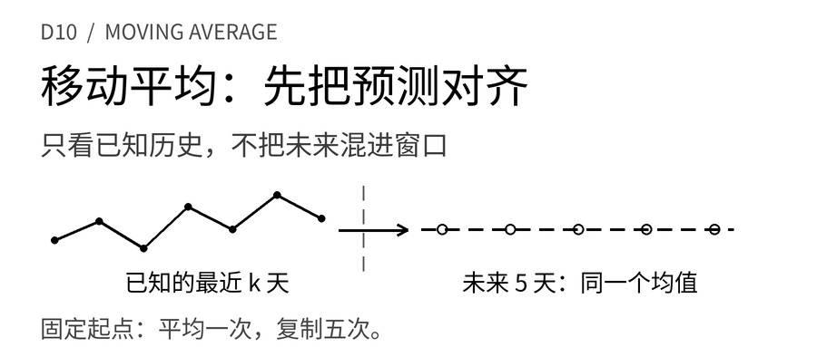
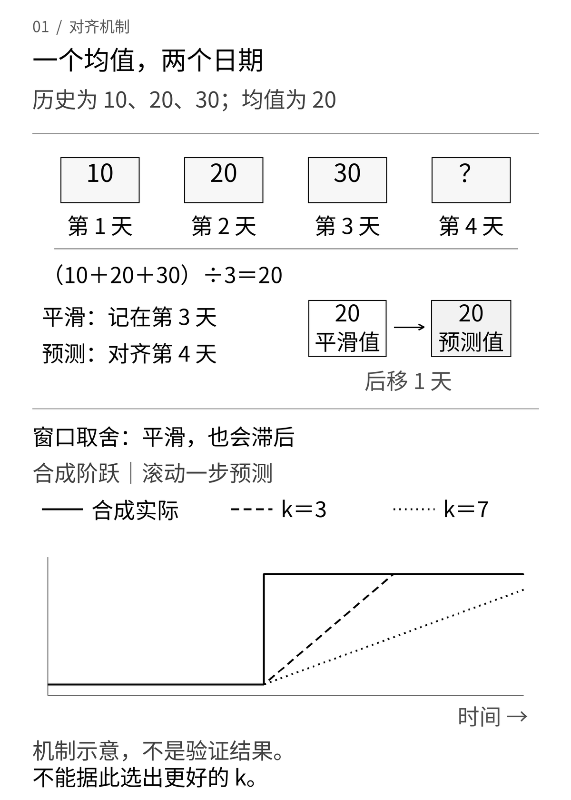
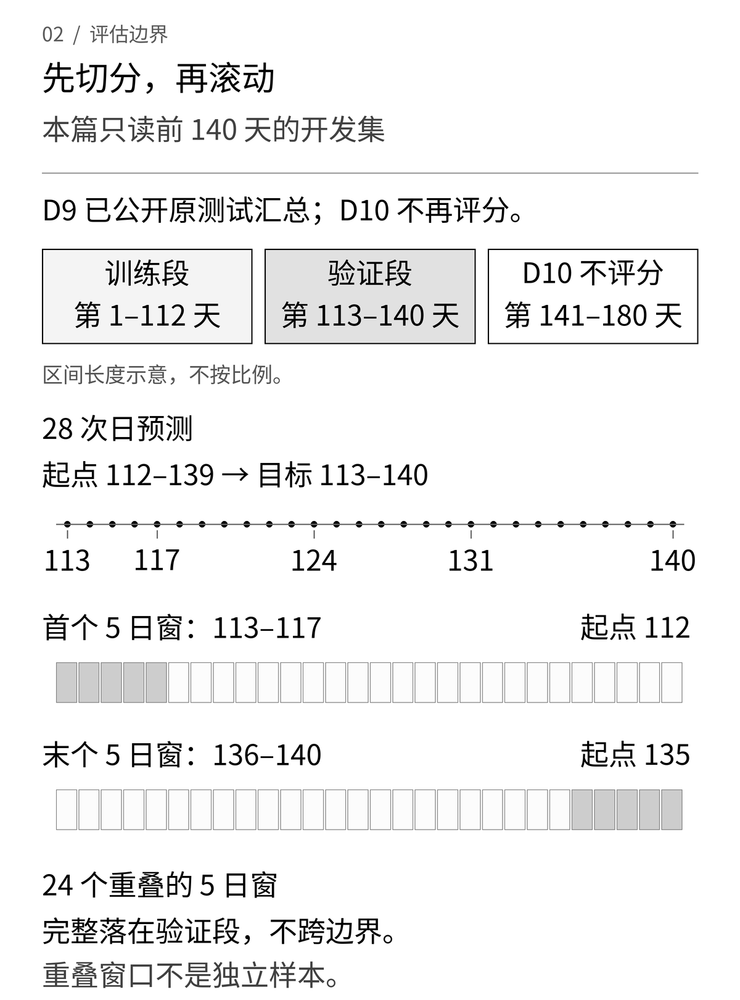
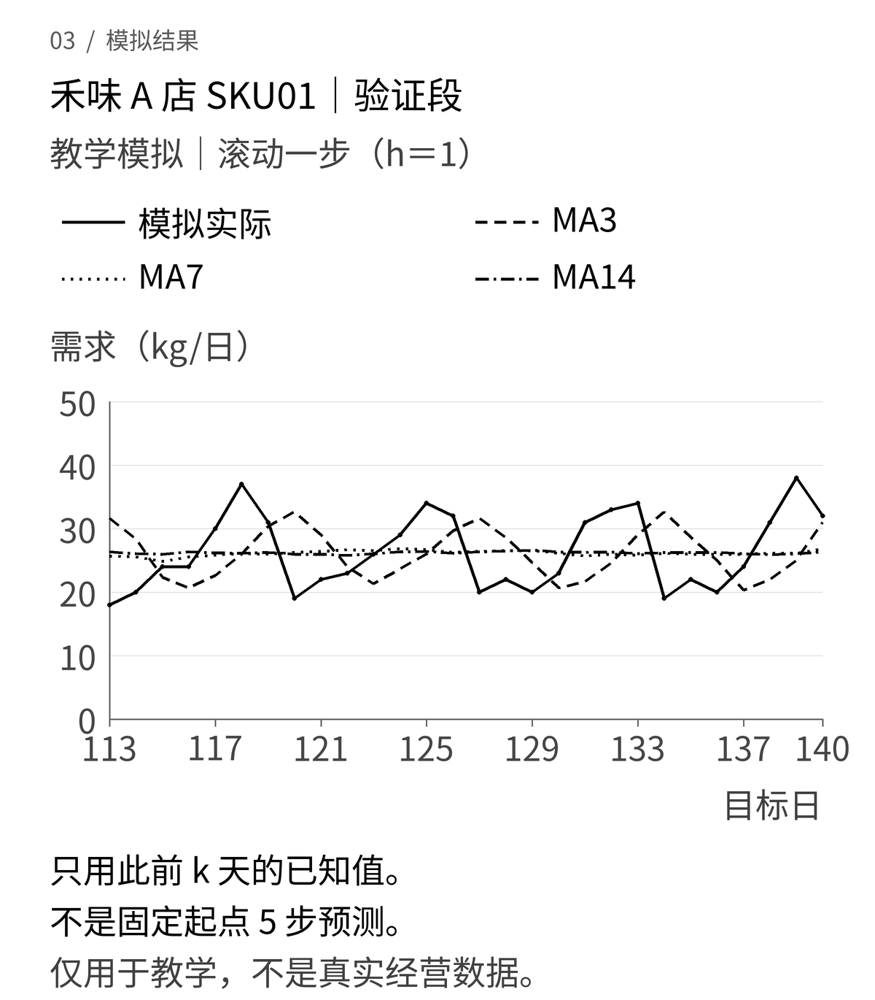
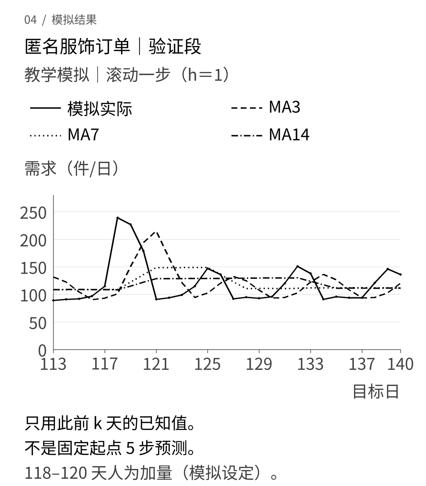

昨天多卖了一些，明天就应该多备一些吗？门店可能遇上临时团餐，服装订单可能赶上一次活动。如果只复制昨天，预测会跟着偶然波动走；如果把很久以前的数据一起平均，又可能跟不上新的需求水平。

移动平均给出一个容易检查的折中：**只取最近k天已经观察到的需求，用它们的平均值预测下一天。** 窗口多长，就是这次要比较的参数。

[D9用上周同一天建立季节性朴素基线](/blog/seasonal-naive-demand-forecast/)。D10不换数据，也不先假定移动平均更好，而是把3天、7天和14天窗口放进同一评价边界。我们会看到，曲线更平滑不等于预测更准；五天总量的排序，也未必与单日误差相同。

这篇文章面向需要与业务、算法和工程一起定义需求预测的供应链产品经理。目标是把“最近”到底多近、预测当时知道什么、结果服务哪种决策说清楚，而不是直接给出采购量或排产单。

## 一 先沿用数据，再比较方法

**数据与案例声明。** 所有情景、日期、数量和活动均为教学模拟，不对应真实品牌、真实项目或经营收益。禾味是虚构餐饮连锁，背景仍为2家门店、8个食材SKU；核心实验只运行**A店、SKU01、一条公斤/日需求序列**。匿名服装生产协同另用一条**件/日的终端订单需求序列**，不是工厂已排产的件数。两条序列分别计算，单位不混加。

第一周的2店、8SKU、14天样本用于学习数据与指标，不能冒充本次完整预测历史。这里复用[D9-v1公开实践包](/downloads/d9-seasonal-naive-practice.zip)：从2026年4月6日至10月2日的180天模拟需求，保留原来的**112天初始训练、28天验证、40天原测试**。D10只读取前140天的两份开发CSV，逐字节核对SHA-256；没有换种子、加门店、延长日期或用另一套大数据集替换。

主实验依然假设没有缺货，需求完全可观测。禾味的星期基础需求依次为20、22、21、24、28、36、32公斤，再加固定生成机制产生的小扰动。服装有星期差异、每14天增加1件的缓慢趋势，并在第118—120天每天加入90件模拟活动增量。这些结构早在D9就已经写定，不是看到D10结果后添加的解释。

如果真实数据只有成交销量，就要先问有没有缺货、休店和渠道限流。顾客需要30公斤而门店只能供给20公斤，记录下的20不能自动成为真实需求。移动平均不会凭空恢复缺失的10公斤；把订单批量、生产量或被库存截断的销量当作需求标签，计算再准确也可能回答错问题。

## 二 平均哪几天，比平均公式更重要

设T为最后一个**已经完整观察到需求**的日子，k为窗口长度。本文采用简单、等权、向后看的移动平均预测：

```text
ŷ(T+h | T) = [y(T−k+1) + … + y(T)] / k
h = 1, 2, …, H
```

竖线右侧的T是预测起点，不是目标日。若在第T天日终之后预测第T+1天，可以使用y(T)；若第T天尚未结束，就不能因为表里有一列“今天”而把全天真实需求提前用进去。真实系统还要定义数据入库延迟与截止时刻。

假设最近三天需求为10、20、30，k=3，那么下一天预测是**20**。若在同一起点一次预测未来五天，本篇规则给出20、20、20、20、20，合计100。五天内没有新观测，因此均值不变。

这里没有把预测值塞回窗口继续平均，也没有拿明天的真实需求更新后天。前者会变成另一种递归规则，后者则使用了预测时尚不存在的信息。等明天真的结束，再向前滚动一个起点，才可以用新观测计算一份新的预测；新旧预测应保留各自的起点，不能覆盖后假装都是今天就知道的。

### 一条平滑曲线，为什么还不能直接评分

同样的均值，放在哪一行，含义不同。

- **第t行的历史平滑值**：平均第t−k+1至t天，包含当天实际值，描述截至当天的局部水平。
- **第t行的提前一天预测**：只能平均第t−k至t−1天，不包含预测目标当天。
- **居中移动平均**：使用目标时刻两边的观测，适合事后分析趋势，不能直接作为当时可发布的预测。

例如10、20、30的均值20，既可以标在第3天，表示前三天的平滑结果；也可以标在第4天，表示第3天结束时对明天的预测。若把它标在第3天并与第3天的30比较，就没有在评估“提前一天”的预测。



使用按日期升序、一天一行的完整序列时，常见的pandas表达式是：

```python
# 仅说明目标日期对齐；本篇实践包不依赖pandas。
smooth = y.rolling(window=k, min_periods=k).mean()
one_day_forecast = smooth.shift(1)
```

这里的`shift(1)`把前一天已算好的均值放到下一天目标行；不传`freq`，不移动日期索引。它不能替你检查重复日期、缺日、实体混合或数据是否及时可得。窗口与标签位置的行为可核对[pandas rolling官方文档](https://pandas.pydata.org/docs/reference/api/pandas.DataFrame.rolling.html)和[shift官方文档](https://pandas.pydata.org/docs/reference/api/pandas.DataFrame.shift.html)。[FPP3关于移动平均的说明](https://otexts.com/fpp3/decomposition.html#moving-averages)主要讨论趋势分解中的平滑，尤其要注意居中窗口与本篇向后看预测的区别。

### k变大，换来的是什么

在每个观测等权的规则下，一天增加90，仍留在窗口期间就会给均值增加90/k。窗口越短，单个新观测占的权重越大；窗口越长，单次冲击被摊得更薄，却也留得更久。若需求水平持续上升，较长窗口会混入更多较低的旧值，更容易滞后。

因此，3、7、14不代表“低、中、高级模型”。短窗口可能适合快速变化但噪声不大的局部水平，长窗口可能适合水平较稳定、偶然波动较多的序列。这只是选择候选的理由，不能代替验证。

尤其不要把**7天平均**误叫作**保留星期规律**。平均一整周后，周一和周六都被压成同一个水平；D9的[季节性朴素](https://otexts.com/fpp3/toolbox.html#seasonal-na%C3%AFve-method)则分别复制最近的周一和周六。前者估计局部平均量，后者保留一周内部的高低形状。

## 三 用禾味的七个数把预测手算出来

仍取D9的T=112，也就是2026年7月26日周日结束。最近七天需求为：

```text
第106—112天：19、25、19、22、28、38、29公斤
最近三天：28、38、29，合计95
最近七天：合计180
最近十四天：合计369
```

<p><small>窄屏可左右滑动表格，查看完整列。</small></p>
<div class="d10-table-scroll" role="region" tabindex="0" aria-label="禾味第112天手算预测（可横向滚动）" style="overflow-x:auto;max-width:100%;margin:28px 0">
<table style="min-width:560px;width:100%;max-width:none;display:table;margin:0;white-space:nowrap">
<thead><tr>
<th scope="col" style="white-space:nowrap;text-align:left">窗口</th>
<th scope="col" style="white-space:nowrap;text-align:right">下一天预测</th>
<th scope="col" style="white-space:nowrap;text-align:right">固定起点未来五天合计</th>
</tr></thead>
<tbody>
<tr>
<td style="white-space:nowrap;text-align:left">k=3</td>
<td style="white-space:nowrap;text-align:right">95÷3＝31.6667公斤</td>
<td style="white-space:nowrap;text-align:right">158.3333公斤</td>
</tr>
<tr>
<td style="white-space:nowrap;text-align:left">k=7</td>
<td style="white-space:nowrap;text-align:right">180÷7＝25.7143公斤</td>
<td style="white-space:nowrap;text-align:right">128.5714公斤</td>
</tr>
<tr>
<td style="white-space:nowrap;text-align:left">k=14</td>
<td style="white-space:nowrap;text-align:right">369÷14＝26.3571公斤</td>
<td style="white-space:nowrap;text-align:right">131.7857公斤</td>
</tr>
</tbody>
</table>
</div>

上表每个五天总量都是“同一个均值×5”，底层计算不先舍入。D9在这个起点的前五天预测则为19、25、19、22、28，合计113公斤。两种规则使用的都是过去信息，却作了不同假设。

最近三天包含周末高峰，k=3把31.6667带到了周一；k=7减弱了这种短期偏高，但也无法单独给周六一个高值。这里还没有必要争论哪一列更漂亮。先固定评价任务，再看同一组目标日上的误差。

## 四 只在验证段比较，不借原测试段选窗口

初始训练是第1—112天，验证是第113—140天。移动平均没有需要拟合的回归系数，但仍要在验证段比较k；112天定义首次预测时可见的历史，不表示算法必须有112天才能运行。

本篇保留D9的两种[滚动起点评价](https://otexts.com/fpp3/toolbox.html#time-series-cross-validation)，所有候选与季节性朴素基线使用完全相同的起点与目标：

1. **逐日滚动、提前一天。** 第112天预测113天，看到113天真实需求后，第113天预测114天，直到第139天预测140天，共28个目标日。
2. **逐日起点、每次固定预测五天。** 第112天一次预测113—117天，第113天一次预测114—118天，直到第135天预测136—140天，共24个完整窗口。

第二种评价的每份五天预测内部不更新观测；不同起点之间可以使用当时已经到达的历史。不能先做五次逐日一步预测，再把它们拼起来，称为某一个起点已经发布的五天预测。



第136天出发的137—141天会跨进原测试段，所以不计入验证。24个窗口彼此重叠，不是24次独立实验；也不能把它们展开的120个预测目标误称为120个独立日期。

```text
日MAE = 28个目标日的 |预测日需求 − 实际日需求| 之和 / 28

五天合计MAE = 24个窗口的
              |五天预测合计 − 五天实际合计| 之和 / 24
```

日需求序列及日MAE以公斤/日或件/日表示，五天合计MAE以公斤或件表示，评价对象、单位与聚合方式均不相同。五天内有高估也有低估时，总量可能相互抵消，不能因此说每一天都准确。

**关于原测试段。** 第141—180天仍保留原分块身份，但本篇不读取其标签、不重新评分、不据此选择k。D9已经公开过这段数据的测试汇总，所以它也不能被包装成一份对后续模型从未暴露过的新盲测。D10实践包只带前140天开发数据；如果以后要报告经多轮选择后的最终泛化能力，需要另行约定新的未触碰数据。下文全部数字都是验证结果，不是最终测试成绩。

## 五 禾味案例 平滑掉周末高峰，也可能丢掉有用信息

禾味A店SKU01的模拟需求有明显星期差异。门店若只问“最近一天是否偶然偏高”，移动平均能提供一个局部水平参照；若问“下周六准备多少”，把每天都预测成周平均就可能忽略真正需要保留的差异。

<div class="d10-table-scroll" role="region" tabindex="0" aria-label="禾味验证集方法比较（可横向滚动）" style="overflow-x:auto;max-width:100%;margin:28px 0">
<table style="min-width:560px;width:100%;max-width:none;display:table;margin:0;white-space:nowrap">
<thead><tr>
<th scope="col" style="white-space:nowrap;text-align:left">方法</th>
<th scope="col" style="white-space:nowrap;text-align:right">日MAE（公斤/日）</th>
<th scope="col" style="white-space:nowrap;text-align:right">五天合计MAE（公斤）</th>
</tr></thead>
<tbody>
<tr>
<td style="white-space:nowrap;text-align:left">移动平均 k=3</td>
<td style="white-space:nowrap;text-align:right">6.7143</td>
<td style="white-space:nowrap;text-align:right">24.7083</td>
</tr>
<tr>
<td style="white-space:nowrap;text-align:left">移动平均 k=7</td>
<td style="white-space:nowrap;text-align:right">5.3214</td>
<td style="white-space:nowrap;text-align:right">9.3750</td>
</tr>
<tr>
<td style="white-space:nowrap;text-align:left">移动平均 k=14</td>
<td style="white-space:nowrap;text-align:right">5.3852</td>
<td style="white-space:nowrap;text-align:right">9.1518</td>
</tr>
<tr>
<td style="white-space:nowrap;text-align:left">D9季节性朴素，周期7</td>
<td style="white-space:nowrap;text-align:right">1.7857</td>
<td style="white-space:nowrap;text-align:right">3.2917</td>
</tr>
</tbody>
</table>
</div>



图中每一个预测点都来自前一天的起点，**不是在第112天一次画出后面28天**。表格与图由同一份开发CSV复算，完整精度和逐行明细保存在下载包中。

在这份事先写入稳定星期规律、小幅噪声的模拟数据里，三个移动平均窗口都没有胜过季节性朴素。k=7的日MAE略低于k=14，但五天合计误差次序相反。差距只能描述这28天，不能据此制定“餐饮一律用7天”的行业规则。

产品经理更有用的追问是：业务需要一个近期平均水平，还是每天的不同需求？若周末峰值确实稳定，不能为了让看板曲线平滑而丢掉它。若菜单、营业时间和客群刚刚改变，D9的星期复制同样可能失效。需要补充变化标记并设计新的验证，而不是从这张图直接推出哪天采购多少公斤。

## 六 匿名服装协同案例 活动结束了，均值还会记多久

匿名服装生产协同场景使用独立的模拟终端订单序列。采购、生产和仓库可以借需求预测讨论风险，但已有订单承诺、面料可用量、产能和交付期限仍需单独处理；预测件数不等于可以直接下发的生产件数。

第118—120天的模拟活动每天加90件，实际订单需求分别为239、227、179件。第117天结束时，最近三天还没有这次活动，k=3对第118天的预测只有101.3333件。它不会因为叫作“需求预测”，就自动知道明天有一场活动。

等到第120天结束，最近三天正好全是活动日。k=3对已经结束活动的第121天预测为**215件**，而当天实际为**91件**。k=7在同一起点预测148.5714件，k=14预测128.6429件：长窗口降低了冲击的高度，但没有消除它。

仅看事先设定的活动增量，三个活动日全部进入窗口时，对均值的附加量分别为90、270÷7≈38.5714、270÷14≈19.2857件。最后一个活动日是第120天；若窗口为14天，它直到第134天结束后的新预测才完全退出。均值把事件影响分摊到后续多个起点，并不理解“活动已结束”。这段分解用于解释机制，没有把活动增量事后扣掉再报一个更好成绩。



<div class="d10-table-scroll" role="region" tabindex="0" aria-label="匿名服装验证集方法比较（可横向滚动）" style="overflow-x:auto;max-width:100%;margin:28px 0">
<table style="min-width:560px;width:100%;max-width:none;display:table;margin:0;white-space:nowrap">
<thead><tr>
<th scope="col" style="white-space:nowrap;text-align:left">方法</th>
<th scope="col" style="white-space:nowrap;text-align:right">日MAE（件/日）</th>
<th scope="col" style="white-space:nowrap;text-align:right">五天合计MAE（件）</th>
</tr></thead>
<tbody>
<tr>
<td style="white-space:nowrap;text-align:left">移动平均 k=3</td>
<td style="white-space:nowrap;text-align:right">35.5238</td>
<td style="white-space:nowrap;text-align:right">169.2361</td>
</tr>
<tr>
<td style="white-space:nowrap;text-align:left">移动平均 k=7</td>
<td style="white-space:nowrap;text-align:right">30.1531</td>
<td style="white-space:nowrap;text-align:right">120.1964</td>
</tr>
<tr>
<td style="white-space:nowrap;text-align:left">移动平均 k=14</td>
<td style="white-space:nowrap;text-align:right">30.2143</td>
<td style="white-space:nowrap;text-align:right">109.4524</td>
</tr>
<tr>
<td style="white-space:nowrap;text-align:left">D9季节性朴素，周期7</td>
<td style="white-space:nowrap;text-align:right">21.1071</td>
<td style="white-space:nowrap;text-align:right">115.8750</td>
</tr>
</tbody>
</table>
</div>

这里出现了值得保留的矛盾：季节性朴素的日MAE最低，但k=14的五天合计MAE略低于它。总量上的部分抵消、活动影响在时间上的分布，都会改变排序。不能摘下109.4524这一格就写“移动平均优于季节性朴素”，也不能只看日误差就断言它对所有提前期总量任务都无用。

如果业务真正关心五天补货周期，应事先把五天需求设为主要评价对象；若关心每日产能负荷，单日误差、峰值低估和交付约束更直接。本文并列展示两个任务，不事后挑出有利指标宣布一个最终模型胜出。两个案例的公斤误差与件误差也不能相加或直接排名。

对于活动，后续合理的工作是补充**在预测起点就已知**的活动日历、力度和渠道信息，区分可重复活动与一次性事件，再建立新候选。看到活动实际结果后人工加减90件，只能算事后情景分析，不能混入本轮预测分数。一次模拟活动也不支持“减少多少库存”“节省多少成本”之类业务效果结论。

## 七 把移动平均接进产品前，先约定失败时怎么办

最近k天不是最近k条随便找到的记录。按日预测时，缺一天就可能把窗口偷偷变长；把门店合并后平均，又可能把不同单位和营业模式混在一起。本篇数据入口要求日期连续、唯一、升序，需求非负且有限，并核对日编号与分块。缺值、非法文本、NaN、无穷值、重复或缺失日期都明确报错，不静默丢行或补零。

**零需求合法，缺测不是零。** 真实确认的连续零需求可以得到零预测；系统没有收到记录则需要修复数据。若业务包含退货形成的负净销量，要先重新定义预测目标，而不是在本函数里取绝对值或截成零。

**历史不足k天时拒绝计算。** 新SKU只有5天历史，却被配置为k=14，不能悄悄改成5天均值还叫“14天模型”。产品可以明确设计冷启动回退，例如同类SKU或人工输入，但要另标方法、来源和适用范围，本篇没有把它混入比较。

**异常不能仅凭数值高就删除。** 高峰可能是促销，也可能是录入错误或真实需求变化。先确认事件与证据，再决定是否更改数据契约。无论采用截尾、异常修正还是事件模型，都属于新的候选，需要在同一时间边界下重新验证；不能看见评分不好才清洗那些“碍事”的点。

对业务侧，一个可用的预测记录至少应带上：对象和单位、预测起点、目标日期、k、可见历史的最后日期、数据与模型版本。这样采购问“这份五天需求昨天为什么变了”时，团队才能区分是新增了一天真实需求、修正了历史记录，还是擅自换了参数。

## 八 下载后怎样主动尝试推翻它

下载 [D10移动平均实践包](/downloads/d10-moving-average-practice.zip)，解压后在目录内执行：

```bash
python -m unittest -v
python run.py
```

需要Python 3.10或以上，无第三方Python依赖，无需Docker。输入是D9公开包中原字节复制的两份开发CSV，包含第1—140天；运行先核对输入哈希，再生成验证明细和汇总。不包含原测试标签，也没有读取或评分测试的入口。

`results/daily_predictions.csv`保留28个目标日、每种方法的预测与实际；`results/five_day_windows.csv`保留24个固定起点窗口的实际与预测合计；`results/validation_summary.json`对应正文两张比较表；`results/origin112_examples.json`对应手算。结果文件由脚本重算，不能靠修改文章中的表格制造“提升”。

另有[黑白配图与重绘脚本](/downloads/d10-moving-average-images.zip)和[文章Markdown与配图](/downloads/d10-moving-average-article.zip)。配图包带同一份开发CSV；预测计算仍只需标准库，重绘图片另需Pillow、fontTools和指定的简体中文字体，具体命令见包内说明。

检查不只问程序有没有跑完，还要故意给它不该成立的条件：

- **手算基准。** 10、20、30的下一步必须是20；历史1至14时，k=3、7、14必须分别为13、11、7.5，固定起点五步分别重复这些值。
- **阻断递归与反馈。** 历史2、4、6、8、10，k=3固定五步必须全为8。不能出现把预测8放回窗口得到的第二步26/3，也不能读入未来实际值。
- **污染未来。** 保持起点之前不变，把后续需求改成极大值、负值或非法对象，把未来日期改坏，该起点的预测仍应不变。数据入口会拒绝坏数据，但按起点预测的函数必须先截取可见历史，不能先校验整张未来表再声称与未来无关。
- **核对边界。** 验证第一份五天目标为113—117，最后一份为136—140，恰好24份；137—141必须被排除。零合法，短历史、非法k与步长、布尔值充当整数等情况都应有明确行为。

这些测试用独立写出的预期值核对实现，不把“同一个函数算两遍相等”当成正确性证明。它们证明的是当前规则和具体边界经得起这些检查，不证明能准确预测所有真实业务。

本篇得到的结论并不复杂：移动平均是一个透明的局部水平基线，窗口长度控制新旧信息的权重，也决定冲击留下多久。对供应链产品经理而言，先明确预测发布时点和业务评价目标，比把窗口从7改成14更重要。等下一种方法加入时，仍然要回答同样的问题：它在当时能看到什么，在哪些相同的目标上确实做得更好。
