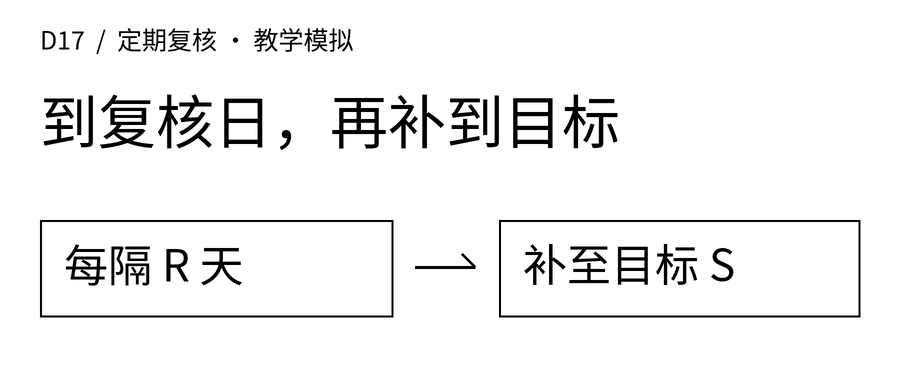
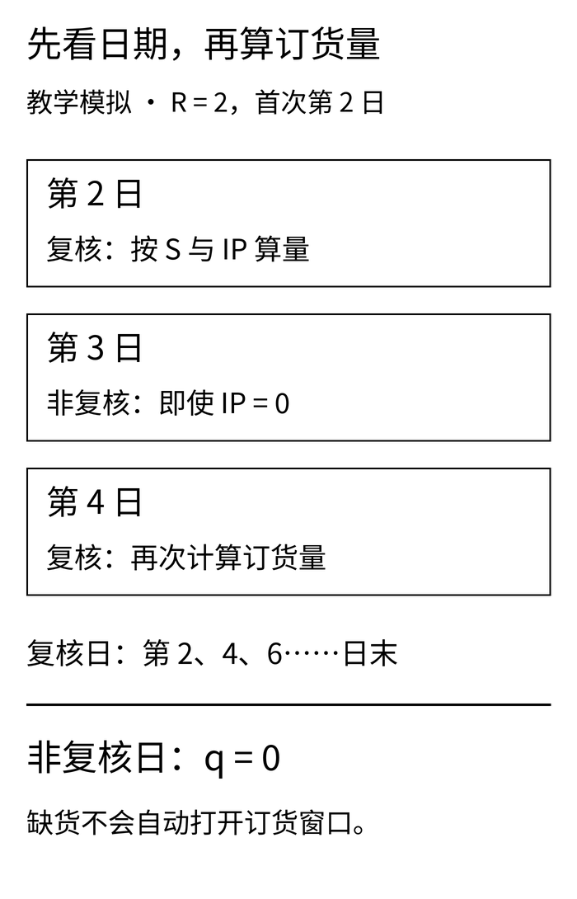
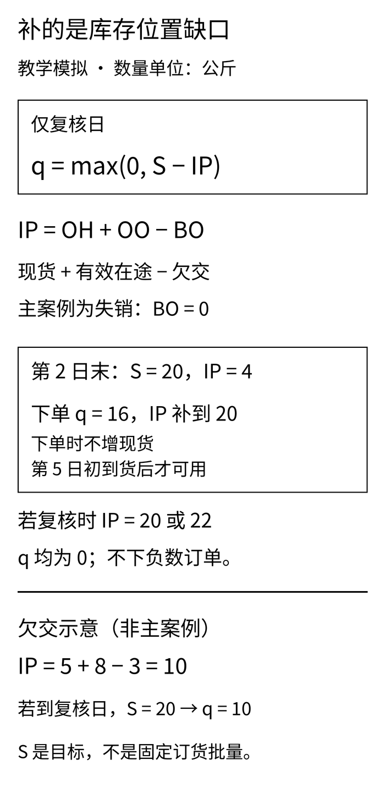
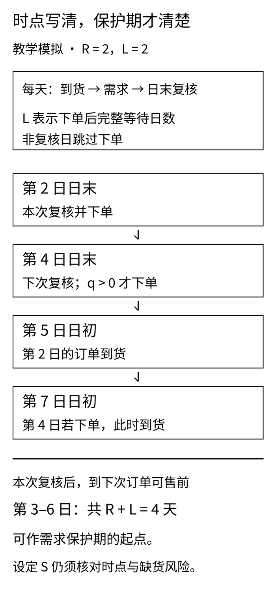

禾味A店关门时，SKU01只剩4公斤。店员准备补货，采购却说：“这一组食材每三天统一复核，明天才到日子。”

问题从“库存够不够低”变成了“今天能不能做这次决策”。如果把复核日这道判断删掉，即使后面的补货公式完全正确，执行的也已经是另一种策略。

[D16](/blog/fixed-batch-reorder-threshold/)讲日末检查：库存位置不高于阈值，就订固定的一批。本篇换一条规则：**每隔R天复核一次，只在复核日把库存位置补到目标S；其余日子不下新单。**

## 一 先看日历，再算数量

**本文的案例、需求、数量、参数和订单号全部为教学模拟，不对应真实企业品牌、项目规则或经营收益。** 禾味是虚构的两店、八食材SKU连锁，本篇只回放A店SKU01，其他15条店×SKU组合没有生成或评估。匿名服装案例是另一条独立的单SKU库存沙盘，单位为件，不与公斤汇总，也不代表真实生产排程。

定期复核通常记为(R,S)。两个字母分别回答两个问题：

- **R是复核周期，单位为天。** 它不是D16的数量阈值r。
- **S是目标库存位置，单位与该SKU一致。** 它不是目标现货，也不是每次固定买S。

MIT《Logistics Systems》第11讲第5页区分库存位置与复核方式，第6页介绍固定批量阈值规则，第7页给出周期复核(R,S)。这里沿用其概念，但将日历、日末决策和到货时点写成可执行约定，不直接把讲义中的模型结论当成本例服务保证。[讲义原文](https://ocw.mit.edu/courses/esd-260j-logistics-systems-fall-2006/8b53c45fd26ffff706d815131e8d177e_lect11.pdf#page=7)

只写R还不完整。每两天复核一次，可以从第1天开始，也可以从第2天开始。两张日历会让首单、到货和缺货轨迹不同，所以还必须冻结**首次复核日a**。本篇采用整数日历，不自动跳过周末和假日：

```text
复核日：t ≥ a，而且 (t − a) 能被 R 整除
复核日订单量：q = max(0, S − IP)
非复核日订单量：q = 0
```

例如R＝2、a＝2，复核日就是第2、4、6天；R＝3、a＝3，复核日就是第3、6天。第1天不会因为模拟刚开始就自动补一次。

设S＝20公斤，在同一个孤立状态下：

```text
复核日，IP = 4：订16，订后IP = 20
复核日，IP = 20：订0
复核日，IP = 22：订0，不退货、不取消在途
非复核日，IP = 0：仍订0
```

与D16并排看，区别就清楚了：D16每天日末都检查，IP≤r时只订固定Q；D17先由日历决定能否复核，再用S−IP决定数量。前者的订单量固定、触发日期随状态变化；后者的复核日期固定、订单量随状态变化，而且复核不一定产生订单。

最后一行最容易写错。现实中可以设紧急补货，但那是额外的触发条件、费用和权限，需要另行定义。本篇没有临时加单；不能一缺货就绕过日历，再把结果叫作同一条(R,S)策略。

[](images/d17-01_calendar.png)

## 二 补的是库存位置，不是货架

沿用[D15的库存状态与事件口径](/blog/inventory-position-event-timing/)，一般表达为：

```text
IP = 可用现货 OH + 有效在途 OO − 未履约欠交 BO
```

OH是当前可用于履约的现货，不包含尚未验收、不可分配的货；OO是已经生效、尚未到货且没有取消的订单；BO是仍需在以后履约的欠交。本文没有额外预留或分配台账，不再从OH重复扣减一次同一份承诺。

为什么要加在途？如果现货4、在途16、欠交0，IP已经是20。此时即使是复核日，也不应再下16。只用现货计算，会把同一份缺口补两次。

为什么要减欠交？在一个**独立的算式边界例**中，现货5、在途8、欠交3，则IP＝10；复核日S＝20时订10。忘减欠交就会只订7。这个例子只核验库存位置公式，不是后文回放中的某一天；后文不运行欠交履约队列。

**后文四组七日回放统一采用失销模型：未满足需求当天离开，BO始终为0。** 因而回放中的IP简化为OH＋OO，库存位置下降的是实际履约量，不是所有原始需求。不能一边把缺口记失销，一边又留成欠交再扣一次。

在复核日新增q后，改变的是OO和IP，OH不会增加。若IP不高于S，且没有包装倍数、MOQ或产能限制，订后IP恰好等于S；若IP已高于S，q为0，订后IP仍高于S。所谓“补到目标”没有自动退货的含义。

[](images/d17-02_order-up-to.png)

## 三 复核周期与提前期，放进同一条时间轴

每天固定按三个步骤运行：

1. **日初到货。** 当天到期的有效订单从OO移出，同量加入OH，假设足量、准时、立即可用。
2. **当日需求。** 履约量为需求与OH的较小值，不足部分记当天失销。
3. **日末复核。** 先判断是不是复核日，再用需求后的状态计算q；q大于0才创建订单，数量0不生成空订单。

L是下单后完整等待的日数。**L＝2时，t日末下单，经过t＋1和t＋2两个完整等待日，在t＋3日初到货。** L＝0也是次日日初到，不是当天逆流回日初。初始在途使用自己已有的到货日，不能统一改成模拟开始后再等L天。

以R＝2、a＝2、L＝2为例：第2日末新单在第5日初到；下一次第4日末新单在第7日初到。站在第2日日末看，在下一次复核所下订单变得可用之前，需要面对第3、4、5、6日四天需求。

这就是本例中**R＋L＝4天的保护期**。它既包含两次复核之间的等待，也包含供应等待。不能只按L＝2天的需求准备目标，又忽略还没到下一次复核日的那段时间。这里第7日日初先到货再发生第7日需求，所以没有把第7日需求也算进本次保护期。

不过，R＋L只是这个事件约定下识别需求窗口的起点，**不是服务保证，也不是S的完整公式**。现货能否撑到第5日、既有在途在哪天到、需求波动和失销口径都要继续检查。库存位置总量看似够，也可能在到货前已经缺货。若换成工作日日历、日中交付、随机提前期或部分到货，必须重新画时间轴，不能照搬天数。

[](images/d17-03_timing.png)

## 四 禾味七日回放：相同目标，两张复核日历

两组都从同一起点出发：第1日日初到货前现货12公斤，初始在途8公斤在第2日初到。需求依次为7、9、8、4、5、6、3公斤，总计42公斤。S固定为20公斤，L固定为2天。

A组R＝2、a＝2，B组R＝3、a＝3。这里同时规定周期和起始相位，比较的是两张**完整复核日历**，不是把所有差异归因于R这一个数字。这些参数提前写进策略卡，不是看过七日结果再挑出来的“最优值”。

第1日两组均履约7，现货剩5，另有8在途，IP＝13。今天不是复核日，两组都不下单。

第2日初8到货，现货变成13，在途清零；当天需求9，履约后现货4、IP＝4。A组今天复核，订20－4＝16，第5日初到。B组今天不复核，订单量为0，即使它看到的是同样的4公斤。

两表单位均为公斤。“在途”和“IP”均取**日末下单前**；“复核”表示是否到达日历上的决策日，不表示一定有订单。手机端可在表格内左右滑动。

### A组：第2、4、6日复核

<div role="region" tabindex="0" aria-label="禾味R2七日台账，单位公斤，可横向滚动" style="overflow-x:auto;max-width:100%;margin:28px 0">
<table style="min-width:820px;width:100%;max-width:none;display:table;margin:0;white-space:nowrap">
<thead><tr><th scope="col">日</th><th scope="col">到货</th><th scope="col">需求</th><th scope="col">履约</th><th scope="col">失销</th><th scope="col">日末现货</th><th scope="col">在途</th><th scope="col">IP</th><th scope="col">复核</th><th scope="col">新单</th><th scope="col">新单到货日</th></tr></thead><tbody>
<tr><td>1</td><td>0</td><td>7</td><td>7</td><td>0</td><td>5</td><td>8</td><td>13</td><td>否</td><td>0</td><td>无</td></tr>
<tr><td>2</td><td>8</td><td>9</td><td>9</td><td>0</td><td>4</td><td>0</td><td>4</td><td>是</td><td>16</td><td>5</td></tr>
<tr><td>3</td><td>0</td><td>8</td><td>4</td><td>4</td><td>0</td><td>16</td><td>16</td><td>否</td><td>0</td><td>无</td></tr>
<tr><td>4</td><td>0</td><td>4</td><td>0</td><td>4</td><td>0</td><td>16</td><td>16</td><td>是</td><td>4</td><td>7</td></tr>
<tr><td>5</td><td>16</td><td>5</td><td>5</td><td>0</td><td>11</td><td>4</td><td>15</td><td>否</td><td>0</td><td>无</td></tr>
<tr><td>6</td><td>0</td><td>6</td><td>6</td><td>0</td><td>5</td><td>4</td><td>9</td><td>是</td><td>11</td><td>9</td></tr>
<tr><td>7</td><td>4</td><td>3</td><td>3</td><td>0</td><td>6</td><td>11</td><td>17</td><td>否</td><td>0</td><td>无</td></tr>
</tbody></table>
</div>

### B组：第3、6日复核

<div role="region" tabindex="0" aria-label="禾味R3七日台账，单位公斤，可横向滚动" style="overflow-x:auto;max-width:100%;margin:28px 0">
<table style="min-width:820px;width:100%;max-width:none;display:table;margin:0;white-space:nowrap">
<thead><tr><th scope="col">日</th><th scope="col">到货</th><th scope="col">需求</th><th scope="col">履约</th><th scope="col">失销</th><th scope="col">日末现货</th><th scope="col">在途</th><th scope="col">IP</th><th scope="col">复核</th><th scope="col">新单</th><th scope="col">新单到货日</th></tr></thead><tbody>
<tr><td>1</td><td>0</td><td>7</td><td>7</td><td>0</td><td>5</td><td>8</td><td>13</td><td>否</td><td>0</td><td>无</td></tr>
<tr><td>2</td><td>8</td><td>9</td><td>9</td><td>0</td><td>4</td><td>0</td><td>4</td><td>否</td><td>0</td><td>无</td></tr>
<tr><td>3</td><td>0</td><td>8</td><td>4</td><td>4</td><td>0</td><td>0</td><td>0</td><td>是</td><td>20</td><td>6</td></tr>
<tr><td>4</td><td>0</td><td>4</td><td>0</td><td>4</td><td>0</td><td>20</td><td>20</td><td>否</td><td>0</td><td>无</td></tr>
<tr><td>5</td><td>0</td><td>5</td><td>0</td><td>5</td><td>0</td><td>20</td><td>20</td><td>否</td><td>0</td><td>无</td></tr>
<tr><td>6</td><td>20</td><td>6</td><td>6</td><td>0</td><td>14</td><td>0</td><td>14</td><td>是</td><td>6</td><td>9</td></tr>
<tr><td>7</td><td>0</td><td>3</td><td>3</td><td>0</td><td>11</td><td>6</td><td>17</td><td>否</td><td>0</td><td>无</td></tr>
</tbody></table>
</div>

第3日A组虽然缺货，却不是复核日，不下单；第4日轮到复核时，已有16公斤有效在途，所以只订4，不会因为现货为0就再订20。B组第3日才下第一张20公斤订单，第6日初才到；第5日即使IP＝20，也没有可用于当日需求的现货。

七日内，A组履约34、失销8，新下3单共31；B组履约29、失销13，新下2单共26。期末A组现货6、在途11，B组现货11、在途6，库存位置都为17。这说明**期末IP相同，不能推出中途服务结果相同**，还要看货在什么时候可用。

守恒也要分别核对：

- A组现货：12＋28－34＝6；在途：8＋31－28＝11。
- B组现货：12＋28－29＝11；在途：8＋26－28＝6。

两组尾部订单都在第6日末下、第9日初到，数量分别为11和6。第7日截止时它们依然是有效在途，不能因为超出图表窗口就删掉，也不能提前计入收货。

这条路径上A组失销少5公斤，同时多下1单、多订5公斤，期末现货更少而在途更多。**这些只是给定路径的实算差异，没有转换成成本节省、利润或服务水平保证。** 也不能据此宣称所有门店都应两天复核一次。两组都保留S＝20是为了看清动作；业务上改变R后，S通常也需要重新验证，而不是永远保持不变。

## 五 匿名服装：到了复核日，也可能一单不下

服装生产协同中的“在途”可能来自采购、在制、预计完工或外协回货。多个系统是否指向同一批货、何时验收可用，必须先对齐。不能把采购单和它派生出的工单重复加入OO，也不能把未经确认的产能计划当成已经生效的供给。

本篇只保留一个虚构库存节点：初始现货6件，初始在途4件在第1日初到；需求为5、8、4、7、3、6、2件，总计35件。S＝24件，L＝2。两组复核日历仍为第2、4、6日与第3、6日。

**这里的L由D16服装示例的1天改为2天。** 本篇为统一时间教学提前设定，不把本篇与D16的失销差额当作策略效果。两篇还改变了订货动作和参数，没有控制住同一组比较条件。

A组第2日末复核时IP＝0，订24件，第5日初到。第4日虽然又到了复核日、现货仍为0，但在途已有24，IP恰好等于S，所以q＝0，**这次有复核记录，没有新增订单**。复核次数和订单次数必须分开统计。

七日汇总，A组履约21、失销14，下2单共33件，期末现货13、在途9；B组履约18、失销17，同样下2单，共30件，期末现货16、在途6。两组都在窗口内收货28件，期末IP均为22。尾单分别为9件和6件，均在第9日初到。

A组现货守恒为6＋28－21＝13，在途为4＋33－28＝9；B组现货守恒为6＋28－18＝16，在途为4＋30－28＝6。完整逐日台账、复核标记和订单事件见实践包，件数不与禾味的公斤数混加。

这个节点仍按失销演示，不代表服装客户接受缺口取消。若真实合同要求延期履约，就要建立欠交队列，定义旧欠交与新需求的优先级、取消和后续履约，并重新核验IP。仅在公式里写一个BO变量，不等于实现了欠交业务。

## 六 先冻结什么，再测试什么

定期复核的策略卡至少要写清：实体与SKU、数量单位、R、首次复核日、S、L、初始现货与每笔初始在途、日内顺序、失销或欠交口径、零订单处理，以及节假日和临时加单是否允许。

本篇只做机制校验，不搜索最优参数，不估算安全库存，不评估保质期、报损、资金成本或产能约束。七日需求沿用已经公开的教学路径，**不是未见测试集**。

本次先检查输入、时间与规则边界，写出冻结策略卡、参数和输入哈希回执，再运行四组回放与单元测试。冻结回执能帮助发现文件漂移，不能把模拟参数变成经营验证，也不是不可篡改的外部认证。若改规则、参数或需求，应另开实验版本，不能覆盖回执后仍声称是同一次冻结运行。

真正做策略选择时，应在开发或验证段确定R、S、日历和指标，再冻结，最后才评估未见测试。看到测试段失销后回来调S、移动首次复核日，或临时给“表现差的日子”加紧急单，都让最终结果失去原来的含义。**本篇不读取D9封存数据，不重跑其最后28天，也不提前进行D20的最终评估。**

## 七 下载后，先攻击日历这道门

下载[D17定期复核实践包](/downloads/d17-periodic-review-practice.zip)，用Python 3.10或以上解压，在包内运行：

```bash
python -m unittest -v
python run.py
```

计算只用标准库，脚本按自身位置找输入，不依赖完整博客仓库。包内包含模拟原始需求、冻结策略卡与参数、四组逐日台账、订单事件、期末在途、汇总与校验信息。同一输入重复运行应得到相同字节的结果。

可以从四组问题开始对抗检查：

1. **日历。** 首次复核日前是否错误下单？R＝2、a＝2是否真的是第2、4、6日？非复核日IP为0会不会偷偷触发？改变首次复核日后，执行是否跟着改变？
2. **数量。** 复核日IP等于S应订0；高于S也订0，不产生负订单。已有在途不能漏算，欠交公式的符号不能反。主回放不支持的欠交模式必须拒绝，不能悄悄按失销运行。
3. **状态与时序。** 下单不能增加当天现货，t日末新单必须按t＋L＋1日初到。到货先于当天需求。扰动未来需求，不应改变之前的决策。
4. **交付。** 需求＝履约＋失销；现货和在途分别守恒；窗口结束仍未到的尾单保留；复核次数与非零订单次数分开；非法数量、日期、单位和重复订单标识应被拒绝。

纯策略函数重复调用会返回相同建议，却不能单独保证真实系统不重复采购。本篇模拟器按日期顺序每次只决策一次；接入采购系统还需要实体、SKU、复核日、策略版本等稳定幂等键，以及并发与事务控制。本篇没有向真实供应商发送订单。

另附[文章Markdown与配图](/downloads/d17-periodic-review-article.zip)、[黑白配图与独立重绘脚本](/downloads/d17-periodic-review-images.zip)。封面为900×383，正文图保留竖版大字，也提供可编辑SVG与手机宽度预览。单元测试和人工复核能证明已覆盖的边界，不能代替尚未建模的真实业务。

周期补货最需要统一的，不只是“补到多少”。先把**哪天复核、复核前看什么状态、订单进入哪里、哪天开始可用**说成同一件事，再谈参数与策略比较，才不会让一张看起来正确的公式执行出另一套采购节奏。
