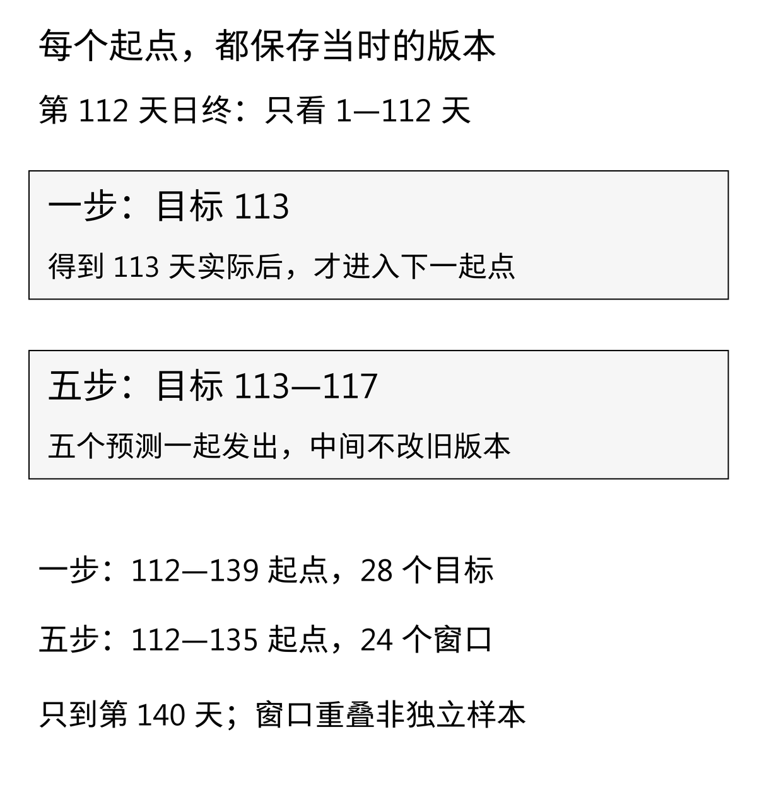
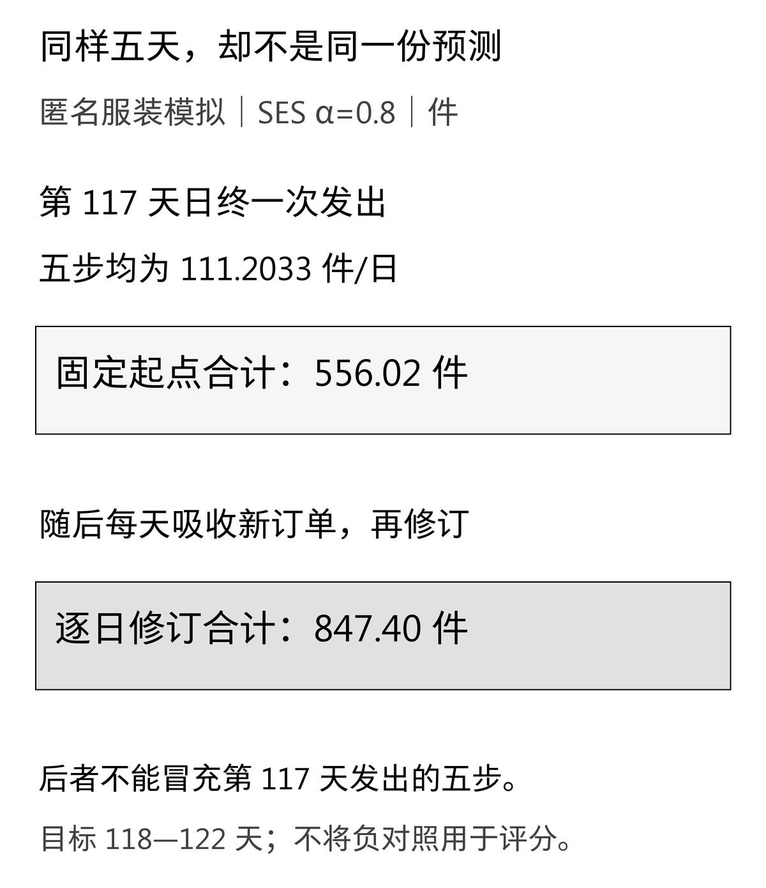
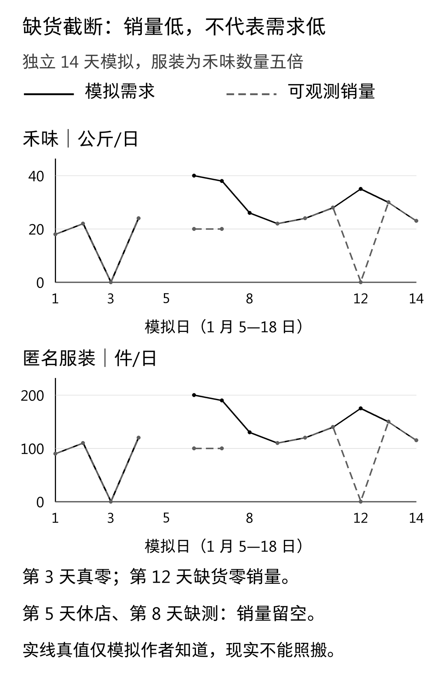

同样预测接下来五天，匿名服装模拟案例中的SES α＝0.8，合计可以是556.02件，也可以是847.40件。差别不是计算精度：前者在第117天日终一次发出，后者把随后几天看过新订单、重新修订的一步预测加在了一起。

如果报表只保留目标日期，不保留“这份预测是什么时候做的”，两种数字很容易被放进同一列。第二种结果可以回答每天更新之后的安排，却不能证明第117天就知道未来五天。

[D12讨论了误差大小和偏差方向](/blog/forecast-error-bias-metrics/)。这篇继续追问两件更早的事：**预测时能看到什么，以及评分时把什么当作需求。** 第一件靠滚动起点和攻击测试核验；第二件用独立的缺货截断反例说明。

## 一 这次回放使用什么数据

**两个案例和全部数据均为教学模拟。** 禾味是虚构的2店、8食材SKU餐饮连锁，本篇只处理A店SKU01，单位为公斤/日；匿名服装案例处理终端订单需求，单位为件/日，不是工厂排产量。日期、数量、活动均为模拟，不对应真实品牌、订单或业务收益；若延伸出订单单号，也只能作为模拟字段，不能冒充企业记录。

主实验沿用D9的180天模拟序列中已经使用过的前140天开发CSV，字节与D12一致。第1—112天为初始历史，第113—140天为验证段，对应2026年7月27日至8月23日。第112天为7月26日。这里只加载这两份140行文件，不读取或重新评价第141—180天标签。

这是一场**教学开发回放**。验证段在前几篇已经多次查看，不能称为新盲测；原40天测试段汇总也已在D9展示，不能重新包装为从未触碰的独立检验。避免在单个起点偷看未来，只解决信息时序错误，不会自动消除反复看验证结果带来的选择偏差。

主实验假定需求完全可见，没有缺货、休店或缺测；单日记录在当天日终即可得到。代码没有实现`available_at`字段或延迟到达过滤，只适用于这一日终记录均可得的假设。现实系统若有报表延迟，应先实现按实际可用时间筛选历史的逻辑，不能把自然日期直接等同于信息已到达。

七个既有候选全部保留：周期7的季节性朴素，MA3／MA7／MA14，以及SES α＝0.2／0.5／0.8。SES用第一个观测初始化。MA在固定起点内保持当时均值，SES保持当时平滑水平；季节性朴素重复最近已观测的七天。没有新模型、全样本标准化、双向插补或未来缺货标签输入。

## 二 滚动的是起点，已经发出的预测不能跟着改

起点t表示第t天日终，已知历史为第1—t天。目标t+h是提前h天预测的对象。预测记为ŷ(t+h｜t)，竖线右侧的t就是这份预测的信息截止点。

流程是：在第112天日终发布第113天预测；等第113天真实观测到达，才把它加入历史，发布第114天预测。每个起点可用历史扩展，MA仍只取最后k天，SES仍按固定α更新。这里没有每到一天重新搜索一个最优参数。

[FPP3第5章第5.10节](https://otexts.com/fpp3/tscv.html)介绍了这种滚动预测起点的评价：构造某次预测只能使用预测起点当时已获得的观测，也可按实际决策需要评价多步预测。本文把同一原则落实到日期字段、固定窗口和可复现代码。

[](images/d13-01_origins.png)

一步任务的起点为112—139，目标为113—140，共28个。固定起点五日任务的起点为112—135，窗口从113—117到136—140，共24个。计算为28−5＋1＝24；第136天日终若预测五天，会到第141天，所以不纳入本段。

“固定起点”不是整个实验只预测一次，而是**每个起点一次发出五个步长，中间不更新这份预测**。下一天可以另发一份新预测，但旧版本必须保留。比如第112天对第114天的h＝2预测，与第113天对第114天的h＝1预测，是两个不同版本。

实践包的`predictions.csv`逐行保留案例、实体、单位、方法、完整参数、起点日及日期、历史截止日、目标日及日期、步长h和任务长度。先由`issue`生成一个起点的全部预测，再由`replay`附上已实现的实际值和误差。预测函数先切历史前缀，连未来记录是否合法都不检查；离线入口另行检查开发文件完整性，这个检查不用于拟合或填补数值。

## 三 把五次一步预测拼起来，会悄悄改变问题

看匿名服装的第117天日终，即2026年7月31日。预测目标为8月1日至5日，对应第118—122天。SES α＝0.8在这个起点的平滑水平约111.2033件/日，五步都维持这个水平，合计556.0164件。

若每天等新订单到达后再做一步预测，同样五个目标的预测依次为111.2033、213.4407、224.2881、188.0576、110.4115件/日，合计847.4012件。其中第二个数字已经用到了第118天的观测，绝不属于第117天日终可发出的版本。

[](images/d13-02_revisions.png)

两组预测不是谁算错了，而是适用决策时点不同。错误在于给逐日修订结果贴上“原起点五步”的标签。实践包把后者存为带有`WRONG_FOR_ORIGIN117`标记的负对照，只演示错误拼接，不让它进入五日成绩表。

对一个固定起点，五日累计误差定义为：

```text
E(t,5) = [y(t+1) + … + y(t+5)]
       − [ŷ(t+1|t) + … + ŷ(t+5|t)]
五日累计MAE = 24个窗口的 |E(t,5)| 的平均
```

这不是“第5天单点误差”，也不是五个逐日绝对误差的和。若五个日误差为[−2,+2,0,0,0]，累计绝对误差为0，逐日绝对误差之和为4。总量刚好并不意味着每天都有货；保质期短的食材尤其不能只盯累计总量。

24个窗口重叠，同一天可能被评分多次。它们代表24次按日启动的五天决策，不是24份独立样本；本篇不据此做独立样本置信区间或显著性检验。五日WAPE的分母是24个窗口实际合计的总和，包含重复覆盖，不是一次性的销量总额。

## 四 同一数据，改了决策长度，排序也可能变

以下表格完整列出七个候选的两类任务，均保留四位小数。一步的n＝28，五日累计的n＝24。误差为实际−预测；正ME表示低估，MAE和RMSE越小表示本任务下相应误差越小。WAPE＝绝对误差合计÷实际合计，实际总量为零时未定义。

### 禾味：星期结构在两类任务中都有效

一步的ME／MAE／RMSE单位为公斤/日；五日累计单位为公斤。一步实际合计738公斤，五日窗口实际合计3158公斤，后者有重复覆盖。两类MAE的大小不能直接当作相同任务的准确率比较。

手机端可左右滑动表格。

<div role="region" tabindex="0" aria-label="禾味一步与五日累计误差表（可横向滚动）" style="overflow-x:auto;max-width:100%;margin:28px 0">
<table style="min-width:700px;width:100%;max-width:none;display:table;margin:0;white-space:nowrap">
<thead><tr><th scope="col">方法</th><th scope="col">任务</th><th scope="col">n</th><th scope="col">ME</th><th scope="col">MAE</th><th scope="col">RMSE</th><th scope="col">WAPE</th></tr></thead>
<tbody>
<tr><td style="white-space:nowrap;text-align:left">SNaive7</td><td style="white-space:nowrap;text-align:left">一步</td><td style="white-space:nowrap;text-align:right">28</td><td style="white-space:nowrap;text-align:right">0.2143</td><td style="white-space:nowrap;text-align:right">1.7857</td><td style="white-space:nowrap;text-align:right">2.2678</td><td style="white-space:nowrap;text-align:right">6.7751%</td></tr>
<tr><td style="white-space:nowrap;text-align:left">SNaive7</td><td style="white-space:nowrap;text-align:left">五日累计</td><td style="white-space:nowrap;text-align:right">24</td><td style="white-space:nowrap;text-align:right">1.2083</td><td style="white-space:nowrap;text-align:right">3.2917</td><td style="white-space:nowrap;text-align:right">4.0260</td><td style="white-space:nowrap;text-align:right">2.5016%</td></tr>
<tr><td style="white-space:nowrap;text-align:left">MA3</td><td style="white-space:nowrap;text-align:left">一步</td><td style="white-space:nowrap;text-align:right">28</td><td style="white-space:nowrap;text-align:right">0.1429</td><td style="white-space:nowrap;text-align:right">6.7143</td><td style="white-space:nowrap;text-align:right">7.8189</td><td style="white-space:nowrap;text-align:right">25.4743%</td></tr>
<tr><td style="white-space:nowrap;text-align:left">MA3</td><td style="white-space:nowrap;text-align:left">五日累计</td><td style="white-space:nowrap;text-align:right">24</td><td style="white-space:nowrap;text-align:right">-0.8472</td><td style="white-space:nowrap;text-align:right">24.7083</td><td style="white-space:nowrap;text-align:right">28.2953</td><td style="white-space:nowrap;text-align:right">18.7777%</td></tr>
<tr><td style="white-space:nowrap;text-align:left">MA7</td><td style="white-space:nowrap;text-align:left">一步</td><td style="white-space:nowrap;text-align:right">28</td><td style="white-space:nowrap;text-align:right">0.2092</td><td style="white-space:nowrap;text-align:right">5.3214</td><td style="white-space:nowrap;text-align:right">5.9375</td><td style="white-space:nowrap;text-align:right">20.1897%</td></tr>
<tr><td style="white-space:nowrap;text-align:left">MA7</td><td style="white-space:nowrap;text-align:left">五日累计</td><td style="white-space:nowrap;text-align:right">24</td><td style="white-space:nowrap;text-align:right">0.9583</td><td style="white-space:nowrap;text-align:right">9.3750</td><td style="white-space:nowrap;text-align:right">10.6516</td><td style="white-space:nowrap;text-align:right">7.1248%</td></tr>
<tr><td style="white-space:nowrap;text-align:left">MA14</td><td style="white-space:nowrap;text-align:left">一步</td><td style="white-space:nowrap;text-align:right">28</td><td style="white-space:nowrap;text-align:right">0.1403</td><td style="white-space:nowrap;text-align:right">5.3852</td><td style="white-space:nowrap;text-align:right">5.9835</td><td style="white-space:nowrap;text-align:right">20.4317%</td></tr>
<tr><td style="white-space:nowrap;text-align:left">MA14</td><td style="white-space:nowrap;text-align:left">五日累计</td><td style="white-space:nowrap;text-align:right">24</td><td style="white-space:nowrap;text-align:right">0.4077</td><td style="white-space:nowrap;text-align:right">9.1518</td><td style="white-space:nowrap;text-align:right">10.2468</td><td style="white-space:nowrap;text-align:right">6.9551%</td></tr>
<tr><td style="white-space:nowrap;text-align:left">SES0.2</td><td style="white-space:nowrap;text-align:left">一步</td><td style="white-space:nowrap;text-align:right">28</td><td style="white-space:nowrap;text-align:right">0.1642</td><td style="white-space:nowrap;text-align:right">5.5652</td><td style="white-space:nowrap;text-align:right">6.4153</td><td style="white-space:nowrap;text-align:right">21.1145%</td></tr>
<tr><td style="white-space:nowrap;text-align:left">SES0.2</td><td style="white-space:nowrap;text-align:left">五日累计</td><td style="white-space:nowrap;text-align:right">24</td><td style="white-space:nowrap;text-align:right">0.2382</td><td style="white-space:nowrap;text-align:right">13.9983</td><td style="white-space:nowrap;text-align:right">16.2369</td><td style="white-space:nowrap;text-align:right">10.6384%</td></tr>
<tr><td style="white-space:nowrap;text-align:left">SES0.5</td><td style="white-space:nowrap;text-align:left">一步</td><td style="white-space:nowrap;text-align:right">28</td><td style="white-space:nowrap;text-align:right">0.1411</td><td style="white-space:nowrap;text-align:right">5.3391</td><td style="white-space:nowrap;text-align:right">6.6390</td><td style="white-space:nowrap;text-align:right">20.2569%</td></tr>
<tr><td style="white-space:nowrap;text-align:left">SES0.5</td><td style="white-space:nowrap;text-align:left">五日累计</td><td style="white-space:nowrap;text-align:right">24</td><td style="white-space:nowrap;text-align:right">0.3750</td><td style="white-space:nowrap;text-align:right">23.2535</td><td style="white-space:nowrap;text-align:right">26.5525</td><td style="white-space:nowrap;text-align:right">17.6721%</td></tr>
<tr><td style="white-space:nowrap;text-align:left">SES0.8</td><td style="white-space:nowrap;text-align:left">一步</td><td style="white-space:nowrap;text-align:right">28</td><td style="white-space:nowrap;text-align:right">0.1120</td><td style="white-space:nowrap;text-align:right">4.8633</td><td style="white-space:nowrap;text-align:right">6.4049</td><td style="white-space:nowrap;text-align:right">18.4517%</td></tr>
<tr><td style="white-space:nowrap;text-align:left">SES0.8</td><td style="white-space:nowrap;text-align:left">五日累计</td><td style="white-space:nowrap;text-align:right">24</td><td style="white-space:nowrap;text-align:right">1.2834</td><td style="white-space:nowrap;text-align:right">31.4695</td><td style="white-space:nowrap;text-align:right">33.8708</td><td style="white-space:nowrap;text-align:right">23.9160%</td></tr>
</tbody>
</table>
</div>

季节性朴素的一步MAE为1.7857公斤/日，五日累计MAE为3.2917公斤，在各自任务的候选中最低。MA7与MA14的五日累计MAE为9.3750、9.1518公斤；SES α＝0.8为31.4695公斤。这个序列具有稳定星期差异，单一水平在固定五步内无法表达每天的起伏。

这些只是当前模拟回放的描述性结果。若用于真实餐饮采购，还要区分到货日、保质期、库存和服务要求，不能把累计预测直接当作订单，也不能把误差差值写成节约金额。

### 匿名服装：一步赢家不等于五日累计赢家

一步的ME／MAE／RMSE单位为件/日；五日累计单位为件。一步实际合计3374件，五日窗口实际合计14642件，含重复覆盖。

手机端可左右滑动表格。

<div role="region" tabindex="0" aria-label="匿名服装一步与五日累计误差表（可横向滚动）" style="overflow-x:auto;max-width:100%;margin:28px 0">
<table style="min-width:700px;width:100%;max-width:none;display:table;margin:0;white-space:nowrap">
<thead><tr><th scope="col">方法</th><th scope="col">任务</th><th scope="col">n</th><th scope="col">ME</th><th scope="col">MAE</th><th scope="col">RMSE</th><th scope="col">WAPE</th></tr></thead>
<tbody>
<tr><td style="white-space:nowrap;text-align:left">SNaive7</td><td style="white-space:nowrap;text-align:left">一步</td><td style="white-space:nowrap;text-align:right">28</td><td style="white-space:nowrap;text-align:right">0.6071</td><td style="white-space:nowrap;text-align:right">21.1071</td><td style="white-space:nowrap;text-align:right">42.2717</td><td style="white-space:nowrap;text-align:right">17.5163%</td></tr>
<tr><td style="white-space:nowrap;text-align:left">SNaive7</td><td style="white-space:nowrap;text-align:left">五日累计</td><td style="white-space:nowrap;text-align:right">24</td><td style="white-space:nowrap;text-align:right">4.2917</td><td style="white-space:nowrap;text-align:right">115.8750</td><td style="white-space:nowrap;text-align:right">159.7541</td><td style="white-space:nowrap;text-align:right">18.9933%</td></tr>
<tr><td style="white-space:nowrap;text-align:left">MA3</td><td style="white-space:nowrap;text-align:left">一步</td><td style="white-space:nowrap;text-align:right">28</td><td style="white-space:nowrap;text-align:right">0.1667</td><td style="white-space:nowrap;text-align:right">35.5238</td><td style="white-space:nowrap;text-align:right">47.8544</td><td style="white-space:nowrap;text-align:right">29.4803%</td></tr>
<tr><td style="white-space:nowrap;text-align:left">MA3</td><td style="white-space:nowrap;text-align:left">五日累计</td><td style="white-space:nowrap;text-align:right">24</td><td style="white-space:nowrap;text-align:right">-6.0972</td><td style="white-space:nowrap;text-align:right">169.2361</td><td style="white-space:nowrap;text-align:right">218.7075</td><td style="white-space:nowrap;text-align:right">27.7398%</td></tr>
<tr><td style="white-space:nowrap;text-align:left">MA7</td><td style="white-space:nowrap;text-align:left">一步</td><td style="white-space:nowrap;text-align:right">28</td><td style="white-space:nowrap;text-align:right">0.3163</td><td style="white-space:nowrap;text-align:right">30.1531</td><td style="white-space:nowrap;text-align:right">41.4708</td><td style="white-space:nowrap;text-align:right">25.0233%</td></tr>
<tr><td style="white-space:nowrap;text-align:left">MA7</td><td style="white-space:nowrap;text-align:left">五日累计</td><td style="white-space:nowrap;text-align:right">24</td><td style="white-space:nowrap;text-align:right">2.3155</td><td style="white-space:nowrap;text-align:right">120.1964</td><td style="white-space:nowrap;text-align:right">151.6128</td><td style="white-space:nowrap;text-align:right">19.7016%</td></tr>
<tr><td style="white-space:nowrap;text-align:left">MA14</td><td style="white-space:nowrap;text-align:left">一步</td><td style="white-space:nowrap;text-align:right">28</td><td style="white-space:nowrap;text-align:right">0.7245</td><td style="white-space:nowrap;text-align:right">30.2143</td><td style="white-space:nowrap;text-align:right">41.0821</td><td style="white-space:nowrap;text-align:right">25.0741%</td></tr>
<tr><td style="white-space:nowrap;text-align:left">MA14</td><td style="white-space:nowrap;text-align:left">五日累计</td><td style="white-space:nowrap;text-align:right">24</td><td style="white-space:nowrap;text-align:right">4.3690</td><td style="white-space:nowrap;text-align:right">109.4524</td><td style="white-space:nowrap;text-align:right">138.5447</td><td style="white-space:nowrap;text-align:right">17.9406%</td></tr>
<tr><td style="white-space:nowrap;text-align:left">SES0.2</td><td style="white-space:nowrap;text-align:left">一步</td><td style="white-space:nowrap;text-align:right">28</td><td style="white-space:nowrap;text-align:right">0.5517</td><td style="white-space:nowrap;text-align:right">30.8933</td><td style="white-space:nowrap;text-align:right">41.0226</td><td style="white-space:nowrap;text-align:right">25.6376%</td></tr>
<tr><td style="white-space:nowrap;text-align:left">SES0.2</td><td style="white-space:nowrap;text-align:left">五日累计</td><td style="white-space:nowrap;text-align:right">24</td><td style="white-space:nowrap;text-align:right">1.9844</td><td style="white-space:nowrap;text-align:right">119.3056</td><td style="white-space:nowrap;text-align:right">155.0519</td><td style="white-space:nowrap;text-align:right">19.5556%</td></tr>
<tr><td style="white-space:nowrap;text-align:left">SES0.5</td><td style="white-space:nowrap;text-align:left">一步</td><td style="white-space:nowrap;text-align:right">28</td><td style="white-space:nowrap;text-align:right">0.1639</td><td style="white-space:nowrap;text-align:right">28.4215</td><td style="white-space:nowrap;text-align:right">40.4326</td><td style="white-space:nowrap;text-align:right">23.5863%</td></tr>
<tr><td style="white-space:nowrap;text-align:left">SES0.5</td><td style="white-space:nowrap;text-align:left">五日累计</td><td style="white-space:nowrap;text-align:right">24</td><td style="white-space:nowrap;text-align:right">-1.9116</td><td style="white-space:nowrap;text-align:right">155.9761</td><td style="white-space:nowrap;text-align:right">202.6959</td><td style="white-space:nowrap;text-align:right">25.5664%</td></tr>
<tr><td style="white-space:nowrap;text-align:left">SES0.8</td><td style="white-space:nowrap;text-align:left">一步</td><td style="white-space:nowrap;text-align:right">28</td><td style="white-space:nowrap;text-align:right">0.1144</td><td style="white-space:nowrap;text-align:right">24.0696</td><td style="white-space:nowrap;text-align:right">37.9167</td><td style="white-space:nowrap;text-align:right">19.9748%</td></tr>
<tr><td style="white-space:nowrap;text-align:left">SES0.8</td><td style="white-space:nowrap;text-align:left">五日累计</td><td style="white-space:nowrap;text-align:right">24</td><td style="white-space:nowrap;text-align:right">0.3860</td><td style="white-space:nowrap;text-align:right">191.1509</td><td style="white-space:nowrap;text-align:right">236.9220</td><td style="white-space:nowrap;text-align:right">31.3319%</td></tr>
</tbody>
</table>
</div>

按MAE看，一步最低仍是季节性朴素，21.1071件/日；五日累计最低则是MA14，109.4524件，低于季节性朴素的115.8750件。若只沿用一步排名，就会忽略决策长度改变后的结果。SES α＝0.8的一步RMSE最低，但它的五日累计MAE为191.1509件，又是另一种表现。

原模拟序列在第118—120天加入了活动扰动。多个五日窗口覆盖同一活动，不能把这一批窗口当作很多场独立活动的证据，更不能据此宣称服装企业普遍适用MA14。

本篇以“各案例、各任务内验证MAE最小；完全同分按方法标识排序”为教学选择规则，在全部回放结束后保存配置：禾味两类任务与服装一步均为季节性朴素7，服装五日累计为MA14。冻结回执保存参数、运行编号和输入哈希，**不会把选中的方法回灌到早期起点，假装当时就已选好**。

这是用已反复查看的开发段演示配置留痕，并非此前预注册的业务目标，也不是选中模型的独立效果证明。未来正式应用仍需提前约定损失、冻结规则，再使用另外获得的时序数据评价。

## 五 真正有用的防泄漏测试，要主动破坏未来

只看代码里有没有`shift`，不足以判断是否泄漏。全样本均值、居中移动平均、双向插补，甚至后来才知道的缺货标记，都可能把未来带回起点。

本实践对每个完整五日起点、每个候选、两个案例做三类攻击：把起点后的需求统一增加10000并篡改缺货与观测标记；把所有未来行换成无效对象；直接删掉全部未来行，只留下已知前缀。三种情况下，原起点的五步预测都必须逐值不变。共有2×7×24＝336组，每组包含三种攻击。

还对完整回放增加一道检查：从第121天起把标签改大，所有截至第120天日终已经发出的预测保持不变。评分结果可以变，因为实际标签变了；预测版本不能变。最后四个一步起点也单独覆盖。

反过来，若第113天需求增加10，α＝0.5的SES在第112天发出的预测应保持不变，第113天日终发出的下一预测应增加5。这一正对照说明我们没有通过“永远不更新”来蒙混过关。

上述测试验证了当前接口的信息边界，不代表所有现实数据管道都无泄漏。实践包另外用分数算术与SES几何权重展开复算全部预测与指标，防止两个实现共享同一个循环错误。日期缺失、重复、混合实体或非数值需求会被拒绝，不用零代替。

## 六 缺货反例：报表里的零，可能有四种含义

主实验需求完全可见。现在另造一组14天、2026年1月5日至18日的模拟记录，专门演示观测边界，不改主实验数据。禾味用公斤，服装用件；服装数量设为禾味的五倍，是同一机制的单位演示，不是第二份独立实证。

在这个简化反例中，正常开业且销售记录完整时：

```text
可观测销量 = min(模拟真实需求, 当日可售上限)
```

它忽略了替代、延后购买、退货与跨日补单，只用于展示截断机制。第6天禾味真实模拟需求40公斤，可售上限20公斤，于是销量20公斤；第12天可售上限为0，真实模拟需求35公斤，销量却为0。服装对应为200／100／100件和175／0／0件。

[](images/d13-03_stockout.png)

四种状态必须分开保存：第3天是真的零需求；第5天休店，目标不定义；第8天缺销售记录；第12天缺货导致零销量。第5、8天销量字段为空，不填零；图中也断开。第8天的真实值只是模拟作者知道，现实缺测并不会自动提供它。

给这组反例预先放一个固定的演示预测：禾味每天20公斤、服装每天100件，不拟合参数。第6天对销量评分时误差恰为0；对作者已知的模拟需求评分时，分别低估20公斤和100件。一个“完美预测销量”的数字，仍然可能漏掉需求。

更完整地看，在相同12个开业且有销量记录的日期上，禾味对销量的MAE为6.25公斤/日、ME为−0.75；对模拟真实需求的MAE为9.00、ME为+5.3333。评分对象一换，连平均偏差方向都变了。服装相应MAE为31.25与45.00件/日。这不是普遍的误差大小关系，只是可复算的反例；两边都排除相同的休店和缺测日期，避免样本集合变化干扰解释。

模拟里可以看到“真实需求−销量”，因为真值由我们编写。现实通常只能知道销量与部分缺货记录，不能从一个20公斤销量推出到底有40还是60公斤需求。缺货标记可以提示标签受截断，但不能自动还原失销量；未来才得到的标记更不能加入过去的预测输入。

因此，这个反例没有修复现实需求，没有把截断销量送进无缺货主实验，也没有给出真实收益。下一步若要估计未满足需求，需要额外观测、明确假设和另外的验证方案。

## 七 把回测交给别人复核，需要留下哪些证据

下载[D13滚动回测实践包](/downloads/d13-rolling-backtest-practice.zip)，使用Python 3.10或以上；计算和测试仅依赖标准库。解压后执行：

```bash
python -m unittest -v
python run.py
```

`predictions.csv`含2072条逐步预测：两个案例×七个候选×（28个一步目标＋24个窗口×五步）。`window_totals.csv`含728条任务总量，`metrics.csv`含28行指标。另有336组泄漏诊断、错误拼接负对照、独立缺货记录与评分、配置冻结回执和运行清单。运行编号为`D13-v2-development-replay`，数据哈希固定，输出不带运行时钟，便于逐字节比较。

预测和指标使用浮点数，正常舍入仍存在；本篇表格只显示四位小数。MA先用稳定求和聚合窗口，再除以窗口长度，避免三个最小正浮点数各自先除以3后消失。MA要求窗口聚合和有限，即使最终平均值可表示，聚合溢出也报错；正均值下溢成零同样报错。这个约定不提供任意精度保证。指标的非有限输入、溢出或非零指标下溢成零会报错，WAPE零分母返回空值及状态。文件入口坚持连续日期与112／28分块；不会自动补缺、合并重复日期或混加公斤与件。

还可下载[文章Markdown与配图](/downloads/d13-rolling-backtest-article.zip)、[黑白配图及重绘脚本](/downloads/d13-rolling-backtest-images.zip)。图形重绘需要Pillow、fontTools和Noto简体中文字体；读者运行预测实验不需要这些库。宽表在手机内可横向滚动，配图提供原图入口。

这次留下的关键证据是：同一目标日的预测必须带上起点；五日累计应使用同一版本的五步；销量为零还要追问是否开业、有记录、有货。模型可以很简单，这三处边界却必须清楚，后续模型选择才有可以复核的基础。
