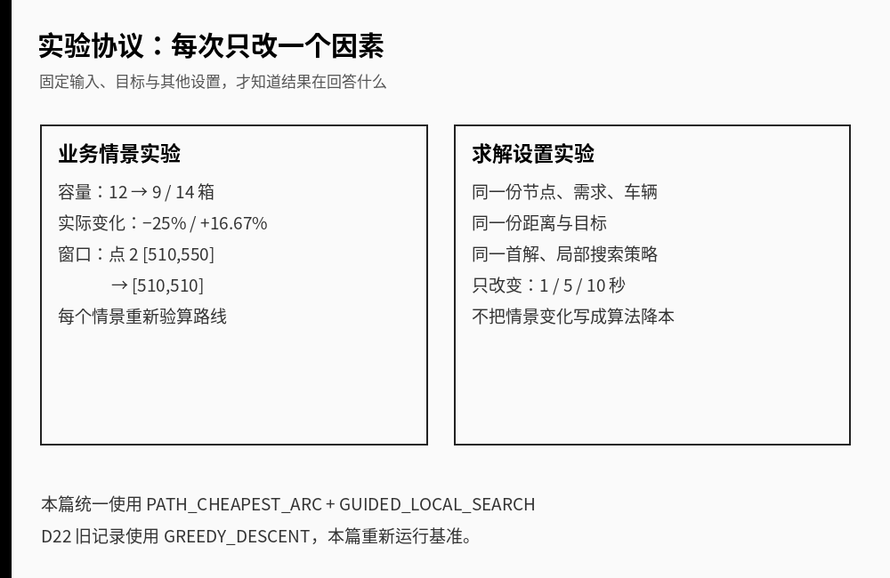
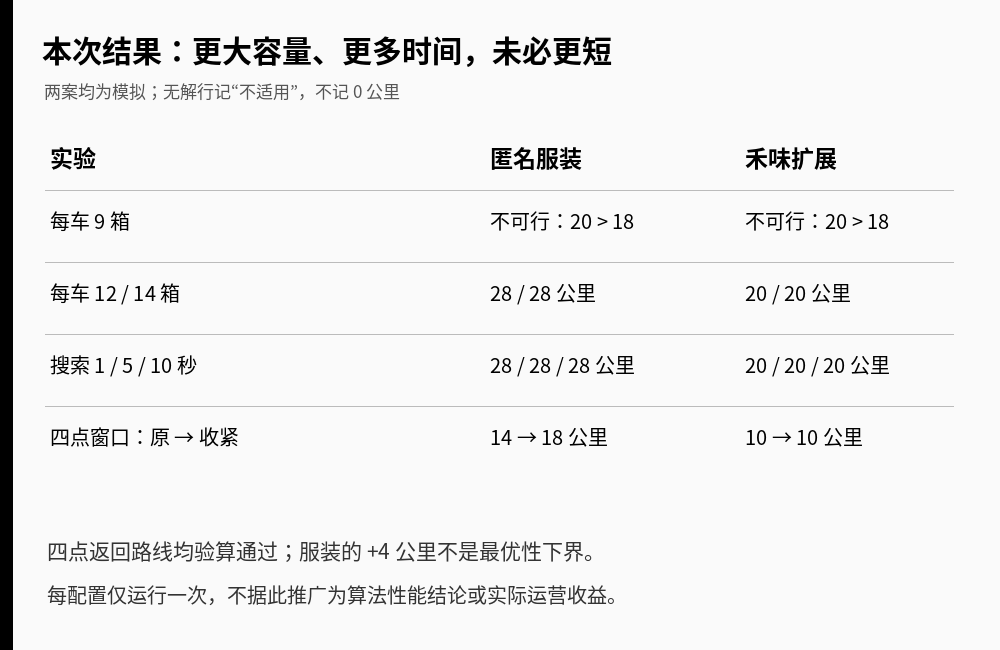
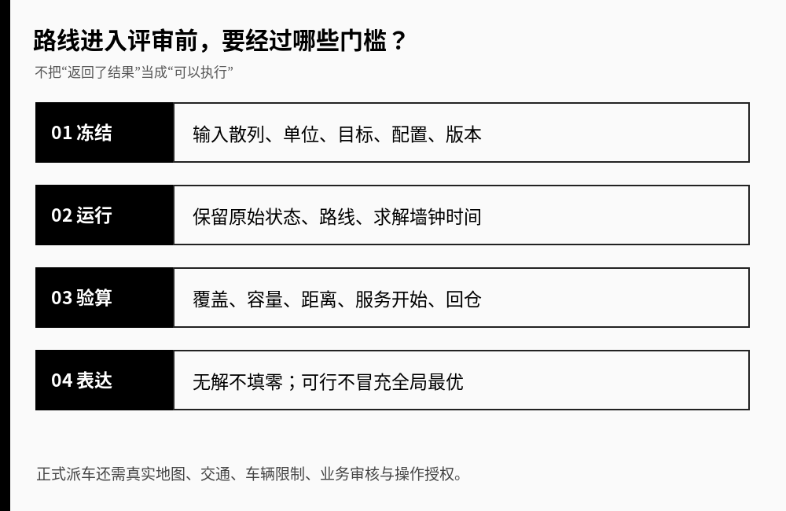

“把时间限制从1秒加到10秒，路线是不是就能再短一点？”这是一个合理的问题。可如果同一轮测试里又换了车型、放宽了收货窗口、改了首解策略，即使里程少了，也不知道是哪一项变化造成的。

[D22](/blog/capacity-constrained-routing/)解决车能否装下的问题，[D23](/blog/routing-time-windows/)把收货时间放进排程。D24 不引入更炫的新算法，而是把实验做得更可信：**把业务情景和求解设置分开，每次只改一项，并先检查可行性，再比较结果。**

本文全部输入、企业案例和实验结果均为教学模拟。匿名服装只借用生产协同业务语境，不对应真实工厂订单。虚构禾味仍以2家门店、8个食材SKU、14天作为首周背景；十点配送是独立教学扩展，四点时间窗是其中的教学切片，不代表真实门店扩张或运营节省。

## 一 两种“调参”，回答的是两个问题

容量从12箱改为9箱，改变的是车的装载上限。收货窗口从08:30—09:10缩到08:30，改变的是客户接收条件。二者都会改变允许采用的方案集合，属于**业务情景实验**。

而同一份输入，把搜索时间上限从1秒改到5秒或10秒，改变的是求解过程可以使用的计算预算。客户没有换要求，车辆没有变大，才是在比较同一个问题上的**求解设置**。

| 问题 | 本篇改变的因素 | 必须保持的条件 | 能回答什么 |
| --- | --- | --- | --- |
| 车辆容量变化 | 每车9、12、14箱 | 节点、需求、距离、车辆数、搜索设置 | 这些模拟资源条件下能否配送 |
| 收货窗口收紧 | 四点案例中2号点的窗口 | 其他窗口、卸货、出发回仓、容量 | 原顺序是否失效，是否存在替代顺序 |
| 搜索时限变化 | 1、5、10秒 | 完整输入、首解策略、局部搜索、目标 | 本次运行是否找到更好的可行路线 |



[OR-Tools 的搜索选项](https://developers.google.com/optimization/routing/routing_options)包含搜索时限、首解策略、局部搜索等设置。本文选择 `PATH_CHEAPEST_ARC` 构造首解，随后使用 `GUIDED_LOCAL_SEARCH`，并记录原始求解状态。参数名不是质量保证，最终路线仍要独立验算。

D22 的发布记录使用的是 `GREEDY_DESCENT`。本篇没有把旧记录偷偷当作新实验的控制组，而是在统一的新配置下重新求解所有基准。这样，容量实验中的差别才不会同时混入局部搜索方法的变化。

## 二 “容量上下调20%”里藏着一个口径问题

两个十点案例均来自 D22 的公开实践包，原始JSON保持不变：每点2箱，共20箱；两辆车各12箱；每辆只跑一趟，每点完整服务一次，不拆单、不丢点。距离仍是各自的11×11整数米矩阵，包含回仓段。

箱数要求整数，本篇事先规定**容量乘倍率后向下取整**：

- 12×0.8＝9.6，按规则取9箱，实际减少25%。
- 12×1.2＝14.4，按规则取14箱，实际增加约16.67%。

所以图表会直接写“9／12／14箱”，而不是只写“±20%”，掩盖真正送进求解器的数值。这是教学实验的取整约定，并不是现实车型容量会按这种方式变化。

当每辆9箱，两车总容量只有18箱，小于必须配送的20箱。在一车一趟、不可丢点、不可拆单的前提下，不用等待求解器，就能给出一条独立的不可行证明：

> 总需求20箱 ＞ 总可用容量18箱，因此不存在满足全部需求的方案。

这与 D22 “总容量够用仍可能因不可拆分而不可行”的例子不冲突。总容量足够只是必要条件，不是充分条件。这里连必要条件都不满足。

在产品上，匿名服装的业务人员可能是在比较不同装箱能力的协同车辆；禾味可能是在检验车辆故障后的配送能力。但本模型没有重量、体积、温区、拼载兼容性或多趟补货，不能把“箱数够”扩写成“运输条件全部满足”。

## 三 先看业务情景，再看求解时间

### 3.1 容量情景：没有路线，就没有“零公里方案”

| 模拟案例 | 每车容量 | 求解器原始状态 | 验算总里程 | 用车数 | 独立结论 |
| --- | ---: | --- | ---: | ---: | --- |
| 匿名服装 | 9箱 | FAIL_TIMEOUT | 不适用 | 不适用 | 20＞18，已由总容量证明不可行 |
| 匿名服装 | 12箱 | SUCCESS | 28,000米 | 2 | 返回路线验算通过 |
| 匿名服装 | 14箱 | SUCCESS | 28,000米 | 2 | 返回路线验算通过 |
| 禾味扩展 | 9箱 | FAIL_TIMEOUT | 不适用 | 不适用 | 20＞18，已由总容量证明不可行 |
| 禾味扩展 | 12箱 | SUCCESS | 20,000米 | 2 | 返回路线验算通过 |
| 禾味扩展 | 14箱 | SUCCESS | 20,000米 | 2 | 返回路线验算通过 |

各组时限均为1秒。这里的 `SUCCESS` 表示本次找到了路线，不是全局最优性证明。

无解行的里程、用车数、违例数显示“不适用”。没有任何可检查的路线，不能填0公里，也不能把“0个违例”写成验收通过。原始求解状态与独立容量证明分别保存：求解器可能到时未找到解，但20＞18这个算术证据可以独立证明该情景不可行。

容量扩大后，即使结果里程不变，也不代表大车永远没有价值。它只说明这两个固定模拟输入、当前目标和本次搜索记录没有展示里程收益。现实中的换车价格、停靠限制、装卸效率没有建模，不能由此推荐购买或取消某种车型。

### 3.2 收紧窗口：比较的是情景，不是算法排名

四点输入沿用 D23，保持08:00出发、10:00前回仓、每车12箱以及原卸货时间和行驶分钟矩阵。只把2号点的服务开始窗口从[510,550]收紧到[510,510]，即必须08:30开始服务。这个闭区间合法，也确实是原窗口的子集。

提前到达可以等待；08:30开始卸货、之后才卸完，仍符合本篇“开始服务”口径。如果合同要求08:30前卸完，那是另一项约束，不能只换一个字段名就沿用结论。

| 四点模拟案例 | 窗口情景 | 返回路线总里程 | 用车数 | 最早排程总等待 |
| --- | --- | ---: | ---: | ---: |
| 匿名服装 | 原窗口 | 14,000米 | 1 | 13分钟 |
| 匿名服装 | 点2收紧 | 18,000米 | 1 | 13分钟 |
| 禾味扩展 | 原窗口 | 10,000米 | 1 | 12分钟 |
| 禾味扩展 | 点2收紧 | 10,000米 | 1 | 12分钟 |

四组均返回 `SUCCESS`，独立验算无违例。两案反应不同：匿名服装原编号顺序在收紧后失效，本次找到18,000米的替代路线；禾味原编号顺序仍可行。本次服装返回路线长了4,000米，不能说“收紧窗口一定至少增加4,000米”，因为这里没有证明该收紧情景的全局最优值。

等待时间由独立检查器按每条返回顺序生成最早可行排程：到达后，如未到窗口起点则等待，再计算卸货与下一段行驶。它不是本篇优化目标，也不保证等于求解器内部选择的等待安排。本文目标仍只有总距离，不把等待减少直接计作成本节省。

### 3.3 搜索预算：1秒、5秒、10秒不是三种业务条件

| 模拟案例 | 搜索上限 | 实测求解墙钟时间 | 验算里程 | 结果 |
| --- | ---: | ---: | ---: | --- |
| 匿名服装 | 1秒 | 1.000秒 | 28,000米 | 可行 |
| 匿名服装 | 5秒 | 5.000秒 | 28,000米 | 可行 |
| 匿名服装 | 10秒 | 10.000秒 | 28,000米 | 可行 |
| 禾味扩展 | 1秒 | 1.001秒 | 20,000米 | 可行 |
| 禾味扩展 | 5秒 | 5.001秒 | 20,000米 | 可行 |
| 禾味扩展 | 10秒 | 10.000秒 | 20,000米 | 可行 |

本次运行，额外搜索预算没有带来更短的返回路线。只能据此说“这次没有观察到改善”，不能推导成“增加搜索时间没有意义”。以上时间按毫秒四舍五入；计时包括求解调用的边界开销，可能略超过设置值。实验使用 Python 3.12.14、OR-Tools 9.14.6206；机器负载未控制。

每个配置只跑一次，时限是搜索预算上限，实际耗时另外记录。这里没有多机器、多随机种子、重复运行的性能评估，不能写成算法速度排行榜。相同距离也可能对应不同访问顺序；公平比较至少要同时保留路线、输入散列、版本和完整配置，而不只截图一个目标值。



## 四 记录状态，不替求解器编结论

结果不应只有“成功／失败”一个布尔值。最少保留原始状态码、是否返回路线，以及独立验算是否通过。

| 观察 | 可以说 | 不能自动说 |
| --- | --- | --- |
| 输入不合法 | 需要修复输入或模型 | 业务方案不可行 |
| 限时前没返回路线 | 本次预算内没找到解 | 全部路线均不可能 |
| 返回路线且验算通过 | 找到当前模型的可行方案 | 已证明全局最优 |
| 有严格不可行证明 | 在明确假设下不可行 | 放宽任何条件仍不可行 |

本篇每条返回路线都重新检查：每点服务一次、车辆出发和回仓、每车需求总量、完整距离；时间窗案例再检查开始服务和回仓时限。检查器直接从输入和节点顺序递推，不相信求解器打印的总数。故意漏点、重复服务、超载、迟到和篡改目标值，都必须触发错误。

这里也要区分“输入无效”和“无解”。例如窗口起点大于终点是错误输入，不能把它包装成客户要求太苛刻的反例。合法窗口变窄后没找到路线，才进入求解状态和可行性分析。

## 五 把实验变成一张产品决策卡



一张可评审的实验卡建议包含：

1. **业务问题**：匿名服装关注协同交接的时间约束；禾味关注食材到店收货。两者使用同一实验表结构，但不能混算不同需求和距离。
2. **冻结内容**：输入文件及SHA256、目标单位、版本、车辆数、首解与局部搜索设置。
3. **唯一改动**：容量情景写清实际整数值；窗口写清原区间与新区间；时限写清秒数。
4. **证据**：原始状态、返回路线、独立验算、里程、用车数、耗时和适用的等待信息。
5. **结论边界**：是否只是情景变化，是否只运行一次，是否包含实际成本，是否具备最优性证明。

例如，不能因为14箱情景的路线比9箱情景“好”，就称算法改进。9箱根本没有可行方案；比较对象不是两条合格路线。也不能在10秒没比1秒更短时删掉这一行。**没有改善是一个实验结果，不是文章写作的失败。**

## 六 D24 短笔记与可复现资料

下列短笔记是基于本次教学实验的写作示例，不代表读者已完成实验，也不代表真实运营效果：

> 配送路线更短，首先要问它是不是一条合格路线。D24把实验分成两组：一组改变车辆容量或收货窗口，观察业务情景；另一组固定输入，只增加搜索时间，观察计算预算。两组回答的问题不同，不能混成“算法优化”。
>
> 本次两个十点案例都是模拟，每点2箱。原每车12箱，乘0.8后向下取整为9箱，两辆车只有18箱容量，无法完成20箱需求。这里没有路线，不应填0公里；总容量不足本身就是不可行证明。容量增加和窗口收紧则必须重新验算每条路线，不能只看求解器有没有返回结果。
>
> 我更关心实验是否可追溯：记录真实整数容量、完整输入、版本、原始状态和路线，再从输入独立计算载荷、服务时间与回仓。增加时限并不等于保证改善；没有改善也保留。匿名服装的工厂交接与禾味的食材收货都需要这条底线：先确认方案能执行，再讨论距离和成本，而且不能把教学模拟写成实际节省。

- [完整输入、求解记录、代码与测试](/downloads/d24-routing-parameters-practice.zip)
- [文章 Markdown 与配图](/downloads/d24-routing-parameters-article.zip)
- [配图及可重绘源代码](/downloads/d24-routing-parameters-images.zip)

复现已发布结果只需要 Python 标准库：

```bash
python test_run.py
python run.py --output-dir replay
```

重新求解需安装实践包固定版本的 OR-Tools，输出到新目录，保留发布记录：

```bash
python -m pip install -r requirements.txt
python run.py --solve --output-dir new-run
```

下一步不再让 Agent 自己随意改模型。D25 将把经过验算的流程收拢成核心 Skill，让输入、工具调用、检查和失败处理形成明确契约。Skill 可以描述操作流程，但不替代权限控制，也不意味着系统可以自动派车。
