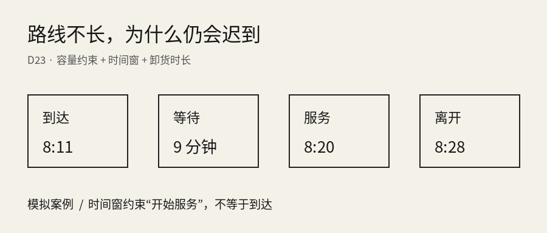
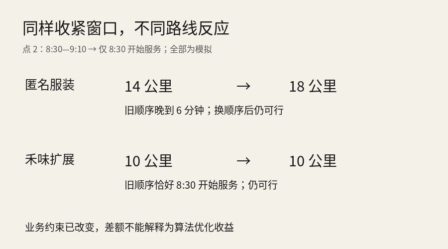

一辆车把货装好，并不意味着当天的配送已经安排妥当。服装协同收货点可能只在交接人员在岗时接货；餐饮门店则可能在开餐准备前集中收货。路线里程看起来很短，车也没有超载，司机却可能在第一站等门、在第二站错过窗口。

D22解决的是“货能不能分给这些车”。今天把问题推进一步：**按这个顺序走，每一站什么时候到、什么时候开始卸货、什么时候离开？**

本文所有数据均为模拟，不连接生产、不真实派车。两个案例分别从D22的十点网络取仓库0和配送点1—4，不换坐标、不改距离与每点2箱的需求，仍有两辆容量12箱的车。四点总需求8箱，一辆车在容量上已经装得下，另一辆允许不出车。这不意味着十点问题突然少了一半工作，而是为了让每一步能手算，明确缩小了问题规模。

## 一、先约定：窗口限制的究竟是哪一个时点

“8:30收货”可能指车到门口、开始卸货，也可能要求全部卸完。三种口径对应不同约束，不能混用。

本练习明确约束**开始服务的时刻**。例如窗口8:20—9:00，8:10到达可以等待，8:20开始卸货合规；9:00开始卸货也合规，即使卸完时已过9:00。若真实业务要求9:00前卸完，就必须改为“服务开始＋服务时长不超过窗口终点”，不能照搬本文。

对每一站记四个时点：

- 到达＝上一站离开＋本段行驶时间。
- 开始服务＝到达时间与窗口起点中的较晚者。
- 等待＝开始服务－到达。
- 离开＝开始服务＋本站卸货时长。

窗口检查为“起点≤开始服务≤终点”。等待并不是行驶，也不是卸货；把这三段拆开，才能解释到底为什么迟到。


这里采用最早开始服务的确定性排程。固定出发时刻和路线，在允许等待、行驶及服务时长确定的假设下，尽早服务不会使后续更晚。它适合独立核验路线；不是要求现实司机无条件提前到场，也没有建模停车、排队和提前等待费用。

## 二、距离和时间分开保存，卸货不能丢

距离矩阵以米计，沿用D22的正交道路教学模型；时间矩阵以分钟计，另存为`time_matrix`。本次教学时间假设是每公里3分钟，再加每一段2分钟的固定开销，对角线为0。它不是实时导航数据，也不是对实际城市速度的估计。

例如匿名服装仓库到点1为3000米，对应11分钟；点1到点2为2000米，对应8分钟。不能直接把3000填进时间维度，也不能认为所有时间成本都与距离成比例，因为每一段还有固定开销。

| 点 | 需求（箱） | 服务开始窗口 | 服装卸货（分钟） | 禾味卸货（分钟） |
|---|---:|---|---:|---:|
| 1 | 2 | 8:20—9:00 | 8 | 5 |
| 2 | 2 | 8:30—9:10 | 10 | 6 |
| 3 | 2 | 8:40—9:40 | 8 | 5 |
| 4 | 2 | 8:40—9:50 | 6 | 4 |

两车均固定8:00出发，最迟10:00回仓；不用的车以`0→0`表示。数据保存的是从午夜起的整数分钟：8:00＝480，8:30＝510。窗口、行驶时间、服务时长不可混用时间戳或秒数。

匿名服装案例只模拟装箱货物向协同点配送，不涉及工序先后、取货、换厂或质检等待。禾味仍是虚构教学案例，原背景为2店、8食材SKU、14天小样本；本篇四点来自其十点配送教学扩展，不能冒充原两店真实数据。每点2箱是外生假设，并非将原SKU公斤数直接相加所得；温层、保鲜时效和混装兼容性也不在本模型中。

## 三、先手算一条服装路线

先不求最优，只检查按编号走的`0→1→2→3→4→0`。

| 站点 | 到达 | 等待 | 开始服务 | 离开 |
|---|---|---:|---|---|
| 1 | 8:11 | 9分钟 | 8:20 | 8:28 |
| 2 | 8:36 | 0 | 8:36 | 8:46 |
| 3 | 8:54 | 0 | 8:54 | 9:02 |
| 4 | 9:10 | 0 | 9:10 | 9:16 |
| 回仓 | 9:33 | 0 | 不适用 | 不适用 |

第一站早到9分钟，这9分钟会进入整条路线的时间账。第二站到达8:36，不是8:28，因为点1还要卸货8分钟，再行驶8分钟。全部站点的开始服务都在各自窗口内，9:33回仓也满足10:00上限。

这条路线距离14公里，出仓8箱，逐站剩余6、4、2、0箱。距离、时间、载荷三本账都通过，才称为可行。不能只截图求解器输出的一行“Objective”。

## 四、求解器怎么表达，而不是怎么替你判断

配套代码的目标仍是**最小化总行驶距离**，不是总行驶时间，不是最少车辆，也不是最短总作业时长。未设置用车固定费，结果使用一辆车只是这次结果，不能推广为最少用车证明。

实现上保留需求回调和容量维度，再增加时间维度。时间回调对弧`i→j`返回：

```python
service_minutes[i] + time_matrix[i][j]
```

此时节点累计时间解释为“开始服务时刻”，不是直接解释为车到场时刻。等待余量允许服务时刻向后推，窗口范围加在客户节点，出发点固定480，终点限制不晚于600。独立检查器根据路线重新计算到达与等待，不把求解器内部累计值直接改名为实际到达。

[OR-Tools的时间窗示例](https://developers.google.com/optimization/routing/vrptw)提供时间矩阵、等待余量和窗口设置的基本方法。本练习另外保留了容量、加入卸货时长，且距离目标与时间约束分开设置。因此，官方示例不能直接当成这里完整的业务模型。

本次使用OR-Tools 9.14.6206，首解为`PATH_CHEAPEST_ARC`，局部搜索为`GUIDED_LOCAL_SEARCH`，时限5秒。每次求解保存版本、设置、原始状态和路线；找到路线后再交独立检查器。没有返回路线时，不应擅自写成“已证明无解”。数据格式错误则应在求解前报告，不能与业务不可行混成一种失败。

## 五、收紧同一个窗口，两类业务并不必然得到同一种结果

将点2窗口从8:30—9:10严格收紧到**仅允许8:30开始服务**。这是极窄窗口的教学压力测试，不建议真实业务直接采用零宽窗口。

匿名服装按编号路线在8:36才到点2，晚6分钟，因此失效。可是“旧顺序不能用了”不代表整个问题无解。重新安排为`0→2→1→4→3→0`：点2在8:17到达，等13分钟至8:30卸货；点1在8:48服务；点4在9:04服务；点3在9:18服务，9:49回仓，仍然合规。

禾味同样按编号走，点1在8:08到达、等到8:20服务、8:25离开，再行驶5分钟，恰好8:30到点2。收紧窗口后，这条旧路线仍然可行。**同样一个“收紧窗口”动作，效果取决于路网、服务时长和原排程中的余量。**



| 案例 | 原窗口求解结果 | 收紧后求解结果 | 按编号旧路线是否失效 |
|---|---:|---:|---|
| 匿名服装 | 14公里，1辆出车 | 18公里，1辆出车 | 是，点2迟到6分钟 |
| 禾味教学扩展 | 10公里，1辆出车 | 10公里，1辆出车 | 否，点2恰好8:30服务 |

服装原窗口求解路线为`0→1→4→3→2→0`，与手算路线顺序不同但距离同为14公里。收紧后的18公里是**新约束下找到的可行结果**，不能说算法“退步4公里”，更不能把两种约束下的差额包装成优化收益。禾味结果持平，也不说明时间窗无用，只说明本次原路线已经满足新窗口。

实践包另枚举四点全排列及两车分割，共120个带车辆标签的候选组合；原窗口分别有66个服装可行组合、88个禾味可行组合，收紧后为28和52。这个小规模枚举用于交叉检查可行性，不作为通用VRP求解能力，也没有把启发式输出宣称为全局最优。空车及两车互换都会被计入，所以这些数字不是不同业务方案的去重数量。

## 六、验收要故意把路线弄坏

独立检查器不调用OR-Tools，根据原始需求、矩阵与路线重算。至少要故意制造以下失败：漏一个点、重复服务、超载、回仓太晚、窗口迟到、内部插入仓库节点、非法编号。输入端另检查矩阵大小、非负整数、窗口起止顺序与单位。

配套测试还包含点2窗口设为8:00的矛盾例。两车都8:00出发，仓库到点2行驶时间大于0，所以不可能按时服务；四点完整枚举也没有可行组合。这个结论来自明确的时间矛盾与穷举，不是因为某次搜索超时。

目前模型仍假设行驶和卸货时长确定、各点一次完整服务、车辆同速、无休息时间和排队随机性。现实上线前还要确认：早到能否等候、等在哪里、司机工时、卸货资源共享、窗口是谁承诺、晚到是否硬性拒收。没有这些业务口径，求解器参数再多也不能使错误模型变成可执行安排。

## 实践资料与下一步

- [下载可复现实验包](/downloads/d23-time-windows-practice.zip)：双案例输入、路线证据、逐站CSV、求解与检查代码、测试及复现说明。
- [下载文章与配图](/downloads/d23-time-windows-article.zip)
- [下载配图包](/downloads/d23-time-windows-images.zip)

先运行不依赖求解器的已保存路线复核，再按说明安装锁定版本重新求解。重新运行可能返回不同但可行的路线，实测耗时也会变化，不能要求逐字复现启发式搜索的内部路径。

D24将继续把容量、窗口与搜索时限拆成单因素实验。今天最值得保留的不是一条看起来漂亮的线路，而是一张可以逐站核对的排程：**车何时到，等多久，何时开始服务，何时离开。**
