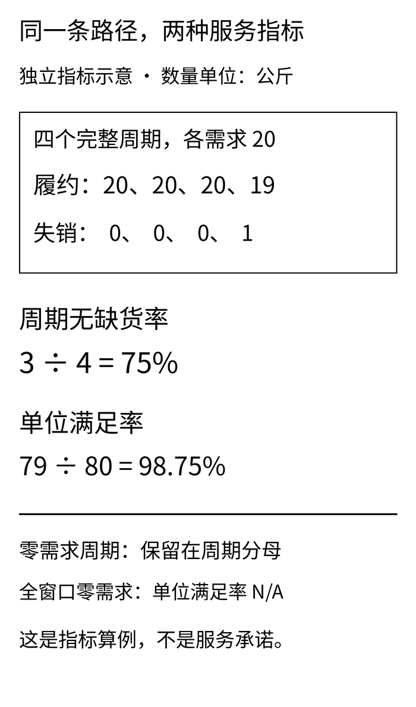
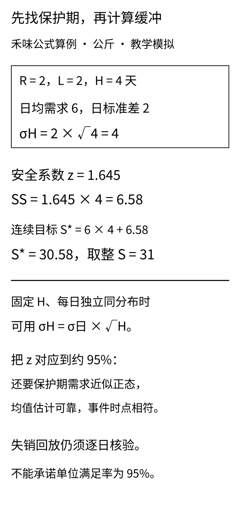
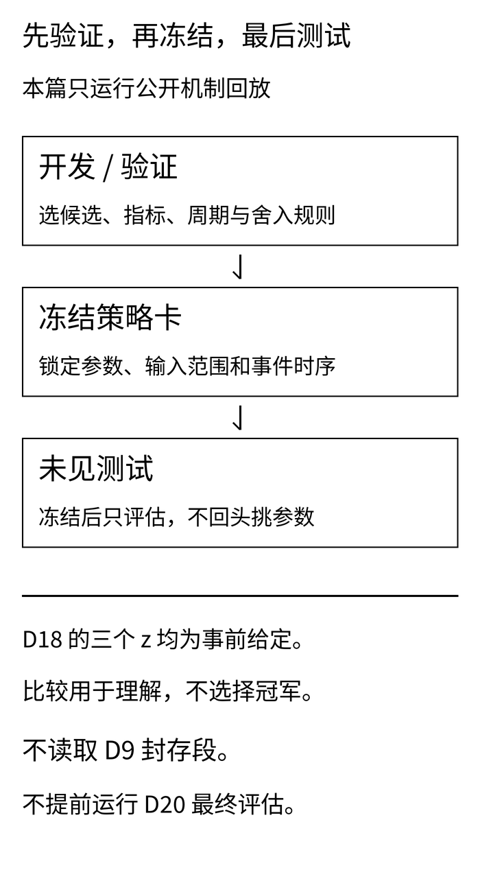

禾味采购在表格里填了“服务水平95%”。门店问：“是说二十个补货周期里大约十九个不缺货，还是一百公斤需求里能满足九十五公斤？”

这两个目标都像“95%”，却会把安全库存带向不同的数。若连分母都没有说清，选一个熟悉的安全系数、再乘上标准差，只会让误解多几位小数。

[D17](/blog/periodic-review-order-up-to/)把周期补货拆成两步：到复核日，再按库存位置补到目标S。这一篇接着问：**目标里为什么要留缓冲，缓冲保护哪段时间，又用什么指标检查？**

## 一 “不缺货”和“满足多少”，分别记账

**本文的案例、需求、数量、参数、日期和订单号全部为教学模拟，不对应真实品牌、项目规则或经营收益。** 禾味是虚构的两店、八食材SKU连锁，本篇只回放A店SKU01，另外15条店×SKU组合未生成或评估。匿名服装案例是另一个单SKU库存节点，单位为件，不能与禾味的公斤混加。

周期无缺货率先把一个周期判为“发生过缺货”或“没有缺货”，然后数周期。单位满足率则数需求数量，关心缺口有多大：

```text
样本周期无缺货率 = 没有未满足需求的完整周期数 / 完整周期数
单位满足率 = 即时履约数量合计 / 原始需求数量合计
```

“即时”是指需求到来时用可用现货满足；若以后补发，不能倒回去修改本次即时满足率。本文按失销处理，缺口当天离开，不进入后续欠交队列。

MIT《Logistics Systems》第11讲第13页将周期服务水平定义为补货周期内不发生缺货的概率，第12页另列按缺口数量衡量的指标。这里分别报告**给定路径上的样本比例**，不把有限样本比例说成已经估准的长期概率。[讲义原文](https://ocw.mit.edu/courses/esd-260j-logistics-systems-fall-2006/8b53c45fd26ffff706d815131e8d177e_lect11.pdf#page=13)

看一个独立算例：四个完整周期各需求20公斤，履约分别为20、20、20、19公斤。只有最后一个周期失销1公斤：

- 周期无缺货率为3÷4＝75%。只差1公斤，整个周期仍被记为一次缺货周期。
- 单位满足率为79÷80＝98.75%。它保留了缺口的数量大小。

这里98.75%高于75%，但不能把这个大小关系当成任何数据上都成立的规则。周期需求规模不同、缺口集中程度不同，两个分母的权重就不同。也不能把每天的满足率简单平均，冒充汇总数量满足率。

零需求的处理要提前写进指标卡。本篇的完整周期即使需求全为0，也保留在周期分母中，记为“没有未满足需求”；同时单列零需求周期数，免得静默周期撑高比例。**若整个统计窗口需求为0，单位满足率记为N/A，不写100%或0%。** 若没有任何完整周期，周期无缺货率同样为N/A。

[](images/d18-01_service.png)

## 二 安全库存，是保护期均值之外的缓冲

先冻结时间轴，再写公式。本篇沿用D17的日内顺序：**日初到货 → 当日需求与履约 → 日末复核下单**。L仍表示下单后的完整等待日数，t日日末下单，在t＋L＋1日日初可用。L＝2时，第2日末的订单第5日初到，不是第4日初到。

R＝2、首次第2日复核时，下一次复核在第4日末，它下的订单第7日初才可用。站在第2日末，直到下一次订单可用前，要面对第3、4、5、6日四天需求。因此这里的保护期H＝R＋L＝4天。换成日中到货、工作日日历或随机提前期，必须重新核对端点，不能直接套这个天数。

最简的定期复核目标可以写为：

```text
保护期 H = R + L
保护期平均需求 μH = μ日 × H
安全库存 SS = z × σH
连续目标 S* = μH + SS
```

σH表示**保护期需求的不确定性**，不是“日标准差乘天数”。在固定H、每日需求独立同分布且方差有限的简化条件下：

```text
保护期方差 = H × 日方差
保护期标准差 σH = σ日 × √H
```

这一步是方差相加，**不需要先假设正态**；把z＝1.645解释为约95%的分位，才进一步需要保护期需求或相应预测误差近似正态，且均值、波动与执行模型适用。MITx SC1x的周期复核小节给出“保护期均值＋安全系数×保护期误差尺度”的结构，本文用简化训练数据手算，不直接继承其模型的服务结论。[概念文档第46页](https://scx-static-assets.s3.amazonaws.com/SCx%20Key%20Concept%20Documents/MITx_SCx_KeyConcept_SC1x_FV.pdf#page=46)

禾味的九条模拟训练需求，均值为每天6公斤，样本标准差为2公斤，样本方差使用n－1作分母。取H＝4，σH＝2×√4＝4公斤；给定z＝1.645，SS＝6.58公斤，连续目标S*＝24＋6.58＝30.58公斤。约95%来自标准正态的单侧累计概率，不是双侧95%区间常见的1.96，更不是“单位满足率95%”。

为了让整数台账容易手算，本篇把目标库存位置的取整步长事前设为1公斤，目标向上取整为S＝31公斤。这只是目标参数的精度约定，不是采购包装规格；本例没有订单最小增量或MOQ约束，出现小数需求时仍允许小数订单。**取整后的实际目标缓冲为31－24＝7公斤，和公式SS＝6.58公斤分别报告。** 安全库存也不是每天锁在货架上、永远不能动的7公斤；真实现货会随到货与需求变化。

[](images/d18-02_buffer.png)

## 三 一个熟悉的z，不是现成的服务保证

公式里的每一项，都可能在真实业务里失去原来的含义。

第一，日需求若有星期效应、趋势或促销，原始需求标准差会混入可预测变化。此时应先把预测结构说明白，再研究**在决策时点可获得的、保护期累计预测误差**。不能把训练残差、一步误差和多步累计误差当成同一个σ，也不能认为加大SS就修好了持续低估的偏差。

第二，每日需求相关时，累计方差还包含日与日之间的协方差。连续旺日、连带采购、成套生产都可能使√H缩放失真。固定提前期也很关键；供应延误和需求高峰若同时发生，随手把平均L塞进公式，会遗漏风险。

第三，低频、偏态、突发或大量为零的需求，未必适合正态近似。H只有4天，不能因为“加了几天”就宣称中心极限定理已经替模型背书。少量训练样本只是演示估计方法，不能证明真实分布；样本标准差为0也只表示已观察样本没有波动，不证明未来永不缺货。

第四，实际销售不一定等于原始需求。缺货时没卖出去的需求若看不见，拿销量估均值与波动会把供应限制当成需求变小。本文给定需求可以完整观察，是模拟器的假设；真实场景要接上[D13的缺货截尾检查](/blog/rolling-backtest-stockout-censoring/)。

最后，公式的分位事件与执行台账的“某个周期内是否发生过缺货”并非天然一一对应。失销不会像欠交那样继续减少库存位置；初始库存、已有在途、取整和日内顺序都会影响轨迹。**本文把公式当作产生候选目标的起点，再逐日回放检查，而不是宣称S＝31就保证95%的周期无缺货。** 若业务目标是单位满足率，还需按明确的缺货模型与周期规则验证或求解，不能直接把该百分比塞进正态分位函数。

## 四 禾味回放：先固定周期，再看缺口

三组禾味回放都从现货24公斤、在途0开始，R＝2、L＝2、首次复核日2固定。只改变给定的z＝0、1、1.645，对应目标S＝24、28、31公斤；没有为了照顾高z组而给它更多初始现货。

九条训练需求为4、4、4、4、6、8、8、8、8公斤，均值6，离差平方和32，样本方差32÷8＝4，标准差2。公开15日回放需求为6、6、6、6、9、9、8、8、6、6、0、0、10、10、4公斤，总计94公斤。这是为讲清机制另建的路径，不是D17七日路径的后续测试。

三组都用失销模型，BO＝0，IP＝可用现货OH＋有效在途OO；复核日q＝max(0,S－IP)，非复核日不下单。本包不含预留、取消、部分到货或随机交期。

拿z＝1.645这一组手算：第2日末现货12、在途0，IP＝12，订31－12＝19，第5日初到。第4日末现货耗完，但已有19在途，故只订12，第7日初到。到第8日，现货5面对需求8，当天履约5、失销3；日末仍有18在途，IP＝18，订13。失销的3已经离开，不再作为欠交扣一次，也不能直接按原始需求8把IP再减一次。

这里的完整周期按**计划收货节拍**事前划分：首次复核日2加L＋1，得到第5日日初，再每隔R＝2天划一个周期。因此统计第5–6、7–8、9–10、11–12、13–14日，共五个完整周期。某次复核订货量为0，也保留相应的计划周期，不能因为没有真实收货就把它删掉。

第1–4日是启动段，第15日属于尚未完整观察的尾周期，二者不进入本篇的周期服务指标。单位满足率也只用同一组完整周期里的需求与履约，保证两个指标比较的是同一个窗口。启动与尾部的需求、失销和库存并未删除，仍在全15日台账与全窗口汇总中披露。五个周期还共享库存状态，不能当成五次相互独立的试验。

<div role="region" tabindex="0" aria-label="D18hewei完整周期服务汇总，数量单位公斤，可横向滚动" style="overflow-x:auto;max-width:100%;margin:28px 0">
<table id="d18-hewei-service" style="min-width:760px;width:100%;max-width:none;display:table;margin:0;white-space:nowrap">
<thead><tr><th scope="col">z</th><th scope="col">目标S</th><th scope="col">完整周期需求</th><th scope="col">履约</th><th scope="col">失销</th><th scope="col">周期无缺货率</th><th scope="col">单位满足率</th></tr></thead><tbody>
<tr><td>0</td><td>24</td><td>66</td><td>56</td><td>10</td><td>60%</td><td>84.85%</td></tr>
<tr><td>1</td><td>28</td><td>66</td><td>60</td><td>6</td><td>60%</td><td>90.91%</td></tr>
<tr><td>1.645</td><td>31</td><td>66</td><td>63</td><td>3</td><td>80%</td><td>95.45%</td></tr>
</tbody></table>
</div>

z从0升到1，单位满足率从84.85%升到90.91%，但周期无缺货率仍是60%：缺口变小了，发生缺口的周期数却没减少。z＝1.645时，五个周期有四个没有缺口，样本周期无缺货率80%；恰好得到95.45%的单位满足率，也不构成“z＝1.645保证95%满足率”的证据。

三组都包含第11–12日这个零需求周期。以z＝1.645组为例，第12日末现货19、在途12，IP＝31，复核但不下新单；这个周期仍在五周期分母中。若另报仅含正需求周期的诊断比例，应标成3÷4＝75%，不能偷换本表4÷5＝80%的定义。

全15日，三组履约84、88、91公斤，失销10、6、3公斤，期末现货0、4、7公斤，在途均20公斤。以z＝1.645为例，现货守恒为24＋74－91＝7；在途守恒为0＋94－74＝20。尾单20公斤在第14日末下、第17日初到，第15日截止时必须保留在途。以上是路径实算，不是成本或利润结果。

读这个表时，先检查分母，再看比例。固定的五个完整周期与完整需求数量不能随z改变；变化的是履约和缺口。若把某组前几天缺货移到“预热期”之外，再把另一组全部计入，就已经不是同一口径的比较。

## 五 匿名服装：缓冲不能替代协同口径

服装生产协同中，采购单、生产工单、外协回货和验收记录可能都指向同一批供给。先把有效在途按真实供给去重，确认什么时点可以分配，再谈安全库存。否则重复计入的在途，会让IP虚高，增加安全系数也未必补到真正的缺口。

本篇的匿名节点只模拟一种成品，训练日均需求8件、样本标准差3件，同样R＝2、L＝2、H＝4。z＝1.645时，σH＝6件，公式SS＝9.87件，S*＝41.87件；目标按1件步长向上取整，得到S＝42件，实际目标缓冲10件。

九条训练需求为5、5、5、5、8、11、11、11、11件。回放需求为8、8、8、8、12、12、11、11、8、8、0、0、14、14、6件，总计128件。三组共同从现货32件、在途0开始，z＝0、1、1.645对应S＝32、38、42件。按与禾味相同的完整周期边界统计，数量单位均为件：

<div role="region" tabindex="0" aria-label="D18apparel完整周期服务汇总，数量单位件，可横向滚动" style="overflow-x:auto;max-width:100%;margin:28px 0">
<table id="d18-apparel-service" style="min-width:760px;width:100%;max-width:none;display:table;margin:0;white-space:nowrap">
<thead><tr><th scope="col">z</th><th scope="col">目标S</th><th scope="col">完整周期需求</th><th scope="col">履约</th><th scope="col">失销</th><th scope="col">周期无缺货率</th><th scope="col">单位满足率</th></tr></thead><tbody>
<tr><td>0</td><td>32</td><td>90</td><td>76</td><td>14</td><td>60%</td><td>84.44%</td></tr>
<tr><td>1</td><td>38</td><td>90</td><td>82</td><td>8</td><td>60%</td><td>91.11%</td></tr>
<tr><td>1.645</td><td>42</td><td>90</td><td>86</td><td>4</td><td>80%</td><td>95.56%</td></tr>
</tbody></table>
</div>

全15日履约分别112、120、124件，失销16、8、4件。第一组的16件比表中14件多2件，来自第15日这个未完整观察的尾周期；它没有进服务指标分母，但必须在全窗口业务量中披露，不能抹掉。三组期末现货0、4、8件，在途均28件。

z＝1.645组现货守恒为32＋100－124＝8，在途守恒为0＋128－100＝28。与禾味一样，它的样本周期无缺货率只有80%，且包含一个零需求周期。

这里仍把未满足需求记为失销，**不代表真实服装订单可以直接取消**。若合同要求延期履约，要改为欠交模型，定义旧欠交与新订单的优先级、取消与补发，再重新计算指标。只有一个库存节点的沙盘，也没有BOM、工序能力、齐套、换线或良率，不能推导服装排产收益。

两案都不把公斤与件求和，不把短路径上较高的满足率换算成节约金额，也不从三组给定参数中宣布“最优z”。缓冲通常还要同时面对保质期、报损、资金与产能约束，本篇没有这些成本或约束数据。

## 六 先验证并冻结，再碰最终测试

真正选择策略时，应先在开发或验证段决定候选z、R、L、预测方法、误差尺度、取整规则和评价窗口，再冻结策略卡；之后只在未见测试上评估。测试结果如果不好，应该如实记录。看过它再改z、换窗口、移动周期边界或添加紧急单，就是新一轮开发，不能继续把同一段叫作未见测试。

**本篇做的是公开机制回放，没有做候选优选、验证集排名或最终未见测试。** 三个z＝0、1、1.645事前给定，训练数据用于演示均值和样本标准差，15日需求是公开的人工教学路径。训练段与回放段分开，并不自动构成可信的外部验证，更不能把短路径误称95%达标证明。

初版机制回放前记录了参数与输入回执。对抗审查发现“目标取整步长”曾被误写成“采购最小增量”，发布版因此明确标为v2，保留v1回执与修订说明，再冻结v2内容后复跑；需求、候选z、目标数值与服务结果没有改变。**v2是看过公开路径后的审查修订，不是重新获得了未见测试资格。** 发布前另外记录代码完整性回执，不把后来定稿的代码假称首次运行前已经冻结。回执能检出文件漂移，但不是不可篡改的第三方时间证明。若输入或规则改变，另开实验版本，不静默改回执掩盖变化。本篇不读取D9的sealed，不重跑其原测试段，也不提前运行D20最终评估。

[](images/d18-03_freeze.png)

## 七 下载后，从分母与时点开始攻击

下载[D18安全库存实践包](/downloads/d18-safety-stock-practice.zip)，用Python 3.10或以上解压，在包内运行：

```bash
python -m unittest -v
python run.py
```

计算只用Python标准库，脚本按自身位置寻找输入，不依赖完整博客仓库。包内包括训练与回放CSV、冻结策略卡、六组逐日台账、周期统计、订单事件、期末在途、公式计算与哈希回执。同一输入重复运行应得到相同字节的结果。

对抗检查可以从五处下手：

1. **分母。** 零需求周期是否保留？总需求为0是否输出N/A？尾部半个周期是否误算完整？单位满足率是否用了同一统计窗口的合计数量，而非日百分比平均？
2. **公式。** 日方差是乘H，标准差是乘√H。样本标准差使用n－1；样本数不足、负数或非有限数必须拒绝。理论SS与取整后缓冲不要混写。
3. **时点。** 日初先到货，之后需求，最后复核；下单只增加在途，不增加当天现货。t日末的新订单必须在t＋L＋1日初到。未来需求变化不能倒改更早的决策。
4. **守恒。** 需求＝履约＋失销；现货和在途分别守恒，窗口后到货的订单仍保留。失销不再留成欠交重复扣减，也不把数量0生成空订单。
5. **冻结。** 输入、代码或规则漂移应被识别；实践包不能从其他文章的封存目录读数据，也不能为得到更漂亮的服务指标悄悄挑参数。

另附[文章Markdown与配图](/downloads/d18-safety-stock-article.zip)、[黑白配图与独立重绘脚本](/downloads/d18-safety-stock-images.zip)。封面900×383，正文使用竖版大字图，含可编辑SVG与手机宽度预览。

安全库存的第一步，往往不是查z表。先写清**服务指标的分母、保护期的端点、误差尺度的来源，以及哪些数据还没看过**。这几件事对齐后，一份多备出来的库存，才有明确的保护对象和可以复核的理由。
