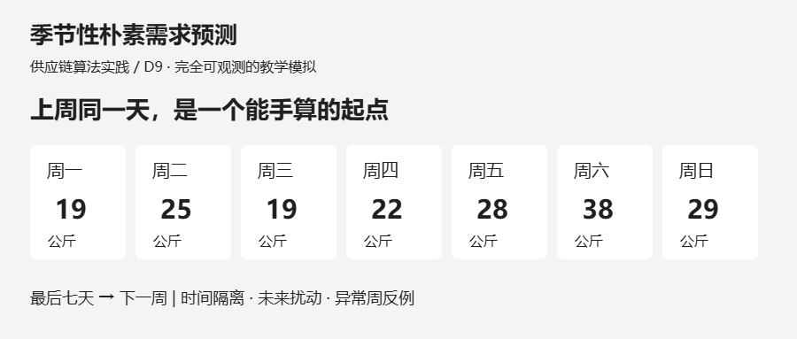
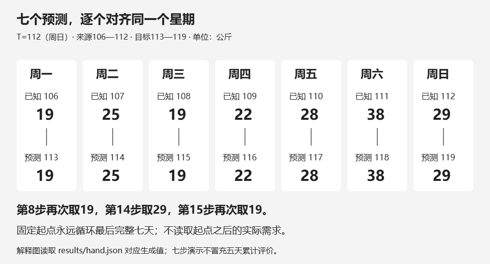
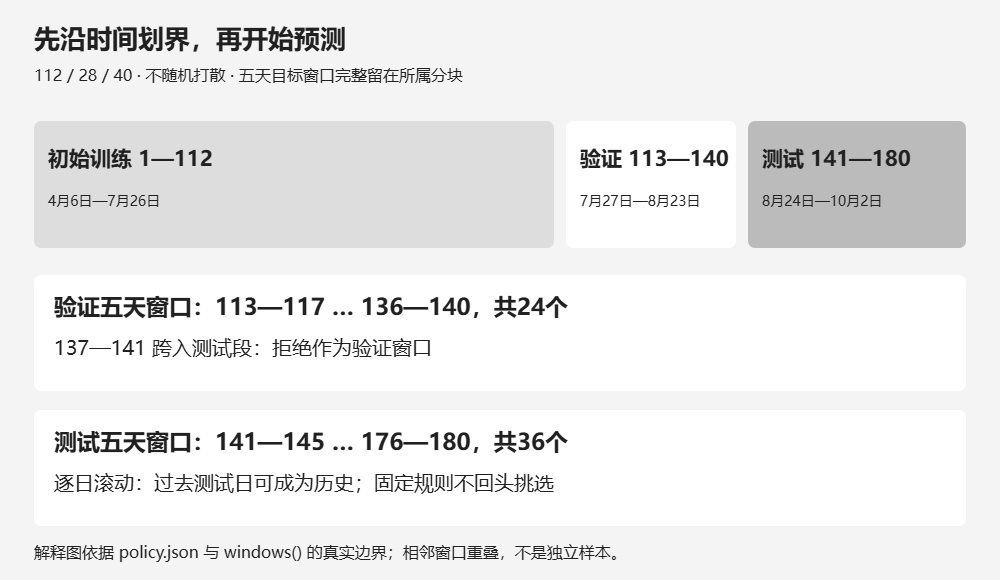
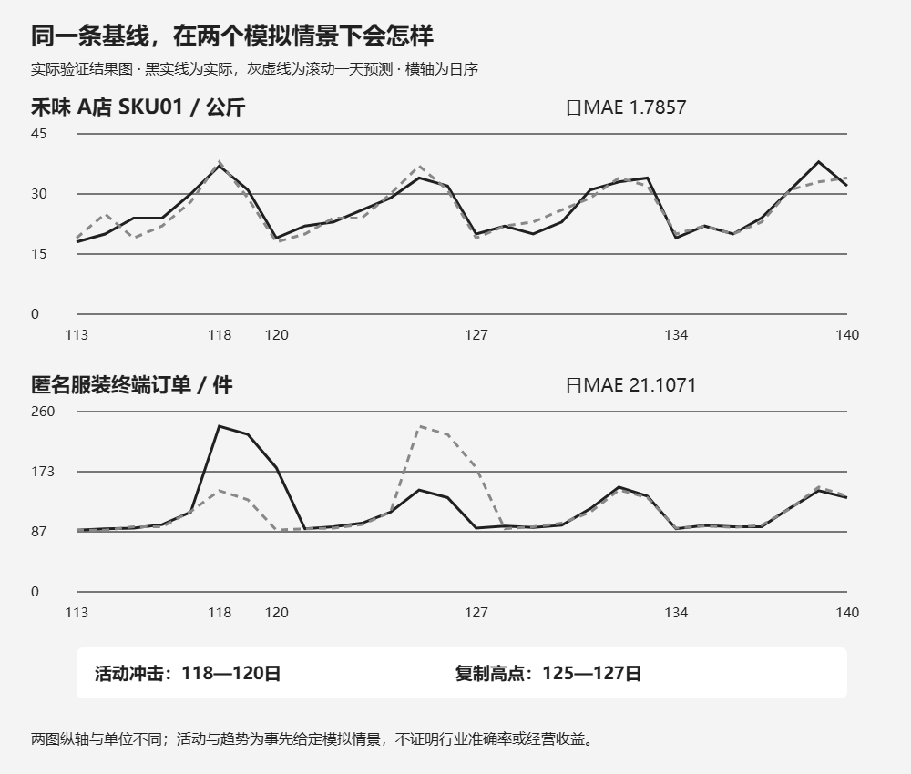
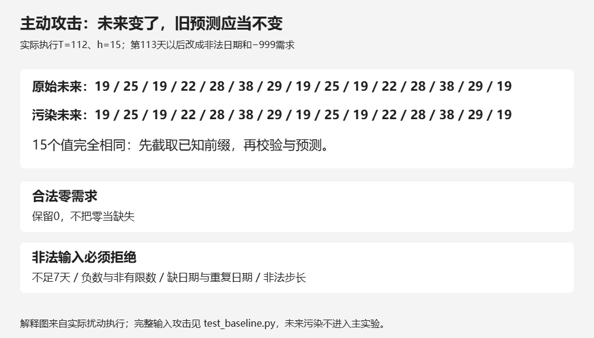

门店问下周六要准备多少食材，生产协同人员问一场直播会带来多少订单。这两句话都在问未来，却不一定适合用同一套历史规律回答。

[D8整理了从履约到库存的指标证据](/blog/supply-chain-metrics-evidence-package/)，也留下一个缺口：库存覆盖需要未来需求，但当时那条需求路径只是人工输入。D9从最小的可检验预测开始：**如果星期规律能够延续，下周同一天就先用最近一次同星期的需求。** 这叫季节性朴素预测。这里的“季节”可以是一周，并不限于春夏秋冬；“朴素”表示规则简单，不表示结果必然准确。

本文只建立可复算的基线，不把预测直接变成采购、排产或派车指令。复杂模型日后必须在相同数据和评价规则下与它比较；今天还没有据此证明任何模型更优。

## 一 先说清楚我们在预测什么

**数据与案例声明。** 禾味是虚构的餐饮连锁，业务背景仍为2店、8种食材，共16条店×SKU序列。本篇核心只运行 **A店、SKU01食材、公斤/日** 一条需求序列；其余15条没有生成或评估。匿名服装生产协同案例另用一条模拟终端订单需求，单位为件/日。所有日期、数量、活动、演示单号均为教学模拟，不对应真实品牌、真实项目、经营数据或收益。

第一周的14天样本能帮助发现字段和粒度问题，却只有两个星期，不足以证明周规律可靠。本次另建 **D9-v1**：从2026年4月6日（周一）到10月2日，连续180天。它延续的是同一虚构业务背景，**不是把D8的14天库存快照拼接成需求历史**，也不是把14天机械复制到180天后称为真实证据。

主实验假设没有缺货，需求完全可观测。食材的“需求”指当天真实需要消耗的公斤数，不是门店的订货批量；服装的“需求”指终端订单件数，不是工厂已安排生产的数量。两种单位分别报告，不能相加。

生成器把星期效应、少量噪声和情景扰动写明。禾味的周一至周日基础量依次为 **20、22、21、24、28、36、32公斤**。每日再加一个−3至3的整数扰动，最后取与0的较大值。服装基础量为 **80、84、86、88、110、140、126件**，使用独立随机状态，额外加入每14天上升1件的缓慢趋势，以及第118—120天每天增加90件的模拟直播活动。

固定种子为 **20261102**；服装为种子加1。为避免依赖随机库版本，脚本明确定义整数递推：

```python
state = (1664525 * state + 1013904223) % (2 ** 32)
noise = state % 7 - 3
demand = max(0, weekday_base + noise + trend + promotion)
```

这只是可复现的教学机制，不是从真实业务拟合出的概率模型。周规律较稳的禾味和被活动打断的服装，正好让我们观察同一规则在不同条件下的表现；不能把这种设计当成代表行业的抽样调查。

## 二 一条公式，把预测起点与目标日期分开

设 `T` 为最后一个已经观察到需求的日子，`h` 为向前预测几天，`m=7` 为周周期。预测记作 `ŷ(T+h | T)`，竖线右侧强调：计算时只能使用截至第T天的信息。

当 `1 ≤ h ≤ 7` 时：

```text
ŷ(T+h | T) = y(T+h−7)
```

例如周日结束后预测下周一，复制最近的周一，而不是复制昨天周日。若同一起点要预测超过一周，仍然循环**起点之前最后七天**：

```text
k = floor((h−1)/7)
ŷ(T+h | T) = y(T+h−7(k+1))
```

第8步与第1步取同一个已知值，第14步与第7步取同一个已知值，第15步又回到第1步。不能在第8步读取第T+1天的实际需求，那是未来泄漏。本文据[FPP3第5章5.2的季节性朴素方法](https://otexts.com/fpp3/toolbox.html#seasonal-na%C3%AFve-method)解释原理；下面是独立的Python实现，没有复制书中的R案例。

```python
def seasonal_naive(history, horizon, period=7):
    # 包内先校验日期连续、需求非负有限、步长为正整数。
    # 历史不足一个完整周期时明确报错。
    return [history[-period + (h % period)]["demand"]
            for h in range(horizon)]
```

这里代码的 `h` 从0开始，所以与数学公式的 `h` 相差1。完整函数见实践包的 `baseline.py`，不要省略注释所说的输入校验后直接接生产数据。

### 把七个值真的手算出来

取 `T=112`，即7月26日周日。第106—112天（7月20—26日）的实际需求为 **19、25、19、22、28、38、29公斤**。因此第113—119天（7月27日至8月2日）的预测依次为同样七个数。

<p><small>窄屏可左右滑动表格，查看完整列。</small></p>
<div class="d9-table-scroll" role="region" tabindex="0" aria-label="七天手算预测（可横向滚动）" style="overflow-x:auto;max-width:100%;margin:28px 0">
<table style="min-width:560px;width:100%;max-width:none;display:table;margin:0;white-space:nowrap"><thead><tr><th>星期</th><th>已知来源日</th><th>目标日</th><th>预测公斤数</th></tr></thead><tbody><tr><td>周一</td><td>第106天</td><td>第113天</td><td>19</td></tr><tr><td>周二</td><td>第107天</td><td>第114天</td><td>25</td></tr><tr><td>周三</td><td>第108天</td><td>第115天</td><td>19</td></tr><tr><td>周四</td><td>第109天</td><td>第116天</td><td>22</td></tr><tr><td>周五</td><td>第110天</td><td>第117天</td><td>28</td></tr><tr><td>周六</td><td>第111天</td><td>第118天</td><td>38</td></tr><tr><td>周日</td><td>第112天</td><td>第119天</td><td>29</td></tr></tbody></table>
</div>

[](images/d9-02_weekdays.png)

这一周预测合计180公斤，只是一次七步演示。它的目标位于验证段，但**不冒充五天累计评价**。若另问这一固定起点的前五天，预测和是19＋25＋19＋22＋28＝113公斤；第六、七天不能混进这个五天答案。

## 三 112／28／40，不是随机抽三堆数据

180天按时间连续分块：第1—112天为初始训练，第113—140天为验证，第141—180天为封存测试。随机打散会让未来记录进入过去的预测历史，因此这里不使用随机训练测试切分。

[](images/d9-01_split.png)

季节性朴素没有要拟合的系数，112天仍有意义：它定义首次预测时可以看到的历史；并非算法必须积攒112天才能计算。`m=7` 来自本篇周规律的事先假设，没有在测试集上比较多个周期后择优。

评价时使用滚动起点：预测某天前，只读取前一天及更早的实际需求。验证段共28个一天预测，测试段共40个一天预测，覆盖完整测试区间。测试第2天可以用已经发生的测试第1天更新历史，这符合实际信息到达顺序；它**不是在第140天一次性预测40天**，不能把两种误差当成同一结果。

另设五天累计需求评价：在每个起点一次预测未来五天，比较“预测五天合计”与“真实五天合计”。验证目标窗口从113—117一直滑到136—140，共24个；测试从141—145滑到176—180，共36个。第137—141天会跨过边界，不能作为验证窗口。窗口互相重叠，不能把它们当成24或36次独立实验来计算显著性。

误差只用容易复算的两项：

```text
日MAE = 所有评价日的 |真实需求−预测需求| 之和 / 评价日数
五天合计MAE = 各完整窗口的 |真实五天和−预测五天和| 之和 / 窗口数
```

两者单位分别为公斤/日预测误差与公斤/五天合计误差（服装为件），量级不能直接比较。累计误差还可能因正负偏差抵消而较小；不能解释为每一天都预测得准。

### 封存怎样留下可检查的痕迹

实践包的 `data/` 只存前140天，`sealed/` 单独存最后40天。先运行 `prepare`，只生成验证结果；确定代码和规则后运行 `freeze`，记录代码、规则和全部CSV的SHA-256；`finalize` 检查这些字节没有变化后，才打开测试标签计算最终结果。

这是可审计的流程约定，**不是访问控制**。读者拿到整个包后当然能够打开CSV，哈希本身也不能证明作者此前从未看过标签。为此审查记录另外记下候选与执行顺序。若因实现错误需要修复，必须披露修复、重新审查和冻结；不能看到测试误差后改变周期、生成种子或活动安排，直到数字好看。发布前曾修复Windows与Linux换行不同导致冻结哈希变化的问题，统一文本为LF后重新冻结和复算；所有需求、预测和误差数值逐项保持不变，没有更换实验规则。

## 四 两种业务情景，为什么不能一见周规律就照抄

### 禾味：周末高峰可以形成起点，但不是充分证明

在这条模拟食材序列里，周末基础需求高于周初，复制对应星期能保留这种差别。验证段28天的日MAE为 **1.7857公斤**；24个五天合计窗口的MAE为 **3.2917公斤**。这些是下载包实际运行的结果，不是给公式配上的示意数字。

这个结果仅说明：在我们事先写入周规律和小扰动的D9-v1里，规则容易工作。它没有回答节假日、菜单变化、关店或天气影响；没有与其他预测方法比较，也没有据此计算少买多少食材、减少多少损耗。

若店里实际需要30公斤，却因只有20公斤库存只消耗或销售20公斤，观察到的20不等于需求。一个独立反例是 `sales=min(demand, available)`：复制这种被库存截断的销量，会复制供给限制。主实验不混入该反例，也没有偷偷用未来需求修复销量。

### 匿名服装协同：活动会让错误在下一周再出现

设一个完全虚构的演示单号 **SIM-LIVE-001**，代表第118—120天的一场直播活动，每天给终端订单需求加90件。与此同时，基础需求每14天缓慢上升1件。生产协同团队可以拿预测讨论面料、产能与交付风险，但排程是决策输出，不能反过来当成终端需求标签。

活动前，最近一周没有活动增量，朴素规则会低估这三天；活动结束后的一周，同星期又复制到活动高点，容易高估。下载包的服装验证段日MAE为 **21.1071件**，五天合计MAE为 **115.8750件**。数字不能与禾味公斤误差横比，也不能推出服装行业通常更难预测：两条模拟机制和单位都不同。

[](images/d9-03_cases.png)

上图是实际CSV和验证预测画出的结果图，非设计草图。灰虚线表示预测，黑实线表示实际。活动、趋势和异常都可能破坏“上周可代表下周”的前提；可解释的失败同样是基线的价值。真实业务需补活动日历、缺货与休店标记，再设计后续比较，不能因为本例有活动就临时给测试预测加90件。

### 最终测试结果

<p><small>窄屏可左右滑动表格，查看完整列。</small></p>
<div class="d9-table-scroll" role="region" tabindex="0" aria-label="最终四十天测试结果（可横向滚动）" style="overflow-x:auto;max-width:100%;margin:28px 0">
<table style="min-width:720px;width:100%;max-width:none;display:table;margin:0;white-space:nowrap"><thead><tr><th>模拟序列</th><th>测试日数</th><th>日MAE</th><th>五天窗口数</th><th>五天合计MAE</th></tr></thead><tbody><tr><td>禾味A店SKU01（公斤）</td><td>40</td><td>2.1750</td><td>36</td><td>4.1111</td></tr><tr><td>匿名服装订单（件）</td><td>40</td><td>2.9250</td><td>36</td><td>5.9167</td></tr></tbody></table>
</div>

测试结果用于报告这套固定规则的最后一次观察，不据此换参数或选择“最好”的案例。服装测试段没有第118—120天的直播冲击，因此这40天的误差不能验证算法应对活动的泛化能力。测试误差也不能自动转换成库存服务率、采购节省或利润提升；那些需要独立的库存回放和业务成本假设。

## 五 不只看误差，还要主动尝试推翻实现

第一项攻击是修改预测起点后的数据。保留第1—112天，把第113天及之后的需求改成非法负数，日期改成非法字符串；原来在T=112做出的15步预测仍必须完全相同。这比只改一个普通未来数值更容易发现“先验证全表、再截历史”的隐形依赖。`forecast_at` 先截取可见前缀，再校验和预测；数据入口另对整份生成数据做完整性检查。

[](images/d9-04_boundaries.png)

第二项攻击是边界：不足7天历史时报错，不从未来补齐；零需求合法；负数、非有限数、空值、非法日期、缺日期、重复日期和倒序都拒绝。步长及周期必须是正整数，布尔值也不当作整数接受。第7、8、14、15步分别检查跨周索引，五天窗口检查首尾和数量。

这里拒绝的是模型无法按当前契约解释的输入，**不是自动判定真实业务没有零需求或不允许退货**。若以后要预测净销量或有营业日历的序列，应先更换数据契约，而不是在这个函数里悄悄丢行、补零、把负值取绝对值。

## 六 下载后怎样复算

下载 [D9季节性朴素实践包](/downloads/d9-seasonal-naive-practice.zip)，解压后在包内用Python 3.10或以上版本执行，不需要Docker，也没有第三方Python依赖。原包已含冻结回执与最终结果，直接核对它们可执行：

```bash
python -m unittest -v
python run.py finalize
```

若要从头完整重建，先将包内 `freeze.json` 和 `results/test.json` 移到包外备份，再执行：

```bash
python run.py prepare
python -m unittest -v
python run.py freeze
python run.py finalize
```

若未移走旧回执和测试结果，`prepare` 会明确拒绝，防止新数据携带旧测试成绩。`prepare` 按固定规则重建CSV与验证结果；`freeze` 更新本地冻结回执；`finalize` 核对回执并写出40天测试明细。文章舍入数值以JSON完整精度为准。

包内有生成器、预测函数、测试、分块与规则文件、七值手算、验证和测试明细以及README。另有 [独立配图包](/downloads/d9-seasonal-naive-images.zip)（PNG与可编辑SVG）和 [文章Markdown与配图](/downloads/d9-seasonal-naive-article.zip)，便于下载复用。图1、图2与图4为依据实际规则和输出排版的解释图，图3为实际验证结果图。

本篇经过两位独立审查者的两轮对抗式检查。第一轮发现旧测试成绩可能残留、CSV分块标注未核验，修复后补上固定七值预期；第二轮独立重算全部窗口并执行1,392组公式与未来污染检查，另修复结果图注释遮挡和实践包混入仓库专用工具的问题。完整发现、修复和可重跑审查脚本保存在实践包的 `review/` 中。审查只能说明这些具体攻击已通过，不能证明对所有真实需求都准确。

做到这里，我们得到的是一条能讲清“用了哪七天”、能复算误差、也能暴露活动周问题的基线。进入更复杂的方法前，先能回答两个问题：预测当时究竟知道什么；新方法是否在同一评价边界下比这条简单规则更有用。

## 参考资料

- [Hyndman与Athanasopoulos，FPP3第5章5.2：Seasonal naïve method](https://otexts.com/fpp3/toolbox.html#seasonal-na%C3%AFve-method)：本文核对的公式与概念来源，2026年11月2日查阅。业务案例、生成机制和Python实现为本篇教学设计。
- 本系列《供应链算法与AI产品实践30天学习计划》D9及统一实验约定：核心一店一SKU，180天固定分块，主实验使用完全可观测需求。该计划是实验范围依据，不是真实业务证据。
