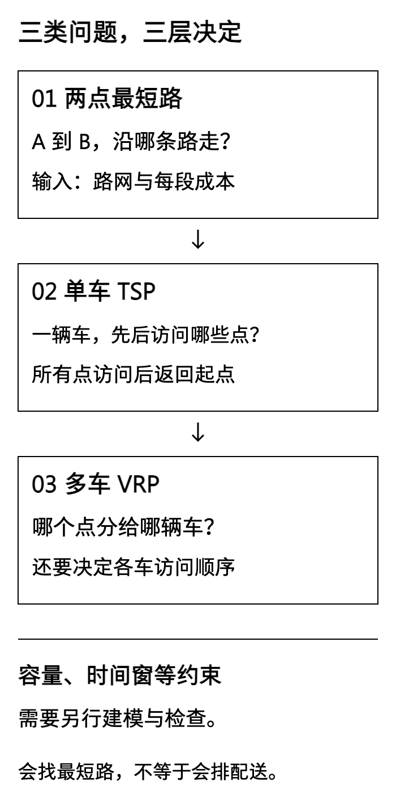
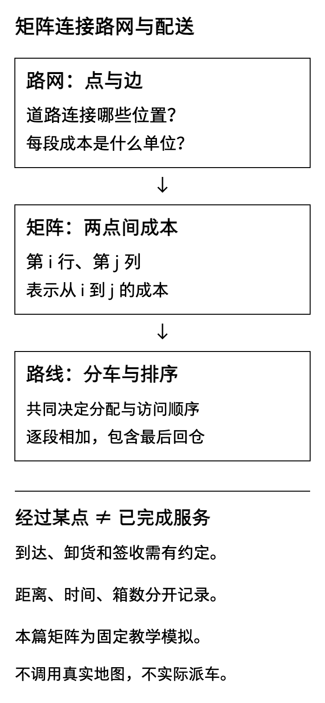
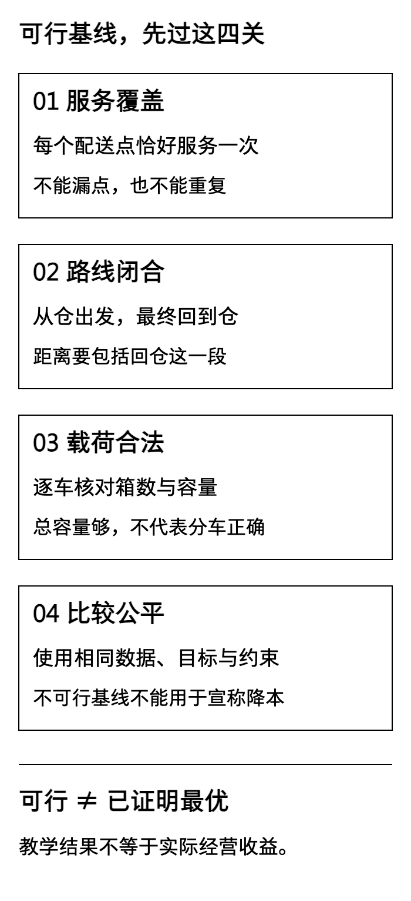

补货建议已经告诉仓库准备多少货，下一步常常是：“今天两辆车，应该怎么送？”如果把地图上的最短路线逐条拼起来，答案看起来很像一份配送单，却可能漏掉客户、少算返程，或者让一辆车装下两辆车的货。

[D20](/blog/inventory-test-stockout-tradeoff/)比较了补货规则下的库存与缺货。D21转向配送，只完成三个任务：手算一个最短路问题、定义车辆路径问题、建立可以逐段复核的基线。今天不调用优化器，也不承诺找到最优路线。先做对这些，明天加入容量约束求解时，才知道应该拿什么作比较。

**全文中的企业、位置、道路、箱数、路线与数据均为教学模拟。** 匿名服装企业只借用生产协同中的物料配送背景；虚构禾味仍是2家门店、8个食材SKU，后文十点网络是单独构造的配送扩展，不是突然把两店业务改称十店，也不是从原14天销售表推算出的订单。

## 一 先问清：我们究竟要决定什么

把地图上的仓库、门店、工厂或交叉口抽象成“节点”，把允许走的路抽象成“边”。边旁的数字叫“权重”，在本文表示距离；若换成分钟，就必须重新定义整个计算口径。

- **两点最短路**：起点和终点已经给定，只问沿哪些道路走，总距离最短。例如仓库A到工厂D，可以经过B或C，但不要求服务每个节点。
- **单车TSP**：一辆车要访问全部指定客户，再回起点，需要决定客户访问顺序。本篇讨论每个客户服务一次的闭合巡回版本。
- **多车VRP**：除访问顺序外，还要决定每个客户分给哪辆车；若加入容量，就成为有容量约束的车辆路径问题。本文所有配送必须完成，不允许拆单、丢点或临时加车。

这里“最短”也有范围。某条A到D的路最短，不等于十个客户的访问顺序最短；某辆车走得少，不等于两辆车的总距离最小。目标与约束都没说清，所谓“路线优化”就没有可核验的含义。

[](images/d21-01_levels.png)

## 二 四个节点，先用加法手算最短路

本节使用一个独立的四节点无向图。边权是非负整数距离。无向意味着同一条边来回距离一致，不代表真实城市道路都如此。

边长如下：A—B为4000米，A—C为1000米，B—C为2000米，B—D为1000米，C—D为5000米；A与D没有直连道路。从A到D的四条简单路径为：

```text
A → B → D：4000 + 1000 = 5000米
A → C → D：1000 + 5000 = 6000米
A → B → C → D：4000 + 2000 + 5000 = 11000米
A → C → B → D：1000 + 2000 + 1000 = 4000米
```

所以本例最短路为A→C→B→D，4000米，也就是4公里。注意，A直接到B是4000米，而先到C再到B只需3000米。因此“道路边长表”和“两点最短距离表”不是同一张表，不能把尚未求最短路的直连边权当成已经计算好的成本矩阵。

若按最短路标签的方式复核：先确认A距离为0；找到C距离1000；经C把B从4000改为3000；再经B把D从6000改为4000。这里的“确认”是算法对当前最短距离的判断，不是车辆实际按这个顺序出车服务。

最短路的长度，是所选道路的边权相加。我们无需为了这道小题实现通用算法库。把起点到终点的简单路径逐条列出，比较总和，就足以验证程序。所谓简单路径，是不重复节点的路径；在本例正距离条件下，绕一圈只会增加距离，不会得到更短的结果。

若程序用了Dijkstra方法，其适用前提之一是边权非负。不能把奖励、折扣等负数直接塞进这里，再假定相同逻辑仍然正确。道路不通也不能填成0；0会被理解为免费通行。本文输入只处理明确连通的教学网络，四节点边权表中null表示没有直连边，程序可以经其他节点绕行；完整配送成本矩阵则不接受缺失数值，必须先求出可达成本或另行建模。

## 三 从路网到矩阵，中间发生了什么

配送求解器通常不直接读取整张道路地图，而是读取“仓库与客户之间的成本矩阵”。矩阵就是一个方形表：第i行、第j列的数，表示从地点i到地点j的旅行距离。

例如有一个仓库和十个客户，就需要11×11个位置：编号0代表仓库，1到10代表配送点。d(i,j)表示从i到j的距离；d(0,3)就是从仓库到3号点。对角线d(i,i)为0，因为留在原地不发生旅行。

真实业务可以在路网上逐对求最短路，得到这个矩阵。但矩阵本身不会决定哪些客户同车，也不会决定访问顺序。更要区分“经过”和“服务”：A到D的最短道路经过B，不意味着司机已经按要求完成B的卸货、交接和签收。一个客户在服务序列中出现一次，不要求车辆在真实道路上绝不经过该地点第二次。

本篇十点矩阵采用固定模拟坐标和明确距离规则生成，不使用真实地址、地图接口或道路收费数据。坐标只是构造整数矩阵的方法：每格1000米，距离等于横向格数加纵向格数，再乘1000。比如横向相差2格、纵向相差1格，就是(2＋1)×1000＝3000米。这对应简化正交网格，不是经纬度，也不是现实导航。是否对称、是否满足三角不等式，是本实验输入的性质，不是对所有VRP的要求。单行道网络的d(i,j)可以不等于d(j,i)。

[](images/d21-02_matrix.png)

## 四 先建立一份能执行的编号基线

基线不是“随便写一个很差的方案，好让算法赢”。它是后续比较的共同参照，应该可复现、可解释，并在声明的约束下可行。

本篇两组扩展数据均设置一个仓库、十个配送点和两辆同型车，每个点2箱，每辆车容量12箱。每辆车从仓出发，按自己的客户顺序完成配送，再回同一个仓。全部货物出车前装好，沿途只卸货；没有取货、退货或回仓重装。

按编号分组的规则固定为：

```text
车1：0 → 1 → 2 → 3 → 4 → 5 → 0
车2：0 → 6 → 7 → 8 → 9 → 10 → 0
```

每辆车承接5个客户，初始装载量＝5×2＝10箱，不超过12箱。送完第一个客户后剩8箱，随后为6、4、2、0箱；回仓时空车。纯配送条件下，出发时装得最多，所以检查一条路线的需求总和即可核验容量。若有取送混合，就必须按每一站的货物流入流出检查沿途载荷，不能照搬这个简化。

路线距离的计算也只需加法。对车1：

```text
D1 = d(0,1) + d(1,2) + d(2,3) + d(3,4) + d(4,5) + d(5,0)
总距离 = D1 + D2
```

D1代表车1完整一圈的距离，D2代表车2。最后一项d(5,0)是回仓距离，不能省略。若矩阵单位是米，总距离也是米；展示成公里才除以1000。箱数只用于容量检查，不能把“10箱＋500米”当成一个目标。

禾味扩展车1的六段分别为2000、1000、1000、1000、1000、4000米，合计10000米。送完5号点时只走了6000米，回仓还要4000米；如果漏算，单车就会少报40%的完整里程。车2同样为10000米，两车共20000米，即20公里。

<div role="region" tabindex="0" aria-label="两案例编号基线距离与容量，可横向滚动" style="overflow-x:auto;max-width:100%;margin:28px 0">
<table id="d21-baselines" style="min-width:650px;width:100%;max-width:none;display:table;margin:0;white-space:nowrap"><thead><tr><th>模拟案例</th><th>车1完整距离</th><th>车2完整距离</th><th>两车合计</th><th>每车初始载荷／容量</th></tr></thead><tbody>
<tr><td>禾味十点扩展</td><td>10000米</td><td>10000米</td><td>20000米</td><td>10箱／12箱</td></tr>
<tr><td>匿名服装十点扩展</td><td>14000米</td><td>14000米</td><td>28000米</td><td>10箱／12箱</td></tr>
</tbody></table></div>

服装车1为3000＋2000＋2000＋2000＋2000＋3000＝14000米；车2为2000＋2000＋2000＋2000＋2000＋4000＝14000米。实践包提供24行逐段账：两案×两车×六段，回仓段也在其中。

**不能把20公里和28公里相减，宣称禾味方案节省8公里。** 两案的距离矩阵不同，差值不是同一任务下的策略效果。本文没有生成优化后路线，没有搜索最优分车方案，这两行仅是各自输入下的可行基线。

## 五 两个业务背景，要保留不同限制

**禾味的配送教学扩展。** 原案例2家门店、8个食材SKU用于说明门店补货与库存；这里另造十个收货点，以便观察两辆车的分配和路线长度。它没有证明真实门店需要十个站点，没有从需求预测里自动生成配送箱数。每点2箱只是可复算假设，箱子被视为占用相同容量单位，不混入公斤或SKU数。

实际食材配送还要考虑冷链、常温与冷藏混载、收货时间、卸货时长、效期和门店库存。即使这份基线容量合格，也只说明它在本文的简化模型里可行，不代表已经可以用于真实易腐品配送。

**匿名服装企业的物料配送扩展。** 十个模拟节点可理解为协同网络里的物料交接点，而不是十家已核验工厂。本实验只演示“仓库统一装货后向各点交货”，不模拟染色、缩水、裁片的取送衔接。真实生产中，有些货必须等质检、前道交出或领料确认之后才能发运，有些要先取再送，不能把一个静态配送矩阵当作整个生产排程。

箱数相同，不等于两案业务相同。公斤、件、匹、卷需要有明确装箱或体积重量换算，不能用单据行数代替运输载荷。对业务系统而言，先把交接对象、可发运数量、装车单位和可用时间定义准确，往往比先换一个搜索算法更重要。

## 六 一个更短的数字，也可能来自漏算

下面这些错误，很容易制造“优化成功”：

1. **漏掉回仓段。** 开放路线和闭合路线是不同问题。要求回仓时，不能用只送到最后一站的长度比较。
2. **漏一个客户或重复一个客户。** 不能只看路线数组长度；例如客户3出现两次、客户4没出现，服务次数总数仍可能是10。
3. **把总容量当逐车容量。** 20箱小于两车合计24箱，只是一个必要检查，不能证明某个分配可行。一车安排7个点就是14箱，仍然超载。
4. **更换成本口径。** 一组用直线距离、一组用路网距离，或者一组算公里、一组算米，差值没有共同意义。
5. **只看图，不复算边。** 线条短、颜色漂亮不构成证据；必须能从矩阵把每一段重新加回来。

因此本文先检查输入，再检查覆盖、车辆起终点、逐车箱数，最后计算距离。无效输入和不可行路线都应给出明确原因，而不是继续输出一个带两位小数的“提升率”。

即使未来找到更短的可行路线，也先写“在同一模拟矩阵与约束下，总路程减少了多少”，不直接写“真实企业降低多少成本”。里程不等于成本，车辆固定费、司机工时、通行费和加班费可能改变最优选择。

[](images/d21-03_validation.png)

## 七 今天的交付，是问题定义与证据

原计划D21的核心安排是阅读20分钟、建模25分钟、实践60分钟、验收记录15分钟。本文把这一学习成果整理为博文，读者今天仍不必安装求解器或自行写完整算法库。

问题定义卡至少要写清楚：服务谁、从哪里出发并返回、几辆车、每点需求、容量单位、旅行距离来源、是否允许拆单或漏点、优化目标和暂不考虑的条件。实践包固定了这些内容，也保留了独立逐段台账，而不是只交一张路线截图。

- [D21模拟输入、基线与可复现实验包](/downloads/d21-routing-baseline-practice.zip)
- [完整文章Markdown与配图](/downloads/d21-routing-baseline-article.zip)
- [黑白配图源文件与重绘工具](/downloads/d21-routing-baseline-images.zip)

Python 3.10或以上，仅使用标准库。在实践包目录运行：

```bash
python -m unittest -v
python run.py
```

按README核对输出：矩阵与点编号一致、十个点每个恰服务一次、每车从0出发回0、载荷不超过12箱、逐段距离之和等于路线总距离。修改数据后应另存实验，不把新结果写成原文结果；如果容量不足，保留失败证据，不偷偷加车或跳过客户。

数学阅读遵循计划B5：《Python数据结构与算法分析》的图与最短路部分，仅定位概念。软件背景参考计划O5：[Google OR-Tools车辆路径概览](https://developers.google.com/optimization/routing)，重点理解问题类型、可添加约束以及“得到好解不代表已证明最优”的限制。本篇未调用OR-Tools，公开脚本负责教学复算，不冒充其求解结果。

D22再在相同案例上加入容量约束求解。那时比较的顺序仍是：先确认双方可行，再对齐目标与单位，最后讨论距离差。今天看起来只是把问题说清楚，其实已经为后面的每一个“优化结论”划定了边界。
