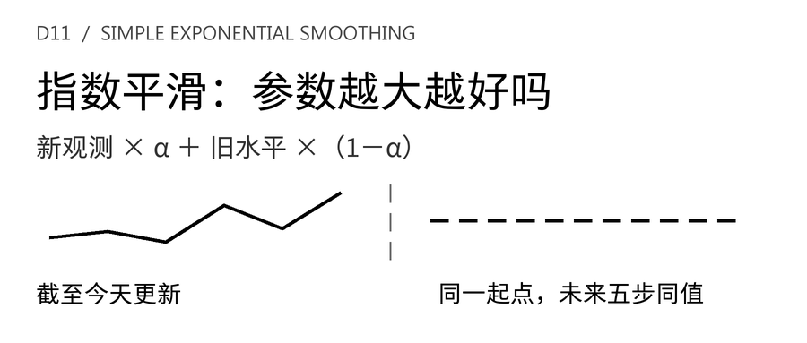
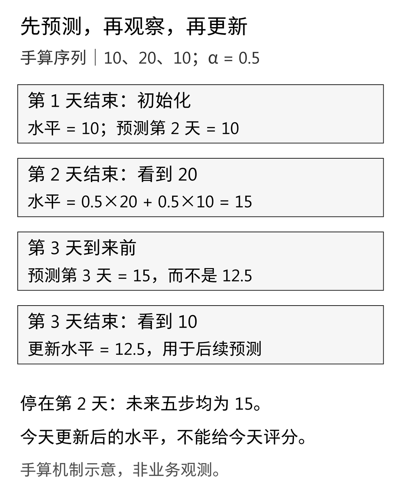
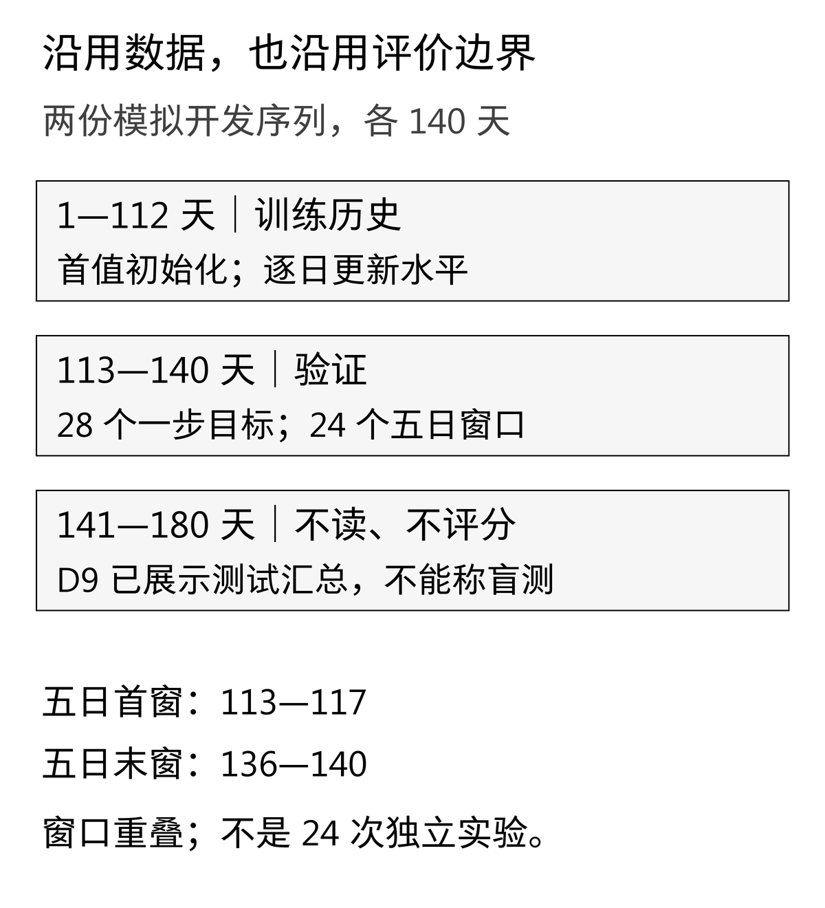
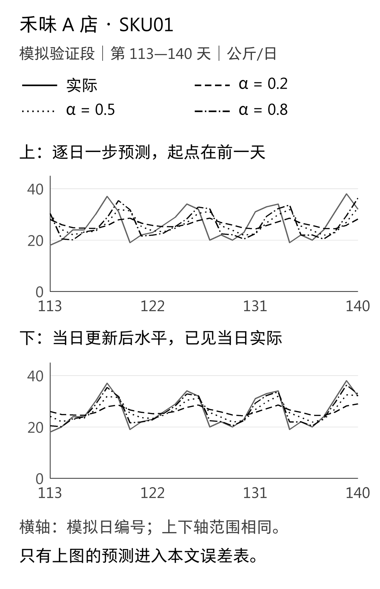
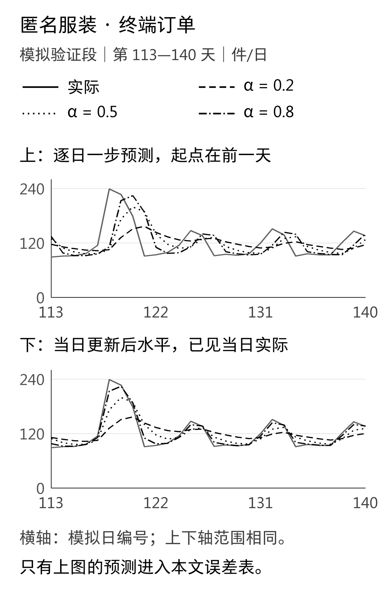

昨天的订单突然增加，明天的预估应该马上跟上，还是先等几天？[D10的移动平均](/blog/moving-average-demand-forecast/)用窗口长度回答这个问题：窗口短，最近变化占的分量更大；窗口长，旧数据留下得更久。

简单指数平滑换了一种做法。它不规定“只看最近七天”，而是保留一个代表当前需求的**水平值**。每收到一天完整观测，就把新需求与旧水平加权平均。参数α控制这次更新有多大。

“α越大，反应越快”容易理解，“所以预测越准”却不能跟着成立。本篇沿用原来的两个模拟案例和验证区间，比较α＝0.2、0.5、0.8。实际计算中，三个候选按单日误差和五天总量误差排列，会得到相反顺序。先把预测时间和业务问题说清楚，才能解释这件事。

## 一 还是原来的数据，先别换一条更好看的曲线

**数据与案例声明。** 全文业务情景、日期、数量和活动均为教学模拟，不对应真实品牌、真实项目或实测收益。禾味是虚构餐饮连锁，背景为**2家门店、8个食材SKU**；核心实验只取**A店、SKU01的日需求，单位公斤/日**。匿名服装案例沿用**终端订单需求，单位件/日**，不是工厂的生产需求或已排产件数。两条序列分别评价，单位不混加。

首周的2店、8食材SKU、14天小样本用于数据整理与指标学习，不能冒充完整预测历史。预测练习从D9起沿用扩展后的180天模拟序列，日期为2026年4月6日至10月2日。D10只复制前140天开发数据；本篇继续使用那两份CSV，文件字节与哈希保持不变。第1—112天作为初始训练历史，第113—140天用于验证。原第141—180天不在本篇实践包中，也不重新评分。**D9已经展示过原测试段汇总，不能再把它称为从未触碰的独立盲测。**

禾味序列包含稳定的星期差异与小幅扰动；服装序列包含星期差异、缓慢趋势，以及第118—120天每天增加90件的模拟活动。这些结构沿用D9，既没有为了SES改种子，也没有删去让它失分的高峰。

这意味着我们并没有挑选最符合SES假设的数据来展示它。把方法放进已有任务，观察它在哪里失效，也是建立基线的一部分。主实验仍假设需求完全可见、没有缺货；若真实系统只有受库存约束的销量，先解决标签口径，平滑算法不会自动还原未成交需求。

## 二 先手算一个水平，再讨论参数

设y(t)为第t天结束后已经完整观察到的需求，l(t)为更新后的水平。本文使用**首个观测初始化**：

```text
l(1) = y(1)
l(t) = α × y(t) + (1 − α) × l(t−1)，t ≥ 2
ŷ(T+h | T) = l(T)，h = 1, 2, …
```

T是最后一个已知日，竖线右侧的T提醒我们：预测只能用截至这个起点的信息。本篇只比较三个预先指定的α，不自动优化参数，也不另行估计初始水平。它是透明的教学基线，不能等同于软件默认的整套拟合流程。

[FPP3第8.1节](https://otexts.com/fpp3/exponential-smoothing.html#simple-exponential-smoothing)给出了SES的水平更新和固定起点预测形式，也说明它适用于没有明显趋势和季节性的序列。书中的参数与初始值可以通过优化估计；本篇特意固定首值初始化，便于逐行复算。

现在只有两天需求10、20，取α＝0.5。第一天水平为10；第二天结束后：

```text
l(2) = 0.5 × 20 + 0.5 × 10 = 15
```

如果此时一次发布未来五天的预测，答案为**15、15、15、15、15，合计75**。这里的平直是“目前只有一个水平”的模型设定，不是断言未来每天真实需求必然一样，也不代表没有预测不确定性。

接着第三天实际观察到10，新水平才变成0.5×10＋0.5×15＝12.5。对同一段10、20、10，三个α对应的最终水平分别为**11.6、12.5、11.6**。α＝0.2和0.8碰巧相等，只是这三个数的结果，不表示两种参数在一般序列上等价。

[](images/d11-01_alignment.png)

### 为什么叫“指数”平滑

把递推展开，可以看到较早观测的权重逐步衰减。采用本篇初始化时：

```text
l(T) = (1−α)^(T−1) × y(1)
     + Σ[t=2…T] α × (1−α)^(T−t) × y(t)
```

首个观测承担初始化的剩余权重，不能把每一项都简单写成同一个系数。以α＝0.2为例，最近三个非初始化观测的权重依次是0.2、0.16、0.128；α＝0.8时则为0.8、0.16、0.032。较大的α更强调最新一天，较小的α让更早历史留下更多影响。

与移动平均的“越过窗口就退出”不同，0＜α＜1时，旧冲击的理论权重逐渐变小，没有固定某一天突然归零。端点也有明确含义：α＝1等于复制最后观测；按本文首值初始化，α＝0会一直保留第一天水平。这两个端点用于测试，不加入本次候选排名。

## 三 最容易做错的地方：把更新后的水平当作当天预测

对于10、20、10这段历史，第三天的**提前一天预测**是第二天结束时的15，误差为|10−15|＝5。第三天结束后算出的12.5已经使用当天实际值，再与当天的10比较，得到的是更新后的贴合程度，不能拿它当提前预测成绩。

落到产品记录中，要区分三个时刻：预测发布截止时间、目标日、实际需求到齐时间。如果业务要求早晨下单，就不能把同一天晚上才完整到齐的数据提前放入模型。`l(t)`应对应第t＋1天的一步预测，不能只因为它与第t天存在同一行，就直接评分。

本文图表同时展示“逐日一步预测”和“当日更新后水平”。两者通常形状相似，却错开一个时点；**误差表只使用前者**。当天更新后的水平曲线是解释机制的材料，不用于证明预测更好。

多步预测也要区分两种流程。站在第112天日终，一次预测第113—117天，五步都用l(112)。等第113天真正结束，再更新l(113)，可以发布第114—118天的新预测。这是两个起点的两份预测，不能把新预测覆盖进旧版本后，声称第112天已经知道了那些信息。

SES也有一个容易误判的测试细节：如果把自身的平直预测喂回同一个更新式，数值仍会不变。所以“输出五个相等数字”本身不足以证明信息边界正确；还必须检查代码只截取起点之前的观测，并改变未来数据，看原预测是否保持不变。

## 四 不换评价问题：28个单日目标，24个五天窗口

本篇沿用D10的滚动起点评价。先用第1—112天初始化并更新水平；在验证段每获得一个新观测，才允许下一起点使用它。各候选的α在整个验证期间保持不变，不会看着每日实际表现临时切换。

- **单日任务**：起点为112—139，目标日为113—140，共28次。日MAE是28个绝对预测误差的平均。
- **五天总量任务**：起点为112—135，每次固定起点预测五天。首个窗口113—117，最后一个136—140，共24个，目标全部位于验证段。指标是每个窗口“预测合计与实际合计之差的绝对值”再平均。

五天合计误差不是五个单日绝对误差之和。它允许窗口内高估与低估相互抵消；评价的是总量，对每天错配未必敏感。24个窗口相互重叠，也不能当成24次独立实验去宣称统计显著。表中的公斤/日与公斤、件/日与件各自保留单位，数值不能跨单位直接比较。

保留[D9的周期7季节性朴素基线](/blog/seasonal-naive-demand-forecast/)，是为了看SES是否真的增加了价值。它在同样的起点、目标和指标上重复最近一周的对应位置。只把三种α互相比完，就选最小误差者，可能漏掉一个更简单且更合适的已有方法。

[](images/d11-02_split.png)

## 五 禾味案例：每天跟得更紧，五天总量却偏得更多

禾味A店SKU01的星期差异在模拟生成时已经写入。SES只有一个水平，没有“星期六”这个状态。即使较大的α更快跟上近期高点，它也不会自动理解下一天是不是周末。

<div role="region" tabindex="0" aria-label="禾味验证集方法比较（可横向滚动）" style="overflow-x:auto;max-width:100%;margin:28px 0">
<table style="min-width:560px;width:100%;max-width:none;display:table;margin:0;white-space:nowrap">
<thead><tr>
<th scope="col" style="white-space:nowrap;text-align:left">方法</th>
<th scope="col" style="white-space:nowrap;text-align:left">日MAE（公斤/日）</th>
<th scope="col" style="white-space:nowrap;text-align:left">五天合计MAE（公斤）</th>
</tr></thead>
<tbody>
<tr>
<td style="white-space:nowrap;text-align:left">SES α=0.2</td>
<td style="white-space:nowrap;text-align:right">5.5652</td>
<td style="white-space:nowrap;text-align:right">13.9983</td>
</tr>
<tr>
<td style="white-space:nowrap;text-align:left">SES α=0.5</td>
<td style="white-space:nowrap;text-align:right">5.3391</td>
<td style="white-space:nowrap;text-align:right">23.2535</td>
</tr>
<tr>
<td style="white-space:nowrap;text-align:left">SES α=0.8</td>
<td style="white-space:nowrap;text-align:right">4.8633</td>
<td style="white-space:nowrap;text-align:right">31.4695</td>
</tr>
<tr>
<td style="white-space:nowrap;text-align:left">季节性朴素，周期7</td>
<td style="white-space:nowrap;text-align:right">1.7857</td>
<td style="white-space:nowrap;text-align:right">3.2917</td>
</tr>
</tbody>
</table>
</div>

[](images/d11-03_hewei.png)

在这份数据里，α从0.2增加到0.8，日MAE由5.5652降至4.8633公斤/日；五天合计MAE却由13.9983升至31.4695公斤。它并不矛盾：单日预测允许明天再更新一次，而今天发布的五日预测必须把当前水平保持五步。一个紧跟最近高点的水平，若被平铺到后面数天，就可能对总量产生较大偏差。

这个解释对应本篇的模拟规律和固定起点评价，不是“高α必然使五天总量更差”的定理。α＝0.8在三个SES候选中的单日误差最低，也仍高于季节性朴素的1.7857；后者的五天合计误差同样更低。这里没有证据支持把禾味的星期基线替换成SES。

对门店补货，应该先明确需要每天的食材需求，还是某个提前期内的总量，再决定主要指标。预测仍不是采购量：现存库存、在途量、损耗、保质期、最小订货单位和到货时间，都需要下一层决策处理。本文没有把误差下降换算成库存收益。

## 六 匿名服装案例：快响应不等于提前知道活动

服装案例的标签是**终端订单件数**。它可以为采购和生产协同提供需求信号，却不能直接变成工厂排产单。已有订单承诺、面料可用量、工序产能和交期约束，都不在这个SES水平中。

<div role="region" tabindex="0" aria-label="匿名服装验证集方法比较（可横向滚动）" style="overflow-x:auto;max-width:100%;margin:28px 0">
<table style="min-width:560px;width:100%;max-width:none;display:table;margin:0;white-space:nowrap">
<thead><tr>
<th scope="col" style="white-space:nowrap;text-align:left">方法</th>
<th scope="col" style="white-space:nowrap;text-align:left">日MAE（件/日）</th>
<th scope="col" style="white-space:nowrap;text-align:left">五天合计MAE（件）</th>
</tr></thead>
<tbody>
<tr>
<td style="white-space:nowrap;text-align:left">SES α=0.2</td>
<td style="white-space:nowrap;text-align:right">30.8933</td>
<td style="white-space:nowrap;text-align:right">119.3056</td>
</tr>
<tr>
<td style="white-space:nowrap;text-align:left">SES α=0.5</td>
<td style="white-space:nowrap;text-align:right">28.4215</td>
<td style="white-space:nowrap;text-align:right">155.9761</td>
</tr>
<tr>
<td style="white-space:nowrap;text-align:left">SES α=0.8</td>
<td style="white-space:nowrap;text-align:right">24.0696</td>
<td style="white-space:nowrap;text-align:right">191.1509</td>
</tr>
<tr>
<td style="white-space:nowrap;text-align:left">季节性朴素，周期7</td>
<td style="white-space:nowrap;text-align:right">21.1071</td>
<td style="white-space:nowrap;text-align:right">115.8750</td>
</tr>
</tbody>
</table>
</div>

[](images/d11-04_apparel.png)

第118—120天的模拟活动使实际需求分别达到239、227、179件。第117天结束时，三个α对第118天的预测分别为105.2865、105.7625、111.2033件。把参数调大，并没有让模型提前知道明天有活动。

等到第120天结束，对第121天的预测分别变为**156.6187、189.3453、188.0576件**；第121天实际只有91件。此时α＝0.8的预测略低于0.5，是因为最新一天179已经低于前一天227，更快响应也可以意味着更快向下修正，不能把“α更大”误解成“预测数字总是更大”。

观察到第121天的91件后，α＝0.8对第122天的预测降至110.4115件，比α＝0.2的143.4950件回落得快。这显示了响应速度，却不意味着一开始的活动低估已经被修复，也不能回写第120天发布的那份五天预测。

整段验证中，α＝0.8的日MAE在SES候选里最低，α＝0.2的五天合计MAE最低；季节性朴素在两项指标上仍都优于三个SES候选。它自身也可能把上周的一次活动复制到本周，所以“本次基线更好”仍只是这段模拟数据的结论。

若要让预测认识活动，后续需要加入**预测起点已经知道**的活动日历、力度和渠道信息，再建立新候选。事后知道活动每天增加90件，并不能成为提前预测时可用的输入。一次模拟活动也不足以支持真实业务效果或行业通用参数的结论。

## 七 把方法做成可核对的产品，而不是一个神秘参数框

这次候选可以用一张简短模型卡说明：方法是SES，状态只有需求水平；首值初始化；候选α为0.2、0.5、0.8；固定起点未来各步使用同一水平；假设目标是完整可观测的日需求，且没有需要显式建模的明显趋势和季节性。本次两个案例恰好含有这些不利结构，因此重点是识别边界，并非推荐上线。

实现的核心很短，以下只展示已校验输入下的算法；下载包还负责数据契约与错误处理：

```python
level = history[0]
for actual in history[1:]:
    level = alpha * actual + (1 - alpha) * level
forecast = [level] * horizon
```

首值初始化允许只有一个观测时产生一个水平，但不等于新SKU只需一天历史就能可靠预测。真实冷启动需要另外约定数据来源、回退方法与可用范围，不能把“程序能输出”当成“业务可采信”。

数据入口要求一天一行、日期连续唯一且升序、实体一致、需求非负且有限。零需求合法，缺测不是零；NaN、无穷值、负值、缺列、错位或非法CSV引号都应报错，不静默丢弃数据记录或补零。这里区分CSV数据记录与物理空行：标准库读取器跳过完全空白、没有任何字符的行；仅含空格的行仍会按不完整记录报错。日期缺失不会因为允许空行就被接受，连续日期校验仍然生效。若业务存在退货形成的负净销量，要重新定义目标口径，而不是在这条非负需求契约里偷偷取绝对值。

预测记录至少要保留对象与单位、α、初始化规则、数据版本、发布起点、目标日期和可见历史截止日。这样团队才能说明，今天与昨天的预测差别来自新观测，还是参数或历史数据发生了变化。真实系统还应另行处理不确定性；本篇只验证点预测，不输出未经建模的“置信区间”。

## 八 下载之后，先尝试把它算错

[D11简单指数平滑实践包](/downloads/d11-simple-exponential-smoothing-practice.zip)需要Python 3.10或以上，只用标准库。解压后在实践包目录运行：

```bash
python -m unittest -v
python run.py
```

两份开发CSV来自D10，仍与D9原始开发文件逐字节一致。`source_manifest.json`保留SHA-256，程序先核验输入，再输出以下可追溯文件：

- `results/daily_predictions.csv`：两个案例、四种方法，共224条一步预测，包含起点、目标、实际、预测与绝对误差。
- `results/five_day_windows.csv`：共192个五日窗口，保存每一步预测与实际、合计及合计误差。
- `results/levels.csv`：三个α各自140天的更新后水平，两个案例共840行，用于解释状态，不能直接给当天预测评分。
- `results/validation_summary.json`：正文比较表的完整精度来源；`origin112_examples.json`与`manual_oracle.json`保留固定起点示例与手算预期。

测试除了10、20得到15，还包括10、20、10的三个参数结果、首值初始化、α端点、固定五步、未来污染、日期缺失与非法输入。完整验证分数另用分数算术和展开后的几何权重独立计算，避免“同一个函数调用两次，结果相等”冒充正确性证明。实现测试通过仍不等于独立审查通过，或保证真实需求可被准确预测。

另可下载[文章Markdown与配图](/downloads/d11-simple-exponential-smoothing-article.zip)、[黑白配图及重绘脚本](/downloads/d11-simple-exponential-smoothing-images.zip)。正文表格在手机上可横向滚动，数字保持完整；图中细节可打开原图查看。重绘需要Pillow、fontTools与简体中文Noto字体，具体步骤在包内说明中，计算预测本身不依赖这些绘图库。

本次实验留下的判断是：α控制模型怎样吸收新信息，业务评价目标决定这种速度是否有用。看到曲线更贴近实际之前，先检查它是不是已经看过当天答案；看到某个α的误差更低之后，再确认比较的是同一任务，并且没有输给已有基线。下一种方法加入时，这些问题仍要继续问。
