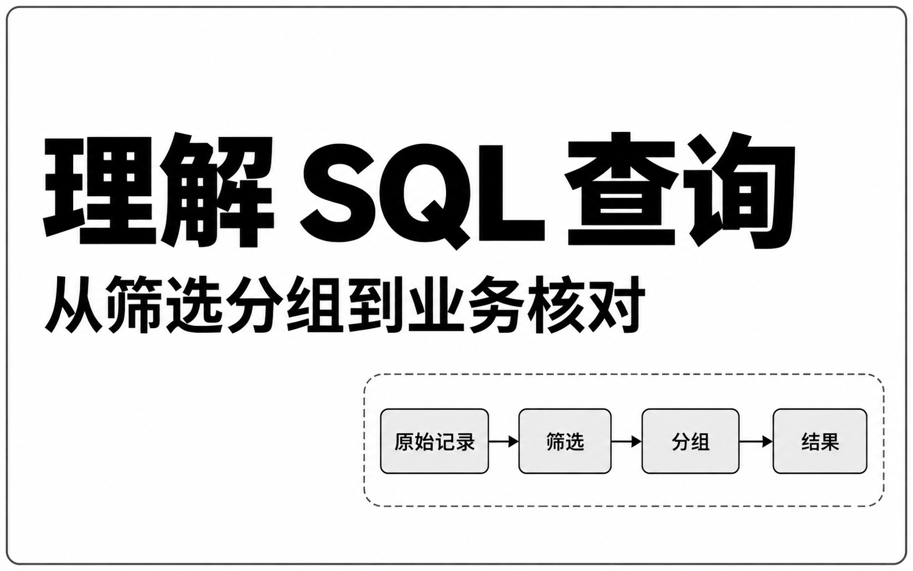
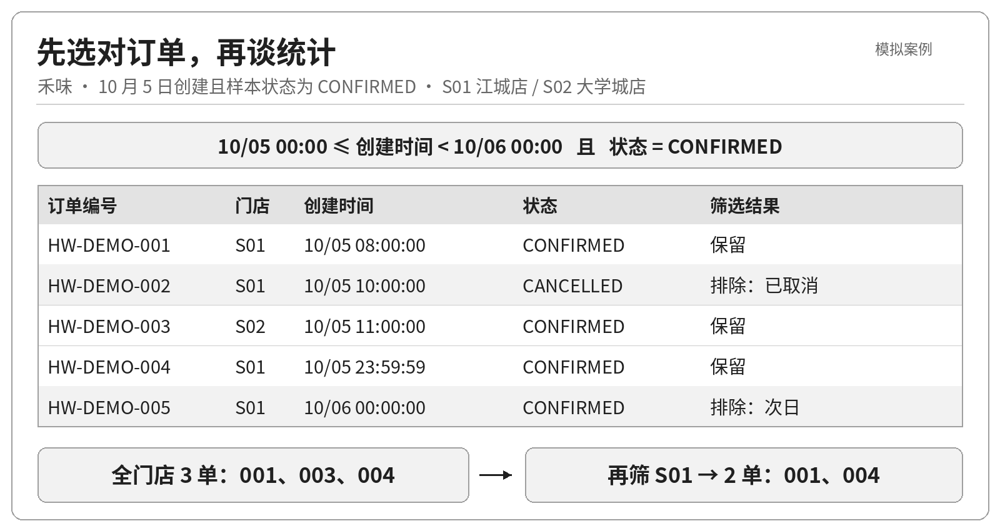
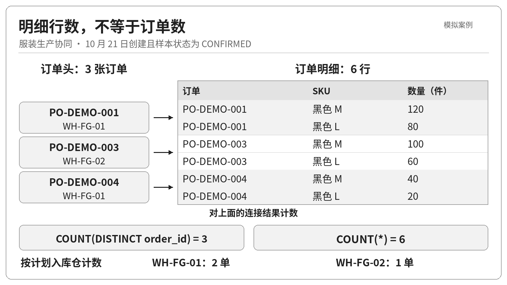
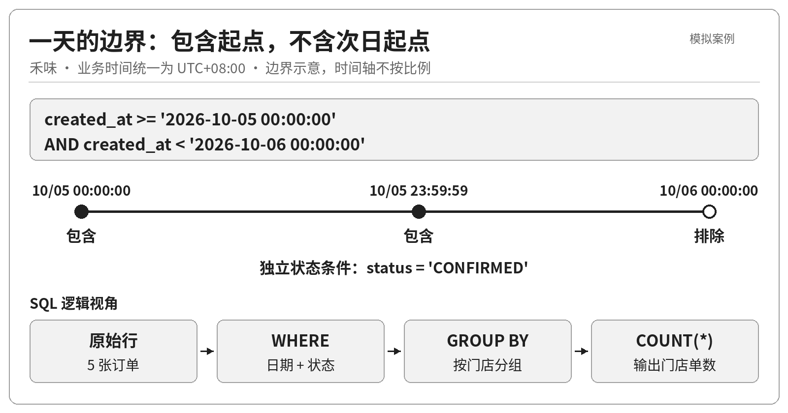
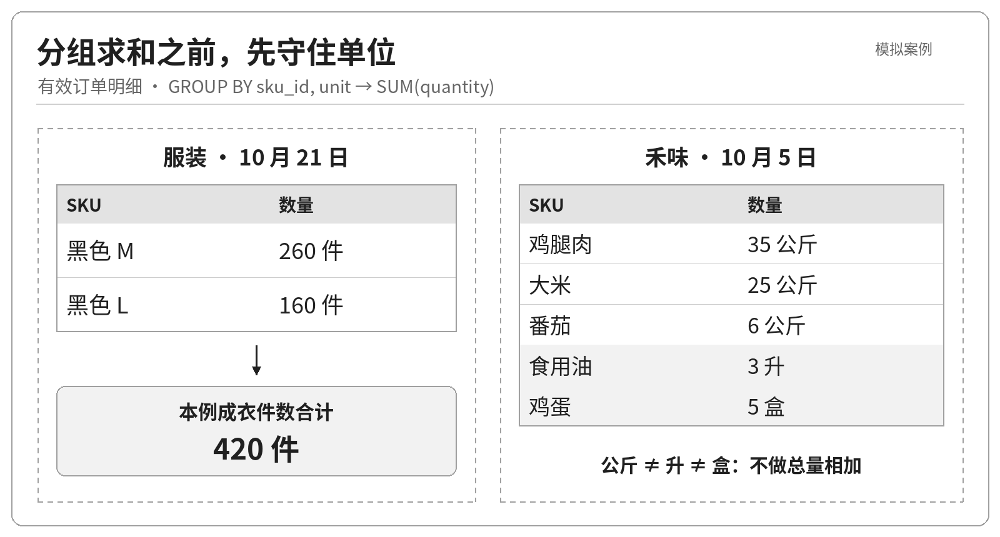

一张报表写着“昨日有效订货 6 单”，门店却说只下了 3 单。另一张表写着“订货总量 74”，采购追问：74 公斤、74 盒，还是 74 升？

这类问题不一定来自复杂算法。很多时候，SQL 完全合法，错误藏在“查哪些记录”“一行代表什么”“哪些数量可以相加”里。

上一篇解决了数据粒度和表之间的关系。这一篇往前走一步：把业务问题翻译成可以执行、可以核对的查询。我们不急着计算满足率或预测需求，先做四件小事：查某天的有效单据、按组织数单、按 SKU 汇总数量，以及排查进入计算的数据是否有问题。

> 本文使用两组教学样本：一组基于匿名服装生产协同的业务背景，组织、单号和数量均为模拟；另一组使用虚构案例“禾味”。禾味的案例框架是 2 家门店、8 个食材 SKU，观察期为 2026 年 10 月 1—14 日；配套数据只生成 5 张订单、10 条明细的教学切片，不是完整 14 天流水。

## 一 先把问题说完整，再写 SELECT

服装生产协同中，一张生产订单可能包含同一款式的多个尺码。业务负责人问“昨天安排了多少单、多少件”，实际上问了两个不同问题：前者看订单头，后者看订单明细。

禾味也一样。门店一次订货可以同时包含鸡腿肉和鸡蛋。“订了几单”不能用食材明细行数回答；“订了多少”也不能把公斤、盒和升相加。

为减少练习中的重复命名，本篇可运行示例统一采用 `order_id`、`line_id`、`quantity` 等列名，两类案例分别存表。服装的 `quantity` 表示计划件数，禾味的 `quantity` 表示订货量；这是教学库的命名约定，不是在修改上篇的业务含义或现有系统字段。服装的 `warehouse_id` 是本篇新增的教学设定：每单对应一个计划入库仓库，不等于实际验收入库仓库。`created_at` 表示本篇定义的单据创建时刻，也不是把上篇的 `ordered_at` 简单改名。

因此，每次写查询前，先写一张简短的口径卡：

| 要确定的事 | 禾味示例 | 服装示例 |
|---|---|---|
| 对象 | 门店订货单 | 生产订单 |
| 时间字段 | 订单创建时间 | 生产订单创建时间 |
| 业务日 | 10 月 5 日，UTC+08:00 | 10 月 21 日，UTC+07:00 |
| 纳入状态 | CONFIRMED | CONFIRMED |
| 统计粒度 | 门店 × 日，或 SKU × 单位 | 计划入库仓库 × 日，或 SKU × 单位 |
| 数量单位 | 公斤、盒、升分别处理 | 件 |

这里的 `CONFIRMED`、`CANCELLED` 只是模拟数据中的分析标签，不是任何真实生产系统的完整状态机。本文把“有效”限定为样本中状态为 `CONFIRMED` 的订单，不代表所有非取消订单都有效。样本没有状态变更历史，因此下文统计的是“某天创建、样本状态为已确认”的订单，不能据此回答“当天完成确认”或“截至当天已确认”的订单数。

另一个容易忽略的点是时间字段。按创建日查出来的是“当天创建的订单”，不是“当天应到货的订单”，更不是“当天已经收货的订单”。把 `created_at` 换成承诺到货时间，看似只改一个字段，业务问题已经变了。

## 二 让样本能一眼对账

禾味有江城店 S01、大学城店 S02。8 个 SKU 为鸡腿肉、大米、土豆、番茄、生菜、食用油、牛奶和鸡蛋。本文五张单如下，展示时简写编号，数据库中使用完整的 `HW-DEMO-001` 等编号。

| 单号 | 门店 | 创建时间 | 状态 | 明细 |
|---|---|---|---|---|
| 001 | S01 | 10-05 08:00:00 | CONFIRMED | 鸡腿肉 20 公斤；鸡蛋 5 盒 |
| 002 | S01 | 10-05 10:00:00 | CANCELLED | 鸡腿肉 10 公斤；鸡蛋 2 盒 |
| 003 | S02 | 10-05 11:00:00 | CONFIRMED | 鸡腿肉 15 公斤；食用油 3 升 |
| 004 | S01 | 10-05 23:59:59 | CONFIRMED | 大米 25 公斤；番茄 6 公斤 |
| 005 | S01 | 10-06 00:00:00 | CONFIRMED | 土豆 8 公斤；生菜 4 公斤 |

这不是随便编的五行：取消单用于检验状态条件，午夜前后的两单用于检验时间边界，每单两条明细用于检验“订单数”和“明细行数”是否混淆。牛奶存在于主数据却未出现在这个切片中，用来提醒我们：查询没有返回某个 SKU，不一定是数据丢失。



服装样本采用同样的对照结构，完整单号为 `PO-DEMO-001` 至 `PO-DEMO-005`。001、002、004、005 属于 WH-FG-01，003 属于 WH-FG-02；创建时间分别为 10 月 21 日 08:00、10:00、11:00、23:59:59，以及 22 日 00:00。002 取消，其余确认。五单的黑色 M/L 明细分别为 120/80、50/30、100/60、40/20、30/10 件。

因此，10 月 21 日应纳入 001、003、004：3 张订单、6 条明细，M 码 260 件、L 码 160 件，共 420 件。注意，“420 件”只回答总体规模；M、L 仍是不同 SKU，不能据此认为尺码之间可以替代交付。



## 三 模板一：筛选某店某天的有效订单

先回答最具体的问题：**10 月 5 日，江城店创建了哪些有效订货单？**

```sql
SELECT order_id, store_id, created_at, status
FROM orders
WHERE store_id = 'S01'
  AND status = 'CONFIRMED'
  AND created_at >= '2026-10-05 00:00:00'
  AND created_at <  '2026-10-06 00:00:00'
ORDER BY created_at, order_id;
```

结果应为 `HW-DEMO-001` 和 `HW-DEMO-004`，共两张订单。这里从订单头取数，一行是一张订单，还没有展开食材明细。

这段 SQL 有三个值得保留的习惯。

第一，状态采用明确纳入条件。`status <> 'CANCELLED'` 看起来更方便，却可能把草稿、待审批等将来新增状态一起纳入。口径是“确认单”，就直接写确认单。

第二，时间用左闭右开区间：`>= 当天零点` 且 `< 次日零点`。若使用 `BETWEEN 当天零点 AND 次日零点`，两个端点都包含，005 就会误入。若结束时间手写 `23:59:59`，遇到毫秒、微秒记录又可能漏单。

第三，本文时间已经转换为各案例的业务本地时间，并统一存为 `YYYY-MM-DD HH:MM:SS` 格式的文本，查询边界也使用同一格式、同一时区。这是 SQLite 教学数据的约定，不是 SQL 自动完成了时区转换；混入仅有日期、不同分隔符或带时区偏移的字符串，不能继续假设文本比较等于时间比较。生产库若存 UTC，应先把业务日的起止边界分别换算为 UTC，再按原时间列查询。[SQLite 日期时间存储说明](https://www.sqlite.org/datatype3.html#date_and_time_datatype)



换成大学城店，只改 `store_id`。换成服装生产订单，则使用 `production_orders`、`warehouse_id = 'WH-FG-01'`，日期改为 10 月 21—22 日。查询结构相同，但不能把门店时区和仓库时区混为一谈。

## 四 模板二：按门店数单，而不是按明细数单

下一个问题是：**10 月 5 日，每家门店各创建了多少张有效订货单？**

```sql
SELECT store_id, COUNT(*) AS order_count
FROM orders
WHERE status = 'CONFIRMED'
  AND created_at >= '2026-10-05 00:00:00'
  AND created_at <  '2026-10-06 00:00:00'
GROUP BY store_id
ORDER BY store_id;
```

结果应为 S01 两单、S02 一单。用逻辑阅读顺序理解它：先从订单表取记录，用 `WHERE` 筛出当天创建且状态为确认的订单，再按门店分组，最后对每组计数。这是理解查询含义的顺序，不是数据库必须逐步执行的物理计划。

这条查询只返回有符合条件订单的门店，不会自动为零单门店补一行。若报表要求所有门店都出现，应从门店主数据出发，左连接已经筛选、汇总好的订单数，再按口径把缺失计数显示为 0；前提是对应日期的订单数据已经完整。

如果接着问“哪些门店当天至少创建了两张有效订单”，应在 `GROUP BY store_id` 后增加 `HAVING COUNT(*) >= 2`，只留下 S01。`WHERE` 过滤分组前的订单记录，`HAVING` 过滤分组后的统计结果，两者不能混用。尤其不要为了让结果只剩 S01，就提前写死 `WHERE store_id = 'S01'`：那是在指定门店，不是在识别达到阈值的门店。

这里使用 `COUNT(*)` 没问题，因为订单头表的一行就是一张订单，本例的 `order_id` 同时声明了 `PRIMARY KEY` 和 `NOT NULL`。

但如果先把订单头与明细连接，再直接 `COUNT(*)`，每张订单会展开成两行。S01 就会变成 4，S02 变成 2，总数从 3 变成 6。

```sql
SELECT o.store_id,
       COUNT(*) AS joined_line_count,
       COUNT(DISTINCT o.order_id) AS order_count
FROM orders AS o
JOIN order_lines AS l ON l.order_id = o.order_id
WHERE o.status = 'CONFIRMED'
  AND o.created_at >= '2026-10-05 00:00:00'
  AND o.created_at <  '2026-10-06 00:00:00'
GROUP BY o.store_id
ORDER BY o.store_id;
```

| 门店 | 连接后的明细行数 | 不重复订单数 |
|---|---:|---:|
| S01 | 4 | 2 |
| S02 | 2 | 1 |

`COUNT(*)` 数当前查询中的行；`COUNT(DISTINCT order_id)` 数当前结果中非 NULL 的不同订单编号。此外，`COUNT(字段)` 只计算该字段非 NULL 的记录，不能默认等于总行数。它们不是谁更高级，而是在回答不同的问题。[SQLite 聚合函数说明](https://www.sqlite.org/lang_aggfunc.html)

只需要订单数时，直接查订单头通常更清楚，也不会因为某张订单暂时没有明细而被内连接排除。

不要把 `DISTINCT` 当作通用修复按钮。001 和 003 都订了鸡腿肉，但它们是两张真实不同的订单。如果按 `sku_id` 去重，就把两次需求错误地压成了一次。

把这一模板换成服装场景，分组字段改为 `warehouse_id`：WH-FG-01 两单、WH-FG-02 一单。若要同时展示仓库名称，应正确关联主数据，并让非聚合输出列进入分组，而不是随手在聚合查询里加一个名称字段。SQLite 对部分“未分组、未聚合的列”较宽容，不代表取到的值有稳定的业务含义。[SQLite SELECT 说明](https://www.sqlite.org/lang_select.html)

## 五 模板三：汇总需求数量，先守住 SKU 和单位

现在回答采购关心的数量问题：**10 月 5 日创建、样本状态为已确认的订单，分别订了多少食材？** 这里汇总的是订货量，不是扣除库存后的净采购量。

```sql
SELECT l.sku_id, s.sku_name, l.unit,
       SUM(l.quantity) AS ordered_qty
FROM orders AS o
JOIN order_lines AS l ON l.order_id = o.order_id
JOIN food_skus AS s ON s.sku_id = l.sku_id
WHERE o.status = 'CONFIRMED'
  AND o.created_at >= '2026-10-05 00:00:00'
  AND o.created_at <  '2026-10-06 00:00:00'
GROUP BY l.sku_id, s.sku_name, l.unit
ORDER BY l.sku_id;
```

| SKU | 食材 | 数量 | 单位 |
|---|---|---:|---|
| K01 | 鸡腿肉 | 35 | 公斤 |
| K02 | 大米 | 25 | 公斤 |
| K04 | 番茄 | 6 | 公斤 |
| K06 | 食用油 | 3 | 升 |
| K08 | 鸡蛋 | 5 | 盒 |

鸡腿肉的 35 来自 001 的 20 加 003 的 15；取消单里的 10 没有纳入。这条对账路径比“看起来差不多”更可靠。

这张表不应该增加一个“合计 74”的总计行。74 只是五个数的算术和，混合单位后没有可解释的订货量含义。即便把公斤类单独相加成 66 公斤，也只能表示重量规模，不能代替具体 SKU 的采购需求。



本例假设每个 SKU 只有一个标准单位。如果真实业务同时以箱、袋、公斤下单，必须先有经确认的换算关系，再转为标准单位；把字段名从“箱”改成“公斤”并不是换算。鸡蛋 5 盒也不能在不知道包装规格时直接当作 5 个。

服装样本的两个 SKU 都采用“件”，所以可以在尺码明细之外提供 420 件总量。将同一汇总结构换成服装案例，SQL 如下：

```sql
SELECT l.sku_id, l.unit, SUM(l.quantity) AS total_quantity
FROM production_orders AS o
JOIN production_order_lines AS l ON l.order_id = o.order_id
WHERE o.status = 'CONFIRMED'
  AND o.created_at >= '2026-10-21 00:00:00'
  AND o.created_at <  '2026-10-22 00:00:00'
GROUP BY l.sku_id, l.unit
ORDER BY l.sku_id, l.unit;
```

这次只保留 SKU 编号，因而不必为了展示名称再连接主数据。查询返回以下两行，`SKU-BLK-L` 对应黑色 L 码，`SKU-BLK-M` 对应黑色 M 码：

| sku_id | unit | total_quantity |
|---|---|---:|
| SKU-BLK-L | 件 | 160 |
| SKU-BLK-M | 件 | 260 |

M/L 数量能与三张纳入的生产订单逐单加总对上，查询才算回答了业务问题。

汇总字段必须来自明细行。若订单头还有“整单数量”，把它带到连接结果里再求和，会随着明细展开被重复累计。

需要看“各门店各 SKU 订货量”时，在 `SELECT` 和 `GROUP BY` 同时增加 `o.store_id`；需要看一天总需求，就保持当前分组。不应只修改展示列，却忘记改变分组粒度。

当前查询没有牛奶，是因为切片里没有牛奶订单行，不是已经证明牛奶需求为零。如果报表必须展示全部 8 个 SKU，应以 SKU 主数据为起点左连接汇总结果，并区分“无订单记录”和业务定义下的零值。

还要区分没有分组与数量为 NULL：本文这种 `GROUP BY` 查询在没有匹配明细时返回零行；不带 `GROUP BY` 的整体汇总仍会返回一行，其中 `COUNT(*)` 为 0，`SUM(quantity)` 为 NULL。`SUM` 也会跳过输入中的 NULL，全部为 NULL 时仍返回 NULL。只有业务口径允许把缺失记录视为零时，才应使用 `COALESCE`，不要让它掩盖未采集或缺失的数量。[SQLite 聚合函数说明](https://www.sqlite.org/lang_aggfunc.html)

## 六 模板四：先检查原始数据，再信任汇总结果

前三类查询都依赖输入数据：主键不重复且非空，关联键能找到唯一的对应记录，数量是有效数值，时间和单位遵循约定。实际导入的数据不一定满足这些前提。

这里要区分两个层次：本例正常表同时声明了主键与非空约束，不允许重复或缺失的主键；SQLite 外键约束也已在连接中开启，教学订单的数量还须通过数值类型与正数检查。为了演示异常，问题数据另放进没有这些约束的原始暂存表，再检查、隔离、修复，不向正常样本表强行塞入重复主键。

以下检查面向教学用的原始暂存订单与明细，不改变前面五张正常样本。

```sql
-- 检查同一个订单主键是否出现多次
SELECT order_id, COUNT(*) AS row_count
FROM raw_staging_orders
GROUP BY order_id
HAVING COUNT(*) > 1;

-- 检查明细引用的订单是否不存在
SELECT l.line_id, l.order_id, l.sku_id
FROM raw_staging_order_lines AS l
WHERE NOT EXISTS (
  SELECT 1
  FROM raw_staging_orders AS o
  WHERE o.order_id = l.order_id
);
```

在配套异常样本中，第一条返回 `HW-DEMO-001`，出现 2 次；第二条返回明细 `HWL-ORPHAN-ORDER`，它引用不存在的 `HW-MISSING`。服装副本也设置了对应的重复单与孤儿行，可用同样方法检查。第一条列出重复编号，方便回到源文件核对；第二条查“有明细、没有订单头”的孤儿记录。`NOT EXISTS` 直接表达“没有匹配订单头”，订单头中相同编号出现几次都不改变这个判断。

明细本身还应按真正的明细主键检查。本例是 `line_id`，就按它分组；若另一套系统采用 `(order_id, line_no)`，才按这两个字段分组，而不是按 `(order_id, sku_id)` 擅自判重。同一张单是否允许同一 SKU 分成两行，取决于业务规则，不能凭查询作者的习惯决定。

门店、SKU 和仓库外键也需要类似检查。重复键查询不能代替非空检查：只有一条 NULL 编号时，`HAVING COUNT(*) > 1` 不会报告它。数量是否为数值、单位是否匹配 SKU、时间格式是否一致，也要在进入汇总前检查。发现异常后，不能为了让报表“好看”就直接删行：重复导入、来源变更、多版本记录，需要不同的处理策略。SQL 先把问题暴露出来，不代替业务判断。

还有一种容易漏掉的失败：查询没有报错，结果却少了。比如明细找不到订单头或 SKU 主数据时，会被相应的内连接排除，最终汇总仍可能看起来很整齐。`COUNT(DISTINCT)` 不能把已经被连接排除的订单找回来。因此，数据检查不是“汇总数异常以后才补做”的动作。应保留原始记录数、检查发现数、进入计算的记录数，让排除有理由、数量能对账。本文把正常表与异常副本分开，也是为了避免把教学异常误当成正常需求。

## 七 把一段查询交付成别人能复核的结果

一段可交付的 SQL，不只是编辑器里亮起绿色对勾。至少应该同时交代三样东西：这段查询回答什么业务问题、适用哪些时间与状态边界，以及如何核对结果。

用本文样本，可以保留一张最小验收单：

- 禾味 10 月 5 日有效订单只有 001、003、004；S01 两单、S02 一单，明细共 6 行。

- 23:59:59 的 004 被纳入，次日 00:00:00 的 005 被排除；取消的 002 不进入数量汇总。

- 鸡腿肉为 35 公斤；公斤、盒、升不出现在同一个无单位总计中。

- 服装 10 月 21 日有效 3 单，M 260 件、L 160 件；420 件不意味着尺码可以互相替代。

- 原始暂存数据中的重复键和孤儿行被单独报告，不混进正常查询结果。

配套实验使用 SQLite 执行两组样本，29 个查询与 79 项断言检查均通过，正文中的 7 条 SQL 也分别核对了输出。这能验证本组样本及已覆盖的边界，不代表查询对任何生产数据都正确。复现时，先解压到独立空目录，再运行 `python3 run_examples.py`。脚本会重建同目录教学数据库中的具名示例表；`setup_and_queries.sql` 也含删除重建语句，只能在独立教学库执行，勿对生产库运行。

有了这些小样本，后续接入更多门店、更多仓库，或者把 SQL 包装成查询工具时，才有办法判断“结果变了”究竟是业务变化，还是实现把口径弄丢了。

**供应链 SQL 的起点，不是写出多复杂的语句，而是让每一个数字都能回答三个问题：数的是什么，为什么纳入，能否回到原始单据。**
