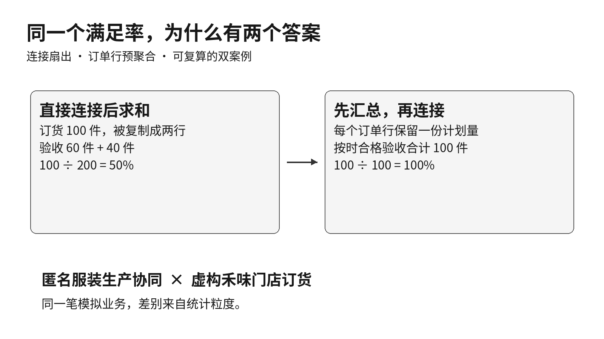
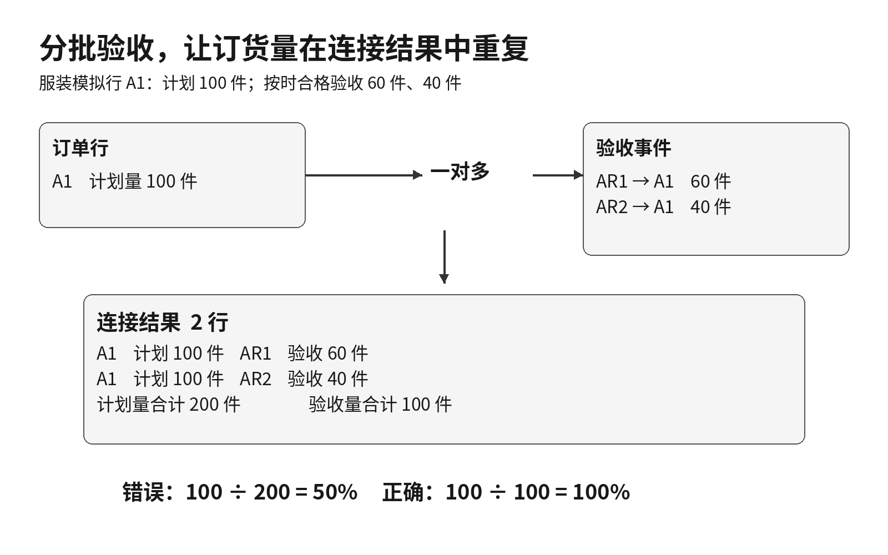
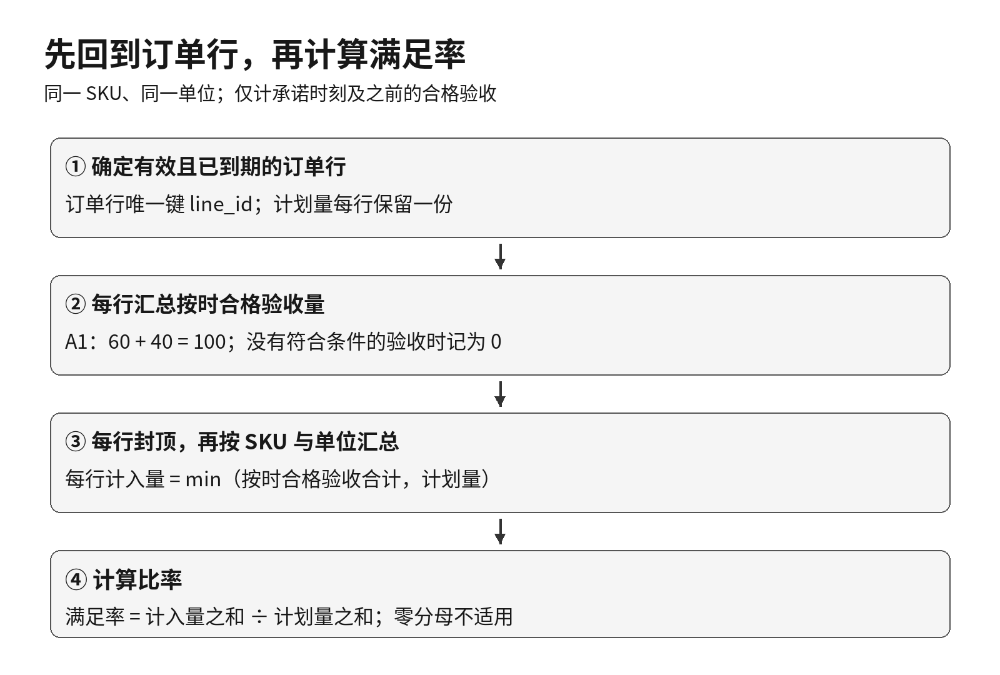
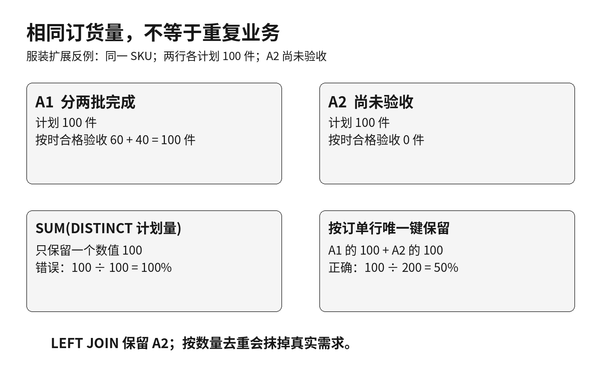
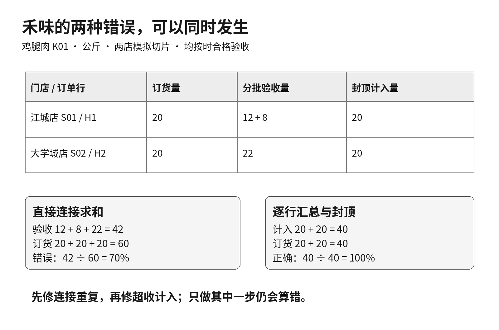

计划生产100件，分两批验收60件和40件，全部按时合格。业务看着记录说已经收齐，报表却显示满足率只有50%。

如果只检查“验收量÷计划量”这条公式，很容易找不到问题。真正发生的是：订单行连接两条验收记录后，计划量100被复制了两次，报表算成了100÷200。

这类错误叫**连接扇出**：一条记录匹配多条记录，连接结果的行数随之展开。连接本身可以完全正确，但原来的求和口径不再成立。对供应链产品经理来说，危险之处在于：SQL没有报错，数字也像一个正常百分比，却可能让本已完成的交付进入催单名单。

这篇文章用两组小样本把问题拆开：先看匿名服装企业的分批验收，再看虚构餐饮企业“禾味”的门店订货。最后落到一条可复算的查询和一组验收条件。

> 两类案例中的单号、时间和数量均为模拟。本篇是独立教学切片，不是前三篇订单的后续真实流水。禾味沿用2家门店、8个食材SKU、14天观察期的案例框架，但本篇只生成两店鸡腿肉的最小反例，不代表完整14天数据。服装的“订货量”字段在本篇教学库中表示生产计划件数。

## 一 100件为什么变成了200件

匿名服装企业有一条生产订单明细A1，SKU为TEE-M，计划100件，承诺验收时间为10月10日18:00。两次合格验收分别发生在10月9日09:00和10月10日12:00，数量为60件、40件。

原始数据并不重复：A1是一条需求，AR1和AR2是两次真实不同的验收事件。

| 订单行 | 计划量 | 验收事件 | 按时合格验收量 |
|---|---:|---|---:|
| A1 | 100件 | AR1 | 60件 |
| A1 | 100件 | AR2 | 40件 |

这张表是连接后的结果，不是原始订单表。它的粒度已经从“一个订单行”变成“订单行×匹配到的验收事件”。因此，验收量相加仍是100，计划量却不能直接相加。

[](images/d4-01_fanout.png)

下面这段查询会得到50%。为隔离连接问题，此处只取A1，两条验收均已按时合格。

```sql
SELECT SUM(r.accepted_qty) * 1.0 / SUM(o.ordered_qty) AS wrong_rate
FROM order_line AS o
JOIN receipt_line AS r ON r.line_id = o.line_id
WHERE o.line_id = 'A1';
```

连接增加了行数，不等于数据源发生了重复上报。这个区别会影响修复方式：如果把AR2当“重复记录”删掉，合法的40件验收也一起丢了。

这里也不应据此得出“连接后的数量都不能求和”。如果统计的是每次验收的数量，在这一对多连接里它仍可以相加。要逐列判断该字段所属粒度，而不是对整张表笼统地去重。

## 二 修复顺序是先汇总验收，再回到订单行

本篇沿用上篇的**承诺期内数量满足率**：先计算每个订单行在承诺时刻及之前的合格验收总量，每行最多计入计划量；再按同一SKU、同一单位汇总。未到期和取消行不纳入，分母为零记不适用。

“先汇总”和“先封顶”不能交换：一行订20公斤，两批各收12公斤，应先合计24，再封顶为20；如果逐批各封顶为12，再相加就成了24。

[](images/d4-02_correct_pipeline.png)

为了把查询读清楚，教学库只保留两个核心对象：订单行和验收事件。`line_id`是全库唯一订单行标识，`receipt_id`是唯一验收事件标识；若真实系统的明细号只在单据内唯一，就必须用完整组合键，不能照搬单列连接。

`received_at`在本教学库中专指验收事件发生时刻，不是物流到场时间，也不是入库过账时间。所有时间统一为同一教学业务时区、固定的`YYYY-MM-DD HH:MM:SS`文本格式，跨时区的真实数据应先统一时间基准。

下列查询在实践包建表后可以直接运行。完整教学库还包含下一节的未验收行A2，以及第四节的禾味H1、H2。若只想复现开头A1的100%，在`eligible`的筛选条件中再加`AND line_id = 'A1'`。完整查询计算10月1日至14日承诺到期、截至14日23:59:59已到期的有效订单行；承诺时刻恰好发生的验收算按时。

```sql
WITH eligible AS (
  SELECT * FROM order_line
  WHERE status = 'valid'
    AND promised_at >= '2026-10-01 00:00:00'
    AND promised_at <  '2026-10-15 00:00:00'
    AND promised_at <= '2026-10-14 23:59:59'
), received AS (
  SELECT r.line_id, SUM(r.accepted_qty) AS on_time_qty
  FROM receipt_line AS r
  JOIN eligible AS o ON o.line_id = r.line_id
  WHERE r.is_qualified = 1
    AND r.received_at <= o.promised_at
    AND r.received_at <= '2026-10-14 23:59:59'
  GROUP BY r.line_id
), per_line AS (
  SELECT o.line_id, o.business, o.sku, o.unit, o.ordered_qty,
         MIN(o.ordered_qty, COALESCE(r.on_time_qty, 0)) AS credited_qty
  FROM eligible AS o
  LEFT JOIN received AS r ON r.line_id = o.line_id
)
SELECT business, sku, unit,
       SUM(credited_qty) AS numerator,
       SUM(ordered_qty) AS denominator,
       1.0 * SUM(credited_qty) / NULLIF(SUM(ordered_qty), 0) AS fill_rate
FROM per_line
GROUP BY business, sku, unit;
```

完整教学库的预期输出为服装TEE-M：100÷200＝50%；禾味K01：40÷40＝100%。A1单独收齐，与A1＋A2只完成一半，是两个不同的统计范围。

这里最重要的中间产物是`per_line`：**每个有效订单行只出现一次，计划量也只出现一次。** `received`已按`line_id`聚合，一行只有一个验收合计，因此左连接回来不会再次扇出。

`COALESCE`把“没有匹配到符合条件的验收”转为计入量0，不是在把所有数据缺失都当0。这个处理依赖于验收采集完整、订单键能正确关联；若接口漏传，首先应报告数据不完整，不能把它当成真实未交付。

本文的SQLite写法中，`MIN(a,b)`比较两个数，而不是跨行求最小值。最后乘`1.0`避免整数相除丢失小数，`NULLIF`防止零分母被解释为0%。若没有任何有效订单行，分组查询会不返回该组；前端应显示“无适用订单”，不是自行补成0%达标率。

## 三 DISTINCT为什么会把另一条真实需求删掉

只看A1时，有人会提出一个更短的补丁：把分母改成`SUM(DISTINCT ordered_qty)`。连接结果里的100重复了两次，去重后只剩100，似乎修好了。

现在增加另一条同SKU的订单行A2：同样计划100件、同样已经到期，但尚无验收。

| 订单行 | 计划量 | 按时合格验收量 | 封顶计入量 |
|---|---:|---:|---:|
| A1 | 100件 | 100件 | 100件 |
| A2 | 100件 | 0件 | 0件 |
| 合计 | 200件 | 100件 | 100件 |

正确满足率为100÷200＝50%。采用左连接直接求和时，A1展开成两行、A2保留一行，错误分母为300，结果约33.33%；改成`SUM(DISTINCT ordered_qty)`后，两条真实需求的100又被压成一个100，结果错误地变成100%。

[](images/d4-03_distinct_trap.png)

`DISTINCT`按所给的值判断重复，并不理解业务身份。数值100相同，不代表A1和A2是同一条需求。这也是为什么`COUNT(DISTINCT line_id)`有时能正确数订单行，却不能推出`SUM(DISTINCT ordered_qty)`也能正确算数量。[SQLite聚合函数说明](https://www.sqlite.org/lang_aggfunc.html)

另一种看似无关的错误也会抹掉A2：先左连接验收表，随后在外层`WHERE`里写`r.is_qualified = 1`。A2没有右表记录，该条件不会成立，于是整行被过滤。只有迟到验收、只有不合格验收的订单行，也必须留在有效需求分母中。

解决办法是把验收条件放到右侧预聚合里，或者放在适当的`ON`条件中，再保留全部有效订单行。仅仅把`INNER JOIN`改为`LEFT JOIN`，却不检查后续过滤条件，还不够。[SQLite连接与WHERE说明](https://www.sqlite.org/lang_select.html)

## 四 禾味案例里，连接重复和超收会叠加

禾味有江城店S01和大学城店S02。8个食材SKU仍为鸡腿肉、大米、土豆、番茄、生菜、食用油、牛奶和鸡蛋；这次只取鸡腿肉K01，单位统一为公斤。

两店各有一条20公斤的有效订货明细，承诺时刻均为10月10日18:00。江城店H1分两批按时合格验收12＋8公斤；大学城店H2一次按时合格验收22公斤。

[](images/d4-04_hewei.png)

直接连接求和会得到验收42公斤、订货60公斤，满足率70%。即使只修复分母，把60还原为40，42÷40仍是105%，因为大学城店多收的2公斤被当成了额外完成量。

正确做法是H1计入20、H2计入20，合计40÷40＝100%。这并不要求把实收22改成20：**真实验收量保留22，指标计入量另列20。** 前者支撑实物流和后续账务核对，后者服务这项履约指标；不应为了让报表好看而修改业务事实。

如果H2只收18公斤，而H1收22公斤，也不能用两店总共收齐40来判满额。逐行封顶后计入20＋18＝38，满足率为95%。同SKU、同单位允许在这一口径下汇总，但不意味着门店间的超收可以自动抵消短收。

现在可以看出两类错误的业务影响：连接重复可能把正常分批交付误报成未按承诺交足，跨行抵消则可能掩盖某个门店的未满足订货量。是否已经造成库存缺货，还需结合库存与消耗数据判断。看板上的一个比率，背后对应的是不同的催单、调配和异常处理动作。

## 五 把修复变成可验收的产品规则

只保留一条“结果等于100%”的测试，很难防止问题再次出现。更有效的做法是留住能击穿错误写法的小样本。

| 验收情形 | 应验证的结果 |
|---|---|
| 同一行一次验收100，改为60＋40 | 满足率不变，仍为100% |
| 新增同SKU、计划100且未验收的已到期行 | A1＋A2变为50%，未验收行仍在分母 |
| 一行订20，两批各收12 | 先合计24再封顶20，不计24 |
| 只迟到、只不合格或没有验收 | 对应行计入量为0，需求仍保留 |
| 承诺时刻恰好验收与晚1秒验收 | 前者计入，后者不计入 |
| 加入取消行或未到期行 | 当前指标不受影响 |

可以在报表开发验收中增加两个检查点：第一，预聚合后每个订单行键必须唯一；第二，连接前后的有效计划量应一致。若后续再接入质检明细、扣款明细等一对多对象，仍要重新检查粒度，不能认为前面修过一次就永远安全。

同一订单行若有两条验收记录和三条扣款记录，直接把两张明细表一起连接，可能展开成六行。此时验收量也会被重复计算。通常应让各类明细先分别汇总到目标粒度，再连接；前提仍是业务上确实允许按该粒度汇总。

本篇提供的SQL是静态教学快照，`valid`表示样本中的有效状态。它没有订单状态版本、撤销记录和数据到达系统的时刻，不能据此声称重建了任意历史时点“当时已知”的全量事实。若要审计历史看板，还需要状态与数据到达时间的历史记录。

## 六 留给下一次报表评审的三个问题

下次再看到一个满足率，不妨先问：

1. 分子、分母各自来自什么粒度，连接后哪一列被复制了？

2. 没有匹配记录的真实需求是否仍在分母，过滤条件有没有把它删掉？

3. 去重依据是业务键，还是碰巧相同的数量；封顶发生在每个订单行，还是整体合计之后？

这三个问题比单独核对公式更接近报表错误的根部。SQL能执行，只说明语法和数据结构允许这样计算；要让结果能用于业务决策，还得证明每一份需求和每一次验收都只在该出现的位置出现。

配套实践包包含独立教学建表脚本、上述反例、验证脚本与结果表。只在空白教学库运行；建表脚本会删除并重建同名示例表和视图，不要连接生产库。

参考：本文的连接行为与聚合语义依据SQLite官方文档；数量满足率沿用本系列已明确的教学口径，不将其宣称为所有企业通用的标准定义。
