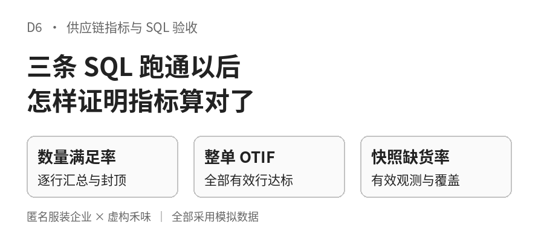
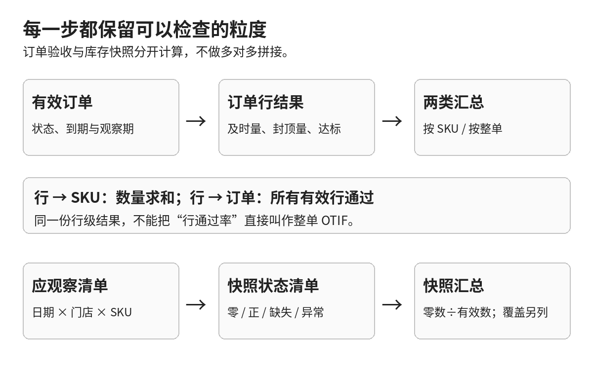
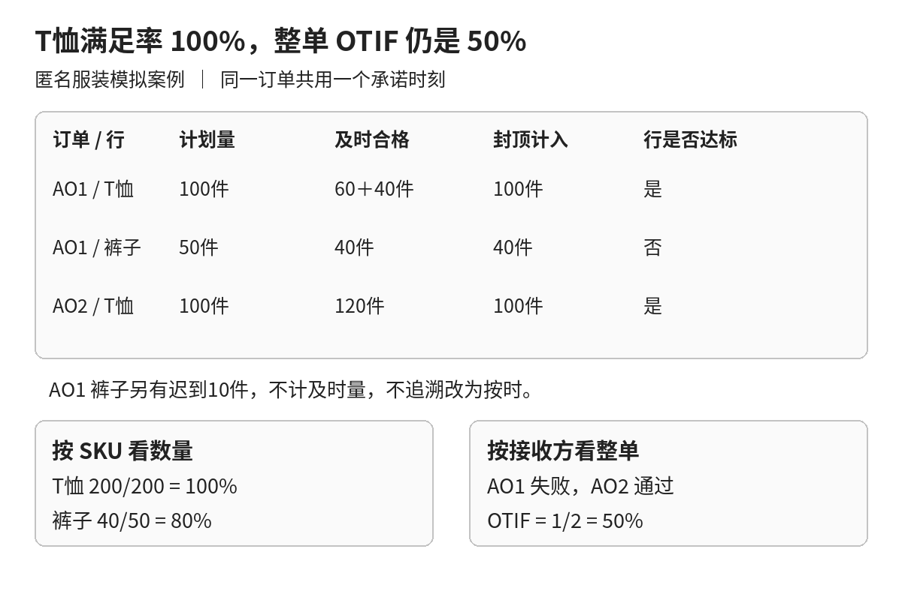
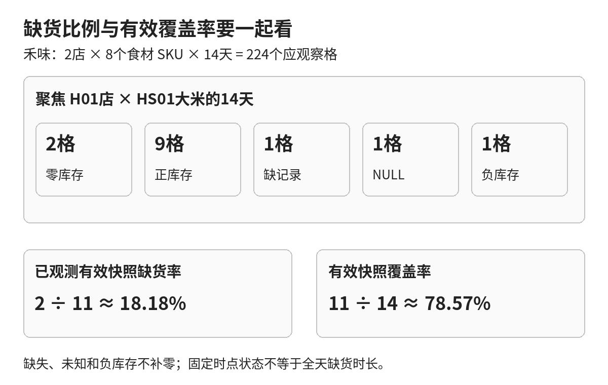
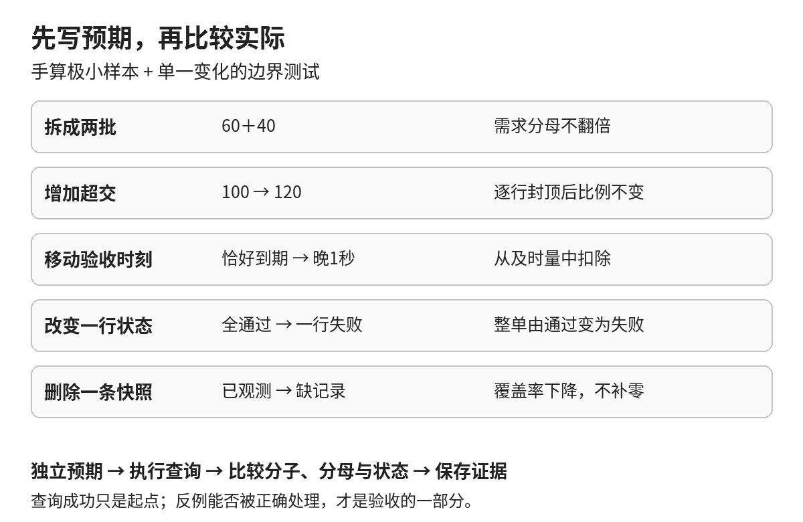

一张生产单有两个商品行：T恤计划100件，裤子计划50件。T恤按时收齐，裤子按时只收到40件，另外10件晚一秒才验收。

如果报表显示“T恤满足率100%”，它可能完全正确；如果据此把整张生产单判为按时足量，就算错了。问题不在除法，而在从商品行走到整张订单的那一步。

前几篇分别讨论了指标口径、连接扇出和数据质量。到了真正交付查询时，还要回答一个更具体的问题：**哪一份证据能够证明，这条SQL按照约定的对象、时间和分母计算？**

这篇把三项指标放进同一个可复算实验：按接收方看整单OTIF，按SKU看数量满足率，按门店与SKU看快照缺货率。不做看板，先把每一个百分比往回追到原始记录。

> 所有单号、数量、时间和结果均为模拟。服装案例以匿名生产协同企业呈现，本文“订货量”表示生产计划件数，“接收方”表示交付验收组织。禾味是虚构餐饮案例，包含2家门店、8个食材SKU、2026年10月16日至29日的教学数据。本篇为独立实验，不承接前文模拟订单的真实后续，也不代表任何实际项目收益。

## 一 先写出能被推翻的验收条件

“按时足量”听起来明确，写成SQL之前仍有几处必须落笔。

- **评价谁**：承诺时间位于观察期、截至统计时点已到期的有效整单；取消订单不参加，未到期订单不提前扣分。不是按下单日或验收日选订单，提前验收也不因发生在观察期起点前而被排除。
- **哪一个时间**：本例用合格验收发生时刻，不用车辆到场或入库过账时间。恰好在承诺时刻验收算按时，晚一秒就不计入及时量。
- **在哪一层封顶**：先合计一个订单行的及时合格验收，再以该行订货量封顶。其他订单行的超额交付不能抵消缺口。
- **结果是什么**：满足率按同SKU、同单位算数量；OTIF按整单算是否达标；快照缺货率数观测，不数缺货小时。

这些约定最好能变成反例。例如，把一笔验收从承诺时刻移动到下一秒，及时量应减少；把一笔已经超额的验收再加10件，封顶后的满足率不应上升。这样，需求不再只有一句“支持按时足量率”，还带着开发和业务都能核对的预期变化。

本实验固定业务时区为UTC+08:00，观察期为10月16日00:00至10月30日00:00，不含右端点；统计截止为10月30日00:00:00。输入时间统一使用ASCII数字的YYYY-MM-DD HH:MM:SS格式，格式不符先拒绝计算，再做比较。真实系统跨时区、历史补录或承诺版本变更，需要另外约定，不能用本例的文本比较直接替代。

## 二 按粒度拆出能检查的中间结果

SQL很长并不等于口径严谨。更容易验收的做法，是让每一步只有一个明确粒度。

[](images/d6-01_pipeline.png)

数量满足率和OTIF共用订单行结果，但走向不同：

1. 筛选有效、到期的订单范围。
2. 按订单行汇总承诺时刻前的合格验收。
3. 回到订单行，保留订货量、及时量、封顶计入量与行达标标记。
4. 满足率按SKU求和；OTIF先把所有有效行归到订单，再按接收方数订单。

库存快照是另一条链。先列出“日期×门店×SKU”的应观察组合，再连接实际快照，区分零、正数、NULL、缺记录与负库存。不能把库存表接进订单验收明细后一起聚合，否则又会引入多对多展开。

这里最值得产品经理要求交付的，不是SQL行数，而是**订单行明细、整单判定和快照状态清单**。汇总不对时，能定位到哪张单、哪一行、哪个时点，而不是围着一个百分比猜测。

## 三 服装案例：T恤100%，整单为什么只有50%

模拟接收组织A01有两张有效且已到期的生产单。AO1含T恤与裤子两行，AO2只有T恤一行。

| 订单 | SKU | 计划量 | 及时合格验收 | 迟到验收 | 封顶计入量 | 行达标 |
|---|---|---:|---:|---:|---:|---|
| AO1 | TEE-M | 100件 | 60＋40件 | 0 | 100件 | 是 |
| AO1 | PANT-M | 50件 | 40件 | 10件 | 40件 | 否 |
| AO2 | TEE-M | 100件 | 120件 | 0 | 100件 | 是 |

同SKU汇总后，T恤满足率为200÷200＝100%，裤子为40÷50＝80%。这里不把两个SKU的满足率直接平均成90%，也不把它当作整单OTIF。

AO1有一行不达标，所以整单不达标；AO2全部有效行达标，所以整单达标。A01的OTIF为1÷2＝50%。晚到的10件可以说明裤子后来收齐，却不能改写已经错过的承诺。

[](images/d6-02_apparel.png)

实践包里，AS01对应TEE-M，AS02对应PANT-M。订单头只保存一个共同承诺时刻，所有商品行继承该时刻，本例不处理部分商品行取消。这样先冻结整单评价范围。若真实订单允许各行承诺不同，必须重新明确整单何时成熟、跨期订单归哪期。不能先删掉未到期行，再把剩下的行当成完整订单。

下面截取实践包中两项指标的关键汇总。执行前，运行器已校验原始数据并建立每行唯一的line_result与每单唯一的order_result。它们不是可以跳过建表、独立粘贴运行的完整脚本；run.py负责原始表、参数和应观察网格的建立，metrics.sql负责中间视图、范围筛选和三个结果视图。

```sql
-- 先判整单：一行失败，MIN 就是 0。
SELECT scenario, order_id,
       MIN(CASE WHEN on_time_qty >= ordered_qty
                THEN 1 ELSE 0 END) AS passed
FROM line_result
GROUP BY scenario, order_id;

-- 再按 SKU 汇总数量：先逐行封顶，不能先把所有验收相加。
SELECT scenario, sku_id,
       SUM(MIN(on_time_qty, ordered_qty)) AS numerator,
       SUM(ordered_qty) AS denominator,
       1.0 * SUM(MIN(on_time_qty, ordered_qty))
         / NULLIF(SUM(ordered_qty), 0) AS ratio
FROM line_result
GROUP BY scenario, sku_id;
```

第一条先返回每单0或1，下一层才按接收组织计算“通过单数÷适用单数”。第二条只展示有适用需求的SKU；完整版本从SKU主表出发做左连接，因此没有需求的SKU也会保留为分母0、比例NULL。SKU在场景内唯一，单位由主数据固定，完整结果同时带单位。

这里的MIN有两种用法：MIN(表达式)跨行取最小值，帮助判断整单；SQLite的MIN(a,b)比较两个值，完成单行封顶。1.0用于避免整数除法，NULLIF使零分母返回NULL，而不是伪造一个零百分比。

无匹配验收计为0还有一个前提：本实验验收事件集合已知完整，关联键经过校验。若真实接口漏传，不能把“没拿到事件”直接解释成“没有交货”。

## 四 禾味案例：三项指标不能混成一个“服务水平”

禾味两家门店、8个食材SKU都在14天观察清单中，每天18:00各观察一次，因此库存应观察格数为2×8×14＝224。食材包括大米、鸡肉、番茄、鸡蛋、土豆、牛奶、食用油与面粉，保留各自单位。

本例on_hand表示该固定时点的可用库存，不另模拟冻结与待检状态。只有等于0才计入快照缺货，低于安全库存不等于本指标中的缺货。

对门店而言，三项结果解决的是不同问题：

- 按店的OTIF帮助找出没有按时收齐的订货单。
- 按SKU的数量满足率帮助查看哪类食材仍有及时交付缺口；公斤、升和个不相加。
- 按店与SKU的快照缺货率反映固定时点的库存状态，并同时披露有效覆盖率。

先手算H01店的三张适用订货单：HO1的大米10公斤已收齐，但鸡肉5公斤只及时合格验收4公斤，整单失败；HO2的大米订10公斤、及时收12公斤，整单通过；HO3的大米10公斤晚一秒到，整单失败。因此H01的OTIF为1÷3≈33.33%。

同一批记录按大米SKU看，封顶计入10＋10＋0＝20公斤，需求为10＋10＋10＝30公斤，满足率为20÷30≈66.67%。这两个结果描述的是订单通过比例和数量缺口，不能互相替代。取消单HO4与未到期单HO5保留在排除清单中，不悄悄消失。

H02店另有两张适用单：土豆8公斤恰在承诺时刻验收，达标；牛奶4升没有合格验收量，不达标，OTIF为1÷2＝50%。没有适用到期需求的SKU则显示分母0、比例NULL，不能借此宣称100%供应成功。

再看H01店大米HS01的14个库存观察时点：2格为零、9格为正、1格缺记录、1格值未知、1格负库存。已观测有效快照缺货率为2÷11≈18.18%，有效覆盖率为11÷14≈78.57%。负库存另列异常，不把它改成0，也不当作有效正库存。

实践包同时为服装的2个接收组织、8个服装SKU生成224格库存测试数据，所以两类场景合计448格。上面的224格和18.18%只属于禾味范围，不是全包合计结果。库存量未建立收发存守恒关系，这些是指标验收夹具，不是经营数字仿真。

[](images/d6-03_snapshot.png)

从已经按应观察网格分类的snapshot_result出发，第三项指标的核心查询如下。它保留有效数与应有数，避免只展示18.18%而隐藏数据覆盖不足。

```sql
SELECT scenario, site_id, sku_id,
       SUM(CASE WHEN quality='valid' AND on_hand=0
                THEN 1 ELSE 0 END) AS numerator,
       SUM(CASE WHEN quality='valid' THEN 1 ELSE 0 END) AS denominator,
       1.0 * SUM(CASE WHEN quality='valid' AND on_hand=0
                      THEN 1 ELSE 0 END)
         / NULLIF(SUM(CASE WHEN quality='valid'
                          THEN 1 ELSE 0 END), 0) AS ratio,
       COUNT(*) AS expected_count,
       1.0 * SUM(CASE WHEN quality='valid' THEN 1 ELSE 0 END)
         / COUNT(*) AS coverage
FROM snapshot_result
GROUP BY scenario, site_id, sku_id;
```

完整脚本还输出缺记录、未知值和负库存的数量。这里COUNT(*)数的是左连接后保留的应观察格，不是收到的有效快照条数。

即使某店OTIF低，也不能仅凭这份模拟表断言它的零库存由供应商迟到造成。开期库存、门店消耗、调拨和盘点差异都可能影响库存。三项指标可以并列诊断，但没有建立因果链，更不能据此自动生成采购单。

## 五 让边界测试替你守住口径

只用一张“全部按时收齐”的订单测试，错误查询也很容易通过。一个有用的验收集要包含：看上去相近，但应得不同结果的记录。

[](images/d6-04_tests.png)

| 测试变化 | 必须保持或发生的结果 |
|---|---|
| 一次100拆成不同事件60＋40 | 及时合计不变，需求分母不翻倍 |
| 同一事件完全相同地重放一次 | 验证身份与载荷后折叠，计入量不变 |
| 同事件ID出现不同数量 | 拒绝计算，不能随意取第一条 |
| 一行交120，另一行缺20 | 逐行封顶，超交不替另一行补缺 |
| 恰在承诺时刻与晚一秒 | 前者计及时，后者不计 |
| 单内一行不达标 | 整单不达标，不能用行通过率代替OTIF |
| 没有适用订单 | 比例不适用，不写成0%或100% |
| 缺快照、NULL、负库存 | 分别披露，不当作零库存 |

一个已运行的受控对照是：只把禾味土豆验收事件HE7从10月24日12:00:00改到12:00:01，数量仍为8公斤。HS05满足率应从8÷8变为0÷8，H02店OTIF应从1÷2变为0÷2，两项指标的分母分别保持8公斤和2单不变。实践包的边界测试验证了及时量的变化；这个对照说明，一秒钟改变的是承诺内的交付归属，而不是实际收到的总量。

测试也分两层。第一层用像AO1、AO2这样的极小表手算，核对预期值。第二层在一份固定数据上做单一变化，检查查询是否满足不变量。不能只把同一段SQL换一种缩进写进测试，再说“两边一致”就是独立验证。

实践包保留手工预期与查询实际输出。输入质量验证先于业务计算：无法确认订单键、事件身份或时间格式时，先失败并指出原因。已知的缺失快照则按预先约定输出诊断比例和覆盖率，不假装完整。

## 六 下载复算时 先看明细再看比例

[下载D6独立教学实践包](/downloads/d6-sql-metrics-practice.zip)。包内包括模拟数据、SQL、手算预期、测试与运行说明，不包含生产连接或自动采购动作。

解压后进入实践包目录，使用带标准库sqlite3的Python 3.10及以上版本执行：

```bash
python3 tests.py
python3 run.py --out ./my-d6-results
```

输出目录必须不存在，运行器拒绝覆盖既有结果。数据库建在内存中，不修改输入CSV。三个汇总文件是metric_otif.csv、metric_fill.csv和metric_stockout.csv；另有行级结果、整单结果、排除订单、异常快照及记录统计范围与输入哈希的audit.json。

expected目录是固定样本的参考输出，不是用户本次运行结果，也不充当独立的正确性证明。独立证据是tests.py中的手算常量、逐事件Python参考算法与边界变化测试。实际运行结果应保存到新的结果目录，与参考输出逐项核对。

建议按这个顺序读结果：先检查范围与排除记录，再看订单行及时量和封顶量，然后核对整单判定，最后看三个汇总文件。只要其中一层的粒度说不清楚，就不急着把最后的百分比搬到看板。

这次练习的交付标准，是另一个人拿到同一份数据和规则，能够得到同样的结果，并能指出哪些记录不参加评价。到了D8，指标字典才不只是一张定义表，还能附上查询、样本和验收证据。
