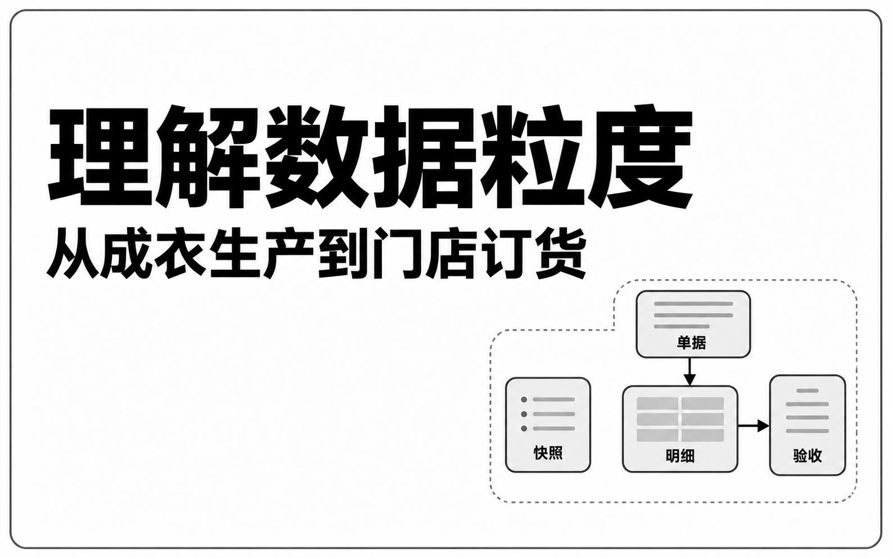
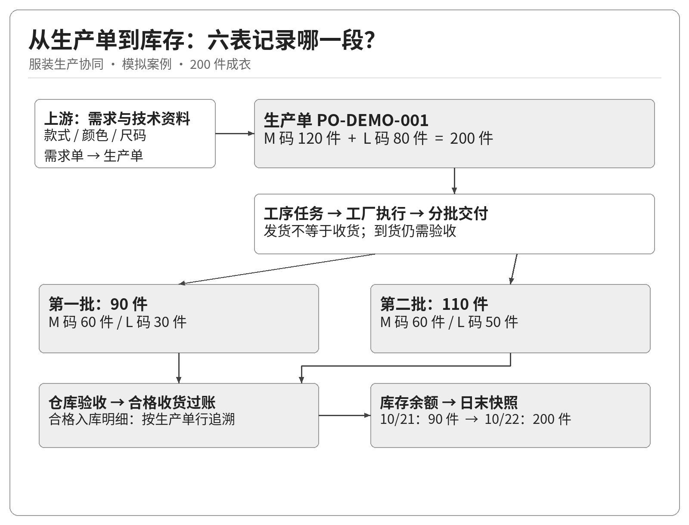
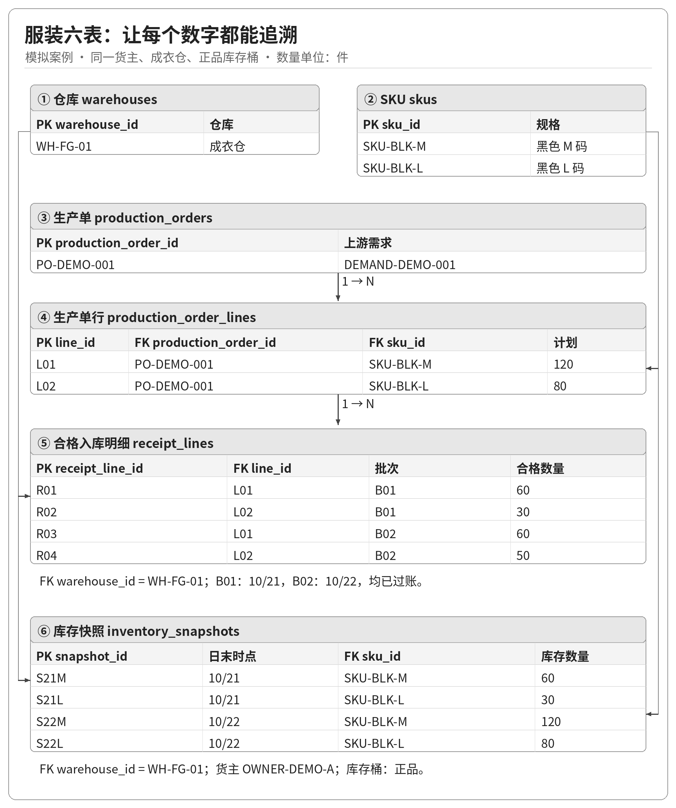
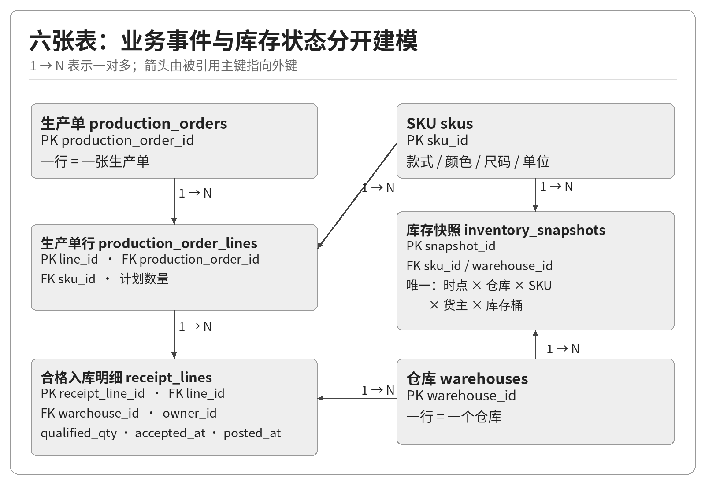
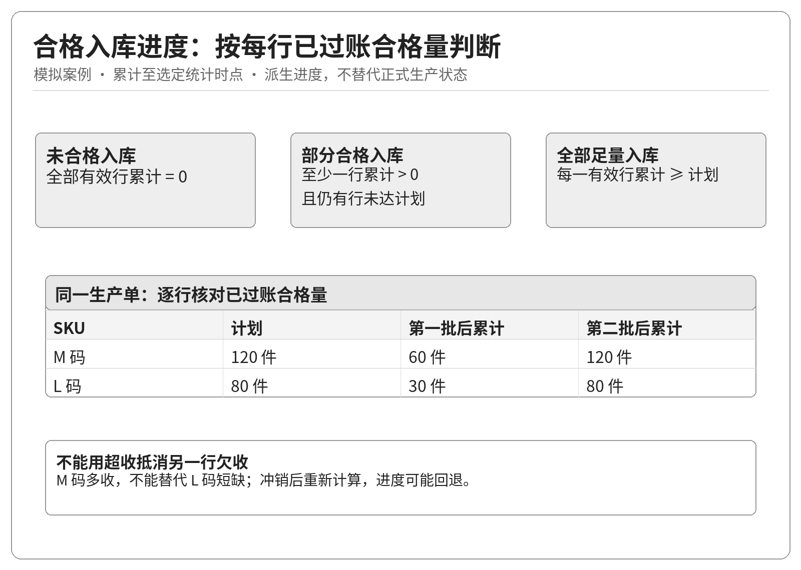
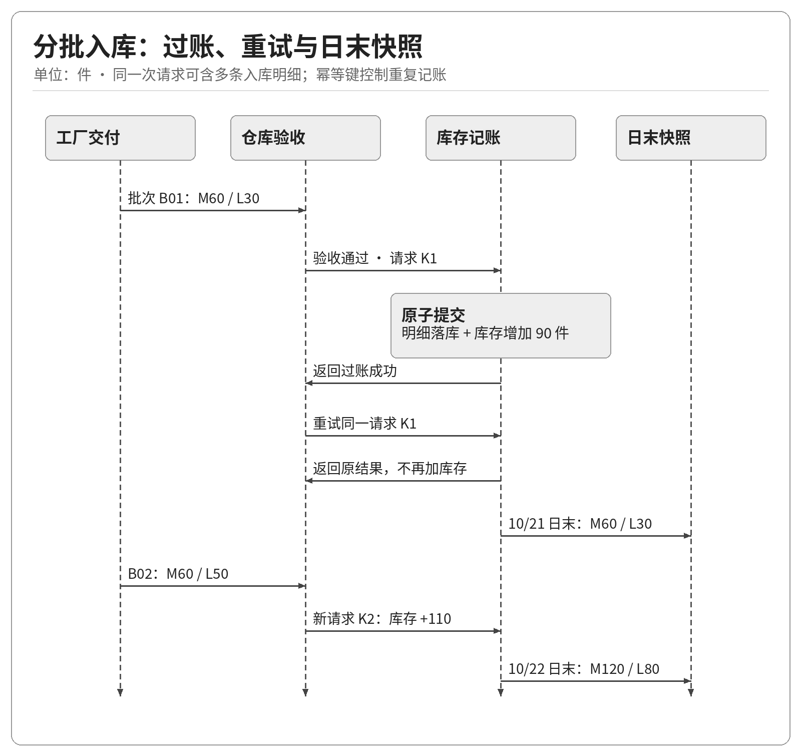
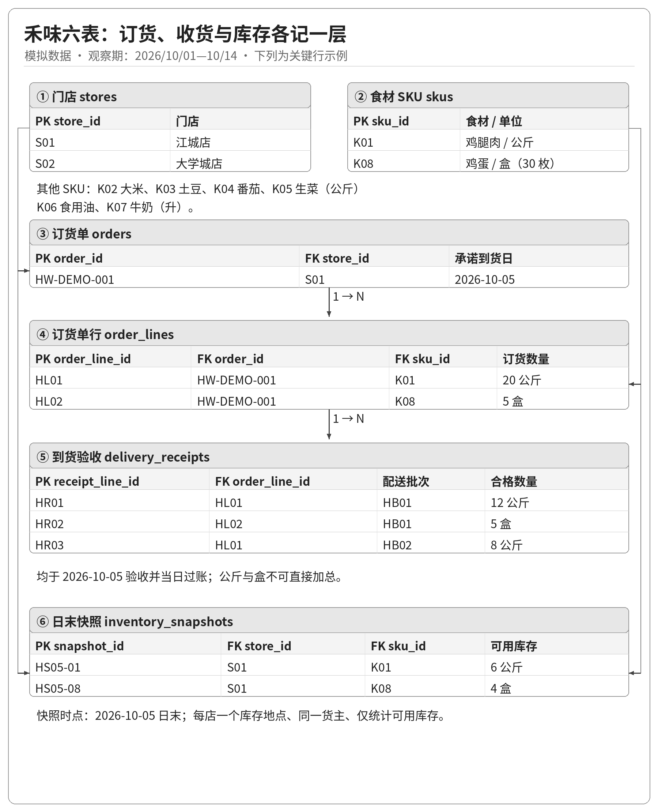
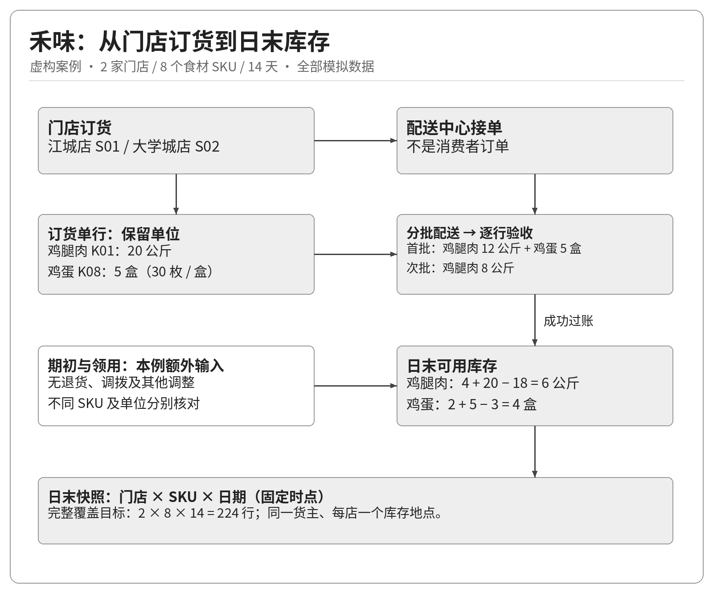

做供应链指标时，最容易被跳过的问题，往往最基础：**数据库里的一行，到底代表什么？**

同一批200件成衣，可能对应1张生产单、2个商品行、2批收货和4条合格入库明细。每个数字都对。但把不同层级的数据直接拼在一起，200件需求也可能被算成400件。

本文用匿名服装生产与虚构餐饮品牌“禾味”两个案例，回答三个问题：**需求拆成哪些行，分批交付如何累计，日末到底剩多少。** 两类业务分别建模，不共用数量口径。

> **案例范围**：服装案例基于实际服装生产协同业务背景作匿名化表达，单号、款式、日期与数量均为模拟；餐饮案例使用虚构案例“禾味”：2家门店、8个食材SKU、14天小样本，全部采用模拟数据。两套六表是教学分析切片，不是现有数据库的复刻，不代表相关状态或接口已经上线。

## 一 服装案例先把200件成衣的业务讲清楚

该服装企业涉及商品开发、生产需求、工序任务、工厂协同、仓储与销售履约。生产需求单与生产单按一对一关系衔接，工序任务继续拆分；完整业务不止六张表。

本文只截取一段：**成衣需求如何经过分批验收，形成合格入库记录和日末库存。** 商品技术包、任务、报工、结算等对象不在这次切片中展开。

假设主键为PO-DEMO-001的生产单安排同一款黑色连衣裙：

| 生产单行ID | SKU ID | 商品规格 | 计划数量 |
| --- | --- | --- | ---: |
| L01 | SKU-BLK-M | 黑色 M码 | 120件 |
| L02 | SKU-BLK-L | 黑色 L码 | 80件 |
| 合计 | 2个SKU | 同一款式 | 200件 |

工厂分两批交付。模拟中两批均全部验收合格，并完成入库过账：

- 10月21日，M码60件、L码30件，共90件。

- 10月22日，M码60件、L码50件，共110件。

于是，这段业务同时包含**1张生产单、2个生产单行、2个收货批次、4条合格入库明细**。“收了几单”“收了几批”“收了多少件”，必须分别回答。

**图1 生产需求到库存快照的业务流程**

图1中，工厂交出、仓库接收、质检确认和入库过账是不同业务动作。它们可以被系统整合到同一操作界面，但含义不能混同。工厂已交出，不等于成衣仓已有可用库存。

## 二 数据粒度先于字段设计

**粒度，就是一条记录所描述的业务对象、事件或观察范围。** 先把这句话写清，再决定主键、字段和关联。

六张表分为四类：仓库和SKU是对象档案，生产单及明细是业务单据，入库明细是事件，库存快照是时点观察。它们都能显示成Excel行，但不能按同一种方式相加。

Kimball在《Declaring the Grain》中强调，设计事实表时应先明确每条记录代表什么。本文借用这一思考方法理解业务数据，但这六张操作与分析用表并不是一套完整的星型数仓模型。[参考原文](https://www.kimballgroup.com/2003/03/declaring-the-grain/)

### 主键与外键分别解决什么问题

主键回答“怎样唯一识别这条记录”；外键回答“它引用哪个已有对象”。主键唯一且非空；外键校验引用是否存在，**必需的引用还要设为非空**。[PostgreSQL约束文档](https://www.postgresql.org/docs/18/ddl-constraints.html)

例如，L01必须唯一标识一个生产单行；R01引用L01，就必须能找到这个行。字段名字都叫“订单号”，并不自动保证对象相同，也不能保证引用有效。

还有一个常见陷阱：**商品行不一定永远等于生产单加SKU。** 同一SKU可能因交期等条件在同一单据中分成多行。因此，本文给商品行独立的line_id，并约束同一生产单内line_no不重复，而不草率地把“单号加SKU”当作永久唯一键。

## 三 服装案例的六张表各自保存一种含义

这六表用于核对“需求是否足量入库”和“某时点有多少库存”：单头定位业务，商品行给出需求，入库明细累计已过账数量，快照观察余额；仓库与SKU统一地点和规格。货主等档案可引用现有系统，不必硬塞进六表。

**先看样例怎么连，再查字段定义**

从PO-DEMO-001向下看：1张生产单拆成2个商品行，再对应4条入库明细。两侧关联线把仓库、SKU与它们的引用记录连起来；快照不直接挂在某张生产单下面。

### 仓库表 warehouses

**一行代表一个仓库。** 主键warehouse_id；关键字段warehouse_code、warehouse_name、warehouse_type。示例WH-FG-01表示本例的成衣仓。

仓库编码应唯一，名称可以变更，不能依赖名称做关联。仓库回答“货在哪里”，货权主体回答“货属于谁”；仓库运营方也不必然就是货主。

### SKU表 skus

**一行代表一个可独立管理的商品规格。** 主键sku_id；关键字段style_id、color、size、base_unit。示例SKU-BLK-M表示黑色M码，基础单位为“件”。

款式用于组织商品，SKU用于区分规格。M码与L码不能只因同属一款就合并。本文只用成衣“件”，不把面料米数、重量或包装箱数混入同一数量合计。

### 生产单表 production_orders

**一行代表一张生产单。** 主键production_order_id；关键字段production_order_no、source_demand_id、created_at、status。source_demand_id引用切片之外的生产需求单。

生产单号应唯一；一对一转换下，source_demand_id也要防止重复。status保留业务系统定义，不被本文的入库进度覆盖。单头总量用于展示或核对，SKU数量仍以明细为准。

### 生产单明细表 production_order_lines

**一行代表生产单中的一个商品行。** 主键line_id；外键production_order_id、sku_id；字段line_no、planned_qty、unit。

本例计划数量为正整数，单位为件；同一生产单内行号唯一。L01是M码120件，L02是L码80件。仅用production_order_id做本表主键，会丢掉一张单对应多行的事实。

### 合格入库明细表 receipt_lines

**一行代表一次已过账入库事件中，一个生产单行、一个实际仓库和一个货主的合格数量。** 主键receipt_line_id；外键line_id、warehouse_id，owner_id引用切片外货主档案；字段receipt_batch_id、qualified_qty、unit、accepted_at、posted_at、source_line_event_id。

accepted_at记录验收确认时间，posted_at记录库存入账时间。本例两者落在同一天；真实分析应按问题选择时间，不能默认它们相等。库存类统计只使用已成功过账的记录。

本例在单一来源内约束source_line_event_id唯一，以识别重复明细；接入多来源时，唯一范围须包含来源标识。**批次ID只能归组，不能唯一标识明细**：同一批有M、L两行。若用“请求幂等键＋来源行号”识别明细，请求级幂等仍应单独管理。

本文只记录合格入库。待检、不良、拒收和返工必须按实际流程单独记录；不能因为它们不在本表中，就声称这些数量为零。需要管理验收单头、附件和交接双方时，还应扩展单头或事件表。

### 库存快照表 inventory_snapshots

**一行代表固定时点、指定仓库、SKU、货主和库存桶下的数量。** 主键snapshot_id；外键warehouse_id、sku_id，owner_id引用切片外货主档案；字段snapshot_at、stock_bucket、quantity、unit。

业务唯一约束为“时点＋仓库＋SKU＋货主＋库存桶”，这些字段均不得缺失。本文只展示互斥统计桶中的正品桶；若系统用重叠标志表达正品、冻结、占用等属性，要先划定互斥统计集合，不能直接相加。

若继续按库位、批次或其他维度管理，必须同步细化粒度与唯一约束。**库存快照不按生产单存一份**：同一库存桶可能来自多张生产单，仅凭快照无法追溯某张单剩下多少货；这种问题还需要批次或库存流水追溯。

**图2 六表关联与数据粒度**

图2省略非关键字段。快照的组合业务唯一约束见上文；生产需求、货主等外部档案未画入六表。入库明细的SKU由生产单行追溯，避免在最小模型中重复维护两份规格。

## 四 200件如何被关联成400件

本例四条入库明细如下，仓库均为WH-FG-01，货权均为同一模拟主体OWNER-DEMO-A。

| 入库明细 | 收货批次 | 生产单行 | 合格入库量 | 验收及过账日期 |
| --- | --- | --- | ---: | --- |
| R01 | B01 | L01 | 60件 | 10月21日 |
| R02 | B01 | L02 | 30件 | 10月21日 |
| R03 | B02 | L01 | 60件 | 10月22日 |
| R04 | B02 | L02 | 50件 | 10月22日 |

按生产单行汇总，L01是60＋60＝120件，L02是30＋50＝80件，累计200件。

如果直接把生产单明细与入库明细连接，结果会变成：

| 生产单行 | 原计划数量 | 本次合格入库量 |
| --- | ---: | ---: |
| L01 | 120 | 60 |
| L01 | 120 | 60 |
| L02 | 80 | 30 |
| L02 | 80 | 50 |

连接后，一行已经变成“生产单行与一次入库明细的组合”。计划数量随一对多关系重复展开，直接求和得到120＋120＋80＋80＝400件。业务没有多订200件，是查询改变了记录粒度。

解决方法是：**先按line_id汇总入库明细，再以全部有效生产单行为基表做左关联（LEFT JOIN）**。确认入库数据完整后，没有入库记录的行按0比较，不能从结果中消失。例如L01已入库120件、L02尚未入库，仍应保留L02的80件需求，不能把整单判为足量。回到前述两批均已入库的主例：

| 生产单行 | 计划数量 | 累计合格入库量 |
| --- | ---: | ---: |
| L01 | 120 | 120 |
| L02 | 80 | 80 |
| 合计 | 200 | 200 |

也不能靠“对数量去重再求和”修复。如果两条真实商品行恰好都为120件，按数值去重又会少算。需要识别的是业务记录身份，而不是数字是否相同。

## 五 合格入库进度应逐行判断

第一批后，M码为60／120，L码为30／80，整单部分合格入库；第二批后，两行分别达到120／120和80／80，才是全部足量入库。

截至选定统计时点，按**已成功过账的合格量**逐行判断。本例两条有效行均未取消、计划量大于零：

- 所有有效行累计量为零：未合格入库，不代表尚未送达或验收。

- 至少一行累计量大于零，但仍有行未达计划：部分合格入库。

- 每一行累计合格量均达到计划：全部足量入库。

“总数量达到200”不是充分条件。若M码140件、L码60件，合计仍为200件，但L码还缺20件，M码的超量不能替代L码的不足。超收要单列异常，不能用一个完成标签掩盖。

**图3 合格入库进度判定图**

图3不替代正式生产单状态。足量入库不代表工序、结算、签收或货权转移完成。主案例不含取消、退货和冲销；发生这些事件时，应另定有效数量规则并重算进度。

## 六 库存快照是时点观察

现在增加明确假设：期初库存为零，两批均在当日日末前完成正品入库；期间没有出库、调拨、冻结或调整；仓库与货主不变。

本例沿用印尼业务地点的UTC+07:00时区，于模拟的2026年10月21日、22日23:59:59取快照；系统须固定转换规则，不能随查看者的电脑时区切日。

| 固定日末快照 | M码正品 | L码正品 | 同时点合计 |
| --- | ---: | ---: | ---: |
| 10月21日 | 60件 | 30件 | 90件 |
| 10月22日 | 120件 | 80件 | 200件 |

这两天不能相加成290件，再称为“当前库存”。相同货物可能在连续两个时点被重复观察。库存可在同一时点、同单位、互斥库存桶之间汇总，但不能像入库事件量那样直接沿时间累加。

只看到库存从90变成200，也不能立即断言当天入库110件。真实业务中，净变化可能同时包含入库、出库、调拨与调整。本文能推导110件，是因为假设排除了其他变化。

**图4 分批入库与库存快照的信息时序**

图4展示一种建议实现：在同一库存记账边界内，使入库明细与库存增量原子提交，并让相同请求的重试复用原结果。请求K1对应两条明细，不能拿K1直接做每条明细的唯一主键。

生产协同与仓储系统若异步交互，不能假定共享同一数据库事务；需另做事件持久化、重试去重与对账。验收成功和库存入账要有可核对的对应关系，收到消息不等于已入账。

## 七 禾味案例把粒度迁移到餐饮供应链

禾味保留同样的头行关系与分批结构，但需求主体、单位和库存范围都要重新确认。

禾味有S01江城店、S02大学城店，统一向一个配送中心订购食材。这里的orders是**门店向配送中心发出的订货单**，不是消费者的点餐订单。这个区别决定了谁在订货、谁负责履约，以及后续满足率应该评价哪一段业务。

本例限定每店一个库存地点、一个货主、只观察可用库存；两店均在UTC+08:00按固定日末时点取数。批次、保质期、温层、冻结和待检暂不展开，这些是后续生产级设计要补充的维度，不是餐饮业务中不存在。

### 固定两店共用的8个食材SKU

| SKU | 食材及规格 | 基础单位 |
| --- | --- | --- |
| K01 | 鸡腿肉 | 公斤 |
| K02 | 大米 | 公斤 |
| K03 | 土豆 | 公斤 |
| K04 | 番茄 | 公斤 |
| K05 | 生菜 | 公斤 |
| K06 | 食用油 | 升 |
| K07 | 牛奶 | 升 |
| K08 | 鸡蛋 固定30枚每盒 | 盒 |

公斤、升、盒不能相加。即使同为公斤，多送番茄也不能抵消少送鸡腿肉：运输总重量与逐项需求满足是不同问题。公斤和升采用定点小数，不能沿用成衣整件的整数假设。

### 禾味的六表模型

先沿HW-DEMO-001找到HL01与HL02，再向下找到三条验收记录。鸡腿肉按公斤核对，鸡蛋按盒核对；最下面的日末库存另含领用假设，不能只看验收量。

两类业务分别使用自己的六表，不能把生产单机械更名为餐饮订单。餐饮模型的关联对象是门店、食材与订货单。

| 表与主键 | 一行代表什么 | 关键关联与字段 |
| --- | --- | --- |
| stores · store_id | 一家门店 | store_name、region |
| skus · sku_id | 一个食材及规格 | sku_name、category、base_unit |
| orders · order_id | 一张门店向配送中心的订货单 | store_id引用stores；ordered_at、promised_at、status |
| order_lines · order_line_id | 订货单中的一个商品行 | order_id、sku_id引用单头与食材；line_no、ordered_qty、unit |
| delivery_receipts · receipt_line_id | 一次验收中一个订货行的合格数量 | order_line_id引用订货行；delivery_batch_id、accepted_at、qualified_qty、unit、source_line_event_id |
| inventory_snapshots · snapshot_id | 固定时点某店某SKU的可用库存 | store_id、sku_id引用档案；snapshot_at、quantity、unit |

本例快照的组合业务唯一键为snapshot_at＋store_id＋sku_id，各字段均非空；新增库位、批次等维度时须重定粒度。订货行另约束同单line_no唯一；验收source_line_event_id沿用单一来源内唯一规则。

delivery_batch_id只是把同批明细归组，不能当作每条验收的唯一ID。验收明细通过订货行找到SKU，再通过订单找到门店；若增加冗余字段，也必须校验它们与上游一致。

**图5 禾味两店订货到库存快照的流程**

图5将领用等库存变化单独画出，提醒读者：六表能够记录订货、验收和快照，但并未覆盖所有库存变动。本文主样本简化为验收后当日成功入库；真实系统不能据此省略入账校验。

### 一张订货单手算到每一行

2026年10月5日，江城店发出HW-DEMO-001，约定当日到货，包含鸡腿肉20公斤、鸡蛋5盒。当天分两批到货并全部验收合格：

| 验收明细 | 配送批次 | 订货行 | SKU | 本次合格验收量 |
| --- | --- | --- | --- | ---: |
| HR01 | HB01 | HL01 | K01 鸡腿肉 | 12公斤 |
| HR02 | HB01 | HL02 | K08 鸡蛋 | 5盒 |
| HR03 | HB02 | HL01 | K01 鸡腿肉 | 8公斤 |

这里应留下**1张订单、2条订货明细、2个配送批次、3条验收明细**。第一批两个SKU都有到货，但只有鸡蛋足量，鸡腿肉还缺8公斤。“SKU都有到”与“各SKU都足量”回答不同问题。

不能写成“订购25、首批收到17”，因为公斤与盒被错误相加。鸡腿肉应独立核对12＋8＝20公斤，鸡蛋独立核对5盒。

禾味也会连接扇出：HL01关联两次验收后，20公斤订货量会重复成40公斤。同样要先按订货行汇总验收，再左关联全部有效订货行，保留尚未到货的需求。

### 用库存守恒核对而非猜测损耗

额外规定10月5日的两条手算假设：鸡腿肉期初4公斤、当日领用18公斤；鸡蛋期初2盒、当日领用3盒。当天无退货、调拨、报损或其他调整，则：

- 鸡腿肉：4＋20－18＝6公斤。

- 鸡蛋：2＋5－3＝4盒。

对应日末快照分别是6公斤和4盒。领用量是这里明确增加的模拟输入，不是六表能够自行推算出来的事实。真实业务中，即使期初、验收和期末都有，差额也可能来自领用、报损或盘点调整，不能直接命名为损耗。

### 14天小样本的完整覆盖规则

样本观察期设为2026年10月1日至14日，每天固定23:59:59采集两店全部8个SKU的可用库存。若覆盖完整，应有**2×8×14＝224条快照**。真实零库存仍要记录为0，未采集到则标记缺失，不能为了凑224条把未知值补成0。

订货样本可设计为40张，每店20张、每单两行，共80行；允许同店同日多单，因此不与28个“店日”冲突。验收行数由分批次数和期末未到货情况决定，不能固定为80行。

这里展示手算明细和样本设计，尚未生成完整CSV。生成后应检查订单与行数、引用完整性、快照唯一性、日期边界和SKU单位。

### 两类业务的共同点与差异

| 对照点 | 匿名服装生产供应链 | 禾味餐饮供应链 |
| --- | --- | --- |
| 需求单据 | 成衣生产单及尺码行 | 门店向配送中心的订货单及食材行 |
| SKU区分 | 款式 颜色 尺码 | 食材及固定规格 |
| 业务数量 | 本例统一为件 | 公斤 升 盒 分别计算 |
| 分批结构 | 一个生产单行多次入库 | 一个订货行多次验收 |
| 主要错误 | 尺码互相抵销 连接放大 | 跨单位求和 到货覆盖冒充足量 |
| 快照粒度 | 时点 仓库 SKU 货主 库存桶 | 本例简化为时点 门店 SKU |
| 扩展方向 | 工序进度 交期 质量与结算 | 消耗 保质期 温层 需求与配送 |

对产品工作，六表首先帮助回答“哪一行还缺多少”和“该时点账上有多少”。**门店订货量不等于消费者需求，库存下降也不等于销售或损耗。** 14天样本只检查结构和边界，不能据此证明预测或优化收益。

## 八 把两套模型变成能验收的产品约定

数据字典记录业务含义、类型、单位、必填性、主外键及取值规则；数量单位须与对应SKU一致。时间字段须说明时区和事件含义，缺失不能伪装成零。

上线前或模拟验证时，下面六项可以逐项检查：

1. **粒度可复述**：每张表都能用一句话说明一行是什么，且能指出不是哪一种粒度。

2. **身份与引用可校验**：商品行能找到单头和SKU，入库或验收能追溯到行与地点；货主等外部引用也要校验。

3. **数量可手算**：服装计划200件、逐行入库120与80件；禾味鸡腿肉20公斤、鸡蛋5盒分别核对。另造一行尚未到货的测试样例，结果仍须保留该行需求。

4. **重复输入不重复生效**：同一明细事件或入库请求重放，不增加第二份有效业务量；新的真实批次不能被误判为重复。

5. **快照范围明确**：服装90件和200件是两个时点，不相加；禾味应覆盖224个唯一店日SKU组合，缺失与真实零库存分开，未成功入账的数量不冒充库存。

6. **异常不被悄悄消失**：孤儿明细、负入库量、缺失时间、重复快照应被识别。冲正不是随意把负数塞进普通正向入库记录，需要专门规则。

每项约定都应对应一条校验规则、一个正常样例和一个失败样例。

## 九 让AI分别生成两类业务样例

让AI生成样本前，先给出业务切片、关联和数量约束，避免它自行补齐未经确认的规则：

> 请为该服装企业成衣生产至入库分析切片生成模拟数据。六表为warehouses、skus、production_orders、production_order_lines、receipt_lines、inventory_snapshots。生产单PO-DEMO-001含L01黑M120件、L02黑L80件；B01分别合格入库60、30件，B02分别60、50件。每条入库明细关联唯一生产单行，具有明细级唯一事件标识。仓库WH-FG-01、货主OWNER-DEMO-A不变，基础单位为件。期初为零，无出库、调拨、冻结、退货或冲销。分别在2026年10月21日与22日日末取UTC+07:00快照，正品库存应为60/30与120/80。输出字段字典、示例记录、关联约束和手算检查；说明假设，不新增未确认业务规则，不声称这些是实际项目数据。另生成独立异常副本，包含重复事件、孤儿明细和缺失时间，不修改正常样本。

**禾味案例提示词**

> 请按本文禾味六表生成独立模拟数据，不与服装六表混用。使用S01江城店、S02大学城店及K01至K08八个食材SKU，严格保留公斤、升、盒单位。观察期为2026年10月1日至14日，UTC+08:00每天23:59:59记录快照，完整覆盖应有224条且组合唯一。设计40张订单、80条明细，允许同店同日多单；包含文中的HW-DEMO-001及其三条验收记录。若生成库存变化，必须显式输出期初与领用等模拟输入，不能从库存差额宣称真实损耗。输出数据字典、生成规则、记录和检查结果，区分预期结果与实际运行结果，异常副本单独保存。

AI可整理字典、生成CSV和检查脚本，不能替你定义验收与入库。验证结论必须附具体记录、计算过程和失败样例，不能只写“数据已验证”。

## 结语 先说明一行是什么

先把200件成衣与一张食材订货单从需求行追到分批记录，再核对各自的时点库存。

检查时只问：一行代表什么，用哪个键找到它，引用谁，数量以什么单位、在什么时点生效？

这些答案共同构成一份可检查的约定：**每行的含义、记录身份、上下游关联，以及时间和数量的边界。**

粒度方法可以迁移，业务规则不能照搬：服装按尺码追到合格入库，餐饮按食材和单位追到验收，再分别解释库存。

## 参考资料

- Ralph Kimball：[Declaring the Grain](https://www.kimballgroup.com/2003/03/declaring-the-grain/)。用于理解“先声明记录代表什么”，不作为该服装企业业务规则的来源。

- PostgreSQL 18：[Constraints](https://www.postgresql.org/docs/18/ddl-constraints.html)。用于核对主键、唯一约束和外键的含义；本文不指定该服装企业采用该数据库。

- 《供应链算法与AI产品实践30天学习计划》D1：数据粒度、主外键、头行关系、分批验收与库存时点。本文使用匿名服装生产与虚构禾味餐饮两类业务案例。
