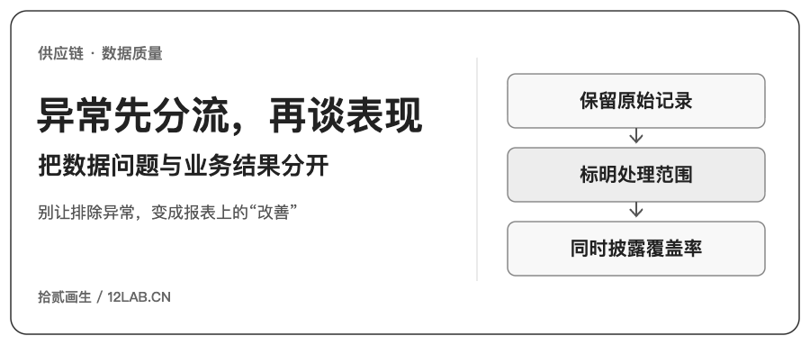
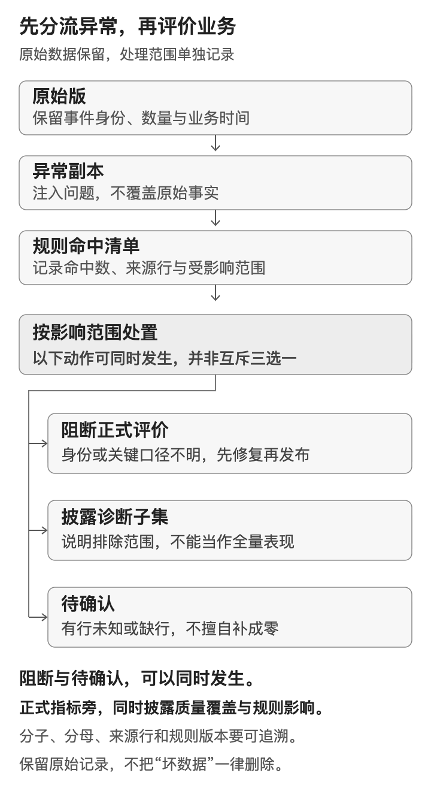
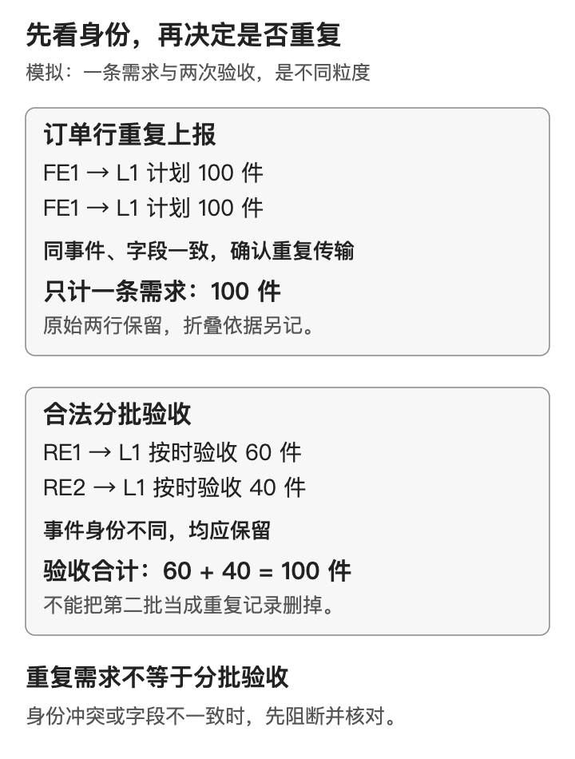
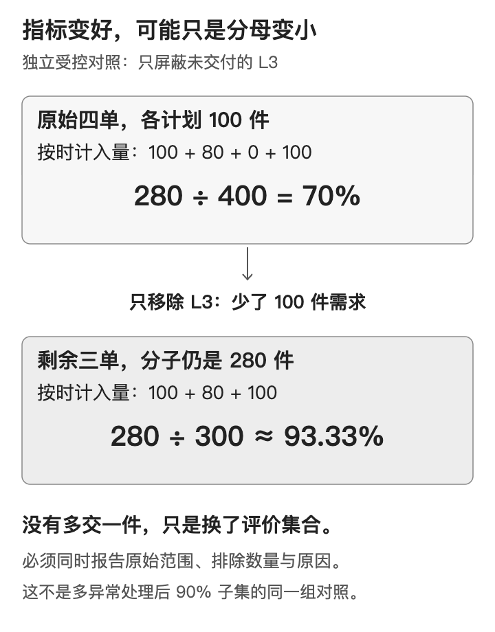
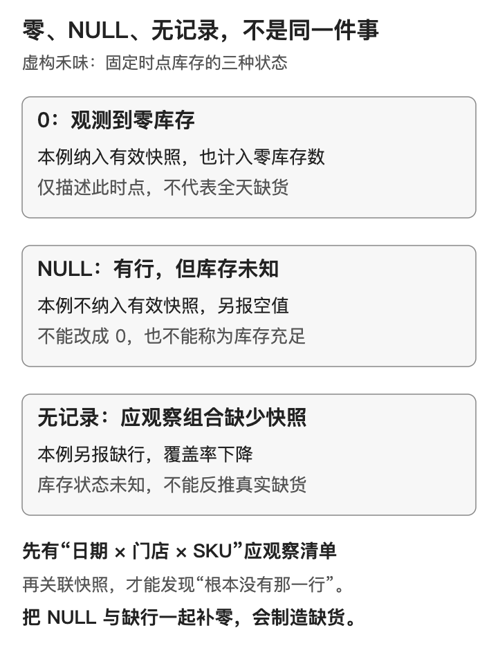

四张生产单，计划各100件，按时合格验收合计280件，数量满足率为70%。把其中一张尚未交货的单排除，分子仍是280，分母变成300，满足率就升到了93.33%。

没有多收到一件衣服。变的是被评价的订单集合。

这是一个模拟对照，却很像报表评审里容易忽略的场景：开发说明“已经过滤异常”，业务看到指标回升，产品把新结果交给负责人。若没有人追问排除了谁、少了多少分母，一个数据处理动作就会被解释成履约改善。

这篇继续使用匿名服装生产协同企业和虚构餐饮品牌“禾味”两个案例。重点是把异常处理落实为可核对的决策：哪些结果暂停发布，哪些只能用于披露后的子集诊断，哪些需要回到来源确认。

> 所有订单号、数量、时间和实验结果均为模拟，服装案例不对应任何真实项目品牌。禾味沿用2家门店、8个食材SKU、2026年10月1日至14日的观察框架，本篇只生成10月10日、11日两天的库存切片，共32个应观察组合，没有生成完整14天流水。下文的原始版是教学实验的已知参照，不意味着真实系统天然有一份正确答案。

## 一 先判断能评价谁，再解释表现好不好

数据质量与业务表现需要同时出现在报表中，但要分别解释。

一条计划数量为负的生产订单行，首先让需求量的含义失效；一条数量为正、信息完整却一件也未验收的已到期订单行，则是需要进入履约评价的真实低表现。不能因为后者拉低了比例，就把它也放进“异常排除”。

同样，门店在18:00记录库存为0，表示这个观察时点的库存状态；库存字段为NULL，表示值未知；连这条快照都没有，则连记录是否按约产生都需要调查。三者需要不同的处理动作。

[](images/d5-01_triage.png)

本例先冻结候选范围，再在副本上注入问题。规则命中后，保存来源行标识、规则编号、处理范围和指标影响，不回写原始版。结果分成三种用途：

- **阻断受影响范围的正式指标发布**：无法确认需求量、承诺边界或验收归属时，不输出一个看似完整的全范围分数。阻断报表发布，不等于停止所有业务操作。
- **披露后的子集诊断**：可确认的记录仍可用于排查，但必须同时展示纳入集合和覆盖率，不能挂上“全量达标”的标签。
- **待确认**：原始事实不完整时，向来源负责人确认。没有证据，不猜承诺时间，不把未知库存补成0。

这些处置可以同时发生：一条异常既可能待来源确认，也可能阻断对应正式结果。

这些是本教学实验的发布约定。真实项目需要由业务和数据负责人按决策风险共同确定：一个问题影响一行、一单、某个SKU日期，还是整个汇总，不能只用一条全局“删除坏数据”的规则。

## 二 服装案例：重复的是上报，还是验收事件

为了隔离问题，四张模拟生产单A1—A4各取一个订单行L1—L4，均为TEE-M、单位为件。原始承诺均为2026年10月21日12:00（UTC+07:00），统计截止为当日18:00。原始版的计划和按时合格验收如下；未验收行也保留在计划分母。

| 订单行 | 计划量 | 按时合格验收 | 指标计入量 |
|---|---:|---|---:|
| L1 | 100 | 两次不同事件，60＋40 | 100 |
| L2 | 100 | 一次80 | 80 |
| L3 | 100 | 无验收 | 0 |
| L4 | 100 | 一次100 | 100 |
| 合计 | 400 | 280 | 280 |

本篇的承诺期内数量满足率仍按订单行先汇总验收、再以计划量封顶，最后汇总同SKU、同单位的分子与分母。承诺时刻恰好发生的合格验收计入；本切片的候选清单预先限定为有效、已到期的生产需求，没有生成取消订单或未到期样本，也不把这两类筛选能力计为已验证。原始模拟验收集合完整，才可将L3没有验收解释为计入量0；真实接口可能漏传时，应先对账。数据质量检查在这套业务口径之前进行。

异常副本对L1增加了一次重复上报：两条物理记录的来源事件ID、订单行身份与业务字段完全一致。它们代表同一份100件需求，可以在有证据的前提下折叠为一个业务事件；两条来源记录及被选用的规范记录仍保留映射。

**“同一个订单行出现两次”本身不够作为删除依据。** 相同来源事件却有不同数量、不同版本，可能是修订冲突；同一业务键下不同事件，也可能是更新。没有版本、操作类型和来源解释时，应阻断受影响范围并确认，而不是随手取第一条。本例对事件冲突按所属整单隔离，包括同单其他正常行；冲突记录不会标为“已确认重复回放”。

L1的两次验收则具有不同验收事件ID，分别收60件、40件，是合法分批。删掉第二批，反而会把已经收齐的订单误判成只收了60件。

[](images/d5-02_identity.png)

副本还加入了一条找不到订单行的孤儿验收，把L4的计划量改成负数，并清空L3的承诺时间。四种问题并不适合用同一种清洗动作处理。

| 检查 | 本切片命中 | 处理与影响 |
|---|---|---|
| 订单行重复上报 | 2条物理行，1条多余上报 | 核对事件身份与字段后折叠；不重复增加100件需求，也不删除合法验收 |
| 孤儿验收 | 1条 | 隔离待确认归属；阻断当前受影响SKU／日期汇总的正式发布 |
| 负订货量 | L4一行 | 本例生产需求要求正数；阻断L4所属订单评价，不能把负数改0继续算 |
| 承诺时间缺失 | L3一行 | 无法确定到期与及时性；阻断该订单评价，不能默认按时或直接当未交付 |

负数在退货、冲销业务中可能合法。本例限定的是生产需求数量，不能把这条正数规则扩展成所有交易表都禁止负数。

孤儿验收也不是“先丢开就不影响任何指标”。它可能属于当前订单，也可能暴露主表漏传。归属未确认前，已关联行的计算只构成诊断子集，不能证明当前SKU的全范围结果完整。

## 三 90%和93.33%，分别改了哪一个集合

按上述规则处理多种异常后，L1和L2有足够字段用于诊断，得到`(100＋80) ÷ (100＋100)＝90%`。L3、L4仍待确认，孤儿验收仍未归属，因此**当前正式汇总处于阻断状态**，不是发布一个90%的全范围满足率。

本实验能说“候选单可评价覆盖率为2÷4＝50%”，是因为注入前保存了四单候选清单。若真实系统连候选需求都不完整，不能仅凭脏副本反推出原本应该有400件，也不能给出貌似精确的数量覆盖率。

更需要警惕的是排除选择偏差。下面把两个实验分开列出，避免混成一条“清洗后越来越好”的曲线。

| 对照 | 纳入订单行 | 分子／分母 | 能说明什么 |
|---|---|---:|---|
| 原始已知参照 | L1、L2、L3、L4 | 280／400＝70% | 教学原始版的业务表现 |
| 独立受控对照：只屏蔽低表现L3 | L1、L2、L4 | 280／300＝93.33% | 分子未变，少了100件分母；不能称改善 |
| 多异常副本处理后的诊断子集 | L1、L2 | 180／200＝90% | 只评价可确认子集，正式汇总仍阻断 |
| 原始版取相同L1、L2 | L1、L2 | 180／200＝90% | 同集合比较后，业务表现没有变化 |

[](images/d5-04_selection_bias.png)

这也是产品验收中值得保留的双重对照：既展示处理前后的集合变化，也用原始版中的相同集合比较。否则，指标抬升可能只是最差的那部分记录退出了评价。

下列查询直接取自实践包的`article-fashion.sql`。`run.py`先载入CSV并执行`analysis.sql`建立诊断视图，再执行它；`diagnostic_line_result`保留每行计划量、及时验收量和封顶计入量。

```sql
-- Diagnostic subset only. BLOCKED means do not publish a full-scope KPI.
SELECT
  (SELECT COUNT(*) FROM candidate_orders) AS candidate_orders,
  COUNT(DISTINCT order_id) AS evaluated_orders,
  SUM(credited_qty) AS credited_qty,
  SUM(ordered_qty) AS planned_qty,
  1.0 * SUM(credited_qty) / NULLIF(SUM(ordered_qty), 0) AS fill_rate,
  CASE WHEN EXISTS (SELECT 1 FROM blocked_orders)
         OR EXISTS (SELECT 1 FROM orphan_receipts)
         OR EXISTS (SELECT 1 FROM event_conflicts)
         OR EXISTS (SELECT 1 FROM line_key_conflicts)
       THEN 'BLOCKED' ELSE 'READY' END AS formal_status
FROM diagnostic_line_result;
```

输出为候选四单、可评价两单、计入180件、计划200件、比例0.9，正式状态为`BLOCKED`。

这段查询服务于已确认子集的诊断。它不能替代“正式发布是否被阻断”的判断；实践包将发布状态、命中清单、行级计算和汇总结果分别输出。

## 四 禾味案例：一条零库存，和一条根本没来的快照

禾味的江城店S01、大学城店S02有鸡腿肉、大米、土豆、番茄、生菜、食用油、牛奶、鸡蛋8个SKU。库存量保留各SKU的原单位，下面统计的是状态记录数，不把公斤、升和个加在一起。

原始版有2格零库存、30格正库存。副本仅把一个正库存值置为NULL，并移除一天快照，两个合法零值保留。本切片约定两天都在当地18:00观察，两店、8个SKU均在应观察清单中：`2天 × 2店 × 8SKU＝32格`。异常副本缺少其中一天全部16条快照；剩下16条中，2条库存为0、1条为NULL、13条为正。

这里有两套数量：**物理快照表收到16条，能够评价库存状态的只有15条。** 两条零库存是合法观测，应该保留；NULL那一条虽然有行，却不能据此判断缺货。

[](images/d5-03_inventory_states.png)

| 状态 | 条数 | 是否进入已观测缺货率分母 | 下一步 |
|---|---:|---|---|
| 有记录，库存为0 | 2 | 是，也进入缺货分子 | 核对该时点业务库存，不因数值低而排除 |
| 有记录，库存大于0 | 13 | 是 | 正常评价 |
| 有记录，库存为NULL | 1 | 否 | 待确认字段值，保留记录身份 |
| 应有但没有记录 | 16 | 否 | 查采集、调度或门店回传，不生成假快照 |

因此可披露的是：

- **有效快照覆盖率**：15÷32＝46.875%。
- **已观测有效快照中的零库存比例**：2÷15≈13.33%，它不代表全部32格的缺货情况。
- **未知状态**：17格，来自1条NULL与16条缺记录，需要单列。

如果把未知都补成0，得到`(2＋1＋16)÷32＝59.375%`，会把“没拿到数据”写成“门店缺货”。反过来，只显示13.33%而隐藏不足一半的覆盖率，也会给人范围完整的错觉。

在这个封闭的32格清单里，若已观测的15格可信，未知17格都非零时，全范围零库存比例最低为`2÷32＝6.25%`；未知全为零时，最高为`19÷32＝59.375%`。这是根据已知条件得到的逻辑范围，**不是置信区间，也不是预测**。如果应观察清单或已观测值本身不可信，这个范围也失去依据。

即使最终确认某格为0，这项固定时点指标也只说明当时库存为零，不能据此推断全天缺货时长、需求损失，或认定供应商履约差。

## 五 SQL先保留“应当有的格子”

直接从快照表分组，缺失的16格根本不会出现。先用应观察清单做左连接，才能把“有行但NULL”和“没有匹配行”区分开。

这条左连接有一个前置门槛：应观察清单与收到的快照都必须在“日期×门店×SKU”上唯一，来源行身份必须非空。否则一格匹配两条快照，32格也会被展开成33行，连覆盖率的分母都会出错。实践包在计算前检查这些条件；遇到重复键或缺少身份就拒绝计算并报告，不按库存值去重，也不任意保留第一条。

实践包中的`article-inventory.sql`将这一步与聚合放在同一条查询中。它只读取已载入的模拟表，结果保留分子、分母和覆盖信息：

```sql
-- Complete query: start from expected combinations, keep missing distinct from NULL.
WITH inventory_audit AS (
SELECT e.snapshot_date, e.store_id, e.sku, s.source_row_id, s.origin_row_id,
       s.inventory,
       CASE WHEN s.source_row_id IS NULL THEN 'MISSING_ROW'
            WHEN s.inventory IS NULL THEN 'NULL_VALUE'
            WHEN s.inventory < 0 THEN 'NEGATIVE_VALUE'
            WHEN s.inventory = 0 THEN 'ZERO_OBSERVED'
            ELSE 'POSITIVE_OBSERVED' END AS state
FROM expected_slots e LEFT JOIN anomaly_snapshots s
  USING(snapshot_date, store_id, sku)
)
SELECT COUNT(*) AS expected_slots,
       COUNT(source_row_id) AS reported_rows,
       SUM(CASE WHEN state = 'MISSING_ROW' THEN 1 ELSE 0 END) AS missing_rows,
       SUM(CASE WHEN state = 'NULL_VALUE' THEN 1 ELSE 0 END) AS null_values,
       SUM(CASE WHEN inventory >= 0 THEN 1 ELSE 0 END) AS valid_rows,
       SUM(CASE WHEN inventory = 0 THEN 1 ELSE 0 END) AS zero_rows,
       1.0 * SUM(CASE WHEN inventory >= 0 THEN 1 ELSE 0 END)
           / NULLIF(COUNT(*), 0) AS coverage,
       1.0 * SUM(CASE WHEN inventory = 0 THEN 1 ELSE 0 END)
           / NULLIF(SUM(CASE WHEN inventory >= 0 THEN 1 ELSE 0 END), 0)
           AS observed_zero_rate
FROM inventory_audit;
```

查询输出`expected_slots=32`、`reported_rows=16`、`missing_rows=16`、`null_values=1`、`valid_rows=15`、`zero_rows=2`，以及覆盖率0.46875、已观测比例约0.133333。

这里先判断匹配行身份，再判断值是否为NULL。`NULL = 0`不会得到真，检查未知值应使用`IS NULL`；`COUNT(*)`数结果行，`COUNT(库存字段)`只数非NULL值。左连接之后有32格，不等于收到了32条有效快照。[SQLite表达式说明](https://www.sqlite.org/lang_expr.html)、[聚合函数说明](https://www.sqlite.org/lang_aggfunc.html)

真正需要确认的是哪一步把未知变成了事实。不能只把`COALESCE`称为好或坏：它可以在来源完整的前提下把“无验收”转为计入量0，却不该替未知库存编造一条业务观测。

## 六 让报表同时交代结果和证据

一个可供业务评审的结果，至少要同时交代以下信息，而不仅是一个百分比。

| 信息 | 本例应呈现的内容 |
|---|---|
| 统计范围 | 候选订单清单或应观察组合、时间、SKU和单位 |
| 业务结果 | 分子、分母、逐行封顶规则，以及是否仅为诊断子集 |
| 数据可用性 | 规则命中数、可评价覆盖率、NULL与缺记录分开计数 |
| 发布状态 | 阻断的具体订单、SKU日期或汇总范围，不影响的范围如何继续 |
| 处理证据 | 来源行、规则版本、决策理由、规范记录映射与待确认责任人 |

产品上的动作也随之分开：采集缺一天，应先找回传链路负责人；同一来源事件重复上报，应修幂等或重试链路；订单确实到期未交，应进入履约跟进。三者可以同时发生，却不能由同一条“排除异常”按钮自动解决。

本篇从《DAMA数据管理知识体系学习笔记（第01—17章）》第13章“数据质量”提取了三条实践思路：规则围绕数据用途与业务影响；规则明细和整体质量水平同时报告；沿来源追溯并修正根因。这份参考是学习笔记，**不是DAMA原著**。上述数据、处理策略和发布边界是本教学案例的约定，不冒充该书的统一结论。

## 七 下载并复算

[下载D5独立教学实践包](/downloads/d5-data-quality-practice.zip)。包内包含原始版、异常副本、注入与处理记录、SQL、验证脚本和期望结果；所有记录均为模拟，不含生产连接、真实凭据或付费API调用。

解压后进入实践包目录，使用带标准库`sqlite3`的Python 3.9及以上版本运行：

```bash
python3 run.py --output ./my-d5-results
```

输出目录必须尚不存在；脚本拒绝覆盖已有结果。省略`--output`时，会创建新的随机结果目录。数据库固定建在内存中，输入CSV不被改写；`expected/report.json`保存期望，实际结果另存为`report.json`，不把期望文件充当运行结果。

本次已在Python 3.14.7、SQLite 3.53.4执行，SQL与已列出的边界断言全部通过，包括同事件载荷冲突、不同事件同业务键、整单阻断、空分母、输入哈希不变，以及上述结果的独立期望比对。原始版、异常副本、命中记录和32格盘点均可逐行核对。

实践包保留每次命中的来源ID和逐行盘点。请先看命中清单和发布状态，再看汇总比例；修复来源、重新计算后，才能判断业务表现是否发生了变化。
