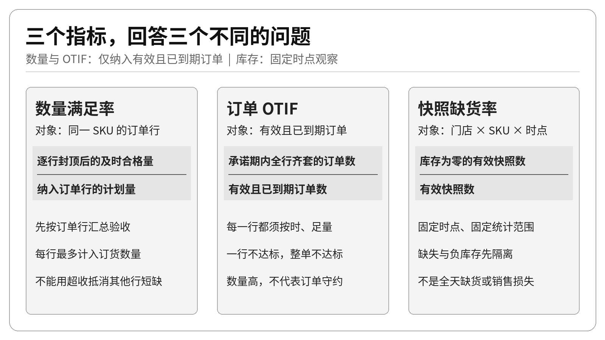
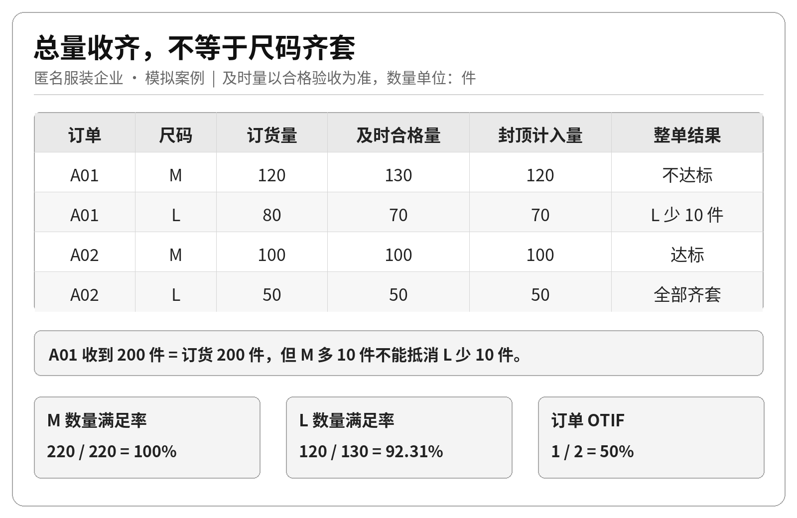
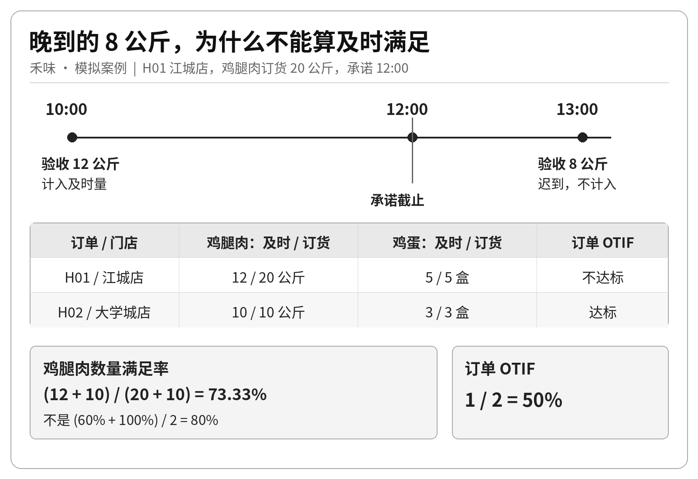
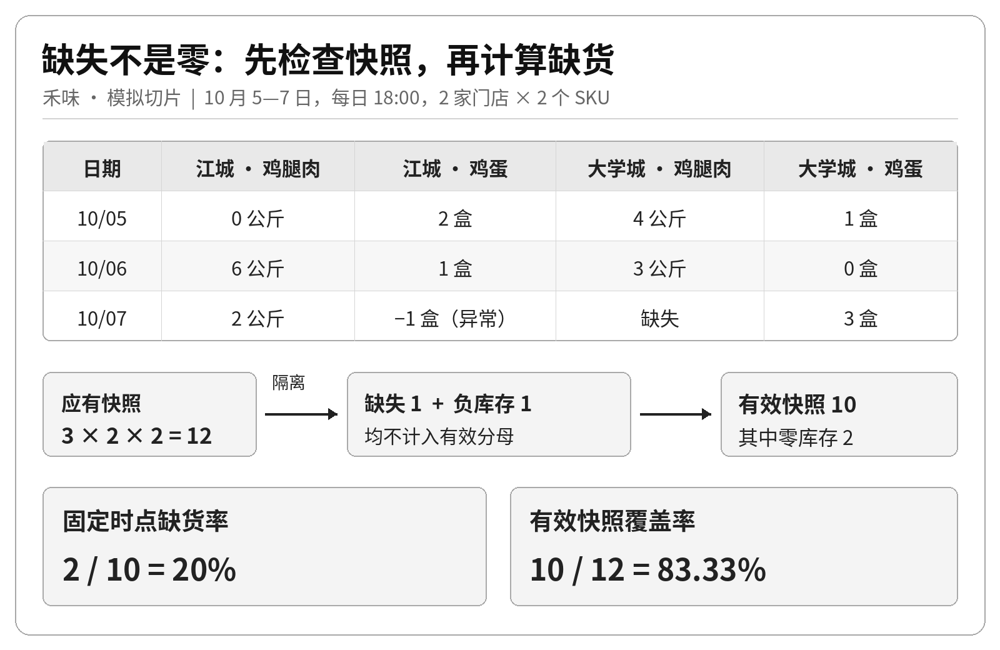

仓库说：“这批货已经收了 200 件。”业务说：“订单还是没满足。”

这两句话可能同时成立：M 码多收了 10 件，L 码少收了 10 件，总数没有少，真正需要的规格却没交齐。餐饮门店也会遇到类似问题：午市前只收到 12 公斤鸡腿肉，剩下 8 公斤下午才送来。当天最终收齐，不代表午市需求得到了满足。

前两篇，我们拆清了数据粒度，并用 SQL 筛选、分组。这一篇继续向前：把“交得怎么样”变成三个可以解释、复算、验收的指标。

本文沿用匿名服装企业与虚构餐饮品牌“禾味”双案例。服装业务以生产协同、分批验收为背景；禾味设定 **2 家门店、8 个食材 SKU、14 天观察框架**，下文只取其中的小切片演示，并未收集完整框架的数据。所有单号、数量与时间均为模拟；判定规则是本次练习的计算约定，不代表所有企业的统一标准。

## 一 三个指标，回答的是三个问题

先不要急着写公式。想清楚问题，才知道该数什么。

- **数量满足率**：需要的这个 SKU，在承诺截止时刻及之前究竟满足了多少？

- **订单 OTIF（On Time In Full，按时且足量）**：有多少张订单，所有订单行都按时、足量完成了验收？

- **固定时点缺货率**：在约定观察时刻，有多少个有效的“门店 × SKU”库存记录为零？



这三个指标不是同一件事的不同叫法。数量满足率关心缺了多少；整单 OTIF 关心承诺有没有完整兑现；快照缺货率关心观察时点的库存状态。

同一张订单可以有 99% 的数量满足率，却因为一个关键物料没交齐而 OTIF 不达标。一个门店也可能早上交货及时、下午销售旺盛，到了库存快照时已经缺货。因此，不能看到缺货率高，就直接认定供应商履约差。

把指标定义压缩成三张可执行的口径卡，可以得到下面这张表。

| 口径字段 | 数量满足率 | 订单 OTIF | 固定时点缺货率 |
|---|---|---|---|
| 问题与对象 | 某 SKU 的需求满足程度 | 一张订单是否完整兑现 | 一个门店 SKU 在观察时刻是否无库存 |
| 最小计算粒度 | 订单行，最终按 SKU 汇总 | 先判断订单行，再判断整单 | 日期 × 门店 × SKU |
| 分子 | 逐行封顶后的及时合格验收量之和 | 所有有效行均及时足量的订单数 | 有效快照中库存等于零的记录数 |
| 分母 | 纳入订单行的计划数量之和 | 纳入的有效订单数 | 有效快照记录数 |
| 时间口径 | 承诺日期入组；验收时间不晚于承诺截止 | 同左，且订单在统计时刻已到期 | 每日当地时间 18:00 |
| 过滤条件 | 有效、已到期；计划数量大于零 | 同左；不能只留下已收齐订单 | 应观察组合中有记录、库存非负 |
| 常用维度 | SKU、规格、门店、供应商 | 门店、供应商、承诺日期 | 门店、SKU、日期 |
| 数据来源 | 订单头、订单行、验收明细 | 同左 | 应观察组合清单、库存快照 |
| 空值与质量 | 缺时间、单位不清先报异常；零分母为不适用 | 缺行或订单数据异常不能默认为成功 | 缺记录与负数排除，并另报覆盖率 |
| 使用边界 | 不混单位，不跨 SKU 用超收抵短缺 | 本文评价收货验收，不是客户送达 | 只描述观察时点，不描述全天缺货时长 |

表里的每一个格子，都应该能落到字段、条件或测试用例上。指标卡不是写给看板装饰的，它是业务、产品与开发之间的计算契约。

## 二 先确定“哪些订单该被评价”

D2 按下单时间筛选，是为了回答“这一天产生了多少需求”。今天改用**承诺日期**，回答“这一天应该兑现的承诺，兑现了多少”。

两种分组都合理，但不能混着解释。10 月 1 日下单、10 月 5 日承诺交付的订单，应进入 10 月 5 日的履约评价，而不是因为创建得早就消失。

本篇的纳入顺序是：

1. 订单处于本例约定的有效状态 `CONFIRMED`，排除已取消订单。这里的状态名只是模拟数据编码；不能照搬成“只纳入未完成订单”，把已经收齐的有效订单反而排除。

2. 承诺日期落在观察范围内。

3. 承诺截止时刻不晚于统计时刻 `as_of`，排除尚未到期订单。

4. 订单行计划数量为正，SKU、单位与承诺时间完整。

计划量异常时，本例将受影响订单整单移出指标计算，单列质量问题，不能只删掉问题行后继续把剩余部分算作完整订单。**排除不等于履约成功**：还要报告排除了多少单、为什么排除。若异常集中在履约差的订单，剩余订单的 OTIF 会偏高；修复数据后应重算，而不是把剔除后的高分当作改善。

订单进入评价集合以后，即使一件货都没收到，也必须留在分母里。否则，只统计已经有收货记录的订单，会把最严重的未交付隐藏起来。

及时验收的边界统一为：`accepted_at <= promise_at`，恰好在截止时刻完成也算及时。本文以订单承诺时间作为订单行共同截止时间；实际业务如果逐行承诺，就必须按行保存、按行比较。时间应先转换到同一业务时区，服装案例使用当地 UTC+07:00，禾味使用 UTC+08:00。

## 三 服装案例：多收的 M 码，不能补上缺少的 L 码

某服装企业向协作工厂下达成衣生产订单，入库前按款式、颜色、尺码验收。下文 M、L 分别指同款同色的两个 SKU，不是把不同款式的 M 码合成一个 SKU。观察范围是 10 月 21 日的到期订单，统计截止为当天 18:00。

| 订单 | 状态 | 承诺截止 | M 码计划 | L 码计划 | 是否纳入 |
|---|---|---|---:|---:|---|
| A01 | 有效 | 当日 12:00 | 120 件 | 80 件 | 是 |
| A02 | 有效 | 当日 12:00 | 100 件 | 50 件 | 是 |
| A03 | 已取消 | 当日 12:00 | 20 件 | 10 件 | 否 |
| A04 | 有效 | 当日 20:00 | 40 件 | 20 件 | 否，尚未到期 |

A01 在 11:00 验收 M 码 130 件、L 码 70 件。A02 在 12:00 恰好完成 M 码 100 件、L 码 50 件的合格验收。

如果只看 A01 的总件数，计划 200 件，实收也是 200 件，似乎完成了 100%。问题是，客户需要的是 120 件 M 码和 80 件 L 码，不是任意组合的 200 件衣服。

**正确做法是先按订单行汇总，再逐行封顶。**

`订单行计入量 = min（计划数量，承诺截止时刻及之前累计合格验收数量）`

| 订单行 | 计划数量 | 及时合格验收量 | 计入分子 | 是否及时足量 |
|---|---:|---:|---:|---|
| A01 / M | 120 | 130 | 120 | 是 |
| A01 / L | 80 | 70 | 70 | 否 |
| A02 / M | 100 | 100 | 100 | 是 |
| A02 / L | 50 | 50 | 50 | 是 |



按 SKU 汇总后：

- M 码数量满足率：`(120 + 100) ÷ (120 + 100) = 100%`。

- L 码数量满足率：`(70 + 50) ÷ (80 + 50) ≈ 92.31%`。

即使同为“件”，也不能把 M 码超收的 10 件拿去冲抵 L 码短缺的 10 件。逐行封顶还意味着：同一 SKU 在另一张订单上的超收，也不会自动抵消本单短缺。若业务允许替代或跨单调配，应先确认并更新对应明细，再按新规则核算，不能让求和操作偷偷替业务做决定。

接着判断整单：A01 的 L 码未足量，整单失败；A02 两行都成功，整单成功。因此：

**订单 OTIF = 1 张成功订单 ÷ 2 张有效到期订单 = 50%。**

数量表现接近完成，整单履约只有一半，并不矛盾。它们揭示的是不同层面的风险：前者告诉我们短缺集中在哪个规格，后者告诉我们有多少次完整承诺没有兑现。

## 四 禾味案例：下午补齐，不能改写午市前的结果

禾味的 8 个食材 SKU 包括鸡腿肉、大米、土豆、番茄、生菜、食用油、牛奶和鸡蛋。数量必须带单位，鸡腿肉按公斤，鸡蛋按盒，鸡蛋每盒 30 枚。练习数据假定计划量与验收量已统一为各 SKU 的目录单位；实际接入数据时，必须先核对或换算，不能只给不同单位的数值换上同一个标签。

我们从 14 天观察框架中，取 10 月 5 日的两张到期订货单。H01 属于江城店，H02 属于大学城店，均承诺当天 12:00 前完成验收；统计时刻为 18:00。已取消的 H03 与承诺 20:00 的 H04 不纳入。

| 订单 / 门店 | 食材 | 计划 | 不晚于12:00的合格验收 | 迟到验收 | 当日最终验收 |
|---|---|---:|---:|---:|---:|
| H01 / 江城店 | 鸡腿肉 | 20 公斤 | 10:00 收 12 公斤 | 13:00 收 8 公斤 | 20 公斤 |
| H01 / 江城店 | 鸡蛋 | 5 盒 | 10:00 收 5 盒 | 0 | 5 盒 |
| H02 / 大学城店 | 鸡腿肉 | 10 公斤 | 11:00 收 10 公斤 | 0 | 10 公斤 |
| H02 / 大学城店 | 鸡蛋 | 3 盒 | 11:00 收 3 盒 | 0 | 3 盒 |



晚到的 8 公斤鸡腿肉，可以增加下午实际库存，却不能计入午市前的及时满足数量。因此：

- 鸡腿肉数量满足率：`(12 + 10) ÷ (20 + 10) ≈ 73.33%`。

- 鸡蛋数量满足率：`(5 + 3) ÷ (5 + 3) = 100%`。

- 订单 OTIF：H01 失败，H02 成功，仍为 `1 ÷ 2 = 50%`。

这里有两个常见陷阱。

**第一，不能把公斤和盒相加。** “计划 38，及时收到 30”只是把不同计量对象拼成了一个没有明确意义的数字。跨食材汇总，需要另行设计有解释力的权重，例如统一成本口径，但那已经是另一项指标。

**第二，总体数量满足率不能直接平均门店百分比。** 江城店鸡腿肉满足率为 60%，大学城店为 100%。简单平均得到 80%，而两店合计数量满足率是 73.33%。前者给每个门店相同权重；后者由需求数量决定权重。它们回答的问题不同，不能把“门店平均表现”标成“总体数量满足率”。

另外 6 个 SKU 在这组订单样本中没有有效计划量，分母为零，应显示“不适用”，不能显示 0%。

聚合时应保留原始分子与分母，再计算汇总比率。这也是指标结果表不应只存一个百分比的原因。

还有一个容易忽略的边界：本文的 OTIF 以**整张生产订单或门店订货单的收货验收**为对象。不同产品可能按订单行定义 OTIF，例如 [Infor 的供应链绩效说明](https://docs.infor.com/lncs/latest/en-us/lncslib/ln_industry_content_user_guide/njd1742535354522.html) 就以入库订单行为粒度，并只纳入 `Final Receipt` 状态的行；这与本文“有效且已到期，未收齐也保留”的分母不同。因此，比较两套看板时，应先核对对象、分母与状态条件，再比较同名指标。

## 五 固定时点缺货率：真正难的是分母

履约解释的是一段交付过程，库存快照记录的是一个时点状态。两者不能直接互相替代。本例把记录中的库存量视作可用库存，不另模拟冻结、待检等不可用数量；缺货判定仅为库存等于零，不是低于安全库存。接入真实系统前，应先确认库存字段是否也表达这个含义。

本例快照另约定每天 18:00 采集，不能与前篇的日末快照混算。这里独立核对截至 10 月 7 日 18:00 的库存切片；前面的订单评价仍截至 10 月 5 日 18:00，不使用后两天的库存解释当时决策。完整观察框架假定两店在 14 天内每天都应观察这 8 个 SKU，因此应有 14 × 2 × 8 = 224 个组合。为便于手算，下面只取 10 月 5 日至 7 日、鸡腿肉与鸡蛋的 **12 个应观察组合**，不把它冒充完整样本结果。

| 日期 | 江城店鸡腿肉 / 公斤 | 江城店鸡蛋 / 盒 | 大学城店鸡腿肉 / 公斤 | 大学城店鸡蛋 / 盒 |
|---|---:|---:|---:|---:|
| 10 月 5 日 | **0** | 2 | 4 | 1 |
| 10 月 6 日 | 6 | 1 | 3 | **0** |
| 10 月 7 日 | 2 | −1，异常 | 缺失 | 3 |

这张表不是简单地“数两个零再除以十二”。

- 应有 12 条快照，其中 1 条没有上报。

- 其余 11 条中，1 条库存为负，不能当作可信的库存状态。

- 有效记录共 10 条，其中 2 条库存为零。

所以应同时输出两个结果：

**固定时点缺货率 = 2 ÷ 10 = 20%。** 这是有效观测样本中的缺货比例。

**有效覆盖率 = 10 ÷ 12 ≈ 83.33%。** 它表示 12 个应观察组合中，有 10 个得到可信观测，另外 2 个仍无法判断库存状态。



缺失不能补成零，否则会凭空制造缺货；负库存也不能因为“不等于零”就算作有货。负数可能来自出入库时间差、重复扣减或其他记账问题，需要追查，不能在指标计算时悄悄修成正常状态。

若直接用全部 12 个组合做分母，会得到 16.67%。这相当于默认两条不可用观测都没有缺货；把它们都算作缺货，同样没有依据。**20% 也只能描述那 10 条有效观测**：如果缺报更常发生在缺货门店，结果可能偏低；其他缺失机制也可能使它偏高。覆盖率说明缺口有多大，不能自动消除这种偏差。

20% 也不表示“全天有 20% 的时间缺货”，更不能推导“损失了 20% 的销售”。18:00 的一个库存状态，无法告诉我们缺货从几点开始、持续多久、有没有客户需求。后续如果要研究缺货时长或损失销售，需要更高频事件和需求证据。这里的订单与快照是独立核对样例，也不能仅凭两张表推导某笔迟到交付导致了某次缺货。

## 六 落地到产品：百分比旁边，要留下计算证据

真正可用的指标，不应只交付三个看板数字。至少还要保留三层证据：

1. **口径证据**：指标版本、粒度、观察范围、统计截止、时区、排除条件。

2. **计算证据**：分子、分母、订单行判定、异常清单，能够追溯到原始验收与快照。

3. **解释证据**：按 SKU、门店拆解后的结果，以及当前数据覆盖程度。

用简洁伪代码表达，计算过程应当是：

```text
按承诺日期选出有效且已到期的订单
先隔离验收时间晚于 as_of 的记录，再检查参与计算的数据
计划量或参与计算的验收量异常：受影响订单整单移出，另报原因与数量
逐订单行：汇总承诺截止时刻及之前的合格验收
逐订单行：计入量 = min(计划量, 及时合格验收量)
逐 SKU：合计计入量 / 合计计划量
逐订单：所有纳入行及时足量，才记为 OTIF 成功
对齐应观察快照：分开标记缺失、异常、有效零、有效正数
输出指标、分子分母、异常数量及快照有效覆盖率
```

在进入 SQL 实现前，可以让 AI 做口径审查，但不要让它自行补充业务规则。一个可复用的检查提示是：

> 请只根据给定指标卡与模拟明细复算结果，列出纳入和排除记录。逐行检查是否先汇总后封顶、是否包含恰好截止时刻、是否误把迟到量算作及时量、是否混用单位、是否平均了百分比，以及是否把缺失或负库存当作正常库存。发现口径缺项时明确指出，不自行猜测。

人工验收也应覆盖这些边界：超收不抵其他行短缺；刚好截止时刻计入、迟到不计入；取消和未到期订单排除；零分母显示“不适用”；缺失与负库存进入质量清单。指标定义如果过不了这些小样本测试，放进更大的数据库，只会更难发现错误。

## 结语 先把问题定义准确，再让数字帮助决策

服装案例告诉我们，总数交齐不等于规格满足；禾味案例告诉我们，最终收齐不等于按时满足；库存快照则提醒我们，看到了多少有效数据，决定了一个百分比能解释到哪里。

读完数字之后，可以先做三件具体的事：

- 服装：沿 A01 的 L 码缺口追查少交的 10 件，而不是因为总件数已够就结束跟进。

- 禾味：核对 H01 的 8 公斤鸡腿肉为何晚于承诺时间，确认后再决定调整交付安排还是订货约定。

- 库存：先补查 10 月 7 日的缺失与负库存记录，再评价两店库存表现；不能仅凭 20% 的快照缺货率追责供应商。

把这些口径落实为可追溯的连接、分组和边界测试，指标才能既算得出来，也经得起业务追问。下一步，就是把这套判定顺序写成计算逻辑。

## 阅读与复核

概念选读：《数据产品经理修炼手册》4.4；练习口径对应《供应链算法与AI产品实践30天学习计划》第17页。本文具体时间边界、逐行封顶与快照排除规则以文中指标卡为准。

配套模拟数据与计算脚本保留逐行验收、整单判定、快照状态、异常清单及分子分母，可复算本文结果；边界检查明细见包内 `verification.json`。练习使用固定的承诺与订单状态，不模拟事后改约、退货冲销和补录记录；这些情况接入生产前需要另定规则。
