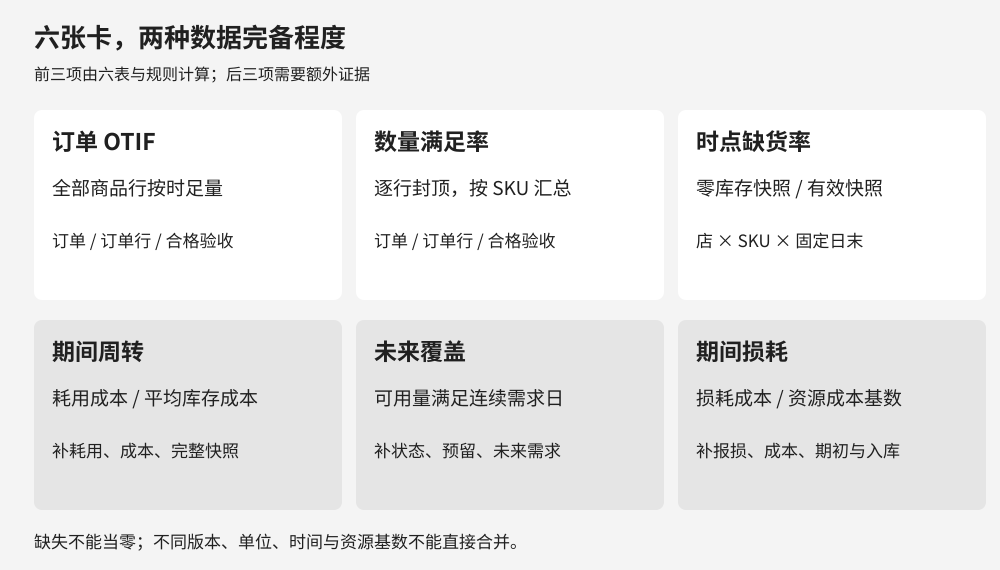
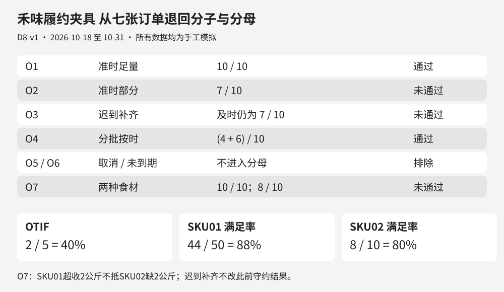
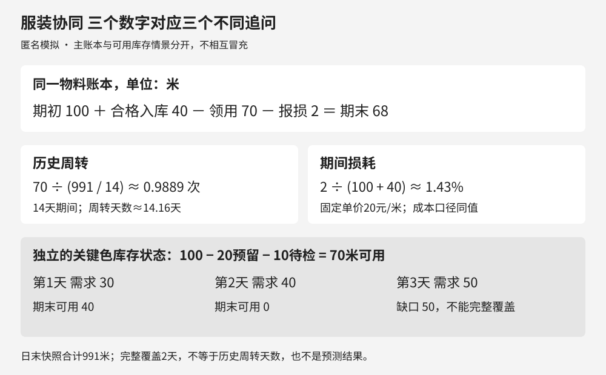
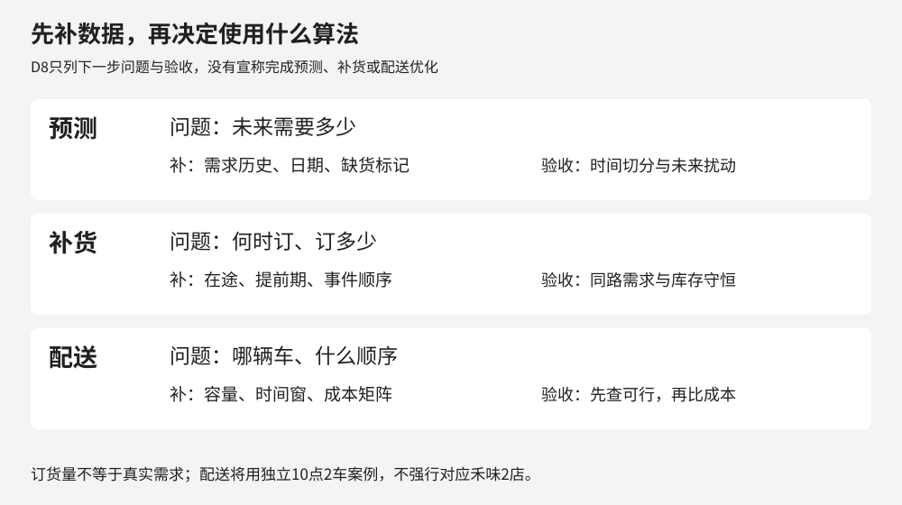

同一场供应链例会上，采购说到货率不错，门店说仍然缺料，财务说库存占用偏高。要判断谁说得对，先得知道每个数字回答什么问题。交付守约、库存状态和资金使用，不能共用一个分母。

[D6把三项履约与快照指标写成SQL](/blog/sql-supply-chain-metrics-boundary-tests/)，[D7区分了周转、覆盖和损耗](/blog/inventory-turnover-coverage-loss-validation/)。D8把这些工作收成一套字典：从业务问题找到口径，从口径找到原始行，再用反例检查计算。接下来是否需要预测、补货或路径算法，也从这条证据链出发。

**数据声明。** 所有情景和数字均为教学模拟，不对应真实企业或经营收益。禾味是虚构餐饮连锁，2家门店、8个食材SKU；本篇使用独立的 **D8-v1，2026年10月18日至31日，共14天**，不拼接D6的10月16—29日或D7的10月17—30日。小订单夹具用于检验SQL，224条日末快照用于检验缺货统计，二者不是一套完整库存流水。服装案例另有独立账本。未来需求为人工给定情景，尚未训练预测模型。

## 一 六张卡先约定六个不同的问题

一张完整指标卡至少保留业务对象、粒度、分子分母、时间、过滤、来源、零值和局限。这里用短表呈现主干；下载包内的 `metric_dictionary.csv` 保留完整字段。

<p class="d8-table-hint"><small>窄屏可左右滑动表格，查看全部列。</small></p>
<div class="d8-table-scroll" role="region" tabindex="0" aria-label="六张指标口径卡（可横向滚动）" style="overflow-x:auto;max-width:100%;margin:28px 0">
<table style="min-width:760px;width:100%;max-width:none;table-layout:fixed;display:table;margin:0"><colgroup><col style="width:16%"><col style="width:28%"><col style="width:28%"><col style="width:28%"></colgroup><thead><tr><th>指标</th><th>计算与粒度</th><th>时间与数据边界</th><th>零值规则</th></tr></thead><tbody><tr><td>订单OTIF</td><td>全部有效商品行均按时足量的订单数÷有效到期订单数；按店</td><td>按承诺期归属；整单取消、未到期排除；来自订单、行、合格验收</td><td>无有效订单为不适用，不记100%</td></tr><tr><td>承诺期内数量满足率</td><td>逐行封顶的及时合格量之和÷订货量之和；按SKU</td><td>验收时刻不晚于承诺，且不越统计截止；不同SKU不互抵</td><td>分母为0不适用；本包零订货行阻断</td></tr><tr><td>固定时点缺货率</td><td>日末库存为0的有效快照数÷有效快照数；店×SKU</td><td>每日固定日末，14天完整覆盖；不等于全天缺货时长</td><td>零库存计缺货；缺行或NULL阻断，不能补0</td></tr><tr><td>期间库存周转</td><td>期间耗用成本÷同口径日末库存成本均值；物料×地点</td><td>14个日末快照，固定成本；需另补耗用与成本，报损不算耗用</td><td>平均库存为0不适用；耗用为0且均值正，周转为0、天数不适用</td></tr><tr><td>未来完整日覆盖</td><td>可用量可满足的连续完整需求日数；物料×任务</td><td>统计时点后逐日累计需求；需预留、待检、未来需求</td><td>零需求日可覆盖；观察窗全部满足只报“至少该窗天数”</td></tr><tr><td>期间损耗率</td><td>已确认损耗成本÷（期初库存成本＋期间合格入库成本）；物料×地点</td><td>本练习选定资源基数；需报损事件、成本和期初量</td><td>资源基数为0不适用；基数正且损耗为0才报0%</td></tr></tbody></table>
</div>

这些是本练习的明示口径，不是对所有公司的通用定义。譬如周转可以采用不同库存均值，损耗也可以采用不同资源基数；比较前必须先确认版本一致。

[](images/d8-01_dictionary.png)

六张基础表包括门店、SKU、订单、订单行、验收和库存快照。前三项可以在这些表与明确规则下计算；后三项必须增加证据。只有库存余额，没有耗用、成本和状态，不能因为字段“看起来够用”就算出周转、覆盖或损耗。

## 二 禾味案例 让百分比能够退回到原始订单

本次观察区间为10月18日00:00至11月1日00:00，右端不含；统计截止为10月31日23:59:59，时区统一为UTC+08:00。及时性按**合格验收时刻**判断，恰好等于承诺时刻算按时。分批验收先汇总到订单行，及时量逐行封顶，再判断整单；超收另一种食材不能替缺少的食材抵账。

<p class="d8-table-hint"><small>窄屏可左右滑动表格，查看全部列。</small></p>
<div class="d8-table-scroll" role="region" tabindex="0" aria-label="禾味订单边界（可横向滚动）" style="overflow-x:auto;max-width:100%;margin:28px 0">
<table style="min-width:760px;width:100%;max-width:none;table-layout:fixed;display:table;margin:0"><colgroup><col style="width:16%"><col style="width:28%"><col style="width:28%"><col style="width:28%"></colgroup><thead><tr><th>订单</th><th>原始情景</th><th style=text-align:right>及时计入量</th><th>OTIF预期</th></tr></thead><tbody><tr><td>O1</td><td>SKU01订10，准时收10</td><td style=text-align:right>10</td><td>通过</td></tr><tr><td>O2</td><td>SKU01订10，准时收7</td><td style=text-align:right>7</td><td>不通过</td></tr><tr><td>O3</td><td>SKU01订10，准时收7，迟到补3</td><td style=text-align:right>7</td><td>不通过</td></tr><tr><td>O4</td><td>SKU01订10，按时分批收4＋6</td><td style=text-align:right>10</td><td>通过</td></tr><tr><td>O5</td><td>整单取消</td><td style=text-align:right>不参加</td><td>排除</td></tr><tr><td>O6</td><td>11月1日才到期</td><td style=text-align:right>不参加</td><td>排除</td></tr><tr><td>O7</td><td>SKU01订10收12，SKU02订10收8，均及时</td><td style=text-align:right>10与8</td><td>不通过</td></tr></tbody></table>
</div>

A店有效到期单5张，达标2张，**OTIF＝40%**。SKU01及时计入10＋7＋7＋10＋10＝44公斤，订货50公斤，满足率**88%**；SKU02为8÷10＝**80%**。O7证明：超额到货不能跨商品补缺。B店没有有效到期订单，OTIF应输出不适用，而不是“全都达标”。

SQL的关键顺序是：

```text
01_otif.sql       到期有效订单 → 每行及时量 → 每单所有行判断 → 按店汇总
02_quantity_fill.sql   每行及时量 → MIN(及时量, 订货量) → 按SKU保留分子分母
03_snapshot_stockout.sql   校验完整日末网格 → 按店与SKU数零库存 → 除以有效快照数
```

这也收束了D4的连接扇出问题：直接把订单行连到多条验收记录，再累计订货量，会重复分母。这里先预聚合，不能用一个 `DISTINCT` 掩盖粒度错误。完整SQL在实践包中由同一入口实际执行，表中预期值与输出逐项比较。

[](images/d8-02_receipts.png)

A店SKU01的14条日末快照中，有2条为0，固定时点缺货率为**2÷14≈14.29%**；其余15个店×SKU组合各有14条正库存快照，缺货率为0。它只能说明两个日末观察点没有库存。两次观察之间缺了多久、顾客少买了多少，现有数据回答不了。样本是手工设计的反例，40%也不能用来评价某种真实经营水平。

## 三 服装案例 同一份账本允许不同的业务追问

在匿名服装生产协同场景里，面料采购、车间排产和仓库占用需要放在一起看，但要分开计算。独立模拟账本设某面料期初100米、期间合格入库40米、领用70米、确认报损2米，期末应为68米。固定单价20元/米，报损不混入领用。

14个日末库存依次为95、90、85、80、75、70、65、60、55、50、45、80、73、68米，合计991米。逐日出入库在下载包中，满足每天和整个期间的库存守恒。

- **历史周转：** 耗用成本1400元，日末平均库存成本为991÷14×20≈1415.71元，14天期间周转约0.9889次；周转天数14÷0.9889≈14.16天。这个数没有年化，也不是未来可用天数。
- **期间损耗：** 确认报损成本40元，资源成本基数（100＋40）×20＝2800元，本口径损耗率约1.43%。更换基数后不能继续当成同一个指标比较。
- **未来覆盖：** 另设某关键色面料当前账面100米，已预留20米、待检10米，两个状态不重叠且此前未扣减，则可用70米。未来三天需求为30、40、50米，不考虑新到货，可以覆盖前两天完整需求，第三天短50米。此库存状态是独立情景，不冒充前述期末68米。

[](images/d8-03_apparel.png)

面对这样的输出，采购应追问交付承诺，排产应追问可用物料，仓库应追问积压和报损原因。现在还不能说调低采购量就一定改善周转，也不能把“第三天短料”解释为预测算法已经发现的风险；那三天需求只是练习输入。

## 四 从指标缺口走向下一阶段算法

指标先描述现象，后续实验才回答估计未来和如何行动。下一步有三类不同的问题，不能把缺失数据直接填成算法结论。

<p class="d8-table-hint"><small>窄屏可左右滑动表格，查看全部列。</small></p>
<div class="d8-table-scroll" role="region" tabindex="0" aria-label="下一阶段算法输入与验收（可横向滚动）" style="overflow-x:auto;max-width:100%;margin:28px 0">
<table style="min-width:760px;width:100%;max-width:none;table-layout:fixed;display:table;margin:0"><colgroup><col style="width:16%"><col style="width:28%"><col style="width:28%"><col style="width:28%"></colgroup><thead><tr><th>方向</th><th>需要回答的问题</th><th>当前缺什么</th><th>下一步验收</th></tr></thead><tbody><tr><td>预测</td><td>未来每天需要多少食材</td><td>更长的需求历史、日期规律、休店与缺货标记；订货量含批量与策略影响，不能当真实需求</td><td>按时间切分，先做季节性朴素等基线；修改未来数据不改变旧预测</td></tr><tr><td>补货</td><td>何时订、订多少，库存与服务如何取舍</td><td>当前可用、在途、提前期、事件顺序、固定需求路径；易腐还需批次效期</td><td>同一路径比较两策略；逐日库存守恒，到货不提前、决策不偷看未来</td></tr><tr><td>配送</td><td>哪辆车以何顺序送哪些点</td><td>点位、容量、需求单位、时间窗、服务时长及一致的距离时间矩阵</td><td>先检查每点一次、容量与时间约束，再比较路线成本</td></tr></tbody></table>
</div>

计划中配送使用独立的1仓、10点、2车案例，不把禾味2店强行扩成真实配送网络。上述输入与验收是后续任务，没有在D8宣称已经完成预测、补货回放或路径优化，更没有成本下降和销量增长的效果数字。

[](images/d8-04_next.png)

## 五 怎样复核这套字典

下载 [D8指标证据实践包](/downloads/d8-metrics-evidence-practice.zip)，解压后在目录内执行：

```bash
python run.py
python -m unittest -v
```

包内包含六张完整口径卡CSV、六表夹具、三份SQL、独立服装账本、预期与实际结果以及测试入口。数据为固定手工构造，不依赖随机种子或付费服务。运行时先验证键、关联、时间、数量和快照完整性，再计算指标；缺失与异常会报错，不会悄悄变成经营表现。结果小数仅作展示，底层保留分子与分母。

这份产物证明的是一套小样本口径可以复算，不能替代真实系统对部分取消、退货、单位换算和历史承诺变更的处理。

指标字典的价值，最终体现在一次具体追问里：当结果改变时，能否找出是哪一张订单、哪个观察时点、哪条业务规则改变了它。能回答这个问题，再进入预测与优化，后面的实验才有可比较的起点。


## 延伸阅读

- 《数据产品经理修炼手册》4.4：可作为指标如何服务业务决策的查阅建议；本文六卡公式以明示的练习口径为准。
- [SQLite聚合函数官方文档](https://www.sqlite.org/lang_aggfunc.html)：核对SUM、COUNT与NULL的语义；数据库函数不能替代输入质量检查。
- [FPP3第5章工具与评估](https://otexts.com/fpp3/toolbox.html)：下一阶段可从5.2的简单预测方法和5.10的时间序列交叉验证开始。
- [OR-Tools容量约束车辆路径](https://developers.google.com/optimization/routing/cvrp)：理解需求与车辆容量约束；本篇未运行路径求解器。
