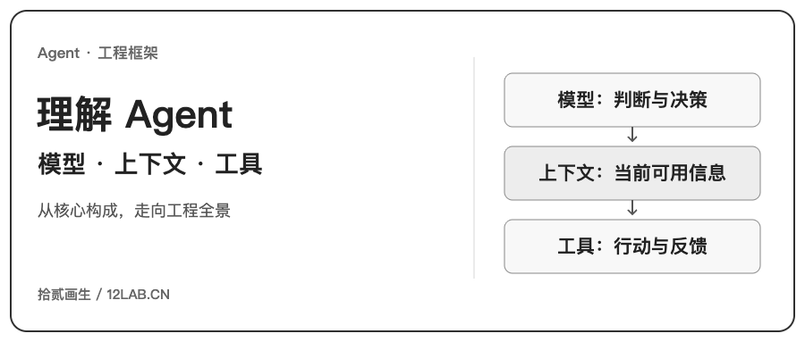

这篇导读围绕《深入理解 AI Agent：设计原理与工程实践》的十章结构，整理核心概念与阅读线索。文中引号保留书本阅读中整理的相关表述，章节介绍与观点应放回书本语境理解。

**Agent ≈ LLM + 上下文 + 工具。**

这里把模型、上下文与工具作为理解 LLM Agent 的工程框架：谁来判断、能看到什么、能做什么。这个概括服务于本系列的讨论，不是对所有 Agent 的严格定义。

“更直观地说，就是大脑 + 眼睛 + 手脚。大脑（LLM）负责思考和决策，眼睛（上下文）决定 Agent 能看到什么信息，手脚（工具）决定 Agent 能做什么事情。（严格来说，“眼睛”只是一个粗略的类比：上下文不仅包含环境信息和对话历史，还包含工具定义等内容，也就是说 Agent “看到”的信息中也包括了“有哪些手脚可用”。这个隐喻旨在传达核心直觉：上下文是模型能感知到的一切信息。）”

“对熟悉强化学习的读者，这三者也可以映射到 RL 的形式化语言。具体来说，LLM 对应 Policy（策略），上下文对应 Observation Space（观察空间），工具对应 Action Space（动作空间）。三种说法对应同一个对象，只是表达层次不同。”

这里的对应是帮助理解的类比，并非严格等同；当前上下文是本次输入，不能直接等同于整个观察空间。

[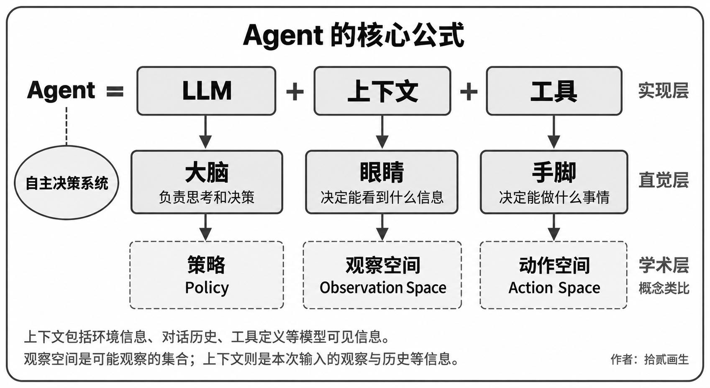](assets/00-agent-framework.png "查看完整原图")

*图中从实现层、直觉层和学术概念类比三个角度组织模型、上下文与工具，并在底部区分当前上下文与观察空间。*

## 第一章（AI Agent 入门）

从多个真实 Agent 产品出发，建立对 Agent 的直观理解。“深入解析 Agent 的核心公式：从实现层的 LLM + 上下文 + 工具，到直觉层的大脑 + 眼睛 + 手脚，再到学术层的策略（Policy）、观察空间（Observation Space）与动作空间（Action Space）。同时通过实验剖析 ReAct 循环的运作机制，也就是“思考→行动→观察”的迭代过程，并区分任务内的上下文适应、跨任务的外部产物（artifact）更新和训练周期中的参数更新。”

[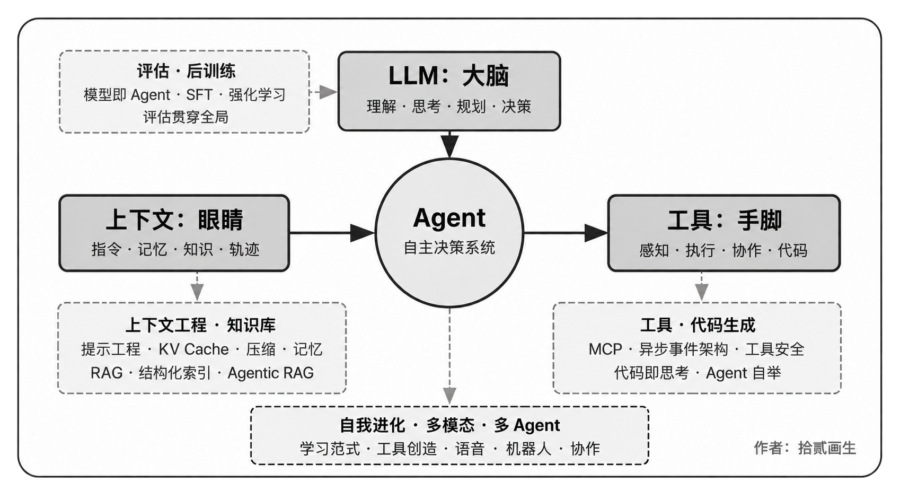](assets/01-agent-overview.png "查看完整原图")

*图中以 Agent 为中心，连接模型、上下文与工具，并展开上下文工程、知识库、代码生成、评估、后训练与协作等主题。*

## 第二章（上下文工程）

是全书最关键的一章，系统讲解上下文，也就是 Agent 的“眼睛”。本章先从 API 消息结构与 Agent 核心循环讲起，为消息式接口中“上下文可以组织为消息列表”这一认识奠定基础，再深入 KV Cache（大模型推理过程中复用历史计算结果的机制）的底层原理，然后依次展开：提示工程（Prompt Engineering，包括流程化设计、工具描述、业务规则细化）与提示注入（Prompt Injection）攻防、Agent Skills 的按需加载机制、Agent 状态栏技术，以及上下文压缩（Context Compression）策略。各术语的完整定义在正文首次出现处给出。

[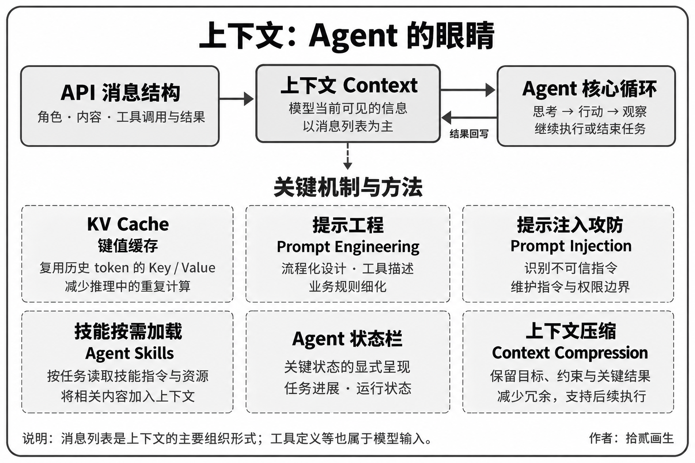](assets/02-context-engineering.png "查看完整原图")

*图中连接 API 消息结构、上下文与 Agent 核心循环，展示 KV Cache、提示工程、提示注入攻防、技能按需加载、状态栏与上下文压缩。*

## 第三章（用户记忆和知识库）

将上下文管理延伸到跨会话的持久化知识体系，让 Agent 不仅能记住当前对话的内容，还能在多次对话间积累和调用知识。涵盖用户记忆的四种渐进式策略、RAG（检索增强生成，即先检索相关文档再让模型生成回答）的完整技术栈（包括不同的文本搜索方法和搜索结果排序优化）、更高级的知识组织方法、智能体化 RAG（Agentic RAG，即让 Agent 自主决定何时检索、检索什么），以及多模态记忆的前沿探索。

[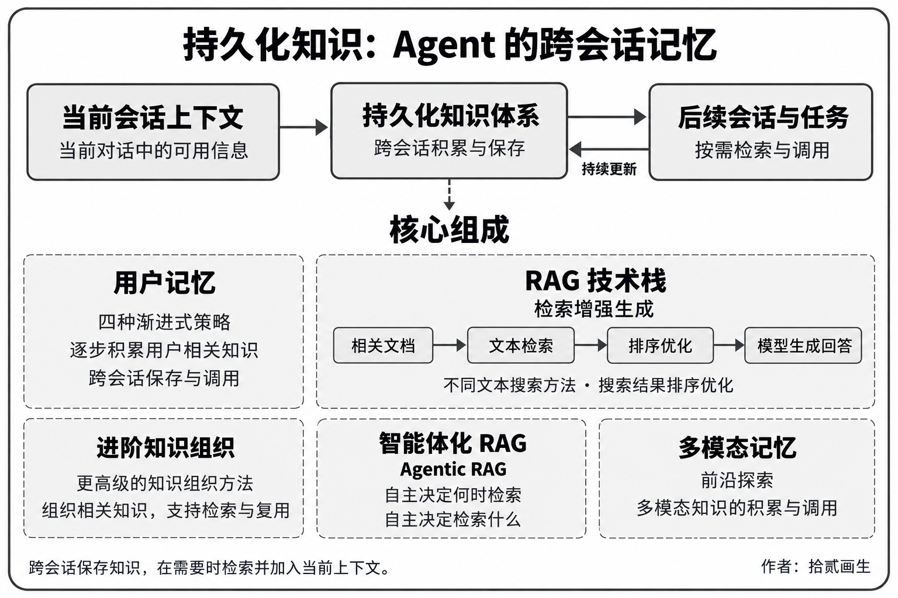](assets/03-memory-and-knowledge.png "查看完整原图")

*图中区分当前会话上下文、持久化知识体系与后续会话，并展示用户记忆、RAG 技术栈、进阶知识组织、智能体化 RAG 和多模态记忆。*

## 第四章（工具）

探讨 Agent 与外部世界交互的桥梁：工具就像是 Agent 的“手脚”，让它能够搜索网页、调用 API、操作数据库等。介绍 MCP 工具互操作标准和五类工具的设计原则（感知、执行、协作、事件触发、用户沟通），展开多模态感知的三条技术路线（原生多模态处理、提取为文本、工具化多模态分析），并重点阐述执行工具的安全机制；事件触发、用户沟通与异步运行时则在第六章展开。

[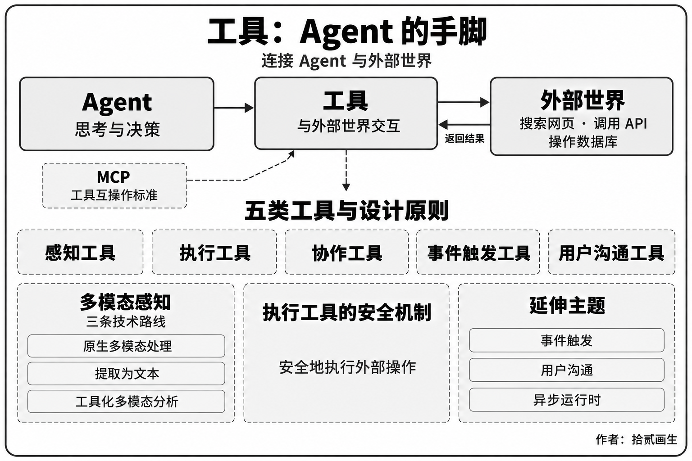](assets/04-tools.png "查看完整原图")

*图中展示工具与外部世界的交互、MCP、五类工具，以及多模态感知和执行工具的安全机制。*

## 第五章（Coding Agent 与通用 Agent）

本章将 Coding Agent 加上文件系统视为构建通用 Agent 的核心技术基础之一，并沿着这一观点展开。以 OpenClaw 架构为主线，剖析 Coding Agent 的工作流程和实现技巧，并展示代码生成在编程之外的广泛价值：从辅助思考、构建知识库，到动态创造新工具和 Agent 自举。

[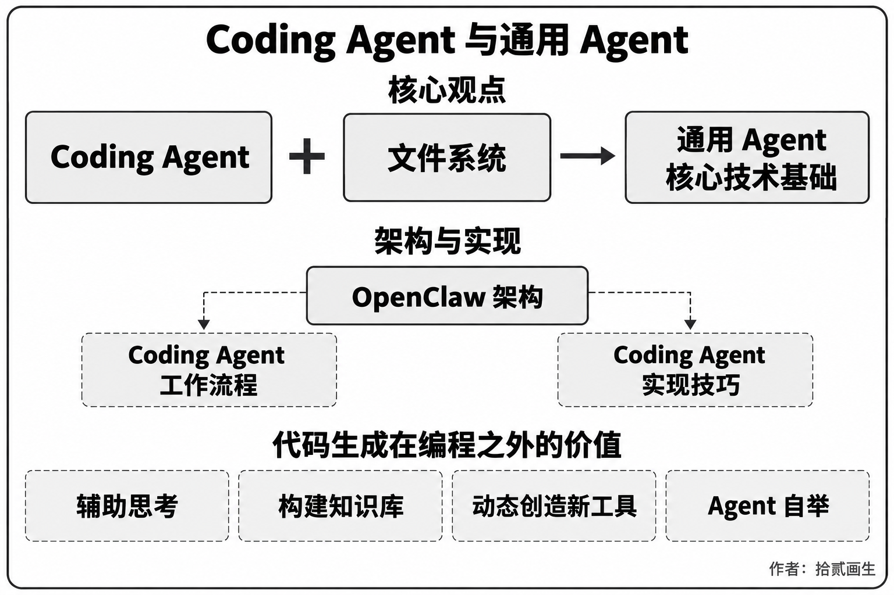](assets/05-coding-agent.png "查看完整原图")

*图中以 Coding Agent 与文件系统为核心观点，连接 OpenClaw 架构、工作流程、实现技巧，以及代码生成在编程之外的用途。*

## 第六章（交互：观察与动作空间的扩展）

从模态与时序两个维度研究 Agent 与环境的交互机制：异步与事件驱动使 Agent 能够持续接收外部事件并及时响应；语音交互将感知、推理与生成推进到实时尺度；Computer Use 将动作空间扩展到图形界面；机器人操作进一步把动作延伸到物理环境。四类场景共享唤醒、安全点、取消、抢占与快慢路径分离等系统原语。

[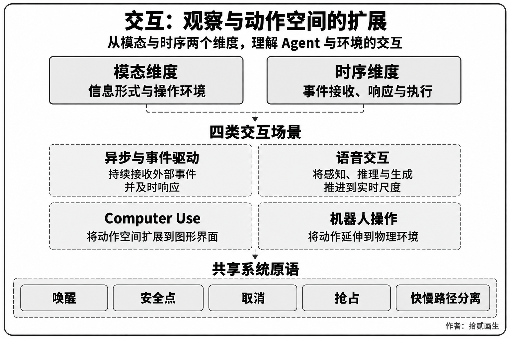](assets/06-interaction.png "查看完整原图")

*图中从模态与时序两个维度组织异步与事件驱动、语音交互、Computer Use、机器人操作，并列出共享系统原语。*

## 第七章（Agent 的评估）

构建一套科学的评估方法论。覆盖评估环境（工具调用型和人机交互型两种核心范式，以及章末单独讨论的仿真环境）、数据集的设计原则、LLM-as-a-Judge 自动化评判方法、评估驱动的模型选型，以及将评估结果转化为系统改进的完整闭环。

[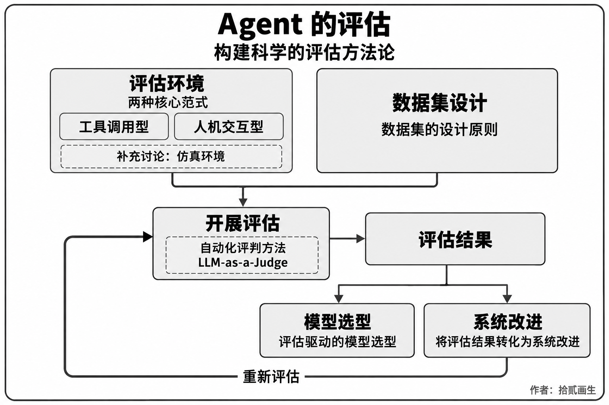](assets/07-evaluation.png "查看完整原图")

*图中把评估环境、数据集设计、LLM-as-a-Judge、评估结果、模型选型与系统改进连接成闭环。*

## 第八章（模型后训练）

深入 SFT（监督微调，即用标注数据教模型“照样学样”）与 RL（强化学习，即让模型通过试错和奖励反馈自主提升）这两种后训练技术。以书中“SFT 记忆、RL 泛化”和“数据与环境比算法更重要”为讨论线索；这些概括应结合具体任务与训练设置理解。本章涵盖预训练/SFT/RL 三阶段全景、经典 RL 理论、奖励信号设计（从二元奖励到过程奖励、再到“奖励结果、约束过程”的验证路径惩罚）、单轮与多轮强化学习算法，以及样本效率优化等前沿探索。

[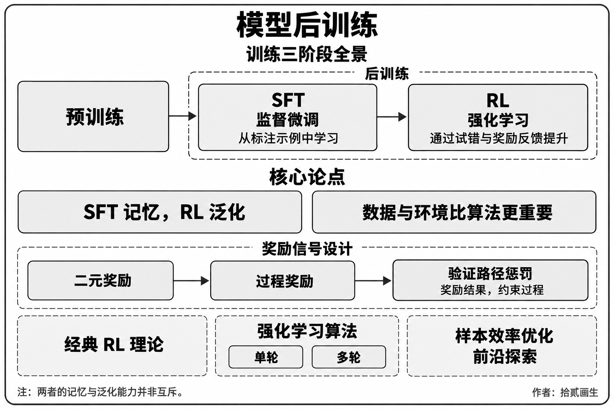](assets/08-post-training.png "查看完整原图")

*图中展示预训练、SFT 与 RL，以及奖励信号设计、强化学习算法和样本效率优化；原图注释说明记忆与泛化能力并非互斥。*

## 第九章（Agent 的持续进化）

研究如何把 Agent 的运行经验转化为下一版本的能力。全章先建立由环境结果、过程规则和 LLM Rubric 组成的学习信号，再比较知识文档、Prompt 与 Skills、程序与 Harness、模型参数四种更新载体，最后讨论新版本如何经过验证、灰度发布、回滚与长期整理。

[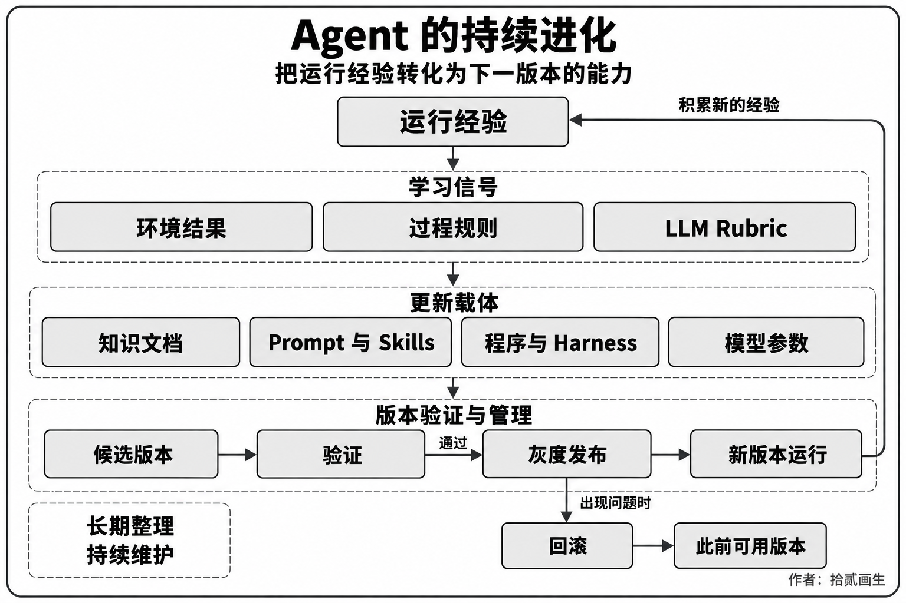](assets/09-continuous-evolution.png "查看完整原图")

*图中展示运行经验、学习信号、更新载体，以及候选版本验证、灰度发布、运行和回滚的闭环。*

## 第十章（多 Agent 协作）

从单体能力扩展到系统级协同，讨论多个 Agent 如何分工合作。系统阐述多 Agent 协作的分类框架（上下文共享/独立 × 对等/管理者/去中心化），通过翻译 Agent、电话与电脑协同 Agent 等案例展示协作架构的设计方法，并讨论 Agent 社会和 Agent 经济的潜在发展方向。

[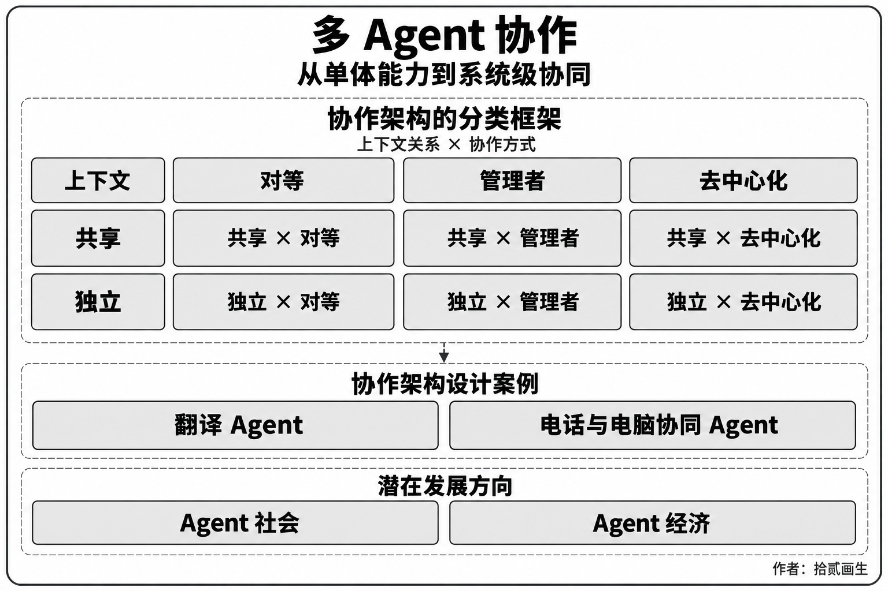](assets/10-multi-agent.png "查看完整原图")

*图中按上下文共享或独立与对等、管理者、去中心化方式分类，并列出协作案例及 Agent 社会、Agent 经济两个发展方向。*
