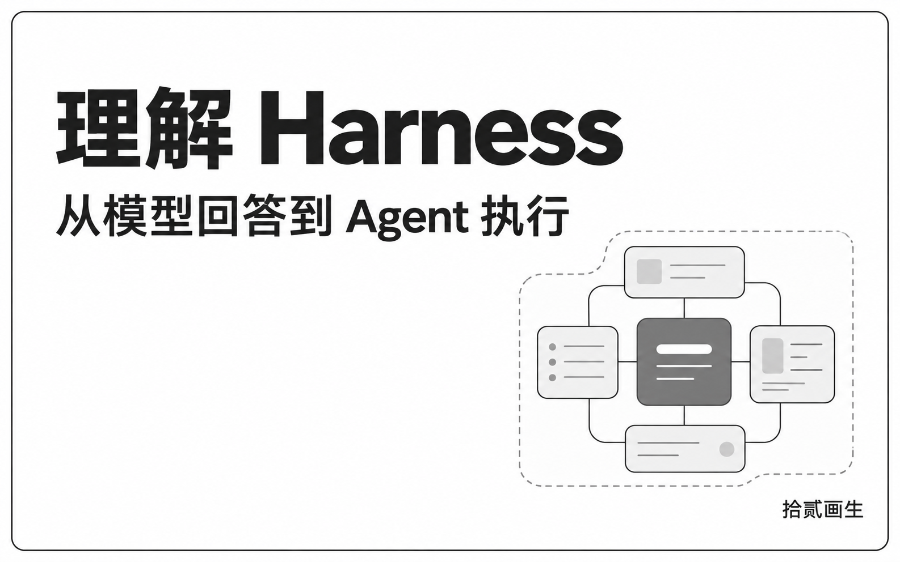
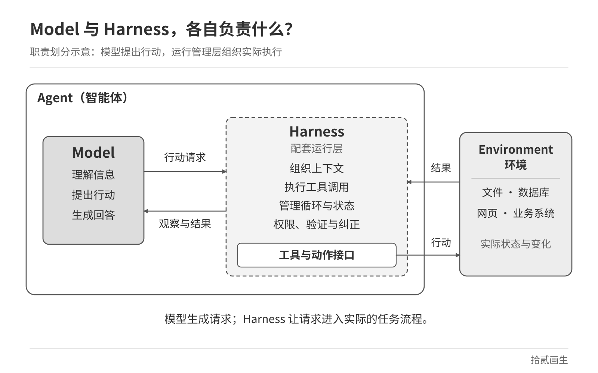
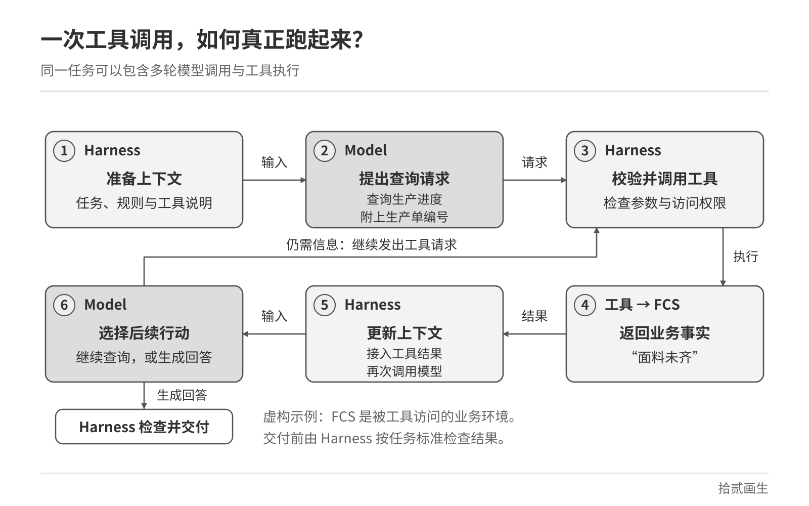
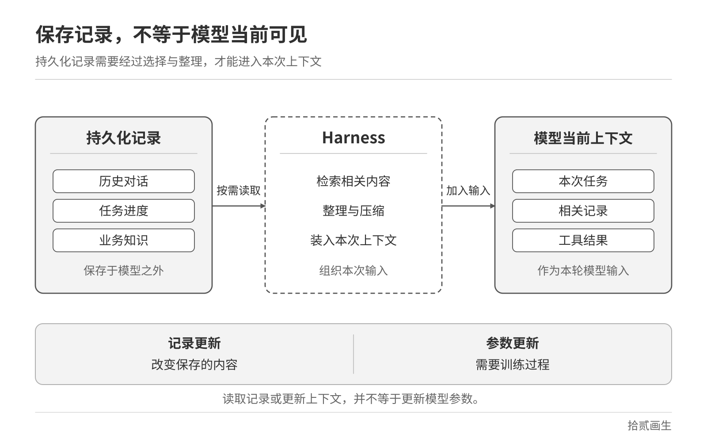
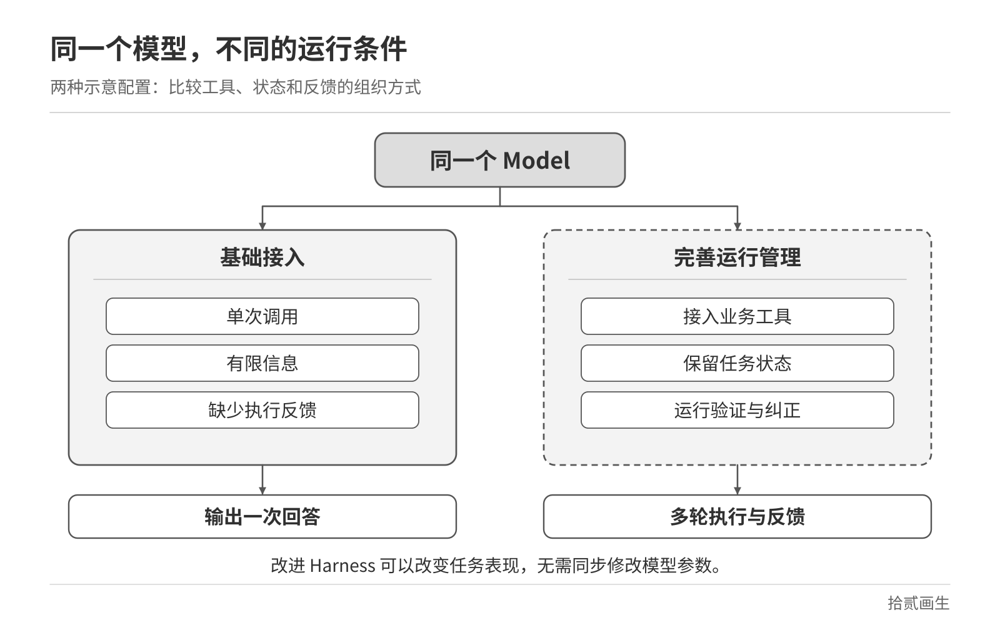

“帮我查一下，这张生产单为什么延期，并给出处理建议。”

对一个生产管理 Agent（智能体）来说，这句话可能意味着一连串工作：找到生产单，查询物料和生产进度，比较计划与实际情况，补充缺失信息，最后形成有依据的判断。

我们很容易把整个过程概括为“大模型在处理任务”。但其中藏着一个关键问题：模型提出“查询生产进度”之后，究竟是谁打开了通往业务系统的接口？查询失败时，谁处理错误？拿到结果后，谁让模型接着往下做？

理解这些问题，就接近了 Harness 的核心。

## Harness：围绕模型的运行管理层

在 Agent 的语境中，可以把 Harness 理解为：**围绕模型的一套运行程序和配置，用来准备输入、组织工具执行、接收反馈，并管理任务的持续运行。** OpenAI 对 Codex 的工程介绍，就将协调用户、模型与工具的核心循环及执行逻辑称为 Harness。

模型根据当前信息生成判断、行动请求或回答。Harness 则把模型调用放进实际的任务流程里：这一轮给它什么信息，接住什么输出，调用什么工具，如何返回结果，以及什么时候继续或结束。

落到软件里，这些机制通常体现为接收用户输入、请求模型服务、读取返回内容、调用业务接口、保存运行记录的一段段程序。它们可以由开发者自己编写，也可以基于已有框架搭建。“有一个 Harness”只说明存在这样的运行结构；具体能处理哪些情况，仍要看实现了哪些功能。

这里的“围绕”，说的是职责关系。即使架构图用一个大框把模型包在 Harness 里面，也不能据此把模型参数算作 Harness 程序。模型本体和调用、组织它的运行系统，仍然需要分开理解。

可以借用一个有限的类比：一位熟悉业务的分析人员，需要有人准备材料、提供系统入口、安排流程、记录进度。分析人员的能力很重要，配套条件也会影响工作能否完成。对于 Agent，这些安排要变成可以实际运行的软件机制。

*Harness 把模型调用、工具执行与环境反馈组织成一个 Agent 的运行过程。*

## 跟着一张生产单，看 Harness 怎样工作

下面用一张虚构生产单说明。这里的 FCS 指工厂生产协同系统，所有数据和事件均为示意。

**第一步：准备这一次模型需要的信息。**

用户只说“这张单”，系统需要确定所指对象。Harness 可以从当前页面取得生产单编号，结合用户问题、相关业务规则和可用工具说明，构造本次上下文。如果编号仍不明确，就应让任务进入补充信息的环节。

工具说明也属于模型需要看到的信息。工具说明告诉模型，当前有哪些操作可用、参数如何填写，帮助它更可靠地生成与当前系统匹配的调用请求。请求最终能否执行，还取决于实际接入的工具和相应检查。

**第二步：模型提出查询请求。**

模型可能输出：“调用生产进度查询工具，查询生产单 A。”实际系统一般会用结构化数据表示工具名称和参数。

**这时产生的是调用请求。真正的查询，还需要模型之外的程序执行。** 常见的 Agent 循环会执行模型请求的工具，把结果加入后续输入，再次调用模型。一条用户消息，因此可能触发多轮模型调用与工具执行。

**第三步：Harness 组织执行，工具访问 FCS。**

Harness 接收请求，检查工具是否存在、参数是否有效，并按系统设计落实访问控制。查询工具随后访问 FCS，取得数据。假设返回的信息是：“面料尚未齐套；裁剪尚未开始。”

在这个环节，查询接口是工具，FCS 及其业务数据是环境，组织请求与返回过程的程序承担 Harness 的职责。三个概念各有对应的对象。

**第四步：带着新事实，再次调用模型。**

Harness 把查询结果交回模型。模型据此发现，还需要了解面料预计到货时间，于是提出第二次查询。Harness 再次执行，并将新结果交回。

这一次假设查到：面料预计到货时间已经晚于原定裁剪开工时间。模型可以据此解释物料未齐对按期开工可能造成的影响，并列出仍需核实的其他因素。

**第五步：验证结果，结束或继续。**

“查到了两条记录”和“完成延期排查”之间，还要有完成标准。例如，这项任务可以要求回答区分已确认事实、原因判断与待核实事项，并附上相关单据和时间依据。系统按预定方式检查；条件不足时补查，无法补足时明确交付限制。

这些步骤把“准备输入—模型输出—工具执行—结果回传”连成了运行循环。Harness 的基本形态，可以从这样一个循环开始；持久化记录、恢复、验证等能力，则需要进一步设计。

*模型提出查询请求，Harness 组织执行，再把取得的结果送回模型。*

## 把模型、Prompt、工具和环境放回各自的位置

围绕 Agent 的词很多，容易把“组成材料”和“运行职责”混在一起。继续沿用生产单案例，可以把边界列清楚。

| 概念 | 含义 | 在案例中的对应 |
|---|---|---|
| 模型 Model | 根据输入生成判断、行动请求与回答的模型本体 | 判断是否还需要查询到货时间 |
| 提示词 Prompt | 为模型描述目标、规则、方法和输出要求的指令内容 | 要求区分事实与推测 |
| 上下文 Context | 本次模型调用接收到的输入信息 | 问题、编号、规则、工具说明和查询结果 |
| 工具 Tool | 可以调用的一项操作能力 | 查询生产进度的接口 |
| Harness | 组织模型调用、执行、反馈和状态的运行系统 | 接住查询请求，接回结果，安排下一轮 |
| 环境 Environment | Agent 观察与行动所面对的外部系统及状态 | FCS、生产单记录、物料与进度数据 |
| Agent | 面向任务运行、能够观察与行动的整体 | 完成生产单延期排查的智能体 |

上下文是此次输入；模型输出也依赖其参数中经训练形成的知识与能力。这里把 Prompt 按较窄的“指令内容”理解。有些技术文章会用 prompt 泛指整次模型输入，阅读时需要结合其具体语境。表格中的边界，是为了区分职责，并不要求它们部署在不同软件或服务器上。

本文按运行管理职责拆分；不同实现也会将配套执行设施统称 Harness。无论部署如何组织，案例中的 FCS 及其业务状态，都是任务面对的业务环境。

这样也能理解两种常见表达：

**Agent ≈ LLM + 上下文 + 工具**，其中 LLM 指大语言模型。这种表达强调关键要素：谁来判断，能看到什么，能做什么。

**Agent ≈ Model + Harness**，强调模型本体与外围系统的责任划分。LangChain 的一篇工程文章采用了这一表达，并将模型之外的代码、配置和执行逻辑纳入较宽的 Harness 定义。

Harness 与上下文、工具之间存在组织关系。上下文怎样准备，工具怎样接入，反馈怎样回传，都可以是 Harness 的设计内容。因此，两种表达是不同观察角度，不能机械地把 Harness 当作完全独立的“第四种材料”。

## 一句要求，怎样变成实际机制？

“查询失败时重试”“没有权限时停止”“完成后检查”，都可以写进 Prompt。它们能影响模型的行为，但实际运行还要有相应机制承接。

以重试为例，系统需要收到失败信息，决定是否再次调用，记录次数，并落实停止条件。这个决定可以来自固定策略，也可以参考模型对错误的判断。无论采用哪一种方式，下一次请求都必须由程序真正发出。

重试策略还要结合操作性质。读取生产进度失败，可以在限制内重新查询；如果是创建一张业务单据，接口超时并不能直接证明创建失败。此时应先核实执行结果，或通过业务系统提供的防重复机制处理，以免产生重复单据。这是设计该案例时需要落实的业务约束。

权限也一样。Prompt 可以告诉模型“当前用户只有查询权限”，工具调用程序和业务后端仍需要执行相应检查。模型生成了一个修改请求，并不会因此获得修改资格。

验证则要回答另一类问题：什么结果足以支持“完成”？例如，把“面料未齐套”直接写成“延期的唯一原因”，超出了当前事实能够支持的范围。可以要求补充相关计划和进度依据，也可以让模型辅助检查回答，但模型再次说“检查通过”，仍需要结合预设标准评估。

在工程实践中，把约束落实为可执行检查，是 Harness 设计的重要内容。OpenAI 关于 Harness Engineering 的实践就包括通过程序检查来维持规则，并为 Agent 提供可以读取的文档和反馈。

## Agent “记得上次”，究竟发生了什么？

延期排查可能跨越几次对话。今天确认面料未齐，明天到货后继续判断剩余工序。Agent 要接得上，至少需要解决保存和读取两个问题。

任务结束前，系统可以保存已查询的单据、取得的事实、待核实事项和下一步安排。明天继续时，Harness 再按任务需要读取记录，整理进当前上下文，并查询最新状态。

**保存在模型外的信息，需要经检索或读取，并将相关内容送入当前上下文，才能被模型直接用于本次推理。** 持久化记录和模型当前上下文是两个层次。Anthropic 的 Managed Agents 架构就将会话事件记录、Harness 和执行环境分别管理，Harness 可以从记录恢复任务，并选择需要交给模型的内容。

这也提醒我们，历史记录需要带上时间。昨天的“未到货”可以解释当时的判断，今天是否到货，则需要新的事实。把过去记录加载进来，只完成了延续任务的一部分。

*持久化记录经读取进入当前上下文，保存记录与更新模型参数属于不同层次。*

当 Agent 表现出“越来越懂这项工作”时，还应区分三个层次：

| 变化发生在哪里 | 生产单案例中的表现 | 模型参数是否因此改变 |
|---|---|---|
| 当前上下文 | 看到刚查到的物料状态，调整下一步行动 | 没有 |
| 外部记录、规则或程序 | 保存经验，更新排查文档、Prompt、Skills 或执行逻辑 | 这些操作本身不更新参数 |
| 模型训练过程 | 利用数据和训练方法调整模型内部参数 | 改变 |

这里的 Skills，可理解为按需加载的任务指引与配套资源。

例如，团队将“判断物料影响时，同时核对计划开工时间”写入排查规则，以后运行时加载它，Agent 就有机会采用这条经验。这是一种外围系统更新。若要把经验用于模型参数更新，还需要另外的数据处理与训练过程。

因此，“系统积累了经验”可以包含多种实现。说明经验存在哪里、何时读取、怎样验证，才能判断这项能力究竟如何成立。

## Harness 可以承载多种工作方式

看到反复调用模型，容易以为每一步都应由模型自由选择。实际设计可以更有层次。

对于生产单排查，可以先固定核验编号、检查访问范围、获取基础进度；在“还应补查哪些信息”这一段，再让模型结合已知事实选择工具；最终输出时，继续执行固定的格式与依据检查。

这就是固定流程与模型判断的组合。

ReAct 常用“思考—行动—观察”概括：模型根据当前信息推理，通过工具行动，再利用观察结果继续处理。Harness 可以组织这种迭代，也可以执行预先安排的工作流。它可以包含固定规则和额外的模型调用。

选择多少固定步骤，应看业务约束和任务变化程度。生产单编号的合法性适合明确校验；延期原因排查则可能因物料、设备或前序工序状态而变化，需要保留选择空间。Harness 的设计，要把这些差异体现在实际运行中。

## 同一个模型，外围工程为什么重要？

设想两个使用同一模型的生产管理 Agent。

一个只能收到模糊问题，工具名称难懂，错误信息缺失，每次开始都没有上次进度。另一个能够取得准确编号，看到清楚的工具说明，读取相关规则，获得明确的错误反馈，并按任务记录继续工作。

后者拥有更充分的任务条件。它的行为因此可能改善，而模型参数可以保持不变。这个对照没有预设任何提升比例；具体效果仍要用实际任务验证。这些配套也需要随任务和模型变化调整，旧规则未必一直适用。

排查 Agent 的失败时，也可以沿着这些位置追问：关键记录有没有进入上下文？工具是否返回了完整事实？判断本身是否成立？正确的行动请求有没有执行成功？这样的拆分能帮助团队确定改动位置。缺少数据时补接口，进度丢失时完善记录，原因判断有误时再检查推理所依赖的条件，必要时比较模型能力。

长时间任务尤其依赖这些配套。Anthropic 的相关工程实践使用任务清单、进度文件和版本历史，帮助后续会话恢复工作状态，并通过验证减少过早宣布完成的情况。这类做法为如何组织跨会话工作提供了具体例子。

进一步讨论 Harness Engineering 时，范围往往会扩大到文档组织、工具设计、工作环境和反馈机制。它关注如何让模型获得完成任务所需的条件，并让运行过程可检查、可调整。

*清楚的工具、完整的状态与明确的验证，可以改善模型完成任务的条件。*

因此，阅读 Harness 相关文章时，可以先确认作者采用的范围：狭义上，它侧重模型外围的运行循环和控制逻辑；广义上，还可能包含与 Agent 配套的提示、工具、文档和执行环境。不同工程实现的边界会有所差异。

回到生产单延期排查，设计一个 Agent，最终要把问题落到具体位置：需要哪些事实，模型怎样取得这些事实；提出行动后由谁执行；执行过程如何记录；中断后怎样继续；什么依据足以支持任务完成。

这些问题有了清楚、可运行的答案，模型的判断才能接上实际业务。Harness 的设计，就是将模型的一次次输出组织成任务过程，并按需要补齐验证、恢复和失败处理等机制。
