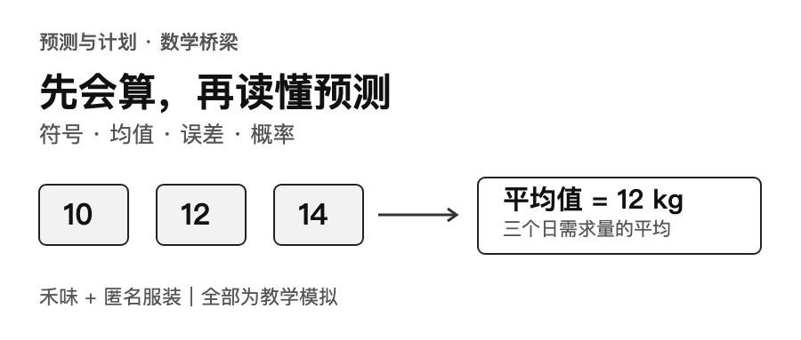
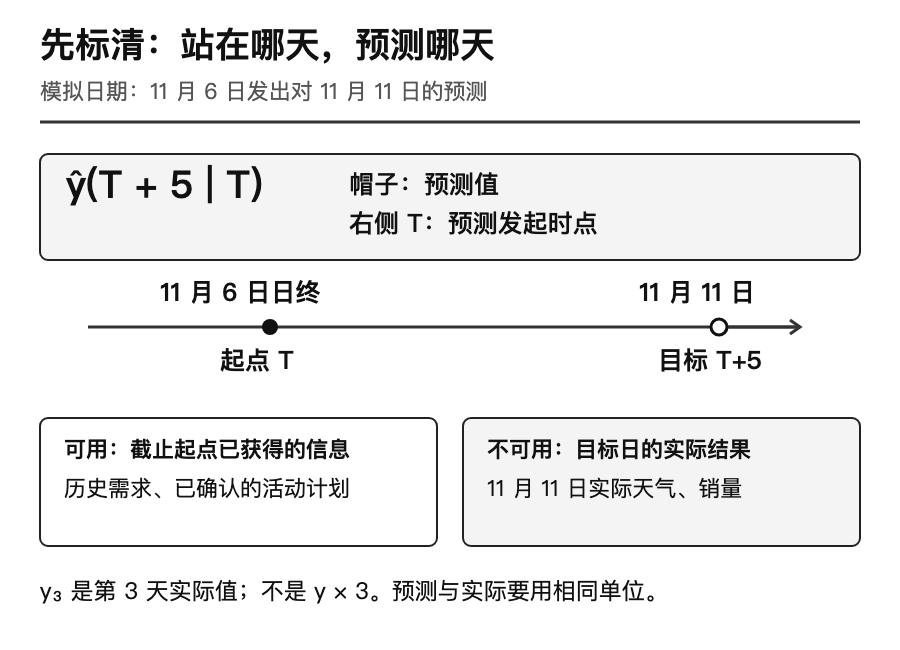
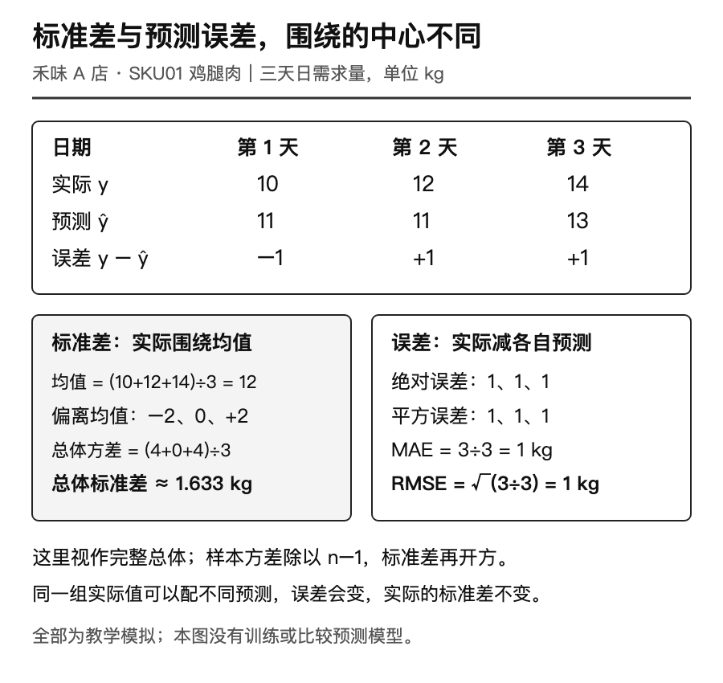
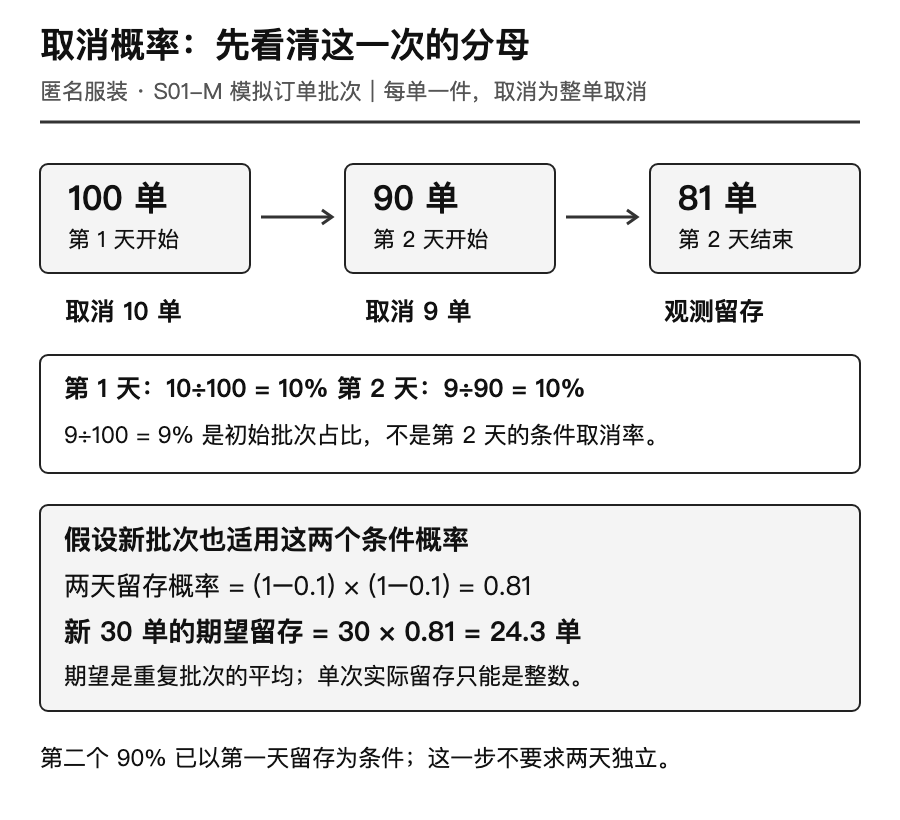
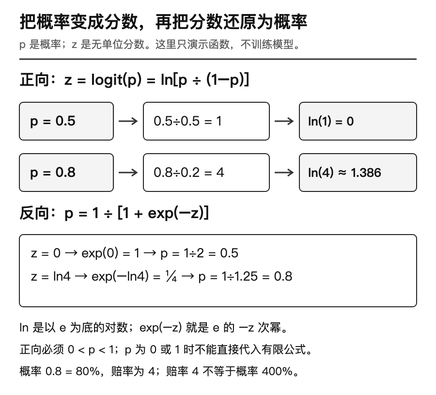

预测表上写着“明天需要12.6公斤”，订单看板上写着“预计留下24.3单”。前一个数可以是连续重量，后一个数却不可能成为实际订单数。这两个小数并不矛盾：它们回答的问题不同。

在学习复杂模型前，我们先把这样的数字读懂。本文是[供应链预测与计划专题](/topics/forecasting/)的第一篇，依据教程站的[“数学桥梁”课](https://shierhuasheng.royal-chub-7016.chatgpt.site/#unit-legacy-0)重新组织为独立博客文章。先用计算器手算，再用下载包核对；没有编程经验也能完成前七节。

**以下企业、日期、需求、预测和订单记录均为教学模拟。** 禾味是虚构餐饮连锁，本篇只取A店鸡腿肉SKU01；匿名服装只是虚构的服装电商场景，取S01-M规格的一批订单。没有真实客户、真实订单或真实经营成果。三天数据不是此前D9—D13实验数据的截取，也没有训练或评选模型。

## 1 先把一句预测拆成四个问题

“预计14”还不够。我们至少要说明：哪个对象、什么单位、预测哪一天，以及什么时候做出的预测。

设禾味A店鸡腿肉在11月1、2、3日的实际日需求分别为10、12、14公斤。假设这三天没有缺货、没有漏记，当天日终数据已经可用，因此本例可以把记录量当作需求；现实若只能看到受缺货限制的销量，要先处理这个差别。

| 符号 | 读法 | 本文的含义和单位 |
| --- | --- | --- |
| `t` | 第t天 | 日期位置，不是数量；t＝3对应11月3日 |
| `yₜ` | y下标t | 第t天整天的实际需求，单位公斤 |
| `ŷₜ` | y帽子下标t | 对第t天的预测需求，单位公斤；单独写它尚未说明发布时间 |
| `T` | 预测起点 | 本例按某天日终定义的信息截止时点 |
| `h` | 提前的天数 | 正整数；h＝2表示提前两天 |
| `ŷ(T+h｜T)` | 在T时点预测T加h | 左边是目标日期，竖线右边是预测起点；数值单位仍是公斤 |

下标是标签。`y₃＝14`表示第三天需求14公斤，绝不是y乘3。帽子表示“预测值”，并不表示这个数字已经实现。我们每天记录一次，所以称为日序列；每行是当天总公斤数，三天相加得到三天的总公斤数。

若T是11月6日日终，h＝5，目标就是11月11日整天。此时可以使用已发布的11月11日天气预报，却不能使用11月11日结束后才得到的实际温度。同一目标日也可能有多个预测版本，必须保留各自起点。竖线在这里标记信息截止点，不是除号。

[](images/p01-01_time.png)

再区分四个经常混用的词。设我们暂时写出一个教学规则：

```text
ŷ = a + b × x
```

这里`x`是截单时已知的次日预订份数，称为**特征**，单位份；`ŷ`是要输出的鸡腿肉需求预测，单位公斤；真正要预测的实际需求`y`叫**目标**。`a`、`b`是规则中的**参数**：a的单位是公斤，b的单位是公斤/份。例如暂定a＝2、b＝0.1，x＝100时，预测＝2＋0.1×100＝12公斤。数值仅为说明单位，没有拟合依据。

“门店A＋SKU01”叫**序列键**，用于区分这条日记录属于谁。门店B的同一商品是另一条序列。一个特征可以对应两个参数a和b；很多条序列也可以共用一个模型。特征数量、参数数量、序列数量不是同一回事。

## 2 禾味案例：把三天需求压缩成一个数

三天实际需求是10、12、14公斤。若只用一个数概括它们，最直接的方法是平均。

```text
Σ 从 t=1 加到 t=3 的 yₜ = y₁ + y₂ + y₃
                         = 10 + 12 + 14 = 36 公斤
ȳ = (Σyₜ) ÷ n = 36 ÷ 3 = 12 公斤
```

`Σ`读作“求和”，相当于一个加号清单；“从t＝1加到t＝3”指定加哪些天。`n`是记录个数，这里是3；`ȳ`读作y上横线，表示平均数。36是三天合计，12是每个日记录的平均数量。若把12用作次日预测，这只是一个候选规则，不能因算对平均值就称它预测准确。

若认为最近一天更值得参考，可以先约定权重为0.2、0.3、0.5，再按日期顺序相乘相加：

```text
加权平均 = 0.2×10 + 0.3×12 + 0.5×14
         = 2 + 3.6 + 7
         = 12.6 公斤
```

权重没有单位，三者都不小于0，且合计为1。最后一天14公斤获得50%的权重，所以结果比普通平均12更接近14。它仍在最小值10和最大值14之间。权重更大只表示规则更重视这一天，不表示这一天的数据更真实。

这组权重是教学预设。真实任务需要在开发阶段用验证数据比较候选，再固定规则到测试段评价；看过测试成绩后反复改权重，会让测试段参与选择。

两条快速检查很有用。第一，把每个实际值都加5，数据变为15、17、19：普通平均应为17，加权平均应为17.6，均比原来多5。第二，把公斤换成克，所有数量乘1000，均值也必须乘1000。不要把公斤和件放进同一个平均数。

## 3 预测错多少：负号、绝对值、平方根分别做什么

现在给三天配上提前一天发出的模拟预测：11、11、13公斤。它们只用于核对算法，不是上节均值规则在同三天拟合出的预测。

下表可在手机上横向滑动，逐列核对计算。

<div class="math-bridge-error-table" role="region" aria-label="预测误差逐行计算表" tabindex="0">

| 目标日 | 预测起点（日终） | 实际y（公斤） | 预测ŷ（公斤） | e＝y−ŷ（公斤） | \|e\|（公斤） | e²（公斤²） |
| --- | --- | ---: | ---: | ---: | ---: | ---: |
| 11月1日 | 10月31日 | 10 | 11 | −1 | 1 | 1 |
| 11月2日 | 11月1日 | 12 | 11 | 1 | 1 | 1 |
| 11月3日 | 11月2日 | 14 | 13 | 1 | 1 | 1 |

</div>

`e`在本节表示误差，约定为**实际减预测**。负数代表预测偏高，正数代表预测偏低。实际10、预测11，e＝−1，就是多预测了1公斤。

`|e|`是绝对值，把负号去掉，只问差距多大。MAE是“平均绝对误差”的缩写：

```text
MAE = (|e₁| + |e₂| + |e₃|) ÷ n
    = (1 + 1 + 1) ÷ 3 = 1 公斤
```

`e²`表示e乘自己。RMSE是“均方根误差”：先平方，再平均，最后开平方。

```text
RMSE = √[(e₁² + e₂² + e₃²) ÷ n]
     = √[(1 + 1 + 1) ÷ 3] = 1 公斤
```

`√`表示非负平方根，例如√9＝3，因为3×3＝9。平方把单位变成公斤²，开方再回到公斤，因此RMSE能与原数量放在同一种单位下理解。

这组数据恰好使两种指标相同，不代表两种指标永远一样。再看两个模拟误差−3和1公斤：绝对值为3和1，所以MAE＝(3＋1)÷2＝2公斤；平方为9和1，所以RMSE＝√[(9＋1)÷2]＝√5≈2.236公斤。大误差平方后的影响更强。符号`≈`表示约等于，这里对结果作四舍五入，代码保留更多精度。

误差的平均数则为(−3＋1)÷2＝−1公斤，回答的是方向偏差。正负误差会抵消，它不能代替MAE。这些误差定义与[FPP3第5章的预测评价说明](https://otexts.com/fpp3/toolbox.html#evaluating-point-forecast-accuracy)一致；这里的三天演算只验证计算，不构成未来准确率证据。

## 4 标准差不是预测误差

回到实际需求10、12、14公斤，暂时不看任何预测。均值是12，各点偏离均值分别为−2、0、2公斤。

```text
偏离平方：(-2)² = 4；0² = 0；2² = 4
平方合计：4 + 0 + 4 = 8 公斤²
总体方差：8 ÷ 3 ≈ 2.666667 公斤²
总体标准差：√(8 ÷ 3) ≈ 1.632993 公斤
```

本段把三天当作要描述的完整集合，所以分母为n＝3。“方差”是平方偏离的平均；“标准差”是方差的非负平方根。它描述这三个实际值有多分散，不需要输入预测值。上节MAE＝1和RMSE＝1描述的则是那三个预测有多偏离实际。

[](images/p01-02_errors.png)

若把三天当作更大总体的一份样本，常用的样本方差分母为n−1：8÷(3−1)＝4公斤²，样本标准差为√4＝2公斤。直观上，均值已经由这批样本估计，偏离值加起来固定为0，最后一个偏离不能独立变化，所以估计总体方差时要作自由度修正。只有一个观测时，n−1＝0，样本标准差不能照算。

n−1的修正针对常规抽样条件下的总体方差估计，不会让三天相关的时间序列自动成为有代表性的随机样本，也不会给出明天的风险范围。作业应写“总体标准差”或“样本标准差”，不要只留下一个没有口径的“波动”。

## 5 匿名服装案例：第二天的10%，分母为什么变了

匿名服装S01-M的一个模拟批次起初有100单，每单1件。为把分母看清，这两天没有新增订单、发货或观察中断；只观察整单取消，取消后不再回来。

| 天数 | 当天开始仍有效的订单 | 当天取消 | 当天结束仍有效 | 当天条件取消率 |
| --- | ---: | ---: | ---: | ---: |
| 第1天 | 100单 | 10单 | 90单 | 10÷100＝10% |
| 第2天 | 90单 | 9单 | 81单 | 9÷90＝10% |

“风险集”在这里就是当天开始仍可能取消的订单。已经取消的10单不能在第二天再取消，所以第二天分母必须是90。9÷100＝9%也能计算，但它回答“第二天取消占最初批次多少”，不是当天条件取消率。

概率用0到1表示，10%＝0.1；写成10再代入会错100倍。`P(A｜B)`表示条件B已成立时，事件A发生的概率。令B为“活过第1天”，A为“活过第2天”；如果对新批次采用同样的教学条件概率，那么：

```text
第1天留存概率 = 1 − 0.1 = 0.9
第2天给定活过第1天后的留存概率 = 1 − 0.1 = 0.9
两天留存概率 = 0.9 × 0.9 = 0.81 = 81%
```

第二个0.9本来就是条件概率，乘法不需要假设两天取消事件独立。旧批次确实留下81单，这是100−10−9得到的观测结果；对新批次采用81%是另一个假设，不能因为旧批次算得出81，就断言所有新批次都会如此。

[](images/p01-03_risk.png)

“期望”描述在相同概率设定下反复出现时的平均数量。用N表示新批次初始单量，用p表示每单两天留存的概率，用R表示最终留下的随机订单数，便有：

```text
E(R) = N × p = 30 × 0.81 = 24.3 单
```

`E`是期望符号，括号内R是我们关心的随机数量。这里假定每单都适用p＝0.81；把各单留存指示的期望相加即可得到24.3，不要求订单之间独立。若要进一步计算波动、缺货概率等，单有这个均值还不够，需要更多分布与相关性假设。

实际留存只能是0到30之间的整数。24.3不是24.3张订单，更不是直接采购24.3件的指令。是否备24件、25件或更多，要结合可用库存、交期、取消与退货时点、缺货损失和服务要求决定。本文不根据期望擅自给出备货量。发货、删失和部分取消也没有在这个两天小表中建模。

## 6 函数与对数：先顺着算，再反着问

函数可以先理解成一条输入输出规则。`f(x)＝2x＋3`表示输入x后，先乘2再加3；输入4，输出f(4)＝2×4＋3＝11。这个纯数字例子没有业务单位；如果用于业务，等号两边就要像第1节那样检查单位。

平方和指数也只是乘法的缩写。x²＝x×x，2³＝2×2×2＝8。对数反过来提问：**底数2要乘自己多少次，才得到8？** 答案是3，写作log₂8＝3。下标2在这里指定对数底数，不是时间下标；要结合符号上下文读。

自然对数`ln`把底数固定为常数e，e约为2.718。这个e是数学常数，与第3节的误差e含义不同。`exp(z)`就是e的z次方；计算器上的ln与exp互为反向操作。

```text
ln(1) = 0        因为 e⁰ = 1
ln(e) = 1        因为 e¹ = e
ln(4) ≈ 1.386294 用计算器求出
exp(ln(4)) = 4
```

实数范围内，ln的输入必须大于0。零销量不能直接取ln，负销量也不能；它们需要重新检查业务定义或选择其他变换。对带单位的量做对数时，还应明确参考单位，例如ln(需求÷1公斤)，让输入成为无单位比值。不能悄悄给零加一个数，然后声称问题已经解决。

## 7 从概率到分数，再从分数回到概率

在取消或留存模型中，经常见到`logit`。这不是另一个百分比，而是把0到1之间的概率转为实数分数的函数：

```text
logit(p) = ln[p ÷ (1−p)]
```

p是无单位概率，必须满足0＜p＜1；`1−p`是相反结果的概率；`p÷(1−p)`叫赔率，比较“发生”与“不发生”。赔率不是概率：80%对应赔率4，不能把4当作400%的概率。

先取p＝0.5：1−p＝0.5；赔率＝0.5÷0.5＝1；logit＝ln1＝0。再取p＝0.8：1−p＝0.2；赔率＝0.8÷0.2＝4；logit＝ln4≈1.386294。这里0.8只是函数演示值，不是第5节两天留存的0.81，也不是训练得到的取消预测。

反方向把无单位分数z转回概率，使用：

```text
p = 1 ÷ [1 + exp(−z)]
```

当z＝0，exp(−z)＝1，所以p＝1÷2＝0.5。当z＝ln4，exp(−z)＝1÷4，所以p＝1÷(1＋1/4)＝0.8。这个反函数常叫logistic函数或sigmoid函数。

[](images/p01-04_logit.png)

p＝0或1时，不能直接代入有限实数logit公式：前者涉及ln0，后者分母为0。数学上，任意有限z的sigmoid结果严格在0与1之间；计算机精度有限，极大或极小z可能舍入为1或0，代码要避免指数溢出，但这不意味着业务事件已经绝对确定。[statsmodels的Logit官方说明](https://www.statsmodels.org/stable/generated/statsmodels.genmod.families.links.Logit.html)列出了链接及反链接，并说明其软件实现会处理数值端点；本篇练习选择对非法logit输入直接报错。

logistic回归还需要从数据中学习产生z的参数。本文只算函数，没有训练分类器，也没有检验概率是否校准。它与后续可能学习的Cox生存模型不是同一个模型。

## 8 动手：把“看懂”变成可检查的结果

下载[练习包](/downloads/p01-math-bridge-practice.zip)，解压到独立文件夹。需要Python 3.10或更高版本，不用安装第三方库；macOS/Linux终端可使用python3，Windows可将命令中的python3替换为py。先进入解压后包含run.py的目录，再运行：

```sh
python3 run.py
python3 -m unittest -v
```

输入CSV使用UTF-8。包内README列出数据字段、命令和输出位置；请先保留原文件，再复制一份做改动。原始输出应对应本文的12、12.6、MAE＝1、RMSE＝1、总体标准差约1.632993、样本标准差2、两天留存0.81，以及新30单期望24.3。浮点结果可有末尾舍入差异，不要用字符串完全相等判断根号与对数。

这份练习包有明确的输入范围：实际需求与预测只能为0至100万公斤内的0.001公斤整数倍；权重只能为0至1内的百万分之一整数倍，且精确合计为1。程序先按十进制文本核验，再转成整数克和整数权重计算，避免相近大数相减或极小数运算失真。超出范围、精度不符或CSV引号不完整都报错退出，不做隐式四舍五入；真实零值正常接受。这个教学输入范围不改变前文的数学定义，输出均值也不强制截成三位小数。

先不看答案，完成四项练习：

1. 手工建一张math_checks.csv，包含actual、forecast、error、abs_error、squared_error五列。用实际[10,12,14]与预测[11,11,13]填写，再与脚本输出核对。
2. 把实际和预测各自都加5。预期均值与加权平均加5，三个误差、MAE、RMSE和两种标准差保持不变。说明为什么“只改实际”不能得到同样结论。
3. 在原服装表上算出第二天9÷90与9÷100的两个结果，并分别写一句话描述它们的分母；再设第三天从81单中取消9单，手算第三天条件取消率9÷81≈11.111%，累计留存72÷100＝72%。第三天只是扩展手算，不冒充原两天输入的一部分。
4. 算logit(0.5)、logit(0.8)，再用反函数回算。试着输入0、1和1.2，解释为什么练习程序应拒绝，而不是返回一个可用于业务的分数。最后写一句“预计24.3单不能直接变成备货24.3件”的原因。

第4项可在同一个解压目录运行下面的命令，直接调用练习包里的函数；三种非法输入都应显示`拒绝`：

```sh
python3 -c "from run import logit, sigmoid; print(logit(0.5), logit(0.8), sigmoid(logit(0.8)))"
python3 check_logit_inputs.py
```

第一行应输出约`0.0 1.3862943611198908 0.8`；第二行逐个检查0、1和1.2。

验收时不要只检查程序退出成功：必须能解释误差正负，声明标准差分母，认出条件概率的风险集，并区分观测结果、概率假设和实际决策。程序会检查格式与数值边界，但不能替你确认真实业务数据是否符合这些假设。

这一篇到这里就够了。带着你的手算表，可以继续读[D9的季节性朴素基线](/blog/seasonal-naive-demand-forecast/)，或者在[D12中比较误差与偏差](/blog/forecast-error-bias-metrics/)。如果读到一个预测数字时，已经会追问“哪个对象、什么单位、站在哪一天、用什么数据”，后面的模型就有了落脚点。

## 下载与来源

- [练习包：CSV、Python与测试](/downloads/p01-math-bridge-practice.zip)
- [文章Markdown与配图](/downloads/p01-math-bridge-article.zip)
- [黑白配图及可编辑源文件](/downloads/p01-math-bridge-images.zip)

教程来源为[预测课堂“数学桥梁”](https://shierhuasheng.royal-chub-7016.chatgpt.site/#unit-legacy-0)。本文保持该课的五组数学主题及微型作业方向，另行组织双案例、单位说明和练习，不把教程整页复制为博客。教材与官方定义链接已放在对应段落；全部示例数值为本文教学设定或明确列出的手算结果。
