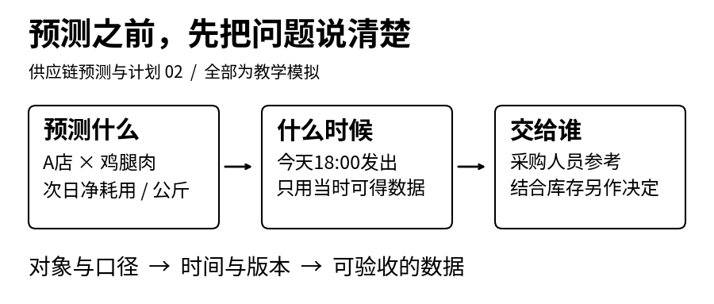
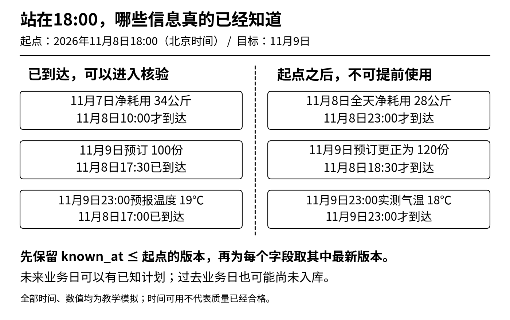
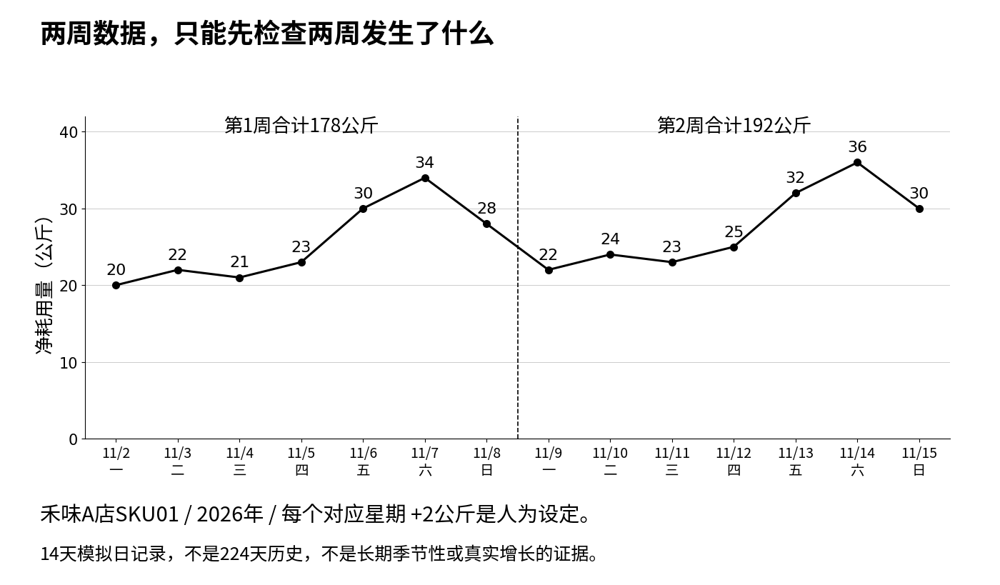
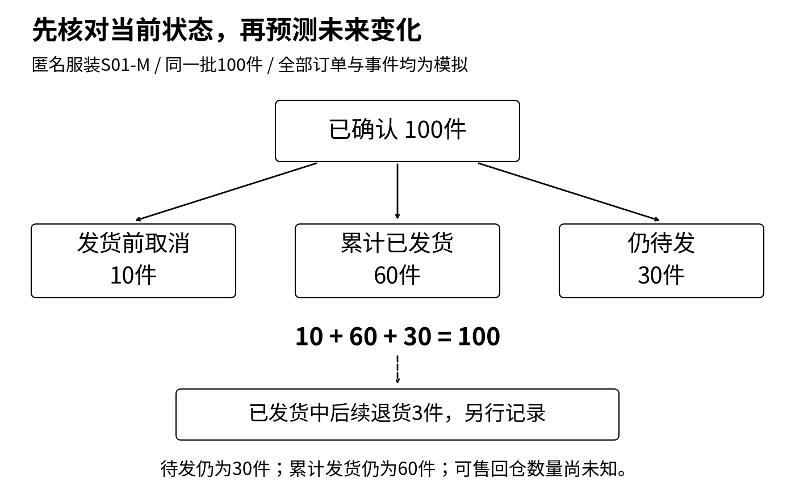

**供应链预测与计划 · 第02篇**

“预测明天的销量”为什么还不能直接交给算法？这一篇从虚构禾味的食材耗用与匿名服装的订单事件出发，把目标、单位、时间粒度和信息截止点写成可验收的任务，再用14天模拟数据检查主键、缺失与缺货。先把数据里每个数字的含义说清楚，后面的回归与时间序列模型才有共同的起点。



采购人员问：“明天鸡腿肉备多少？”技术同事回答：“可以先做销量预测。”这段对话听起来已经明确了方向，实际还隔着几层问题：销量是鸡腿饭的份数，还是食材的公斤数？备货说的是净料、毛料，还是扣除库存后的采购量？结果必须在今天18点前给出，还是等23点结算完也可以？

如果这些问题没有谈清，双方可能拿着一张计算正确的表，作出不同的解释。

[第一篇《数学桥梁》](https://12lab.cn/topics/forecasting/01-math-bridge/)解释了怎样读符号、算均值与误差。这一篇接着解决数据进入公式之前的事，依据[预测课堂《定义问题与数据地基》](https://12lab.cn/forecast/legacy-1/)重新组织为独立文章。阅读时只需要四则运算；先完成手算，再用实践包检查。

**禾味为虚构餐饮案例，保留2家门店、8个食材SKU的设定；匿名服装沿用订单与生产协同的业务背景。文中日期、订单、数量和演示规则均为教学模拟。**本文不训练预测模型，不报告准确率提升，不代表真实经营收益。14天样本不是此前D9—D13实验数据的截取，也不是新的盲测集。

## 1 把一句愿望写成可以验收的任务

先不写“使用某种模型”，把禾味的需求改成下面这段话：

每天北京时间18:00，以当时已到达并通过核验的数据，预测A、B两店各食材SKU次日营业日的净耗用量，单位为公斤；每个门店与SKU输出一行，附预测起点、目标日期和版本。采购人员在18:30截单前查看结果，结合库存、到货与包装规则决定是否下单。预测结果不自动生成采购订单。

这个练习中的营业日统一为北京时间00:00至24:00；另假定A店11月8日23:00前已收工，此后没有耗用，因此当日净耗用可在23:00核验完成。现实如果跨午夜营业，要另定归属规则，不能把一个门店的自然日与另一个门店的营业日直接混在一起。

这段任务有七个可以追问的地方：

1. **对象**：哪家店、哪个食材SKU。鸡腿肉与大米分开，A店与B店也分开。
2. **目标**：次日实际净耗用量。它是供给与营业条件下的实际使用量，不能改个名字就当作货源充足时的潜在需求。
3. **单位**：公斤，且明确为净料口径。
4. **粒度**：一天一条。小时高峰不会在日总量里完整保留。
5. **范围**：明天一天。它不同于未来7天逐日预测，也不同于未来7天合计。
6. **时点**：今天18:00发出，只使用那时确实可得的信息。
7. **动作**：供采购人员参考。下单还需要另一组数据和约束。

如果采购必须18点截止，而模型18点以后才开始跑，即使输入没有泄漏，结果也赶不上决策。预测任务还要给数据到达、计算与人工检查留时间。本例把采购截单设为18:30，是为了把这两个时点分开，不是通用业务标准。

先明确使用者、对象、频率和预测范围，再寻找数据，是预测项目的基本步骤。[FPP3第1章](https://otexts.com/fpp3/intro.html#determining-what-to-forecast)也按这个顺序讨论任务定义。

## 2 从100份鸡腿饭走到采购量，中间还缺什么

为了看清单位，先做一组独立手算：假设明天鸡腿饭销量已经被某个外部情景设为100份，每份标准净用鸡腿肉0.18公斤。这不是本文模型预测出来的结果。

净料需要量＝份数×每份净用量

＝100份×0.18公斤/份＝18公斤净料

乘式里的“份”相互抵消，剩下“公斤”。0.18是配方标准，不是从这14天数据学习出来的模型系数。实际净耗用还可能因配方执行、加工与报损口径而不同。

再假设毛料经过处理后，90%的重量成为可用净料。这个90%叫出成率，写成小数是0.9：

毛料需要量＝净料需要量÷出成率

＝18÷0.9＝20公斤毛料

为什么要除？因为20公斤毛料×0.9，才得到18公斤净料。若用18×0.9，会得到更少的16.2公斤，方向就错了。如果0.18本来就是每份毛料标准，就不能再除一次出成率。

到这里仍然没有得到采购量。仅在“同一种毛料、同一可用时点、不考虑损耗和其他占用”的简化条件下，若已有6公斤可用库存、另有4公斤确定在使用前到达，可先算一个毛料缺口：

毛料缺口＝max(0，20−6−4)＝10公斤

max的意思是“从括号里的数中取较大者”。它让缺口至少为0，避免把库存过剩写成负采购量。这10公斤还没有考虑包装、最小起订量、保质期、到货风险和安全库存，所以不是下单建议。把预计销量、理论净料、毛料缺口和采购订单分列，才知道每一步加了哪些假设。

服装也存在类似区别。顾客想买10件M码，门店只剩4件，售出4件只证明成交了4件，不能据此说完整需求只有4件。反过来，若任务本来就是预测现有供给条件下的成交量，那么库存约束必须成为任务条件。

## 3 数据属于昨天，不等于昨天已经知道

现在站在2026年11月8日18:00，准备预测11月9日。以下时间均为北京时间。

| 记录 | 对应业务日期 | 模型可读取时间 | 18点能否使用 |
|---|---|---|---|
| A店SKU01净耗用34公斤 | 11月7日 | 11月8日10:00 | 能，但要承认它是延迟到达 |
| A店SKU01全天净耗用28公斤 | 11月8日 | 11月8日23:00 | 不能，当天尚未结束 |
| 11月9日预订100份 | 11月9日 | 11月8日17:30 | 能，未来日期的计划也可提前知道 |
| 同一预订更正为120份 | 11月9日 | 11月8日18:30 | 不能，更正在起点之后 |
| 11月9日23:00预报温度19℃ | 11月9日 | 11月8日17:00 | 能，使用当时发布的预报版本 |
| 11月9日23:00实测气温18℃ | 11月9日 | 11月9日23:00 | 不能，这是事后观测 |

[](images/p02-02_timeline.png)

这里需要至少两个时间字段：business_date说明事情属于哪一天；known_at说明数据何时真正可被预测流程读取。前者帮助按日汇总，后者决定能不能进入某次预测。

如果用T表示预测起点，一条候选输入必须先满足：

known_at ≤ T

“≤”读作“小于或等于”。本例就是可读取时间不能晚于11月8日18:00。通过这个检查，只说明时间上可用，还要继续核对字段含义、单位与数据质量。

同一个字段可能有多个版本。先删掉T之后才到达的版本，再在同一对象、业务日期和字段内取剩下的最新版本。因此11月9日预订在18点应取100份；如果直接查今天数据库中的最新值，会取到120份，把未来更正带回过去。

现实还可能有业务发生时间、源系统更新时间、入库时间和校验通过时间。known_at应采用预测流程实际能使用该值的时间，不能只拿业务发生时间冒充。没有历史版本或到达记录，就不能声称已经重现“当时能看到的数据”。

**未来的日期不等于未来才可得的信息。**星期几、已发布的活动安排可以提前知道；未来实际销量、实际温度通常不行。回测时同样要守这个边界。[FPP3的时间序列交叉验证](https://otexts.com/fpp3/toolbox.html#time-series-cross-validation)要求每次预测只利用目标之前的训练信息；实际业务还必须进一步处理上述数据到达延迟。

## 4 224行数据，究竟是224个什么

禾味完整小样本按“一天×一家门店×一个食材SKU”记录。两家店、8个SKU、14个自然日，日期骨架应有：

2×8×14＝224行

每一行的联合主键是business_date、store_id、sku_id。所谓主键，就是能唯一指认一条记录的字段组合。只拿日期不能区分门店；只拿商品不能区分哪天。

这批数据共有2×8＝16条日序列，每条14个点。它不是一条拥有224天历史的序列，也不是224个相互独立的样本。把不同商品串成一条线，会把“换了商品”误看成“需求突然变化”。

完整主样本假定每天营业、记录完整且无缺货；8个SKU都使用公斤净耗用口径。日期为2026年11月2日至15日。A店SKU01鸡腿肉这一条沿用教程的手算数列，本文把第1天明确落到11月2日星期一；其他序列按实践包中的固定规则生成，不代表真实商品之间的比例。

| 周次 | 周一 | 周二 | 周三 | 周四 | 周五 | 周六 | 周日 | 合计 |
|---|---:|---:|---:|---:|---:|---:|---:|---:|
| 第1周 | 20 | 22 | 21 | 23 | 30 | 34 | 28 | 178 |
| 第2周 | 22 | 24 | 23 | 25 | 32 | 36 | 30 | 192 |

表中每天的数值单位都是公斤。第二周的每个对应星期比第一周多2公斤，周合计相差7×2＝14公斤。这种整齐规律是人为设定的，用于核对程序，不是从真实业务中发现的增长结论。

[](images/p02-03_series.png)

最先检查四件事：是否恰好16组店货组合；每组是否有14个连续日期；联合主键是否重复；单位与数值是否合法。总行数恰好224还不够：漏掉一行再重复另一行，总数一样，内容已经错了。

看图时也要限制解释范围。这里可以看见人为设置的星期起伏，却只有两个星期一、两个星期二。它不足以证明周规律长期稳定，更无法验证年度季节性。即使扩成180天，也没有覆盖一个完整年度。

## 5 零、空白与缺货，不能用同一个办法处理

在完整主样本之外，实践包另放了四条互不混用的异常情景。它们用于检查含义，不会覆盖上面的14天数列。

| 情景 | 已记录净耗用 | 标记 | 可以怎样理解 |
|---|---:|---|---|
| 正常营业且记录完整 | 0公斤 | 营业、未缺货 | 该目标确实为0；仍不能仅由此推断潜在需求 |
| 当天闭店 | 0公斤 | 闭店 | 实际耗用可以是0，但不能当作普通营业日 |
| 接口漏数 | 空白 | 记录缺失 | 尚不知道实际值，保留缺失 |
| 食材供应不足 | 2公斤 | 缺货 | 实际只耗用了2公斤，未受限需要量仍未知 |

若任务预测实际耗用，闭店日的0可以作为带状态的真实记录；若任务是“正常营业、货源充足时需要多少”，闭店与缺货的记录就不能未经处理充当完整标签。处理方法要服从目标定义。

还有一个手算陷阱。三天记录是10、空白、14公斤。若把空白填0，三日平均变成(10＋0＋14)÷3＝8公斤。若只看两个已观测日，平均是(10＋14)÷2＝12公斤。

但12也不是已经恢复的三日均值，因为缺失日仍未知。它只能叫“两个已观测日的平均”。程序可以保留空白、报告缺失数量，不能为了让公式运行就替业务作出事实判断。

同理，给缺货日补了一个估计值，也必须保留原始观测、补值结果与补值原因。之后若用它评价模型，应说明它是估计标签，不能称为真实需求。

## 6 匿名服装案例，先把待发、取消与退货分开

服装生产协同中，订单表看起来常常比门店日表更丰富，但字段多不代表目标更清楚。

假设匿名服装的一批S01-M规格订单合计100件，全部已确认，数量与订单标识均为模拟。观察截止时，发货前取消10件、已经发货60件，其余仍待发30件。这里不新增订单、不拆换货、不重复记事件：

待发件数＝已确认件数−发货前取消件数−已发货件数

＝100−10−60＝30件

检查数量守恒：10件取消＋60件已发＋30件待发＝100件初始确认。它说明这批记录在这个时点能够对上账，不说明未来取消率或需求已经预测准确。

[](images/p02-04_orders.png)

后来已发货商品中有3件发生退货。退货属于售后事件，不能再从这30件待发里减掉，否则会把同一批商品放进错误的状态。累计发货仍为60件；若业务另定义“累计发货减退货”，可以得到57件，但那是另一个口径，不是待发数量。

退货申请、仓库收到货、质检通过与重新可售也不是同一时点。仅知道退货3件，不能立即给库存加3件。实践包只记录退货事件，不模拟质检、可售回流或采购。

因此要先选清楚模型想预测什么：新确认订单、现有订单未来取消、某天待发总量，还是未来发货量。对生产排程而言，已确认的30件待发是当前状态；对它未来是否取消、何时要用料的判断，才是另外的预测问题。还需要交付日期、BOM、库存和产能，才能形成生产计划。

## 7 “多参数”到底多在哪里

任务清楚之后，再区分几种常被混用的“多”。学习预测时说“从单一参数到多个参数”，可能实际想问的是怎样增加输入信息。

先看一个只解释结构的规则：

预测净耗用量＝a＋b×预订份数

预订份数是一个**特征**，必须在预测时点已知；a、b是两个**参数**。a的单位是公斤，b的单位是公斤/份。即使只有一个输入特征，也可能已经有两个参数。本篇不估计a、b，所以不能从这个式子推出有效的业务预测。

三个“多”要分别理解：

- **多特征**：同时用预订、价格、星期、已排定活动等输入预测一个目标。
- **多序列**：处理2店×8SKU这16条历史。它们可以分别建模，也可以在适当方法中共用模型。
- **多目标或多输出**：例如同时输出耗用与报损，或一次输出未来7天各日结果。要为每项输出说明含义与单位。

“门店A”“鸡腿肉”“蓝色”“M码”是类别标签。怎样编码是模型输入问题；同时预测多个门店或尺码则是多序列与分组问题。增加一个类别字段，不等于已经完成层级预测。

线性回归与时间序列也不必二选一。回归描述如何建立输入与输出的关系；时间序列强调数据的时间顺序。使用历史耗用、星期与已知预订预测明天，可以使用回归方法，也可以采用其他方法，评价时都必须尊重预测时点。下一步选择模型前，至少先保证它们在回答同一个问题。

## 8 动手做一次数据验收

本篇实践包使用Python 3.10或更高版本，只用标准库。解压后进入含run.py的目录，运行：

```text
python3 run.py
python3 -m unittest -v
```

Windows可将python3替换为py。输入和输出使用UTF-8。**run.py会重新生成并覆盖output目录；单元测试验证程序与生成规则，不验收你手改后的输出文件。**包中有数据生成规则、CSV字段字典、完整小样本、独立异常情景、带版本的时点记录、服装事件表，以及可重复执行的检查。它是本篇独立微型练习，不是教程P01全套清洗作业的替代品。

先手工写答案，再核对程序输出：

1. 两店8SKU14天应该有多少行、多少条序列？从CSV找出A店SKU01，核对两周合计178、192公斤。
2. 站在11月8日18:00，能否使用当天完整耗用？11月9日预订应取100还是120？分别写出依据的可读取时间。
3. 运行下面的独立扰动练习，把18点以后的预订更正、未来实测气温改大，18点快照应不变；再把18点前的已知预订从100改成101，快照应改变。后一个反向对照，防止程序无论输入怎样都返回同一份答案。这个检查只验证本例的取数函数，不代表真实系统已经消除全部泄漏。
4. 检查四条异常情景：哪一条保留空白？哪一条必须带闭店标记？哪一条不能用来声称完整需求只有2公斤？
5. 重算服装守恒式，并解释为什么退货3件既不把待发变成27件，也不自动产生3件可售库存。

第3项运行命令如下，脚本会读取版本文件、保存独立练习副本并打印两组对照，不用run.py重新生成原值来替代实验：

```text
python3 demo_future_perturbation.py
```

若想自行编辑数据，先复制output中的版本JSON，再使用check_asof.py读取你指定的副本；具体参数见实践包README。不要把“程序没有报错”当作实验完成，必须检查读入的是哪份文件、哪些值被改过，以及快照是否按预期变化。

最后写一张你自己的任务定义，包含对象、目标、单位、粒度、范围、发出时间、可用信息和使用人。暂时不填算法名称。请另一位同事只看这张定义，指出应取哪一列作目标、哪天作预测、哪些版本不能使用。如果两人理解一致，才算完成这一课。

这一步交付的是可解释的数据与边界。后续可以据此学习简单基线、回归和多特征；如果标签仍混着销量、耗用和采购量，再复杂的模型也无法替你决定究竟要回答哪一个问题。

## 资料与复现说明

- [专题第一篇 数学桥梁](https://12lab.cn/topics/forecasting/01-math-bridge/)：符号、单位、误差与概率的前置阅读。
- [预测课堂 定义问题与数据地基](https://12lab.cn/forecast/legacy-1/)：本篇课程依据，覆盖任务定义、数据字段与14天手算序列。
- [FPP3 第1章](https://otexts.com/fpp3/intro.html#determining-what-to-forecast)：任务对象、频率与预测范围。
- [FPP3 第5章时间序列交叉验证](https://otexts.com/fpp3/toolbox.html#time-series-cross-validation)：只使用当时可得信息的回测原则。

配套文件包括完整文章、黑白配图及可编辑SVG、独立实践包。全部数字来自文中明示的教学设定与手算，或实践包的确定性生成规则。本文没有实施真实采购、发货或生产动作，也没有宣称完成预测训练与真实业务验证。

## 下载配套材料

- [完整文章包（Markdown、独立HTML、配图）](/downloads/forecasting/02-problem-and-data/article.zip)
- [黑白配图包（PNG与可编辑SVG）](/downloads/forecasting/02-problem-and-data/images.zip)
- [实践包（模拟数据、复现代码与28项测试）](/downloads/forecasting/02-problem-and-data/practice.zip)

下载包保留原始字节与校验文件。所有案例和数据均为教学模拟。
