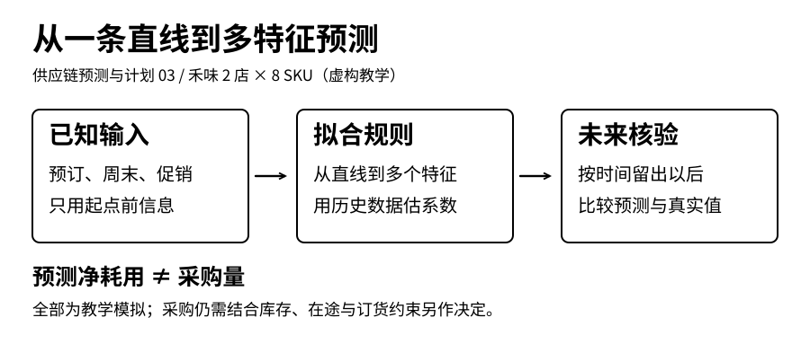
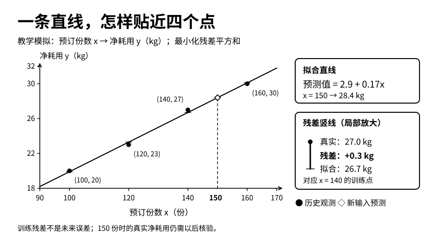
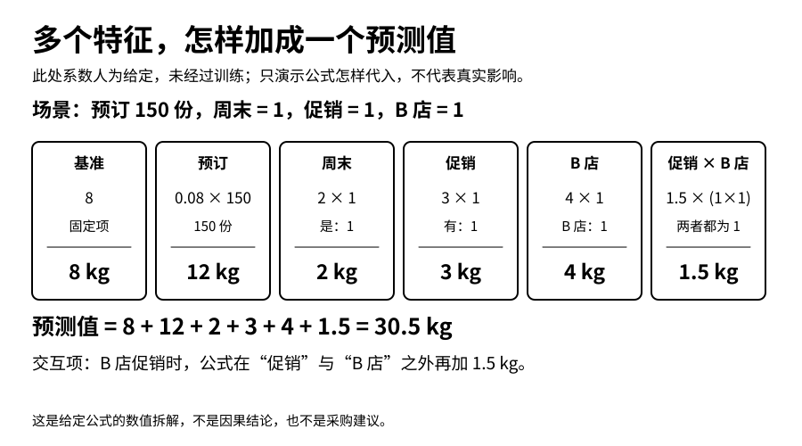
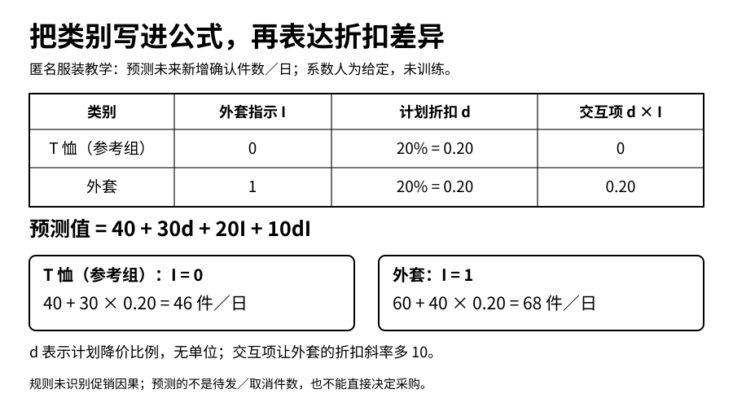
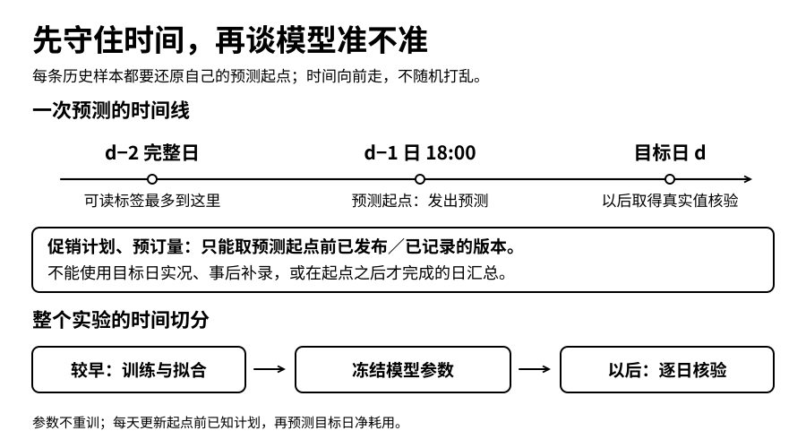

**供应链预测与计划 · 第03篇**

同样是150份预订，为什么周末、有活动的B店，可能比普通工作日的A店多用一些鸡腿肉？这一篇先把四组数据拟合成一条直线，再加入周末、促销与门店，读懂类别和交互项。最后用独立模拟数据真正训练模型，并按时间先后检查未来误差。



[第一篇](https://12lab.cn/topics/forecasting/01-math-bridge/)解决了怎样读符号、算均值与误差；[第二篇](https://12lab.cn/topics/forecasting/02-problem-and-data/)要求我们先写清目标、单位和信息截止时间。现在可以往前走一步：不再给每一天同一个平均值，而是让预测随着当时已知的信息变化。

本文依据[预测课堂《从一条直线到类别特征》](https://12lab.cn/forecast/legacy-4/)展开。只需要四则运算、平方和高一的一次函数。前三节可以用纸笔完成，实践部分不要求先学矩阵。

**禾味为虚构餐饮案例，沿用2家门店、8个食材SKU；匿名服装为虚构的订单与生产协同场景。全部数据、日期和业务规则均为教学模拟，不涉及真实品牌、客户或收益。**四点手算、给定系数示例与84天训练实验是三个不同的数据层次，不能互相冒充。84天数据不是第二篇14天数据的延长，也不是课堂180天数据的截取。本文训练的是教学预测模型，不执行采购、裁剪或生产。

## 1 一条直线究竟在回答什么

先只看禾味A店的SKU01鸡腿肉。任务仍然是：每天北京时间18:00，预测次日营业日的鸡腿肉净耗用量，单位公斤。假定完整记录可得、营业正常且没有缺货。本节用“截至18点已确认的次日套餐预订份数”作为输入。

把次日预订记作x，把次日实际净耗用记作y。一次函数写成：

**ŷ＝a＋b×x**

帽子“ˆ”表示估计，所以ŷ读作“y的预测值”。a叫截距，决定直线的位置；b叫斜率，决定x变化时预测值怎样变化。

<div class="regression-table-scroll" role="region" aria-label="可横向滚动的数据表" tabindex="0">

| 符号 | 这里表示什么 | 单位 |
|---|---|---|
| x | 截止时已经确认的次日预订 | 份 |
| y | 次日结束后核验的实际净耗用 | kg |
| ŷ | 截止时发出的次日净耗用预测 | kg |
| a | 直线截距 | kg |
| b | 每多1份预订时的预测增量 | kg/份 |

</div>

b×x的单位是“kg/份×份＝kg”，所以它可以与a相加。若把价格、温度也放入模型，各项乘完以后也必须得到kg；不能把20份和3公斤直接相加。

注意“一元”说的是这里只有一个输入特征x，不是只有一个参数。a和b是两个待估计参数。训练要解决的是：从历史观测里找出怎样的a、b，而不是先看明天的实际耗用，再把直线调整到它上面。

这里的预订也不是次日最终成交。它必须是预测发出时真的已经知道的版本。取消、临时加单与散客都会使最终耗用偏离预订所提示的数量。这个差别不会因为使用回归就自动消失。

## 2 用四个点把斜率和截距算出来

下面四组观测专供手算，沿用课程的构造例子。每一组x都视为当时18点的快照，y是之后成熟的标签。它们不是完整经营样本，也不用于评选上线模型。

<div class="regression-table-scroll" role="region" aria-label="可横向滚动的数据表" tabindex="0">

| 观测 | 预订x 份 | 实际净耗用y kg |
|---|---:|---:|
| A | 100 | 20 |
| B | 120 | 23 |
| C | 140 | 27 |
| D | 160 | 30 |

</div>

先求两个平均数：

x̄＝(100＋120＋140＋160)÷4＝130份

ȳ＝(20＋23＋27＋30)÷4＝25kg

横线表示这四个数的平均。接着，把每个数减去对应平均值，再做乘法与平方：

<div class="regression-table-scroll" role="region" aria-label="可横向滚动的数据表" tabindex="0">

| x | y | x−130 | y−25 | (x−130)(y−25) | (x−130)² |
|---:|---:|---:|---:|---:|---:|
| 100 | 20 | −30 | −5 | 150 | 900 |
| 120 | 23 | −10 | −2 | 20 | 100 |
| 140 | 27 | 10 | 2 | 20 | 100 |
| 160 | 30 | 30 | 5 | 150 | 900 |
| 合计 |  | 0 | 0 | 340 | 2000 |

</div>

带截距的一元普通最小二乘，用下面的规则求斜率：

**b＝Σ[(x−x̄)(y−ȳ)]÷Σ(x−x̄)²＝340÷2000＝0.17 kg/份**

Σ读作“求和”，本例就是把表中四行相加。分子记录两种偏离是否同向：x高于平均时，y也常高于平均，乘积就偏正。分母按x自身变化的大小进行换算，结果的单位是kg/份。若所有x都一样，分母会变成0；这组观测无法唯一确定斜率，应明确报错，而不是强行设成0。

再求截距：

**a＝ȳ−b×x̄＝25−0.17×130＝2.9 kg**

于是得到ŷ＝2.9＋0.17x。给定150份已知预订，预测为：

ŷ＝2.9＋0.17×150＝2.9＋25.5＝28.4kg

这个28.4是模型的输出，不是保证，不是采购量。150在训练的100至160之间，叫插值。换成800虽然也能算出138.9kg，却已经是远距离外推；厨房能力、订单结构和供应条件可能早已改变。

截距也要限制解释：没有观察过0份附近的日子，不能说“没有预订就一定耗用2.9kg”。它首先只是这条拟合直线的位置。



## 3 为什么选这条线，而不是看起来差不多的另一条

普通最小二乘中的“最小”，指让训练偏差的平方和尽量小。[LinearRegression官方说明](https://scikit-learn.org/stable/modules/generated/sklearn.linear_model.LinearRegression.html)采用的也是这个目标。本例将每一行的残差定义为“实际减拟合”：

eᵢ＝yᵢ−ŷᵢ；Q＝Σeᵢ²

i只是观测编号。残差为正，表示这行拟合偏低；为负，表示拟合偏高。平方能避免正负抵消，也会更加重视大的偏差。Q的单位是kg²，不能当成“平均差了多少公斤”。

<div class="regression-table-scroll" role="region" aria-label="可横向滚动的数据表" tabindex="0">

| x 份 | 实际y kg | 拟合ŷ kg | 残差y−ŷ kg | 残差平方 kg² |
|---:|---:|---:|---:|---:|
| 100 | 20 | 19.9 | 0.1 | 0.01 |
| 120 | 23 | 23.3 | −0.3 | 0.09 |
| 140 | 27 | 26.7 | 0.3 | 0.09 |
| 160 | 30 | 30.1 | −0.1 | 0.01 |
| 合计 |  |  | 0 | 0.20 |

</div>

因此Q＝0.20kg²。平均绝对误差MAE先取绝对值，再平均：

MAE＝(|0.1|＋|−0.3|＋|0.3|＋|−0.1|)÷4＝0.20kg

两处刚好都得到0.20，但单位与含义不同。另一条候选线ŷ＝3＋0.17x，四个残差是0、−0.4、0.2、−0.2，平方和为0.24kg²，比0.20大。

还可以用高中的配方法说明为什么2.9与0.17是这四个点的最小值，不需要求导。把四个(y−a−bx)²展开并合并，可以得到：

**Q＝4(a＋130b−25)²＋2000(b−0.17)²＋0.20**

这里把公斤和份按前表的数值代入。前两个平方都不小于0；要使Q最小，就令b＝0.17，并令a＋130b−25＝0，于是a＝2.9。最小值只能是0.20。读者可把a＝3、b＝0.17代回去：4×0.1²＋0＋0.20＝0.24，正好与上表的候选线核对。

这一步证明的是“它在这四个训练点上最小”，没有证明“它明天最好”。四点几乎排成直线是人为设计的，训练残差很小并不意外。训练R²再高，也不能代替未来数据的检验；增加特征还可能让训练拟合变好、未来预测变差。

这里也不要求先假定数据服从正态分布，才能把最小平方算出来。若要给系数做显著性检验或给预测加上可靠区间，则要另查统计条件、时间相关性和模型误差。本文不提供经过校准的概率区间。

## 4 加入周末 促销和门店后 每一项怎样相加

只用预订的一条线，会给所有同样预订份数的日子相同预测。若想表达其他差异，可以把规则扩成：

**ŷ＝b₀＋b₁x＋b₂W＋b₃P＋b₄B**

W是周末标记，周六周日为1，其余为0；P是截至起点已确认的促销标记；B是门店B标记，B店取1、A店取0。所有标记都没有单位。b₁的单位是kg/份，其他系数是kg。下标0至4只是参数编号，不是日期或乘方。

先不训练，**人为给定**一组系数，只练习怎样使用模型：

ŷ＝8＋0.08x＋2W＋3P＋4B

B店明天是周末，有已确认促销，预订150份，便得到：

8＋0.08×150＋2×1＋3×1＋4×1＝29kg

这里的8、0.08、2、3、4不是四点数据估计出的数，也不是后文实验的系数。不能为了讲解方便，给了一组数以后就说“模型训练发现了这些关系”。真正的多元训练要让所有系数共同减少同一个残差平方和。

为什么强调“共同”？预订和促销可能同时变化。如果先单独算预订对耗用的斜率，再单独算促销的差异，最后直接相加，同一部分变化可能被算了两次。多元回归尝试在同一规则里区分这些关系，前提是历史中确有足够不同的组合。

**类别要选参考组。**A店不是比B店“小1”的数。使用B标记后，A店作为参考组，b₄表示其他输入不变时，模型给B店的差异。若增加C店，可以用B标记、C标记两列。带截距的模型不再同时放A、B、C三个标记，因为每行A＋B＋C＝1，会与截距列重复，系数无法唯一分开。这是完全共线的一种简单情况。参考组处理及未知类别行为可查[OneHotEncoder官方说明](https://scikit-learn.org/stable/modules/generated/sklearn.preprocessing.OneHotEncoder.html)；本文代码自己完成这两店的明确编码，不依赖该库。

**交互项表达差异还会随条件改变。**上式让A店与B店的促销项都加3kg。如果要表达B店的促销关联可能不同，可增加P×B：

ŷ＝8＋0.08x＋2W＋3P＋4B＋1.5(P×B)

1.5仍是给定的教学系数。只有“B店且有促销”时，P×B才等于1，其他组合都为0。刚才的情景变成30.5kg。

<div class="regression-table-scroll" role="region" aria-label="可横向滚动的数据表" tabindex="0">

| 门店和活动 | P | B | P×B | x＝150且W＝1时的预测 kg |
|---|---:|---:|---:|---:|
| A店无促销 | 0 | 0 | 0 | 22 |
| A店有促销 | 1 | 0 | 0 | 25 |
| B店无促销 | 0 | 1 | 0 | 26 |
| B店有促销 | 1 | 1 | 1 | 30.5 |

</div>

A店的促销前后差是3kg，B店是4.5kg；有促销时两店差5.5kg，无促销时差4kg。这些都是模型内部的条件比较，不证明办活动就一定带来相应新增耗用。



若数据中每个周末都促销、每个工作日都不促销，P和W就完全相同，就无法从这些样本唯一分清“周末系数”和“促销系数”。多加一列不会创造新证据。即使没有完全重复，两列高度相关时，系数也可能很不稳定。预测尚可与系数易解释，是两件需要分别检查的事。

## 5 换成服装 特征变了 目标也要重新写

匿名服装的协同人员问：“已计划折扣的外套，明天会新增确认多少件订单？”我们先将目标限定为某渠道、某品类次日**新增确认件数**，输入只用起点前已确认的折扣计划与品类。不是明天最终交付件数，也不是现有待发订单的留存概率。

为了练习类别与交互，另给定一条未训练的教学规则：

**ŷ＝40＋30d＋20I＋10dI**

d表示折扣比例：原价100元、计划售价80元，折扣比例是(100−80)÷100＝0.20。这里“八折”对应d＝0.20，不是0.80，更不能输入20。I表示外套，外套为1、T恤为0，T恤是参考组。

系数30的单位是“件/折扣比例单位”。从0.20增加到0.30，是增加0.10，也就是10个百分点，不是增加1。于是：

- T恤、d＝0.20：40＋30×0.20＝46件。
- 外套、d＝0.20：40＋6＋20＋2＝68件。
- 外套、d＝0.30：40＋9＋20＋3＝72件。

外套的折扣比例增加0.10时，模型预测增加(30＋10)×0.10＝4件。它只是这条假定规则的算术结果。清库存压力、广告投入和旺季都可能影响价格与销量；没有因果识别证据，不能拿“增加4件”当作真实降价收益，更不能据此制定最优价格。



再回到第二篇的订单账：100件初始确认，10件取消、60件已发、30件待发。这里预测的68件属于**未来新增确认**。不可以直接把30＋68当成明天必发98件，因为新旧订单的取消、承诺日、物料和产能尚未处理。已经发生的退货也不能再次从待发里扣除。

件数预测可以出现小数，那是数量的预测值；实际件数仍是整数。是否取整、在哪个汇总层级取整，要由后续决策规则说明。若目标换成“取消概率”，普通线性回归可能算出负数或大于1的数，不能把它直接当概率。这需要另一个目标定义与概率模型，留到后续文章。

尺码也不要随意编码为S＝1、M＝2、L＝3，再假定需求按固定间隔变化。具体品类可以有尺寸顺序，但尺寸有序不代表需求随编码线性变化。品类、尺码、渠道的组合越多，每一组合的有效历史往往越少，不能把列数增加当成信息自动充足。

## 6 用84天数据做一次真正训练

现在把“代入给定系数”与“从历史估计系数”分开。配套实践包新增一组独立、可重建的禾味数据：2026年1月5日至3月29日，共84天、2店、8SKU，合计2×8×84＝1,344行目标记录。每行是“营业日×门店×食材”，全部使用kg净耗用。它们是16条84天序列，不是1,344天历史，也不是1,344个相互独立的样本；同一店日的套餐预订由8个SKU共同使用，各SKU的系数分别估计。

8个SKU沿用第二篇：鸡腿肉、大米、小麦粉、食用油、鸡蛋液、土豆、胡萝卜、白菜。主样本假定每天营业、记录完整、无缺货，没有把观测耗用偷偷改称无法观察的潜在需求。生成规则和真实用于生成的参数都公开在包中，模型函数只读取训练输入；不能用生成答案代替估计。

本次对每个SKU，把两店历史放在一起训练，共得到8套建模任务；每套拟合3种回归，合计24个已拟合模型。B店标记用来区分同一SKU的门店差异。没有把鸡腿肉和大米混成一个目标，也没有实现16条序列的层级协调。

四个候选在运行前写定：

<div class="regression-table-scroll" role="region" aria-label="可横向滚动的数据表" tabindex="0">

| 候选 | 使用的输入 | 每个SKU要估计的参数数 |
|---|---|---:|
| 上周同日 | 同店同SKU在目标日前7天的实际耗用 | 0 |
| 一元回归 | 截止时已知的预订x | 2 |
| 多元回归 | x、周末W、计划促销P、门店B | 5 |
| 加交互回归 | 上述输入，再加P×B | 6 |

</div>

上周同日是必须保留的参照。回归如果连一个便宜、容易解释的参照都没有超过，就需要诚实面对，而不是换一个更容易赢的比较对象。此前的[季节性朴素预测文章](https://12lab.cn/blog/seasonal-naive-demand-forecast/)可作为补充阅读，本次不复用它的实验结果。

所有时间都是北京时间。标签规定在目标日的次日09:00才能读取；预订与促销保留版本，预测只取前一日18:00之前最新可见的版本。

<div class="regression-table-scroll" role="region" aria-label="可横向滚动的数据表" tabindex="0">

| 环节 | 时间与数量 | 可以做什么 |
|---|---|---|
| 训练标签日期 | 1月5日至2月28日，55天 | 每SKU两店共110行，用来估计参数 |
| 模型冻结 | 3月1日18:00 | 只使用此时已成熟的标签；3月1日全天耗用不可用 |
| 未来评估目标 | 3月2日至3月29日，28天 | 每SKU两店共56行，成熟后才计算误差 |
| 各日预测起点 | 每个目标日的前一日18:00 | 参数不重训，按当天截止点读取计划版本 |

</div>

冻结日期是模拟业务时间，不是声称程序已在3月实际运行。55＋1＋28＝84，中间的3月1日是有记录但未进入训练或评估目标的间隔日，不是漏掉一行。因为3月1日18点不可能已经拥有3月1日全天结算结果。



这里评估的是**冻结参数后的逐日提前预测**。虽然模型系数始终不变，但3月10日的预测可以使用3月9日18点新收到的计划；上周同日参照也会依法使用已经成熟的3月3日标签。它不是3月1日一次性预测未来28天，也不是每天重新训练的滚动回测。不同任务不能只凭同一张指标表互相替代。

实践包真实求解各候选的最小平方系数，使用标准库实现并对常数输入、重复列和未知类别做检查。读者不必先理解求解器细节，但应能核对输入有哪些行、系数在哪里、预测如何从系数算出。工业使用应采用成熟数值工具，并增加更广的数值与故障验证；这个小型实现不是通用建模平台。

## 7 看未来误差 不把模拟优势写成经营收益

对评估集仍定义e＝实际−预测。MAE是每行绝对误差的平均；Bias是有符号误差的平均。Bias为正，表示平均预测偏低。WAPE则先把所有绝对误差加起来，再除以所有实际量之和：

MAE＝Σ|e|÷n；Bias＝Σe÷n；WAPE＝Σ|e|÷Σy

n是本候选的评估行数，不是天数。本文全部目标非负且总实际量大于0，所以WAPE有定义；若分母为0，应报告无法计算。WAPE不同于逐行百分比误差的平均，也不等于“准确率”。

[预测准确度评估的基础说明](https://otexts.com/fpp3/toolbox.html#evaluating-point-forecast-accuracy)区分训练残差与真正的预测误差；本次用时间上后置的数据计算下表。所有候选使用完全相同的448个店货日目标，即28×2×8行。

<div class="regression-table-scroll" role="region" aria-label="可横向滚动的数据表" tabindex="0">

| 候选 | MAE kg | Bias kg 实际减预测 | WAPE |
|---|---:|---:|---:|
| 上周同日 | 3.4874 | −0.0335 | 18.9734% |
| 一元回归 | 1.5295 | −0.0804 | 8.3215% |
| 多元回归 | 1.2792 | −0.0697 | 6.9594% |
| 加交互回归 | 1.2770 | −0.0714 | 6.9478% |

</div>

这些数由实践包实际运行得到，正文四舍五入到4位小数，CSV保留更多位。交互模型的整体MAE仅比多元低约0.0021kg，这个微小差异不足以证明多一项就值得部署，更没有做统计显著性论证。

**多特征也有输的时候。** SKU07胡萝卜的一元MAE为1.3986kg，多元为1.4255kg；SKU08白菜分别为1.6067kg与1.6312kg。不能只报总体较好的数字，把没有改善的商品藏起来。三种回归各有16行预订超出对应SKU训练范围，均保留并标记参与评估；本次没有负预测触发截断。

这张表只描述一套公开模拟机制下的结果。因为生成数据时本来就安排了预订、周末、活动、门店等结构，包含相应特征的模型占有结构上的便利。生成的预订还含有14天起伏，上周同日只回看7天，天然较难跟上这一设定。它说明程序能从这样的数据估计并使用关系，不说明真实门店一定存在同样关系，更不说明库存、报损或利润获得相同比例的改善。

这些数据、结果和生成规律全部可见，没有独立封存的盲测集。我们没有看完这28天后反复调整特征，再把同一段数据称为最终验收；若你根据结果修改模型，这一段就参与了选择，还要留出更晚、未参与调整的数据重新检查。

总指标也不能代替分组。鸡腿肉、大米都是kg，但波动大小和业务重要性不同；大用量商品会对总体WAPE贡献更多。请同时打开按SKU、门店、促销状态与日期的预测误差记录。连续多天正误差，可能提示共同低估；某店活动日误差集中，可能提示缺少条件关系。图形提示检查方向，不自行证明原因。

以SKU01的交互模型为例，实际估计出的规则约为：

ŷ＝3.416610＋0.168253x＋1.891583W＋1.699491P＋1.084391B＋0.837201PB

它使用110条训练记录估计，与第4节人为给定的系数不同。预订斜率单位是kg/份，其他项的系数单位是kg。精确系数见coefficients.csv；用正文舍入后的数核对逐行结果，允许出现小的舍入差。不要强行要求它重现第4节的30.5kg，因为那是另一条规则。

例如3月2日A店SKU01，起点可见预订101份，W、P、B都为0。用完整精度系数，交互模型预测20.410140711kg；其实际18.720kg要到3月3日09:00才能核验，所以预测误差为18.720−20.410140711＝−1.690140711kg。这一天上周同日预测19.650kg，反而更接近实际。整体平均较好，不代表每一天都较好。

作为反向对照，包内把首个预测起点已经知道的SKU01预订增加10份，一元预测从21.664851928变成23.546763463kg，增加1.881911535kg。它等于该模型估计斜率0.188191153498乘10，说明程序确实使用了可见输入；不是证明真实业务增加10份预订一定多耗用这些公斤。

系数解释仍是“在这组输入和这个模型内，其他输入保持相同时的预测差异”。现实里其他条件能否真的保持不变，是另一件事。[FPP3的相关与因果讨论](https://otexts.com/fpp3/regression.html#correlation-causation-and-forecasting)也明确区分这两类问题。预测可用的相关关系，不自动成为促销、定价或扩店的干预效果。

## 8 让程序主动暴露几个容易被忽略的错误

模型运行成功不等于任务验收通过。实践包安排了可以失败的检查，尤其是以下几类。

**未来信息扰动。**把某个起点之后才出现的最终计划版本大幅改动，起点时的输入与预测应保持不变。把冻结后才成熟的标签改动，冻结模型的系数和此前预测也应不变。反过来，把截止前的已知预订改变，输入与预测应该按规则变化。如果只测试“什么都不变”，一个永远返回常数的假模型也可能过关。

这类检查要说清对象。把未来标签改大，之后计算的评估误差当然会改变；到更晚的起点，该标签成熟后也可能被上周同日基线合法使用。应该不变的是当时不能看见它的拟合或预测，而不是所有时间、所有输出都永远不变。

**不能唯一估计。**一元回归遇到常数x，多元回归遇到重复列或样本信息不足，要明确失败。若促销列全是0，就没有数据证据估计促销系数。不要把求解器返回的某个数值解误读为唯一业务解释。

**未见类别与外推。**本包对训练中未定义的新门店拒绝静默编码，要求补充处理规则；不能把C店随手当A店。数值超出训练范围时必须显式告警。本包保留原始预测及外推标记，不把“公式算得出”伪装成“已经验证可靠”。

**负预测。**最小平方不会自动保证结果非负。如果算出−2kg，它不能成为负耗用指令。本包事先声明输出规则为max(0，原始预测)，并同时保留raw_prediction_kg与negative_clipped标记。若原值是−2kg，则输出0、原值仍记−2、标记为1；这一步是额外的非负后处理，不是最小平方自动提供的保证。本次没有触发截断，所以表中指标也等于未截断预测的指标。换用对数变换或计数模型，则要把整个方案重新评价，不能把后处理带来的变化隐去。

**不擅自补标签。**真实门店有缺货、闭店、漏数或返工时，要回到第二篇重新定义可用标签。回归无法凭空恢复没被记录的潜在需求。本文的无缺货设定只是一条教学前提。

正则化可以约束不稳定的大系数，更多历史也可能改善估计，但它们都不能修复未来数据泄漏、错单位和错目标。先修正问题，再讨论模型复杂度。

## 9 动手练习 从手算一直核对到文件

实践包使用Python 3.10或更高版本，只依赖标准库。解压进入含run.py的目录，先运行：

```text
python3 run.py
python3 -m unittest discover -s tests -v
```

Windows可以用py替换python3。**run.py默认读取data目录内的CSV并更新output输出；只有显式加--generate或缺少标签文件时，才重建data中的模拟输入。**想保留已有输出，请先复制文件，或用--out指定新输出目录。测试验证程序和设定，不代表真实业务已验收；重建输入会覆盖你对data中原始CSV的修改。

再执行文件化扰动与完整验收：

```text
python3 demo_temporal_controls.py
python3 verify.py
```

前一条命令在exercise目录保存基准与4种扰动的5套CSV副本，真实读回副本后重新拟合和预测，不修改原data目录。all_changes.csv记录逐字段改动，file_evidence.csv记录相对路径与SHA-256校验值，exercise_report.json给出哪些控制通过。重复执行会覆盖该目录的同名练习文件，可用--out指定另一个目录。后一条命令要求发现的测试数大于0，实际执行24项测试，再对两次运行的14份核心结果逐字节比较。

查文件时可以按这张清单走：

<div class="regression-table-scroll" role="region" aria-label="可横向滚动的数据表" tabindex="0">

| 想核对的内容 | 文件 |
|---|---|
| 每一列是什么、何时可得 | data_contract.md |
| 四点手算和给定多元规则 | output/hand_calculation.json |
| 从训练估计的104行系数 | output/coefficients.csv |
| 1,792条预测所用的起点与版本 | output/predictions.csv |
| 预测连接实际量后的逐行误差 | output/scored_predictions.csv |
| 每SKU与总体指标 | output/metrics_by_sku.csv、metrics_overall.csv |
| 训练样本的历史信息截止检查 | output/training_time_audit.csv |
| 24项测试及重复运行验收 | output/test_results.txt、verification.json |

</div>

1,792条是448个目标×4种候选，不是1,792个不同未来目标。SHA-256是文件内容的校验值，用于核对副本字节是否相同；它不证明标签是真实经营数据。

建议按下面的顺序完成，不要先看参考答案：

1. 重算四点的平均、340、2000、斜率与截距。预测130份应是多少？为什么0.20kg²与0.20kg不相同？
2. 给定多元教学公式中，x＝150、周末、B店有促销得到30.5kg。取消促销后是多少？减少的量为什么不是1.5kg？
3. 若每个周末都促销、每个工作日都不促销，W与P两列完全相同，能不能可靠地分别解释两个系数？
4. 服装“八折”应该输入0.20、0.80还是20？外套从八折改为七折，给定规则中的预测差是多少？为什么不能把它称为真实促销收益？
5. 3月1日18点为什么不能用3月1日完整耗用？3月10日预测能否用3月3日已成熟的标签作为上周同日参照？
6. 从逐行预测文件找出一条结果，用相同SKU的估计系数与快照特征重新计算。再重算该行残差，确认误差符号没有颠倒。
7. 运行未来扰动及已知特征反向对照。写明改的是哪份文件、哪个时间版本、哪些输出应变与不应变。
8. 找一个表现没有达到你预期的分组。先报告样本数与误差，再写需要补充什么证据，不急着加一个新特征。

**参考答案要点。**第1题为25kg；平方和与平均绝对误差的运算、单位不同。第2题为26kg，去掉了3kg促销主项和1.5kg交互项。第3题不能唯一拆分两项。第4题输入0.20，改到0.30，外套预测增加4件，但它来自未训练的假定规则。第5题前者标签尚未成熟，后者在预测起点前已成熟且属于允许使用的历史。后面三题以包中的逐行输出和你保存的扰动副本核对，不能只写“程序通过”。

完成后，为一个你关心的任务写一张模型解释卡：预测什么、什么时候发出、用什么版本、特征单位是什么、参数怎样估计、与哪个基线比较、哪些情况拒绝使用，以及预测交给谁作下一步判断。

从平均数走到回归，重要的变化是输入开始影响预测。但一个公式仍然需要清楚的边界：历史拟合不能替代未来核验，类别差异不能直接解释成因果效果，数量预测也不能跳过库存与产能直接变成行动。后续学习概率预测时，我们再追问：除了给一个数，能不能描述这个数周围的不确定性。

## 资料与复现说明

- [专题第一篇 数学桥梁](https://12lab.cn/topics/forecasting/01-math-bridge/)与[第二篇 问题与数据](https://12lab.cn/topics/forecasting/02-problem-and-data/)：本篇前置阅读。
- [预测课堂 从一条直线到类别特征](https://12lab.cn/forecast/legacy-4/)：课程依据；四点手算与给定多元公式在此衔接，84天实训为本文独立新增。
- [FPP3 第7章](https://otexts.com/fpp3/regression.html)：回归、类别变量、预测输入与因果边界。
- [FPP3 第5章](https://otexts.com/fpp3/toolbox.html)：基线、残差、准确度与按时间评估。
- [LinearRegression](https://scikit-learn.org/stable/modules/generated/sklearn.linear_model.LinearRegression.html)与[OneHotEncoder](https://scikit-learn.org/stable/modules/generated/sklearn.preprocessing.OneHotEncoder.html)：最小平方及类别处理的官方工具说明。本文标准库实践不依赖scikit-learn。

配套材料提供全文Markdown、可离线阅读的独立HTML、5张黑白配图及可编辑SVG（封面900×383，4张正文图保留900×500原比例），以及模拟输入、复现代码、逐行结果、自动测试和运行说明。所有实验结论仅适用于所述教学数据和比较条件，不构成真实业务效果证明。

## 下载配套材料

- [完整文章包（Markdown、独立HTML、配图）](https://12lab.cn/downloads/forecasting/03-regression-and-features/article.zip)
- [黑白配图包（PNG与可编辑SVG）](https://12lab.cn/downloads/forecasting/03-regression-and-features/images.zip)
- [模拟数据与复现代码（Python标准库、逐行结果、24项测试）](https://12lab.cn/downloads/forecasting/03-regression-and-features/practice.zip)

下载包附SHA-256校验文件。全部案例、输入和实验结果仅用于教学模拟。
