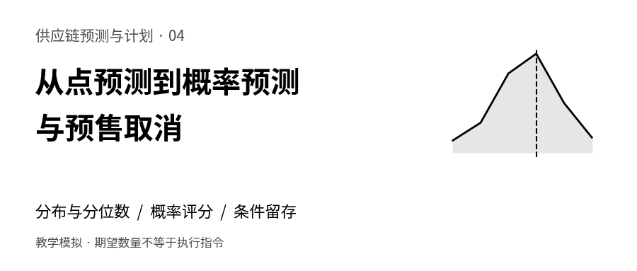
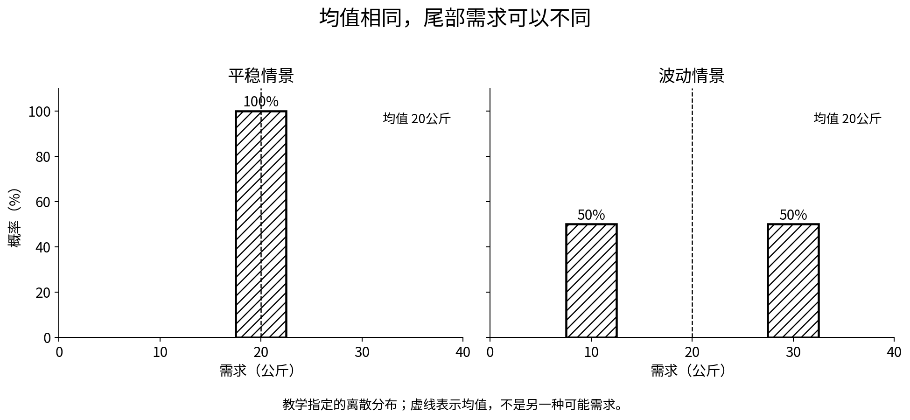
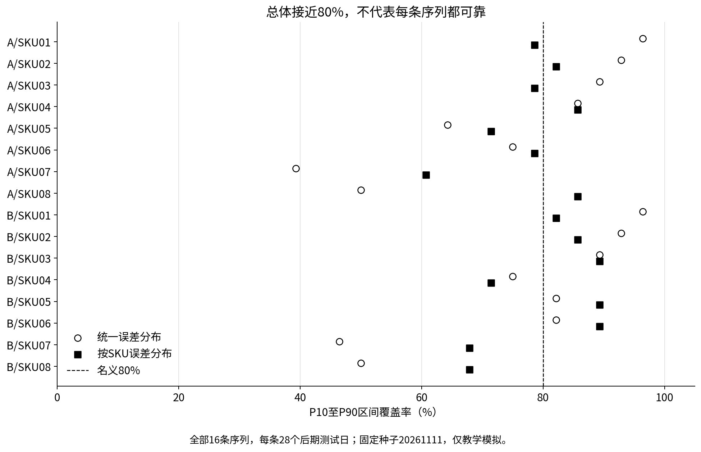
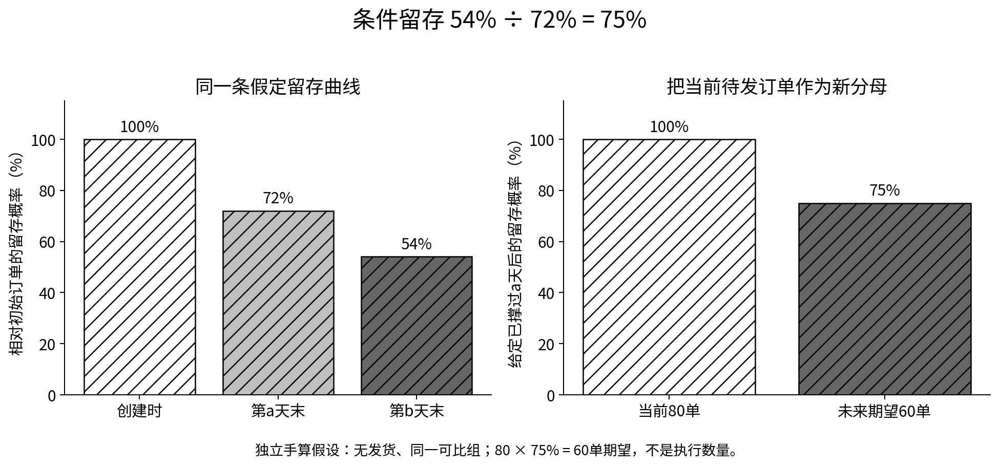
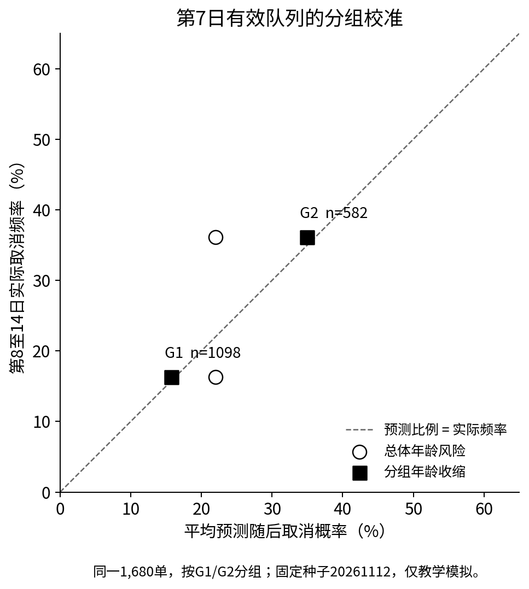

**供应链预测与计划 · 第04篇**



禾味A店的预测表写着“明天鸡腿肉需要20公斤”。采购人员追问：“超过24公斤的可能性有多大？”匿名服装的协同人员也有一个相似的问题：“当前还有80单没取消，等到面料到齐时，预计还剩多少？”

第三篇已经能把特征代入模型，得到一个数量。这一篇继续往前走：数量会变化，订单会退出，决策需要知道哪些变化已被模型描述，哪些仍然没有依据。我们先把一个数扩展成一组可能结果，再学习怎样评价概率，最后把每天的取消风险接成一条条件留存曲线。

读完后，你应当能做三件具体的事：解释P90与“九成把握”的适用条件；从当前仍待发的订单出发计算未来留存，而不重复扣减过去的取消；用独立测试结果判断概率输出是否值得继续使用。这里仍然不生成采购单或排产指令。

**全部企业、数量、订单、日期和实验结果均为教学模拟。**禾味是虚构餐饮连锁，沿用A、B两店及8个食材SKU；服装场景保持匿名。主实验没有真实客户数据，也没有经过真实业务验证的准确率或经营收益。本文的新实验与前三篇各自独立，不把公开模拟测试段称为盲测集。

文章承接[第三篇 多特征预测](https://12lab.cn/topics/forecasting/03-regression-and-features/)，重新组织[预测课堂的概率预测](https://12lab.cn/forecast/legacy-7/)与[预售取消](https://12lab.cn/forecast/legacy-10/)内容。阅读只需要四则运算、百分比和函数概念；连乘与分位数会逐步展开。

## 1 先分清我们究竟在预测什么

下面两句话都含有“预测”，答案却不属于同一种对象。

- 禾味：明天A店SKU01的净耗用量是多少公斤？实际答案可以是19.6公斤，也可以是23.2公斤。
- 服装：一张目前尚未取消且未发货的订单，会不会在下一等待日取消？实际答案只有发生与未发生，可以分别记为1与0。

第一句要描述一个数量的分布。第二句要给一个事件的概率。前者可以输出P10、P50、P90，后者可以输出0.12，但不能把“取消概率0.12”写成“取消0.12件”。只有在明确订单数、每单件数和时间范围以后，概率才能转换成预计数量。

本文用大写D表示还没发生的随机需求，用小写d表示某次实际发生的需求，单位都是公斤。随机并不意味着没有规律，而是站在预测起点时，结果还未确定。p表示事件概率，没有单位，范围为0到1；12%在公式中写成0.12。

预测始终附带信息条件。例如“今天18:00已知的信息下，预测明天全天”，不同于“明天午餐结束后，再预测当天剩余时间”。天气预报版本、促销确认时间、订单当前年龄都必须与这个起点一致。不能在概率模型中补入事后实际气温或最终取消原因。

## 2 一个均值可以对应很不一样的风险

先做一张与后面的程序数据分开的手算表。假设有以下两个需求情景，每个情景的概率都由我们人为指定。

<div class="regression-table-scroll" role="region" aria-label="可横向滚动的数据表" tabindex="0">

| 需求情景 | 可能需求及概率 | 均值 | P50 | P90 |
| --- | --- | ---: | ---: | ---: |
| 平稳情景 | 20公斤，概率100% | 20公斤 | 20公斤 | 20公斤 |
| 波动情景 | 10公斤，概率50%；30公斤，概率50% | 20公斤 | 10公斤 | 30公斤 |

</div>

均值按“每种数量乘相应概率，再相加”计算：波动情景为10×0.5＋30×0.5＝20公斤。概率合计必须为1，否则这张表还没有完整描述所有可能结果。

P50为什么取10，而不是20？我们采用统一规则：**按需求从小到大累计概率，第一次达到或超过目标比例的位置，就是该分位数。**累计到10公斤已经达到50%，所以按这一定义P50＝10；累计到30公斤才达到90%，所以P90＝30。离散分布的其他中位数定义可能允许10至30之间的值，本篇统一采用上述“首次达到”的分位数规则，避免软件约定不同而误判对错。

把目标比例写成τ，读作“tau”。例如τ＝0.9，对应第90百分位数q₀.₉，即P90。下标0.9是概率水平标签，不是把q乘0.9。q和D的单位都是公斤，τ没有单位。

P90＝30的准确含义是：按照这张已指定的分布，需求不超过30公斤的概率至少为90%，而不是恰好90%。这里累计概率从50%直接跳到了100%，因此实际覆盖为100%。如果分布本身只是模型估计，是否接近这个含义，还要拿后来成熟的结果检验。

[](images/01-distribution.png)

图1中的两种情景均值同为20公斤，尾部位置却不同。它提醒我们：把均值报得更精确，并没有自动回答“高需求可能有多高”。这是教学概率表，不是禾味真实分布。

再看一组10个等权历史误差，已经从小到大排序，单位公斤：

−4，−3，−2，−1，0，1，2，3，4，8。

对n个数且0＜τ≤1，本篇的样本分位数取排序后第k个，k＝⌈n×τ⌉。n是样本数；⌈ ⌉表示向上取整，例如⌈2.3⌉＝3；排序位置从1开始。于是P10取第1个，为−4；P50取第5个，为0；P90取第9个，为4。这里明确了算法，不使用默认插值。n很小时，分位数的位置很粗糙，尾部尤其不稳定；计算器算得出不代表信息足够。

## 3 把历史误差接到点预测上

假设一个已经冻结的点预测模型，对某天输出20公斤。我们另留一段没有参与点模型拟合的校准数据，逐日计算：

误差rᵢ＝实际耗用dᵢ−当时点预测mᵢ。

i是校准记录编号；mᵢ是点预测，dᵢ是后来成熟的实际值，rᵢ三者单位均为公斤。正误差表示点预测偏低。上一节的10个数就可作为一组独立教学误差。

对明天的点预测m＝20，加上历史误差的分位数：

qτ＝m＋误差的τ分位数。

因此P10＝20−4＝16公斤，P50＝20＋0＝20公斤，P90＝20＋4＝24公斤。这是一个简单的经验误差分布方法。它保留了原点模型，再估计点模型过去会偏到哪里；没有训练神经网络，也没有假定误差一定是正态分布。

这一步真正依赖的是可比性：校准期误差，能否代表预测对象未来的误差？鸡蛋液与大米的波动尺度可能不同；平日与促销日也可能不同。把它们的误差混在一起，虽能得到更多样本，却可能把“小波动商品区间过宽、大波动商品区间过窄”一起平均掉。

P10到P90通常称为**名义80%的中心预测区间**，因为90%−10%＝80%。它描述未来一个实际结果的范围，不是均值估计的置信区间，也不表示“模型有80%的概率正确”。在离散或经过取整的数据中，端点堆积可能使实际覆盖偏离80%。这是预测分布的范围，不是承诺；预测区间的概念可参见[FPP3关于分布预测的说明](https://otexts.com/fpp3/toolbox.html#distributional-forecasts-and-prediction-intervals)。

还要分清两个动作：用校准段估计区间，与在测试段评价区间。前者已经使用了校准答案；不能再把这段成绩包装成“完全没看过答案”。如果看测试结果后调整误差分组、分位数水平或区间宽度，就需要新的后续数据检验新方案。

## 4 怎样判定一个概率区间有没有用

区间不是画得越窄越好。我们同时看三个角度。

**第一，覆盖了多少。**对于每条测试记录，若实际d落在P10至P90之间，含两个端点，记1；否则记0。把这些0和1加起来，再除以测试记录数n，就是区间覆盖率。

覆盖率＝区间内的记录数÷n。

若100条成熟记录中有79条落在区间内，覆盖率就是79%。这只是这100条的观测频率；它不是未来每一天都有79%的服务保证。相邻日期或同店多个食材可能相关，不能把全部行数当作同样多的独立证据。

**第二，区间有多宽。**每条宽度＝P90−P10，单位公斤；再把所有宽度取平均。报[0，100万]很容易覆盖需求，却几乎不给采购人员有用的信息。先看覆盖是否合理，再讨论能否在保持覆盖的同时缩窄范围。

**第三，分位数的位置合不合适。**设误差e＝实际d−预测分位数qτ，分位数损失Lτ分两种情况计算：

- e≥0，说明预测偏低或刚好相等，Lτ＝τ×e。
- e＜0，说明预测偏高，Lτ＝(1−τ)×(−e)。

“≥”读作“大于或等于”；−e在第二种情况下是正的差距。Lτ与e、qτ、d具有相同数量单位，本例都是公斤。L是评价分数，没有自动变成金额。若要解释成缺货与过量成本，必须另外明确成本参数和决策条件。

令τ＝0.9，实际100公斤、预测80公斤：e＝20，损失0.9×20＝18公斤。若预测120公斤，e＝−20，损失0.1×20＝2公斤。相同20公斤偏差，P90更重罚低估，因此把上尾放高有理由；但无限放高仍会累积损失。τ＝0.5时，损失恰好等于绝对误差的一半。定义与例子可核对[分位数损失官方说明](https://scikit-learn.org/stable/modules/generated/sklearn.metrics.mean_pinball_loss.html)。

程序会分别报告P10、P50、P90的平均损失，再给三者的等权平均。这里“三者等权”是本篇固定的汇总方式，不是通用业务权重。还会检查P10≤P50≤P90，避免出现上尾反而低于中位数。

整体成绩之外，至少按门店、SKU、平日与周末拆开看。分组后样本更少，需要同时显示分母。覆盖率从79%变成81%，可能只是少数几天变化，不能单凭两个百分点宣布改进已经可靠。

## 5 用禾味数据跑一次完整的概率预测

本次新增114天独立模拟数据，从2026年1月5日至4月28日，共114×2×8＝1,824行，仍是16条序列，不是1,824天历史。8个食材依次为鸡腿肉、大米、小麦粉、食用油、鸡蛋液、土豆、胡萝卜和白菜，单位统一为公斤净耗用。主样本设定每天营业、记录完整且无缺货，因此不需要从受库存限制的销量反推潜在需求。

生成器固定种子20261111。每个SKU有不同基础量与波动尺度，B店有门店差异，周末增加固定量；每天还加入跨商品共同扰动、各自扰动和少数正向冲击。测试期另给B店SKU08增加4公斤的模拟变化，专门观察旧误差分布遇到变化时的表现。所有规则公开，但预测函数不会读取生成器的基础量、波动参数或未来冲击。

**时间按先后切开，标签还要等成熟。**每天的预测起点为前一日北京时间18:00，实际净耗用到目标日次日09:00才可用。

<div class="regression-table-scroll" role="region" aria-label="可横向滚动的数据表" tabindex="0">

| 用途 | 目标日期 | 天数 | 行数 |
| --- | --- | ---: | ---: |
| 点模型训练 | 1月5日至3月1日 | 56 | 896 |
| 成熟空档 | 3月2日 | 1 | 16 |
| 误差校准 | 3月3日至3月30日 | 28 | 448 |
| 成熟空档 | 3月31日 | 1 | 16 |
| 后期测试 | 4月1日至4月28日 | 28 | 448 |

</div>

点模型在3月2日18:00冻结，此时3月1日标签已到达；区间参数在3月31日18:00冻结，此时3月30日标签已到达。两个空档的目标值不参与训练、校准或测试评分。测试期间模型不更新，只每天依据提前已知的日历发出次日预测。这样避免了把尚未到达的上一日全天结果塞进当天18:00的模型。

点模型特意保持简单：分别求“门店×SKU×平日/周末”的训练均值，共32个均值。它等价于给每个组合单独一个常数预测，不是重用第三篇已经训练的多特征模型。本文把复杂度留给概率输出的检查。

在同一个点模型上，预先规定三个输出方法：

- **点预测当作零宽区间**：P10、P50、P90全等于点预测。这是故意设置的诊断对照，不声称它是合格概率模型。
- **统一误差分布**：把448条校准误差合并，取同一组P10、P50、P90偏移量。
- **按SKU误差分布**：每个SKU使用两店合计56条校准误差，得到8组偏移量。门店与周末均值已在点模型中区分，但误差分布仍未按它们细分。

输出数量下限设为0，即max(0，点预测＋偏移量)，max表示取两者较大值。这是非负耗用的输出约束，不是校准保证。三个方法使用完全相同的测试目标，不在看过成绩后改选测试日期。

以下是程序实际运行的448条测试结果，表中仅为显示而四舍五入。

<div class="regression-table-scroll" role="region" aria-label="可横向滚动的数据表" tabindex="0">

| 方法 | P10至P90覆盖 | 平均区间宽度 kg | P50平均损失 kg | 三分位平均损失 kg |
| --- | ---: | ---: | ---: | ---: |
| 零宽诊断对照 | 0.00% | 0.000 | 1.4831 | 1.4831 |
| 统一误差分布 | 75.45% | 8.633 | 1.4809 | 1.0242 |
| 按SKU误差分布 | 79.02% | 8.893 | 1.5203 | 0.9713 |

</div>

按SKU区间覆盖了354÷448＝79.02%的记录，统一区间覆盖338÷448＝75.45%。前者区间稍宽，三分位平均损失较小，但P50损失反而更大。两者的点模型本来相同，点均值的MAE都为2.9663公斤；区间方法没有改善这个点预测。

还不能把79.02%写成“已经保证80%”。按SKU方法的P90单边覆盖只有87.28%，低于名义90%；P10单边覆盖为8.26%。这里单边覆盖的分母也是448，计算的是实际值≤该分位数的比例。边界是否包含等号须保持一致，尤其不能在有重复值时用两项单边覆盖简单相减，代替直接计算双边覆盖。

最差门店商品组合恰好是A店SKU07，不是人为加入漂移的B店SKU08。A店SKU07的28天中，统一区间仅覆盖11天，即39.29%；按SKU后覆盖17天，即60.71%。这说明失败不一定只发生在我们预先标记的压力场景。共同扰动、少量尾部样本、门店差异与有限样本都可能影响结果，不能从这28天唯一归因。

[](images/03-hewei-coverage.png)

图2展示全部16条序列，每条28个测试日。虚线是名义80%，不是统计显著性门槛。图表与outputs/hewei_metrics.csv使用同一批结果；文件还保留SKU、门店、平日/周末分组和每个分位数的损失，不只保留平均值。

平日320条中，按SKU区间覆盖80.31%；周末128条中只覆盖75.78%。分母和条件不同，整体79.02%仍然会掩盖这种差异。

这套方法可以作为概率预测的起点，但没有给出任意时间序列的有限样本覆盖保证，也没有估计参数不确定性或多日联合分布。看到失败后，可以提出分组、滚动更新或加入新特征的改进，但需要另留后续数据，不能在这448条上反复调整后仍称其为独立测试。

## 6 订单概率应该怎样打分

需求量有很多种可能值，单个订单的取消结果只有0或1。假设我们对四张订单给出“下一等待日取消”的概率，并且四张都已经完整观察到该日结束：

<div class="regression-table-scroll" role="region" aria-label="可横向滚动的数据表" tabindex="0">

| 订单 | 取消概率p | 实际结果z | 平方误差(p−z)² |
| --- | ---: | ---: | ---: |
| A | 0.8 | 1 | 0.04 |
| B | 0.2 | 0 | 0.04 |
| C | 0.6 | 0 | 0.36 |
| D | 0.4 | 1 | 0.36 |

</div>

这里z＝1表示在规定窗口取消，z＝0表示在整个规定窗口内未取消；窗口尚未结束的订单不能先填0。Brier评分就是四个平方误差的平均：

Brier＝[(0.8−1)²＋(0.2−0)²＋(0.6−0)²＋(0.4−1)²]÷4＝0.20。

平方表示一个数乘自己，例如(−0.2)²＝0.04。一般写为Brier＝Σ(pᵢ−zᵢ)²÷n，其中Σ表示逐条相加，n是可评分记录数且必须大于0；这个二分类评分没有单位，越小越好。若四条全报0.5，每条平方误差0.25，平均也是0.25。这个四行例子只帮助理解运算，不是模型有效性的验证。[Brier官方定义](https://scikit-learn.org/stable/modules/generated/sklearn.metrics.brier_score_loss.html)也强调需要使用概率，而不只是0/1分类。

概率还要检查校准。把相近预测概率放在一组，同时列出样本数、平均预测概率、实际取消比例。例如平均报0.20的一组有100单，其中18单取消，我们就比较20%与18%。一个订单的实际结果不可能等于0.20，所以不能拿一张单判断概率是否校准。

Brier变小并不等于每个分组都校准好了。它同时受多种因素影响；始终报总体取消率的模型，有可能在整体上不偏，却无法区分不同风险订单。应在同一批可评分样本上比较基线，并查看分组校准图，不能只保留一项平均成绩。相关区分见[概率校准说明](https://scikit-learn.org/stable/modules/calibration.html)。

至于“超过某个取消概率就催单或改排产”，那是另一个决策。它需要动作成本、错误干预损失与真实行动效果。本文没有估计催单能降低多少取消，也没有执行任何订单动作。

## 7 预售取消的分母每天都会变

继续使用匿名服装的独立手算批次：初始100单，每单1件；第1天取消10单，剩余订单中20单于日末发货；第2天取消7单，没有新增、部分取消、退货或强制关单。

<div class="regression-table-scroll" role="region" aria-label="可横向滚动的数据表" tabindex="0">

| 等待日 | 日初仍待发R | 当天取消C | 当天日末发货H | 日末仍待发 | 当天取消比例 |
| --- | ---: | ---: | ---: | ---: | ---: |
| 第1天 | 100 | 10 | 20 | 70 | 10÷100＝10% |
| 第2天 | 70 | 7 | 0 | 63 | 7÷70＝10% |

</div>

R叫风险集，是当天开始仍处于我们定义的取消风险中的订单数。C、H、R的单位都是单。同一张订单不能既算取消又算发货；本表明确按先取消、再在日末发货的顺序处理。

下一天风险集＝今天风险集−今天取消−今天发货。

第2天分母是70。用7÷100得到7%，回答的是“第二天取消占初始100单多少”，没有回答“当前仍待发订单今天的取消概率”。若当天风险集为0，C÷R没有定义，不能填0来表示以后肯定没人取消。

把等待年龄记为t，第t天的条件取消概率写成hₜ。下标t只表示第几天，hₜ没有单位。用历史计数估计时，写作ĥₜ＝Cₜ÷Rₜ；帽子表示估计，不是已知真概率。本文使用按天的条件事件概率，英文常称discrete hazard，不能直接当作连续时间瞬时风险率，也没有拟合Cox模型。

再换到**没有发货、没有观察中断的独立手算情景**，并人为假定前两天h都为0.1。令S(t)表示从创建时起一直未取消至第t天末的概率，规定S(0)＝1：

S(1)＝1−0.1＝0.9。

S(2)＝(1−0.1)×(1−0.1)＝0.81。

一般地，S(t)＝(1−h₁)×(1−h₂)×…×(1−hₜ)。省略号表示把中间各天都接着乘。每个h都是“此前还没取消的条件下，今天取消”的概率，所以连乘来自条件概率，不需要再假设每天取消事件彼此独立。每天都可能发生取消，但一张单取消后就退出，不能再次取消。

S是概率，不是订单数量。100单乘0.81得到81单期望，属于这个无发货情景；前面的手算事件账的日末待发是63单，不能用81替换63。

## 8 已经等过的日子不要再扣一次

协同人员现在看到80张有效待发订单，它们都已等到第a天末。我们要估计继续等到第b天末还会留下多少，且b≥a。

假设对这批条件相同的订单，适用的无发货留存曲线给出S(a)＝0.72，S(b)＝0.54。这两个值是独立手算假设，不是上一节100单批次的观测结果。撑过b天的订单一定已经撑过a天，因此从a到b的条件留存概率是：

p＝S(b)÷S(a)＝0.54÷0.72＝0.75。

要求S(a)＞0，不能除以0。当前80单已经通过前a天的筛选，不应再次承担那一段已发生的取消。这里另外假定，给定当前已知信息后，这80单每单未来留存概率都适用0.75，因此模型预计为：

E(N_b｜N_a＝80)＝80×0.75＝60单。

E表示期望，即相同条件重复出现时的平均数量；N_a、N_b分别表示a、b两时点的留存数量；竖线表示“已知当前条件”。若误算80×0.54＝43.2，就是把前a天风险重复扣了一遍。

[](images/02-conditional-survival.png)

这条计算还要求当前订单和用于估计曲线的历史订单，在使用的分组及信息条件下可比。当前已经得知工厂延期，旧曲线却没有这种状态，不能只因分母写对就相信预测有效。

若订单年龄、品类或承诺时间不同，应分别算概率再相加。第i单仍需vᵢ件，条件留存概率为pᵢ，则预计保留件数＝Σvᵢpᵢ。例如10单各1件、p＝0.8，另外5单各2件、p＝0.6，合计10×1×0.8＋5×2×0.6＝14件期望。不能只数15单再随手乘一个取消率。

期望相加不要求订单彼此独立，但**总件数的分布和P90需要订单间的相关结构**。一次共同延期可能让许多订单同时取消；只掌握每单p，还不够算批次尾部。每日P90、各SKU的P90也不能一般性地直接相加成合计P90。

本篇只计算指定情景下的期望。剩下60单，不等于今天就该裁剪60件：已裁片、共用面料、最小批量、尺码组合、交期和允许追加的时点，都属于后续计划层。

## 9 发货以后观察不到的取消不能凭空补回来

我们真正关心的可能是两个不同问题：

1. 按照实际发货安排，未来某日还有多少订单仍在等待？
2. 假如先不发货，这些订单还会有多少没有取消？

第一个问题需要同时描述取消、发货以及其他退出事件；第二个问题是一个无发货情景。在真实订单中，一旦发货，这张单通常不再暴露于同一种“发货前取消”风险；后来的退货属于另一个事件。

把观察结束前尚未发生目标事件的情况称为右删失。发货若作为无发货取消过程的删失处理，需要额外的识别前提：在所用信息条件下，提前发货不能继续挑走隐藏的高风险或低风险订单。例如客服优先给快要取消的人发货，剩余等待池就会被筛选；简单连乘剩余人的取消比例，并不能还原“如果大家都不发货”的曲线。

“把发货行删掉再训练”不能解决这个问题。按已知特征分组也不能证明没有遗漏的差异。删失记录可以贡献仍被观察期间的风险信息，但不能被标成“整个未来都不会取消”。生存分析的观察边界可参考[NIST关于风险集与删失的说明](https://www.itl.nist.gov/div898/handbook/apr/section2/apr215.htm)。

因此本篇的服装主实验主动缩小范围：每单只观察创建后14个完整等待日，期间不发货，未取消者到14日终才统一结束观察。超过14天的自然取消风险没有被估计。另附的发货小账只验算事件守恒，不借它证明真实删失可忽略。

规定第60天强制关闭订单，也是规则事件，不等同于消费者自然取消。不能把强关写进自然风险曲线，然后解释为“用户到第60天全部失去耐心”。模型没有数据支持的年龄，应返回不可估计，而不是继续画出光滑尾巴。

## 10 在模拟订单上估计风险再检查留存

服装主实验固定种子20261112，生成71个日创建批次，每批80单，合计5,680单。每单1至3件，整单取消，不拆单；每个订单从创建时起观察14个完整24小时等待日，所以“第1日末”是创建后24小时，不必对应自然日午夜。分组G1、G2是下单时已知的匿名业务类别，没有真实品牌与个人属性。

生成规则人为让G2的取消风险更高，且不同等待年龄的概率不同。这个差异是教学设定，不是从真实服装业务发现的规律。两组都有完整观察，没有依据模型预测提前发货。

- 1月1日至1月28日创建的2,240单用于训练。
- 1月29日至2月12日创建的1,200单留作成熟空档，不参加拟合或评分。
- 2月13日至3月12日创建的2,240单用于后期测试。

每个训练订单的14日结局成熟以后，模型才在2月12日18:00冻结；所有测试结局等到3月28日18:00再统一评价。当前年龄状态在评分时可见，最终取消年龄只用于构造历史风险表和事后标签，不能作为预测特征。

先按年龄统计训练风险集和取消数，得到总体年龄概率h₀。再计算G1、G2各自的分龄概率。小组样本少时，直接用C÷R容易很不稳定，本篇采用一个固定的收缩规则：

分组估计h＝(C＋m×h₀)÷(R＋m)。

C是该组该等待日的取消单数，R是风险单数，h₀是同年龄总体估计概率；m表示参考总体的等效样本强度，单位按“单”理解，不是真实增加的订单。分子也是等效取消单数，分子除以分母才得到无单位概率。本实验预先固定m＝20，不通过验证或测试结果选择m，因此不声称20是最优值。

另做一组独立手算：若小组R＝2、C＝1，总体h₀＝0.1，暂取m＝8，则h＝(1＋8×0.1)÷(2＋8)＝0.18。它介于小组50%与总体10%之间。m越大越靠近总体，但若总体本来不适合该组，多借信息也可能更差。m＝8只属于手算，不能与程序的20混用。

程序比较两个预先确定的方法：所有组共用总体年龄风险；分组年龄风险向总体收缩。两者都从训练计数估计，都是离散风险表，没有训练logistic回归或Cox。某组某年龄没有风险样本时，本包选择拒绝给出该处及后续概率，即使公式中m大于0也不自动借总体掩盖缺乏支持；这个保守规则与收缩公式的数学可计算性是两件事。

本篇重点评价“已等过7天，继续等到第14天”的预测。测试批次中，2,240单有1,680单活过第7日末。这1,680单组成两模型共同的评分集合，不把已取消的560单重新放回分母。它们分别在各自创建后第7日评分，跨不同创建日汇总，不是一张同日实时待发清单。

<div class="regression-table-scroll" role="region" aria-label="可横向滚动的数据表" tabindex="0">

| 方法 | 当前有效订单 | 预测随后取消的Brier | 预计第14日仍留存 | 实际第14日留存 |
| --- | ---: | ---: | ---: | ---: |
| 总体年龄风险 | 1,680单 | 0.178065 | 1,310.28单 | 1,291单 |
| 分组年龄收缩 | 1,680单 | 0.169143 | 1,304.00单 | 1,291单 |

</div>

1,304.00仍然是期望，不是执行后必然出现的整数。它由各组当前单量乘各自S(14)÷S(7)后相加得到。总体模型预测随后取消比例22.01%，实际为389÷1,680＝23.15%；分组模型平均预测22.38%。这个模拟测试中，分组模型Brier较小，但这不证明其在新业务中可迁移，更不证明改用它能减少389单取消中的任何一单。

校准不能只检查总计。对同一第7日有效队列，G1有1,098单，分组模型平均预测随后取消15.73%，实际16.30%；G2有582单，平均预测34.92%，实际36.08%。两组仍都有差距。分组只是两个固定概率群，在本例中还不能说明对每个订单都实现了细粒度个性化。

[](images/04-apparel-calibration.png)

图4在同一1,680单队列上比较两模型。总体年龄模型给两组相同概率，整体接近不代表各组接近；虚线仅表示预测比例与观测频率相等，不是误差容忍带。

包内另报告创建时至14日的评分，以及每日仍在风险订单日的评分。后者同一订单会贡献多个日记录，不能把24,124个风险订单日当作24,124个独立订单。每日Brier与7日至14日的Brier预测窗口、发生率、样本都不同，不宜横向比较大小来宣布哪个任务更好。

outputs/apparel_training_risk_table.csv保留各年龄分母，apparel_survival.csv保留风险与留存，apparel_horizon_predictions.csv保留逐单概率和事后标签，apparel_conditional_counts.csv保留期望与实际数量。当前1,680单对应3,425件；分组模型预计第14日保留2,656.43件，实际保留2,628件。配套数量表同时保留单数和件数，分别核对，不与物理可用库存混账。

## 11 把结果交给协同时还要带上哪些说明

技术输出只写“60”会丢失最重要的条件。一个最小交接记录至少应当包含下面的信息。

<div class="regression-table-scroll" role="region" aria-label="可横向滚动的数据表" tabindex="0">

| 字段 | 禾味示例口径 | 匿名服装示例口径 |
| --- | --- | --- |
| 预测对象与单位 | 门店×食材，公斤净耗用 | 当前有效待发订单，单或件 |
| 信息起点 | 前一日18:00，保留版本 | 当前年龄与该时点可见状态 |
| 预测窗口 | 指定下一营业日 | 当前日末至指定未来日末 |
| 输出含义 | P10、P50、P90及点预测 | 条件留存概率与预计件数 |
| 关键假设 | 耗用完整可见，校准误差可迁移 | 当前订单可比，14日内无发货 |
| 验证范围 | 后期测试及SKU分组结果 | 同一风险集的Brier及分组校准 |
| 不能直接推出 | 采购量、满足率、真实节省 | ATP承诺、裁剪量、真实催单效果 |

</div>

采购与生产同事可以据此追问：什么时候还允许追加？现有库存是否已经分配给别的单？交期是否稳定？一张单取消后，裁片能否用于其他尺码？问题需要继续向计划层展开，而不是把概率表直接改名成采购表。

同样地，P90不是“满足90%的需求量”。“有多少个周期不缺货”与“满足多少单位需求”是不同分母；库存政策、提前期和缺货处理没有进入模型时，二者都没有被测量。本篇到此只把不确定性与订单状态说清，为下一步库存和约束决策准备输入。

## 12 自己复算一次再交卷

配套练习包使用Python 3.10或更高版本，核心实验与测试只用标准库，不连接网站、不访问生产系统。解压后先阅读README，再运行：

```text
python3 run.py
python3 -m unittest discover -s tests -v
```

Windows可把python3换成py。运行结果写入包内outputs；重新生成输入的命令和覆盖范围见README。改动前复制练习包，避免覆盖自己的练习结果。

先不看答案，完成以下六项：

1. 将波动需求改为10公斤概率80%、60公斤概率20%，算均值、P50和P90。为什么均值仍可能与P50不同？
2. 对排序误差[−4,−3,−2,−1,0,1,2,3,4,8]，手算P20、P80，再接到点预测20公斤上。写出使用的排序位置规则。
3. 实际100公斤，分别预测90与110公斤，计算P90损失。解释为什么差距相同，分数却不同。
4. 把四张订单的概率全改成0.5，复核Brier。若只预测“取消或不取消”，会丢掉什么信息？
5. 当前40单已撑过第5天，S(5)＝0.8，S(10)＝0.6。计算第10天预计留存。说明为什么不能直接用40×0.6。
6. 找出实验中一个分组表现不佳的地方，写下分母和可能原因。提出一个需要下一批数据验证的修改，不把已经看过的测试段再次当作新验收。

参考答案：第1题均值20公斤、P50＝10、P90＝60；第2题P20误差−3、P80误差3，对应17与23公斤；第3题损失分别9与1公斤；第4题Brier＝0.25，分类标签丢掉判断强度；第5题40×0.6÷0.8＝30单。第6题没有唯一答案，但必须保留失败与限制，不能只挑好看的组。

验收时，除了脚本退出成功，还要能回答：概率的事件与时间窗口是什么，分位数采用什么约定，分母由谁组成，标签何时成熟，以及哪些数量只是期望、还不能执行。计算正确与业务可用之间，就隔着这些需要逐项说明的条件。

## 资料与复现边界

[下载完整文章与可复现实验](downloads/forecasting-04-complete.zip)（含离线阅读页、全部数据与代码），也可[单独下载实践包](downloads/forecasting-04-practice.zip)。

本篇配套提供文章源文件、离线阅读页、黑白图及可编辑SVG、CSV输入与输出、生成代码和自动测试。前文的手算概率表与大样本实验分别标注，所有程序成绩均取自本次运行，没有替换成理想值。

本文没有完成多步联合需求分布、真正的时间序列覆盖保证、竞争风险估计、信息性删失校正、Cox或离散logit训练，也没有库存优化、真实协同系统连接和收益评价。模型名称应当按实际代码能力填写，不能把“计划以后实现”计入当前成果。

继续阅读时可返回[专题目录](https://12lab.cn/topics/forecasting/)，或查看教程的[概率训练与校准](https://12lab.cn/forecast/legacy-9/)及[预售取消完整工程与边界](https://12lab.cn/forecast/presale-full/)。教程工程覆盖更长年龄与发货情景，本篇采用更小的独立实验，便于读者把每一项计算检查到底。
