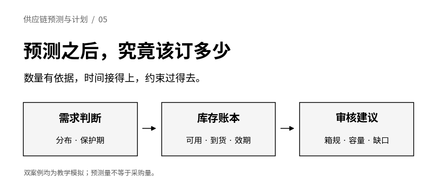
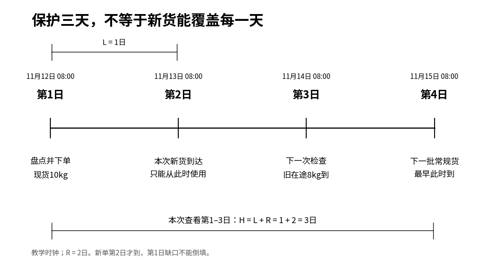
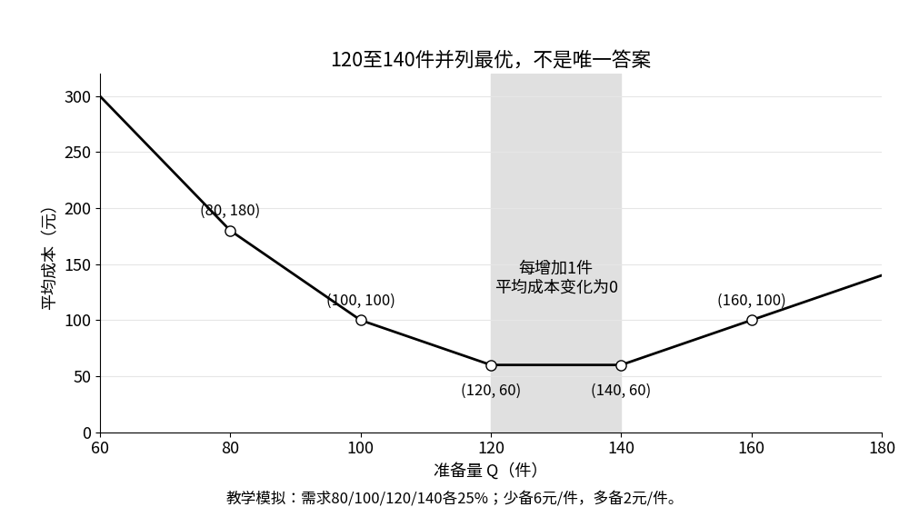
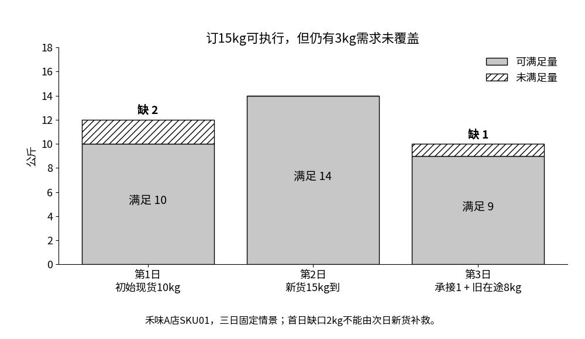
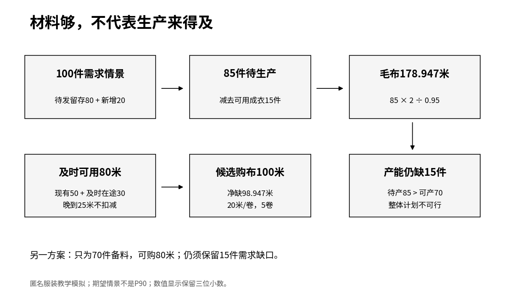

<strong>供应链预测与计划 · 第05篇</strong>



承接[第04篇：从点预测到概率预测与预售取消](/topics/forecasting/04-probability-and-presale/)，上一篇把“明天大概用多少”扩展成了需求分布，也算过待发订单的条件留存。接下来，采购人员仍会问：“所以，这次到底订多少？”

这个问题不能把预测表抄一遍就回答。仓库里还有货，在途货可能晚到，旧批次可能先过期，供应商按整箱卖，冷柜也未必放得下。服装企业更要往后看：布够了，生产线能按时做完吗？

这一篇只做一件事：<strong>把一个有条件的需求判断，转成带有库存账、约束检查和未解决缺口的建议。</strong>先用简单模型理解取舍，再故意给它增加会使公式失效的条件。计算得到一个数，与这个数能执行，是两次不同的验收。

<strong>全文企业、订单、日期、成本与结果均为教学模拟。</strong>禾味沿用虚构两店、8食材SKU的背景，本篇实际回放仅为A店鸡腿肉SKU01，不声称已验证16条序列。服装只取一个匿名款码。它们都是独立小实验，不是前三篇或第四篇数据的延长，不训练新预测模型，不评价真实收益，也不是盲测。后面的需求路径是提前指定的情景，不是程序偷读到的未来答案。

本文承接[第四篇：概率预测与预售取消](https://12lab.cn/topics/forecasting/04-probability-and-presale/)，衔接[预测课堂的概率与库存决策](https://12lab.cn/forecast/legacy-7/)、批次效期和物料计划练习。只需四则运算、百分比和简单不等式。每个公式都先说明它回答什么，再代入数字。

## 1 先决定要保护哪几天

如果今天下单，明天到货，为什么不能只预测明天？因为今天到下一批货真正可用之前，都可能消耗库存。需要同时知道两个时间。

- <strong>L：补货提前期。</strong>从本次下单，到这批货可以使用，隔多久。
- <strong>R：检查间隔。</strong>隔多久才有下一次常规下单机会。

在固定提前期、定期检查并补至目标的简化设置里，保护期H＝L＋R。H是本次库存计划需查看的时间窗口，不是货物保质期。连续检查的订货点通常着眼于提前期L，不能把两种策略的公式任意互换。

禾味本篇在11月12日08:00、第1日开门前完成盘点并下单。L＝1个完整日，新单第2日08:00到。R＝2日，下次常规检查在第3日08:00，那次订单第4日08:00才到。因此本次要查看第1、2、3日，H＝1＋2＝3日。没有第1日可用的临时加急渠道。

这套日界线很重要。如果供应商午后才送到，而午餐前就要用完，把它记成“当天有到货”仍会算错。真实数据应精确到业务需要的时刻，本例为便于手算，统一为开门前到货、当天耗用、闭店处理到期批次。

[](images/01-protection-window.png)

设D₁、D₂、D₃是这三天尚未发生的需求量，单位公斤；下标只是第几天。保护期累计需求为D(H)＝D₁＋D₂＋D₃。要决定风险缓冲，需要的是<strong>这三个量相加后的分布</strong>，而不只是三个各自的P90。

## 2 每天的P90不能直接相加

下面另造10条等权三日路径，每条概率10%。路径不是10个真实营业周期，而是我们完整指定的10种未来。

<div class="regression-table-scroll" role="region" aria-label="可横向滚动的数据表" tabindex="0">

| 路径 | 第1日 kg | 第2日 kg | 第3日 kg | 三日合计 kg |
| --- | ---: | ---: | ---: | ---: |
| 1 | 30 | 10 | 10 | 50 |
| 2 | 10 | 30 | 10 | 50 |
| 3 | 10 | 10 | 30 | 50 |
| 4—10，各一条 | 10 | 10 | 10 | 每条30 |

</div>

沿用第四篇的定义：把数量从小到大排列，累计概率第一次达到或超过90%的数量，叫P90。

每一天都有9条路径需求10公斤，1条需求30公斤。累计到10已经是90%，所以三天各自的P90都是10。直接相加得到30公斤。

但先逐条相加，三日合计只有7条为30、3条为50。累计到30只有70%，到50才达到100%，因此<strong>累计需求P90＝50公斤</strong>。两个操作的先后顺序不能交换：先相加再取分位数，不等于先取分位数再相加。

本例高峰互斥，依赖关系已写在同一行的三个数里。相反，其他依赖结构下，逐日分位数相加也可能过高。因此不能把“直接相加”一概称作保守做法。实践中需要保留同一情景内的日期关系；只有各天的P90，没有联合信息，就不能据此唯一恢复累计P90。

均值另当别论。每天均值为0.9×10＋0.1×30＝12公斤，三日均值为36公斤，也等于0.7×30＋0.3×50。均值可以这样相加，不要求三天独立；但均值36并不能代替累计P90的50。

## 3 选P50、P75还是P90，要先说清取舍

“越保险越好”不是完整目标。若少备会失去订单，多备又会报损，两种后果都要计算。我们先离开多日补货，单独建立一个能完全手算的<strong>单周期报童模型</strong>。

这个模型只有一次准备机会，全部准备量在需求发生前可用；没有中途补货、箱规、容量和提前期变化。只考虑数量导致的线性少备与多备损失，风险中性，即比较平均成本。它不是稍后禾味多日场景的通用最优解。

设Q是准备量，D是本周期需求，单位件。少备一件的增量损失Cᵤ＝6元/件，多备一件的净损失Cₒ＝2元/件。u与o分别标记少备和多备，不是乘号。它们是教学成本，不能直接拿售价当缺货损失，再把毛利和采购成本重复加进去。

先定义两个容易算的量：

- 少备量＝max(D−Q，0)。max取较大者，实际需求少于准备量时，少备为0，不能为负。
- 多备量＝max(Q−D，0)。只计算超过需求的部分。

于是一次情景的成本为：

<strong>成本＝Cᵤ×少备量＋Cₒ×多备量。</strong>

件乘元/件，结果是元。准备120、需求140时，少20，成本6×20＝120元；准备120、需求80时，多40，成本2×40＝80元。两个误差大小不同，即使一样大，两侧成本也不相同。

这时对应的目标概率τ＝Cᵤ÷(Cᵤ＋Cₒ)＝6÷8＝0.75。τ没有单位，τ＝0.75对应P75。

为什么是这个比例？不妨比较“再多准备一件”。当需求已经被Q覆盖时，多这一件损失2元；当需求还没被覆盖时，多这一件避免6元损失。若F(Q)表示需求不超过Q的概率，增加一件的平均成本变化就是2×F(Q)−6×[1−F(Q)]。两边恰好平衡时，8×F(Q)＝6，即F(Q)＝0.75。对于整数需求，这个边际比较可直接用于Q到Q＋1；连续需求则是相同的边际思想。

因此，取累计概率第一次达到75%的最小数量，可以得到一个最优准备量。这里说的是“一个”，并不保证唯一。单周期成本假设与临界比例可对照[MIT供应链课程的报童模型讲义](https://courses.edx.org/assets/courseware/v1/5856cf9a448c4ef63de1915a99f7f644/asset-v1%3AMITx%2BCTL.SC1x_1%2B3T2023%2Btype%40asset%2Bblock/W07_L2_Newsvendor_ANNOTATED.pdf)；下面独立算表，不依赖复杂证明。

## 4 算出一个最优量，还要看是否有并列

给需求四种可能：80、100、120、140件，每种25%。累计概率依次25%、50%、75%、100%，所以按前述规则P75＝120件。

<div class="regression-table-scroll" role="region" aria-label="可横向滚动的数据表" tabindex="0">

| 准备量Q | 需求80成本 | 需求100成本 | 需求120成本 | 需求140成本 | 平均成本，元 |
| ---: | ---: | ---: | ---: | ---: | ---: |
| 80 | 0 | 120 | 240 | 360 | 180 |
| 100 | 40 | 0 | 120 | 240 | 100 |
| 120 | 80 | 40 | 0 | 120 | 60 |
| 140 | 120 | 80 | 40 | 0 | 60 |
| 160 | 160 | 120 | 80 | 40 | 100 |

</div>

因为四种情景等权，平均成本就是四格加起来除以4。例如Q＝120时，(80＋40＋0＋120)÷4＝60元。Q＝140也为60元。这不是程序精度造成的并列。

更完整地说，120到140之间的准备量都有相同的平均成本60元；若只允许整数件，就是120、121直到140件。原因是在120≤Q＜140时，F(Q)＝0.75，增加一件的平均成本变化为0。我们的候选表只展示其中两个端点，不能把它误写成“只有120、140两个解”。

[](images/02-newsvendor-cost.png)

并列时可以另定规则，例如选较少的准备量，以减少资金占用。但这是额外偏好，应记录下来，不能说原模型已经算出了唯一答案。若再增加箱规、固定订货费用或容量，便要对真正允许的候选重新计分，不能只把连续解四舍五入。

还要区分两个“服务”指标。Q＝120时，四种情景中三种完全不缺，故不缺货情景概率为75%。平均少备量只有(0＋0＋0＋20)÷4＝5件，平均需求110件；按“期望满足量÷期望需求量”的汇总口径，数量满足率为105÷110≈95.45%。75%与95.45%都正确，分母不同。

这说明P75既不是“只满足75%的数量”，也不是采购动作的无条件保证。上面的概率表、及时到货与库存规则同时成立，才可得到这些数。真实预测分布还要经过后续校准和业务验证。

## 5 把目标库存与新增采购分开

分位数给出的通常是需要准备的目标，不自动等于新买数量。先看一个没有日期冲突的简化账。

设S是补至目标，单位件；OH是可用现货；OO是能按约定参与这次计划的在途；B是已欠交但尚未被需求目标计入的数量。库存位置IP＝OH＋OO−B。对应未受约束的新增量q₀＝max(0，S−IP)。

例：S＝120，现货30，及时在途20，欠交5，则IP＝30＋20−5＝45件，q₀＝120−45＝75件。S是目标120，q₀才是新买75，两列不能同名。

这里有两个条件必须写在表头旁边。第一，S描述的未来需求<strong>不含</strong>那5件旧欠交；若已含，IP就不能再减5，否则重复准备。第二，现货必须真的可用，在途必须按时间进入可用量。已过期、质检隔离、已承诺给别的需求的货不能默认为自由库存；“扣掉承诺量”与“预测已包含这些订单”也要先对账，不能双扣。

传统库存位置把未到货订单一起登记，是一种账面状态。面对迟到货和效期，不能只看一个总数。接下来禾味就会出现：总量公式看上去够，但每天不一定接得上。

箱规也需要单列。若每箱c公斤，q₀＞0且MOQ为最小订购公斤数，满足两者的候选是：

<strong>箱规候选q＝c×⌈max(q₀，MOQ)÷c⌉。</strong>

⌈ ⌉表示向上取整，如⌈3.2⌉＝4。如果q₀＝0，通常允许不下单，即q＝0，而不是被MOQ强迫订货。这个计算只处理数量规格，还没核对容量、到期和费用。采购量不必总是向上取整后的那个数，也可以在可行数量中比较并保留剩余缺口。

## 6 禾味：三日总量够，第一天仍然会缺

现在回到第1节的三日时钟。为把库存约束看清，冻结一条确定性需求情景：第1至3日分别12、14、10公斤。<strong>它不是第2节的10条概率路径，也不声称是训练模型输出。</strong>两个实验分开存文件。

起点已知信息如下：

<div class="regression-table-scroll" role="region" aria-label="可横向滚动的数据表" tabindex="0">

| 项目 | 本篇设定 |
| --- | --- |
| 起点现货 | 10公斤，批次A，允许使用到第1日闭店，之后剩余报废 |
| 旧在途 | 8公斤，第3日开门前到，批次B，允许使用到第3日闭店 |
| 本次新单 | q公斤，第2日开门前到，批次C，允许使用到第3日闭店 |
| 采购规格 | 每箱5公斤；不订为0，订货至少10公斤 |
| 容量 | 每次到货后、耗用前，SKU01可占用的容量最多18公斤 |
| 供需规则 | 按最早可售截止日优先耗用，即FEFO；缺口为丢失需求，不滚成次日欠单 |

</div>

到期日当天可用，是本教学数据明确给定的可售规则，不是食品安全建议。真实业务必须使用合规的可用截止时间，不能为让方案可行而推迟下架。容量18公斤是分配给这个SKU的容量，不冒充整间冷库的总容量。

只算总量会得到：三日需求36，现货加在途18，净差18，按5公斤一箱取整为20公斤。然而20公斤第2日一到货，就超过18公斤容量。这张采购建议连“放得下”都没有通过。

更根本的问题是第1日。当天需求12，只有现货10，而新单第2日才来。<strong>不管今天订15、20还是30，第1日都有2公斤缺口。</strong>程序必须把它留下来，而不是拿明天到货倒填今天库存。

再只看新单能帮助的第2、3日，需求合计24，旧在途第3日有8，因此至少需要16公斤新货才可覆盖这两天。这比总量净差18少2，正是因为本例第1日未满足需求已流失，不会继续等货。如果改为欠单制度，账本与所需数量都要重算。

16公斤放得下，但不满足整箱；向上到20又超容量。程序按5公斤步长枚举0至30公斤。本例超过18公斤的候选都无法通过到货容量检查，当前满足采购规格与容量的数量只有0、10、15公斤。若教学规则为“先让总缺口最小，再比较报废量，仍并列时少订”，就选择15公斤，同时明确仍有缺口。这不是宣称15在所有利润、服务和保鲜目标下都最优。

下面逐日核对15公斤候选：

<div class="regression-table-scroll" role="region" aria-label="可横向滚动的数据表" tabindex="0">

| 日期 | 承接库存 | 本日到货 | 需求 | 实际可满足 | 缺口 | 日末报废 | 期末可用 |
| --- | ---: | ---: | ---: | ---: | ---: | ---: | ---: |
| 第1日 | 10 | 0 | 12 | 10 | 2 | 0 | 0 |
| 第2日 | 0 | 15 | 14 | 14 | 0 | 0 | 1 |
| 第3日 | 1 | 8 | 10 | 9 | 1 | 0 | 0 |

</div>

每行单位都是公斤。需求守恒：需求＝实际可满足＋缺口；库存守恒：期末可用＝承接库存＋到货−实际可满足−报废。总账为初始10＋新货15＋旧在途8＝满足33＋报废0＋期末0，需求36＝满足33＋缺口3。

[](images/03-hewei-ledger.png)

缺口3公斤分成两部分：2公斤是已经错过可达时间，另1公斤来自箱规和容量共同限制。把它们分开，才能讨论真正有用的下一步：是否有合法且实际存在的临时供应、能否分批送货、能否调整菜单或容量。本文没有取得这些条件，也不会把“可以商量”写成已执行。

<strong>再造一个效期反例。</strong>只把第1日需求从12改为6，其余不动。原10公斤中用6，剩4在第1日闭店报废，不能带到第2日。订15时仍会在第3日缺1公斤，总账变为33＝满足29＋报废4＋期末0。若错误地忽略过期，把4留到以后，就会掩盖这个缺口。配套练习要求读者亲手修改输入，验证这一变化。

## 7 匿名服装：算出面料采购量，不等于算出交付能力

服装沿用第四篇的条件留存思想，但不直接复用其估计结果。另设当前100张待发订单，每单1件；给定当前状态，到计划交付窗口的条件留存概率为0.8。没有部分取消，不同订单先用同一个概率，仅作教学情景。

预计留存＝100×0.8＝80件。另有未来新增且不属于这100单的需求情景20件，合计100件。新增20已经按同一交付窗口、最终待履约的净需求口径定义，不能再混入创建单量。因为没有联合分布，这个100只作为计划情景，不是P90，也不是保证交付数量。

如果输入的“未来总需求100”原本已经含现有订单，就不能再把80加一次。预测表要保留“现有订单留存”和“未来新增”两列，并说明是否相互重叠。

现在给定15件成衣可用，且没有分配给其他客户，也没有再次包含在物料可用量中。待生产数量N＝max(100−15，0)＝85件。每件净耗布b＝2米/件，裁剪利用率u＝95%＝0.95。

净耗布＝N×b＝85×2＝170米；毛布需求G＝170÷0.95≈178.947368米。

为什么是除以0.95，而不是乘1.05？利用率95%表示投入100米，能形成95米有效裁片。反求能形成170米有效裁片的投入，就要满足G×0.95＝170，故G＝170÷0.95。直接乘1.05得到178.5米，乘回0.95只有169.575米，仍少0.425米有效裁片。

这里仅表示裁剪材料利用率，不再额外加一次同名损耗。成衣合格率、检验返工和其他辅料未建模，不能把这个公式当作完整BOM计划。

在需要开始裁剪之前，已有可用布50米、能及时到的布30米。另25米虽在途，却在用料日期之后到，不计入本次及时供给。于是材料净缺口≈178.947368−50−30＝98.947368米。

供应商每卷20米，最小2卷即40米。新购卷数＝⌈max(98.947368，40)÷20⌉＝5卷，采购100米。届时及时毛布共50＋30＋100＝180米，比材料需要多约1.052632米。程序保留精确有理数直到采购取整，只在显示时转为小数，不能先把每件耗布粗糙取整后再乘85。

[](images/04-apparel-material.png)

但这个窗口最多只能生产70件。85＞70，还差15件产能。已有成衣15＋产能70＝85件，只能覆盖100件情景中的85件，<strong>即使买到100米新布，也不能据此承诺100件全部按时交付。</strong>这15件是该情景下的计划能力缺口，不是已发生的客户迟交实绩。

如果计划负责人决定以当前70件产能为边界重做材料计划，净耗布140米，毛布140÷0.95≈147.368421米，扣及时80米后，需67.368421米，整卷采购80米即可。但这是另一份生产方案，仍留下15件未覆盖，不是悄悄把市场需求改成85件。

这两份结果应并排保存：面向完整85件待产目标的材料候选100米，以及只支持70件产能方案的材料候选80米。前者整体计划不可行，后者只是产能内方案，并未解决全部需求。没有成本、追加产能和交付优先级信息，程序不替负责人选一个商业最优方案，更不直接发采购单。

## 8 一张合格的建议表必须留下什么

通过上面两例，可以把输出整理为四层。

1. <strong>需求层。</strong>对象、单位、起点、目标窗口、均值或分位数或情景、预测版本，以及现有订单是否已包含。
2. <strong>供给层。</strong>可用库存、批次截止时间、已分配数量、每笔在途的可用日期。原始库存状态和按本次窗口筛选的量分开保存。
3. <strong>候选层。</strong>未受约束量、箱规或卷数、MOQ、容量、到货日、产能，以及每项约束是否通过。
4. <strong>异常与审核层。</strong>仍未覆盖的日期和数量、不可行原因、可供人判断的替代方案、选择规则与待确认事项。

禾味这次的结论不是“订15公斤就行”，而是“15公斤是在已设规格和容量下、按最小缺口规则选择的候选；第1日缺2，第3日缺1，仍待处理”。服装也不是“买100米就交完”，而是“材料候选100米，但当前85件待产超过70件产能，整体不可行”。

这些句子比一个绿色的“成功”更有用。尤其不要让系统在失败时自动放松容量、延后效期、修改需求、把晚到货移到早一天，再输出一张看似可行的建议。

成本与概率也应分层保留。第4节的平均成本，是所声明单周期损失函数下的数学结果；第6节的3公斤缺口，是确定性三日情景回放；第7节的15件能力缺口，是产能筛查。三者不是同一评估，不应混成“模型整体提升多少”。

## 9 动手复现：先算原题，再故意破坏一个条件

完整包中的practice目录包含UTF-8 CSV输入、Python标准库代码、逐行输出、测试、数据字典和说明。需要Python 3.10或更高版本，无须安装第三方库。进入practice目录运行：

```sh
python3 run.py --output my-results
python3 -m unittest discover -s tests -v
```

Windows可用py替代python3。输出目录应选择新的目录，保护自己已有结果；输入不会在运行时重建覆盖。详细文件名和可修改字段以包内README及DATA_DICTIONARY为准。文章配图另外由绘图脚本生成，阅读和复算数值不需要绘图库。

建议分两次完成，每次约60分钟。

<strong>第一次，把原题算完整。</strong>

- 15分钟：标出第1日下单、第2日到货、下一检查与下一到货，解释为何看3日。
- 20分钟：复算10条路径的逐日P90与累计P90；算出报童Q＝120、140的成本。
- 25分钟：运行程序，选一条禾味库存账和一条服装材料账，用计算器重新核对。

<strong>第二次，只改一个条件，再看后果。</strong>先复制整个练习文件夹，保留原始版本与结果。

1. 报童少备成本从6改为2，多备仍为2。新的τ是多少？哪些Q并列最优？
2. 禾味容量从18改为20，其他不变。新的最小缺口候选是多少？为什么第1日仍缺2公斤？
3. 禾味第1日需求从12改为6，其他不变。订15时应报废多少，后两天还有没有缺口？
4. 将服装晚到25米改为能及时到，重新算完整85件待产目标的卷数。产能问题是否随之消失？
5. 把服装利用率输入为0、1.05或空白。程序应报错，不能返回一个采购量。把需求改成负数、添加重复批次键，也应拒绝。
6. 写一张自己的决策卡，只写一个店–SKU或一个款码。列出已知、假设、尚未知三类输入，最后写明谁需要处理尚未覆盖的需求。

<strong>参考答案。</strong>第1题τ＝0.5，100至120件都可达到平均成本40元。第2题新单20公斤，第1日仍缺2，后两日无缺口，第3日末有4公斤到期报废；多买不等于所有指标都改善。第3题报废4，第3日缺1。第4题及时供给105米，缺口约73.947368米，需4卷80米；产能仍差15件。第5题是数据拒绝测试，不能用默认值掩盖错误。第6题没有唯一答案，但窗口、单位与未覆盖量必须明确。

## 10 从会算数量，到知道何时不能执行

预测给出未来需求的判断，计划把判断放进库存和资源条件里。每往下走一步，都要多核对一层：保护哪几天，概率描述什么，成本少算或重复了什么，库存何时可用，箱规能不能满足，仓库放不放得下，生产来不来得及。

本篇没有构建真实需求分布估计、随机提前期模型、多周期最优库存策略、完整MRP或有限产能排程，也没有真实下单。它交付的是可以逐行复算的建议原型。下一步若要比较两个预测模型或两个补货策略，必须让它们面对相同需求路径、初始状态和事件顺序，再分别检查缺口、报废、库存及费用，不能仅凭预测误差降低就宣布经营改善。

如果最后只记住一条：<strong>一个好的建议不仅告诉你可以准备多少，还必须告诉你哪些需求仍然无法满足，以及为什么。</strong>

## 资料与配套说明

- [专题前四篇及目录](https://12lab.cn/topics/forecasting/)：数学、数据、回归和概率的前置脉络。
- [预测课堂：概率预测与库存决策](https://12lab.cn/forecast/legacy-7/)：保护期、累计需求与成本分位数的课程依据。
- [预测课堂：批次效期与FEFO](https://12lab.cn/forecast/fresh-03/)：本篇效期回放的概念来源，本文三日数据为独立新增。
- [预测课堂：共用面料与延迟制造](https://12lab.cn/forecast/apparel-04/)：材料利用率、卷规与产能边界的课程依据。
- [MIT供应链报童模型讲义](https://courses.edx.org/assets/courseware/v1/5856cf9a448c4ef63de1915a99f7f644/asset-v1%3AMITx%2BCTL.SC1x_1%2B3T2023%2Btype%40asset%2Bblock/W07_L2_Newsvendor_ANNOTATED.pdf)：单周期少备/多备权衡；本文四点成本表为教程指定分布的独立复算。

配套含全文Markdown、内嵌图片的独立HTML阅读版、1张900×383封面和4张黑白正文图及可编辑源文件、模拟数据、Python代码、逐行结果与自动测试。下载完整包后从README开始。所有结果只适用于声明的教学输入、可用时点及决策规则，不构成真实业务效果或实际采购建议。


- [下载完整文章与可复现实验](downloads/forecasting-05-complete.zip)
- [下载独立实践包](downloads/forecasting-05-practice.zip)

离线HTML阅读版已包含在完整包中，解压后即可打开。
