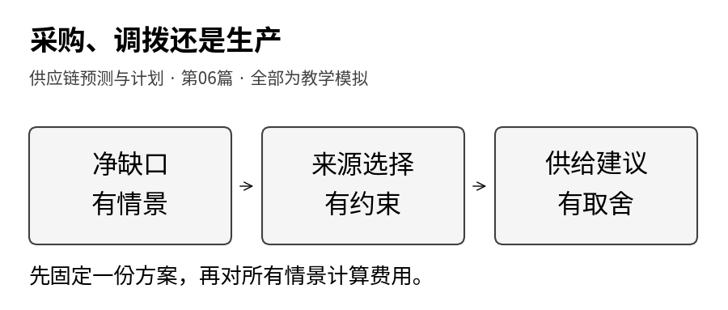
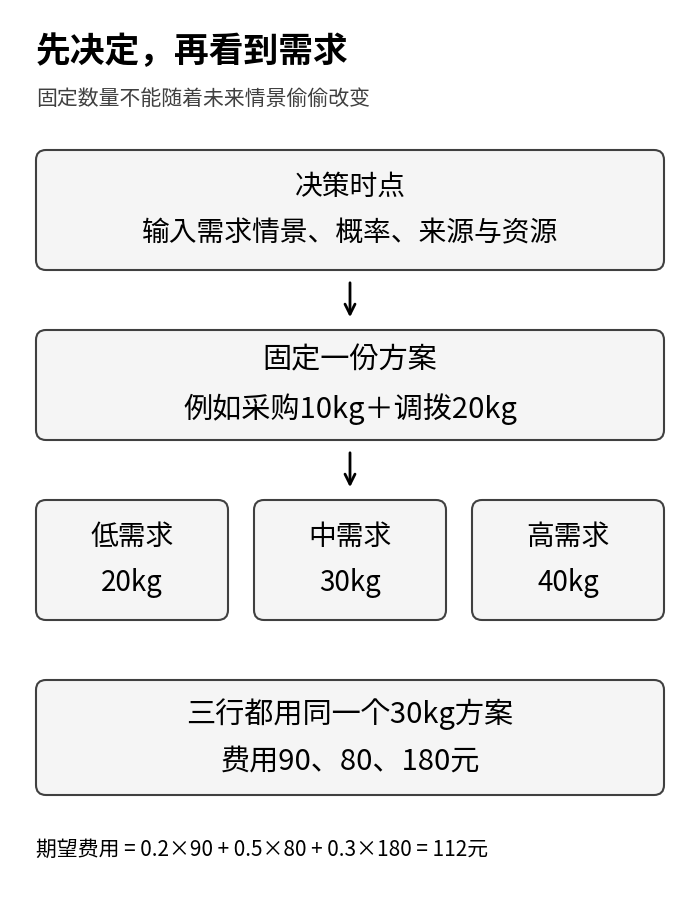
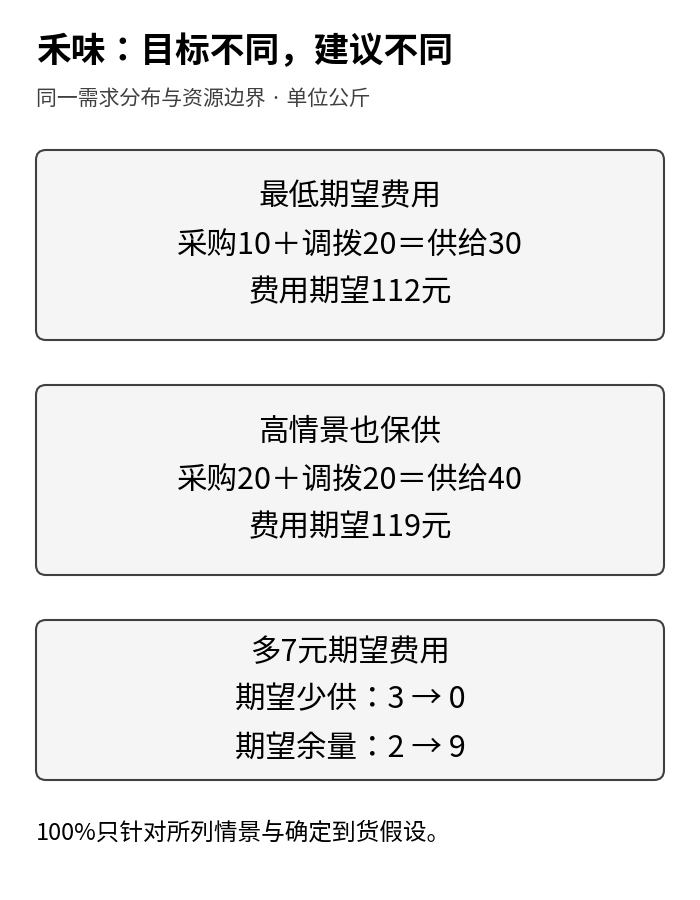
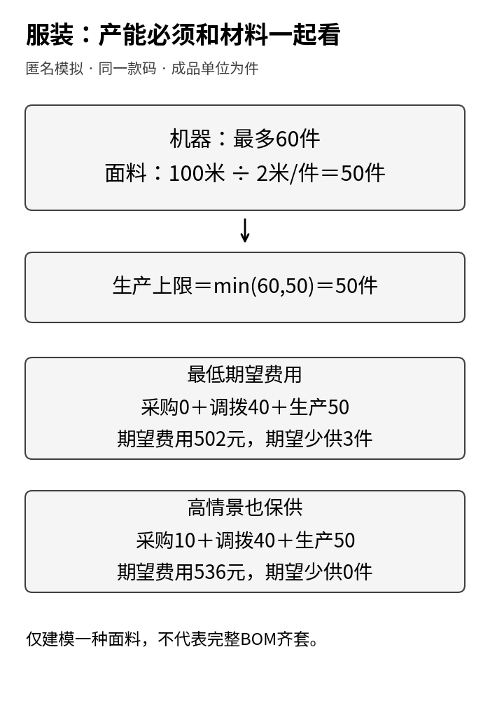
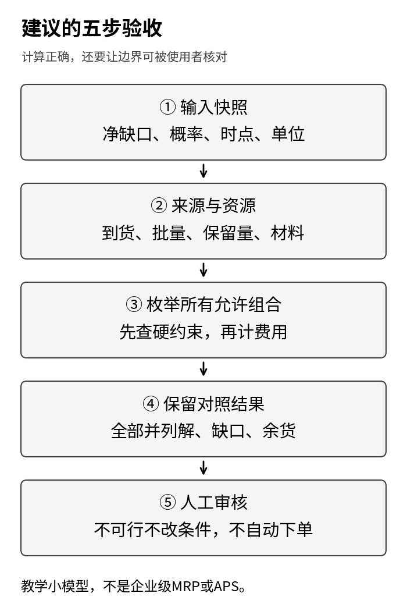

供应链预测与计划 · 第06篇

第五篇算出了补货缺口，也留下两个没有解决的问题：禾味有些食材来不及到，服装企业即使买够面料，也未必有足够产能。继续追问，就会遇到另一张选择题：缺口到底向谁补？从供应商采购、从另一个地点调拨，还是自己生产？

单看报价，答案似乎很简单：先用最便宜的来源。但调拨可能有一笔固定运费，远端门店不能被调空，生产要同时占用材料和产能。需求又不只有一个数。把低价来源排在前面，并不能自动得到一份费用最低、且能执行的方案。

这一篇把这些选择放到同一张表里。先手算一个固定费用反例，再用禾味与匿名服装两个小实验，把“选择什么、不能违反什么、如何比较”逐项写清。程序会真正枚举所有允许的候选，而不只是展示一个预先指定的答案。

<strong>全部企业、需求、费用、资源与结果均为教学模拟。</strong>禾味保留2家门店、8个食材SKU的背景，本篇只计算A店SKU01的一次供给决策，B店只是一个受保留量约束的调出点；其余7个SKU不参与本次实验。服装只取一个匿名款码。两个案例不使用真实客户、实际单据或真实经营收益。

本篇承接[第五篇：受约束的补货建议](https://12lab.cn/topics/forecasting/05-forecast-to-replenishment/)，依据[预测课堂：预售净留存与小型来源联合分配](https://12lab.cn/forecast/core-06/)重新组织。数据为独立指定的单周期情景，不是前几篇数据的延长，也不是D19、D20库存回放的新版本；不训练预测模型，不运行真实采购、调拨或生产。



## 1 先把“需要多少”与“从哪儿补”分开

前四篇讨论过点预测、分位数和订单留存，第五篇把这些判断接到库存、时点与执行约束。现在把输入再说得具体一点。

站在今天的决策时点，计划窗口和可用时点已经核对。预测的总需求扣除该窗口内能够实际使用的自由现存、已有及时在途，形成一个<strong>尚待补齐的净缺口</strong>。本篇表里的需求情景，全部指这个净缺口，不是采购量，也不再重复扣一次现存。

例如，窗口总需求可能为30、40、50公斤，而已经确认有10公斤可用，净缺口就是20、30、40公斤。这里只是解释口径，正式练习直接输入净缺口；它没有再建立这10公斤的批次账。若原始需求已经扣过现存，不能再扣。若旧订单留存已包括在需求中，也不能再把它加一次。

计划的输出则是一组动作数量：外购多少、调拨多少、生产多少。它们可以相加成为新增供给，但不能反过来更改需求。算法决定只准备30公斤，不等于它“预测需求为30公斤”。

为把选择过程算清，本篇统一采用以下假设：

- 只有一次决策，随后需求才发生，没有中途追加、取消或补救动作。
- 被选入的来源都能在同一用货截止时点及以前到齐并通过可用性检查；迟到来源在决策前排除，不能用晚到货倒填早期缺口。
- 需求情景与概率在决策时已经给定，供应数量按本模型确定到齐，没有随机交期、断供或良率波动。
- 每一来源的质量与单位可比，数量可以相加；已留给其他需求的库存和材料不能再用。
- 禾味的合规可用期限覆盖本周期。本文没有FEFO多日回放，不能用于判断真实食品安全或自动延长可售时间。

这些条件比“预测准不准”更先决定方案能否落地。如果现实中存在午餐前与晚餐前两个截止时点，就不能把它们压成同一周期后照搬本篇公式。

## 2 三个词，把优化问题讲清楚

可以把“小型优化”理解为三件事：列出能选的数量，划掉不允许的组合，再在剩余组合中按规则比较。

<strong>决策变量</strong>是你可以选择的数。本篇用p表示采购量，t表示调拨量，m表示内部生产量。它们都是本次新动作，不是现有库存。禾味的单位是公斤，服装的单位是件，两个案例绝不直接相加。

<strong>约束</strong>是不允许越过的界线。例如p≤40表示采购不超过40公斤；t≤20表示调拨不超过20公斤。如果每箱5公斤，还要让p、t只能取0、5、10……。这里“≤”读作“小于或等于”。

<strong>目标</strong>是可行方案之间的比较办法，例如期望总费用尽量低，或者先要求高需求情景也不缺货，再比较费用。目标可以不同，不能把自己选的目标隐藏成“唯一正确的商业答案”。

设新增供给量为q。禾味q＝p＋t；服装q＝p＋t＋m。不能先把q算出来后，假定任意来源组合都一样，因为每个来源的上限、费用和资源消耗不同。

Google的[OR-Tools优化介绍](https://developers.google.com/optimization/introduction)也从变量、约束和目标来说明优化问题。本篇暂不用求解器，只把小规模候选全部试一遍。后续规模扩大，才需要考虑整数规划等方法。

[](images/01-decision.png)

## 3 为什么最低单价有时更贵

先做一个独立手算。假定净缺口恰好10公斤，且采购与调拨都能及时满足。

- 采购：每公斤3元，无固定费用。
- 调拨：每公斤1元，但只要启用一次，就另付30元固定费用。

如果只按单价排序，会先选调拨。实际费用为1×10＋30＝40元；全部采购是3×10＝30元。低单价来源反而多花10元。

固定费用只收一次，不是每公斤再收30元；不调拨时也不收。写成公式：

<strong>来源费用＝3p＋t＋30×I(t＞0)</strong>。

I是“条件是否成立”的记号。t＞0时I＝1，固定费用计30元；t＝0时I＝0，计0元。读者不必先学特殊函数，只要把它当开关。

什么时候调拨开始不吃亏？单独用一个来源补q公斤，调拨费用为q＋30，采购费用为3q。要求调拨不比采购贵，就有q＋30≤3q，两边减q，再除以2，得到q≥15。15公斤时两者都45元；20公斤时调拨50元、采购60元。这里还假定调拨上限允许对应数量。

这个例子说明固定费用会让成本随数量出现跳跃。它不说明调拨永远差，也不说明必须给调拨添加一个永远优先或永远靠后的标签。

## 4 禾味：三种需求情景，一份事先决定的方案

现在回到禾味A店的鸡腿肉SKU01。今天要为同一用货窗口选择采购与调拨数量。下面所有量均为教学设定。

<div class="regression-table-scroll" role="region" aria-label="可横向滚动的数据表" tabindex="0">

| 项目 | 本篇输入与含义 |
| --- | --- |
| 净缺口情景 | 低20、中30、高40公斤 |
| 情景概率 | 分别0.2、0.5、0.3，合计1 |
| 外购p | 0至40公斤，5公斤一批，3元/公斤 |
| 从B店调拨t | B店自由可用35公斤，必须保留15公斤，所以t≤20；5公斤一批 |
| 调拨费用 | 1元/公斤，启用一次另付30元 |
| A店新增接收容量 | p＋t≤50公斤，已为本SKU预留，不是全店容量 |
| 缺口罚损 | 每未满足1公斤计10元，用于教学取舍 |
| 余货额外成本 | 每多出1公斤计1元，表示本周期结束的额外处理成本 |

</div>

B店保留15公斤是输入的硬界线，不是本程序预测出来的安全库存。我们没有对B店再建立需求分布，因此不能声称B店今后绝不会缺货。实际协同要另核对B店的承诺与风险。

用s表示情景编号，Dₛ表示该情景的净缺口，πₛ表示其概率。下标只是索引，不是乘法。固定一组(p,t)，所有情景共用同一个q＝p＋t。

少供量Uₛ＝max(Dₛ−q，0)，余量Vₛ＝max(q−Dₛ，0)。max取两个数里较大的一个，因此不会出现负的缺口或余货。情景费用为：

<strong>Cₛ＝3p＋t＋30×I(t＞0)＋10Uₛ＋Vₛ。</strong>

前半部分是来源费用，后半部分是这个需求情景下的罚损与额外余货成本。数量乘元/公斤，最后全部是元。

这里来源费用已经按准备的全部数量支付，无论是否卖完。余货1元是来源费用之外的额外成本，不是第五篇报童模型中已经净额处理过的“多备损失”。实际业务若把采购成本和残值预先装进某个净损失系数，就不能再照搬此式把相同成本加两遍。我们也没有在此模型计销售收入，所以结果叫所声明的费用，不叫真实利润。

期望费用是按情景概率加权：

<strong>E[C]＝0.2×C低＋0.5×C中＋0.3×C高。</strong>

E表示在这个指定分布下取平均。概率没有单位，所以期望费用仍是元。期望值不是某次真实账单，也不保证每次都接近这个数。

取一个候选：采购10公斤、调拨20公斤。来源费用＝3×10＋20＋30＝80元，新增供给q＝30公斤。

<div class="regression-table-scroll" role="region" aria-label="可横向滚动的数据表" tabindex="0">

| 情景 | 净缺口kg | 少供kg | 余量kg | 来源费用元 | 罚损及余货元 | 总费用元 |
| --- | ---: | ---: | ---: | ---: | ---: | ---: |
| 低，概率0.2 | 20 | 0 | 10 | 80 | 10 | 90 |
| 中，概率0.5 | 30 | 0 | 0 | 80 | 0 | 80 |
| 高，概率0.3 | 40 | 10 | 0 | 80 | 100 | 180 |

</div>

因此E[C]＝0.2×90＋0.5×80＋0.3×180＝18＋40＋54＝112元。

注意这张表的正确读法：今天先选(10,20)，明天可能遇到三种需求之一。不是低情景选一组、中情景换一组、高情景再换一组。后一种算法等于提前知道未来，用它评价今天的一次决策会过于乐观。

## 5 “平均便宜”与“高情景不缺货”，为什么选出不同方案

实际枚举可以很朴素。p有0、5、10……40九种取值；t有0、5、10、15、20五种，共9×5＝45组。去掉p＋t＞50的三组，还剩42组可行候选。程序逐组计算三种情景费用，再求期望，没有凭直觉跳过候选。

在这些输入下，<strong>最低期望费用</strong>选出p＝10、t＝20，也就是上一节的30公斤方案，期望费用112元。

现在另加一个硬约束：“高需求40公斤出现时也必须供足”。因为低、中情景都不超过40，且供应确定到齐，本例等价于p＋t≥40。重新在满足这个条件的候选中找最低期望费用，得到p＝20、t＝20，共40公斤。

40公斤方案来源费用＝60＋20＋30＝110元。低、中、高情景分别剩20、10、0公斤，对应总费用130、120、110元。期望费用＝26＋60＋33＝119元。

<div class="regression-table-scroll" role="region" aria-label="可横向滚动的数据表" tabindex="0">

| 比较项 | 最低期望费用 | 高情景保供约束 |
| --- | ---: | ---: |
| 采购／调拨kg | 10／20 | 20／20 |
| 新增供给kg | 30 | 40 |
| 期望费用元 | 112 | 119 |
| 期望少供kg | 3 | 0 |
| 期望余量kg | 2 | 9 |
| 所列情景中完全不缺的概率 | 70% | 100% |

</div>

多花7元期望费用，换来了本情景集合内少供从3降到0，但期望余量从2升到9。这不是一个方案全面胜出，而是两个不同目标下的取舍。对真实易腐食材，还需要更细的批次、效期与分时消耗模型。

“期望少供3公斤”来自0.3×10，不代表每个周期恰好缺3公斤。低、中情景不缺，高情景缺10。平均净缺口为0.2×20＋0.5×30＋0.3×40＝31公斤。按<strong>期望满足量÷期望净缺口</strong>口径，数量满足率是(31−3)÷31＝28÷31≈90.32%。它与70%的完全不缺概率不是同一个指标。这里分母仅为本次剩余净缺口，不是全门店总需求。

表里的100%只针对明确列出的三种需求、确定供应以及本次资源限制。若出现50公斤需求，或供应商迟到，不能继续声称已经得到真实100%服务保证。“高情景保供”也不是对所有未知未来的鲁棒保证。

[](images/02-hewei.png)

## 6 匿名服装：生产来源要同时过材料和产能两道关

服装场景再增加内部生产m。所有数量都指同一个匿名款码的可交付合格成衣件数，计划窗口和交付截止时间相同。外购成品、调拨成品、内部生产成品才可以相加；面料米数不能直接加到成衣件数里。

净缺口为60、80、100件，概率仍为0.2、0.5、0.3。这些是已完成需求去重后的指定情景，不再另外叠加一次预售订单留存。

<div class="regression-table-scroll" role="region" aria-label="可横向滚动的数据表" tabindex="0">

| 来源或资源 | 本篇约束与费用 |
| --- | --- |
| 外购成品p | 0至80件，每10件一批，8元/件 |
| 调拨成品t | 远仓自由可用70件，必须保留30件，故最多40件；每10件一批，3元/件，启用另付60元 |
| 内部生产m | 每10件一批，机器窗口最多60件；4元/件，启用另付40元 |
| 唯一建模的材料 | 本款可用面料100米，每件固定消耗2米毛布，因此2m≤100 |
| 新增接收／交付缓冲容量 | p＋t＋m≤100件 |
| 缺口罚损／余货额外占用成本 | 20元/件／2元/件 |

</div>

这里2米已经是含既定损耗口径的毛布消耗，不再除以一次利用率；它与第五篇“净耗布÷利用率”的设定不同。不能把两个例子的公式串起来重复加损耗。面料100米是已经圈定给本次计划、可及时使用的量，不包含别的款式已占用的材料。

材料条件给出m≤50件，机器条件给出m≤60件。代码和结果字段用production，函数中的w与正文m均表示这一个生产量。两道关都要通过，所以生产上限是较小者50件。程序不会因为机器能做60，就凭空多出20米面料。辅料、工序先后、换线、在制品与返工没有建模；这只是一个单材料约束示范，不是完整BOM齐套或有限产能排程。

服装的来源费用为：

<strong>A＝8p＋3t＋60×I(t＞0)＋4m＋40×I(m＞0)。</strong>

A记全部来源费用，单位元。每种来源启用的固定费独立支付。m＝0时不收生产启用费，t＝0时不收调拨启用费。

每个情景总费用为Cₛ＝A＋20×max(Dₛ−q，0)＋2×max(q−Dₛ，0)，其中q＝p＋t＋m。

先看候选(p,t,m)＝(0,40,50)。来源费用＝0＋120＋60＋200＋40＝420元，供给90件。

- 低情景60件：余30件，费用420＋2×30＝480元。
- 中情景80件：余10件，费用420＋2×10＝440元。
- 高情景100件：少10件，费用420＋20×10＝620元。

加权后为0.2×480＋0.5×440＋0.3×620＝96＋220＋186＝502元。

程序共检查191组可行候选，最低期望费用就是这个90件方案。若加上高情景100件也不缺的约束，则选(10,40,50)。来源费用500元；三情景总费用580、540、500元，期望536元。

<div class="regression-table-scroll" role="region" aria-label="可横向滚动的数据表" tabindex="0">

| 比较项 | 最低期望费用 | 高情景保供约束 |
| --- | ---: | ---: |
| 采购／调拨／生产件数 | 0／40／50 | 10／40／50 |
| 新增供给件数 | 90 | 100 |
| 期望费用元 | 502 | 536 |
| 期望少供件数 | 3 | 0 |
| 期望余量件数 | 11 | 18 |
| 所列情景中完全不缺的概率 | 70% | 100% |

</div>

多花34元期望费用，消除列出的高情景缺口，同时提高余货。最低期望方案的平均净缺口为82件，期望满足79件，所以数量满足率79÷82≈96.34%。仍然不能把这个数字当成真实客户交付率，因为订单优先级、具体交期及真实履约过程都不在模型里。

[](images/03-apparel.png)

## 7 公平比较，要把“先决定”写进代码

只要允许一份方案看见未来再改变，比较就不公平。本篇的正确顺序是：读取决策时点已知的输入，枚举固定来源向量，给同一向量逐个情景打分，最后按事先声明的目标选择。

例如禾味选择(10,20)，就必须在低、中、高三行都使用它。不能在高情景偷偷增加10公斤采购，再声称这是原方案的效果。若确实存在需求观察后的补救动作，需要另建两阶段模型，说明何时知道需求、哪些动作还能执行、补救单价和时限是什么。本篇没有这项能力。

还有三种常见的不公平做法：

<strong>先便宜后补救，却漏算固定费。</strong>调拨每公斤便宜，但启动那辆车的费用没有进入表，就会偏向过小的调拨单。

<strong>把B店保留量当作可以商量的软提示。</strong>程序不得为了降低A店费用而突破t≤20。确实决定调整保留量时，要形成新版本，重新说明受影响的B店风险。

<strong>看过结果后更改概率或罚损，只展示满意的那一版。</strong>敏感性分析可以修改输入，但要保留原方案及变化原因，不能称为在原假设下证实了更优。

与D19、D20用共同时间路径回放库存策略不同，本篇比较的是单周期来源决策。它没有库存跨期反馈，也没有按112／28／40天训练、验证、测试，因为根本没有估计模型参数。情景枚举算对，只能证明在给定模型与候选内算对；不能借用“测试通过”冒称预测已经经过样本外验证。

## 8 为什么程序要输出候选与失败，而不仅是最佳方案

读者应该能查看所有候选，以及每个候选在每个情景下的费用。这样才有可能查出问题：某笔固定费是否重复收取，某个材料约束有没有漏掉，所谓最优是否遗漏了另一个同成本方案。

对于有限候选，穷举的逻辑很直接：取出每一组允许数量，检查资源约束；符合的才计算费用，再找最小值。它没有训练过程，也没有随机搜索。只要候选集合完整、公式正确，就能找到这个小模型内的全局最优。但“这个小模型”四个字不能省。

两种目标如果有并列最优，实践包保留所有并列项，再按采购量、调拨量、生产量的字典序挑一个作展示：先比较采购量，较小者在前；采购相同时比调拨量，仍相同再比生产量。这只是让运行结果可重复的展示约定，不是新增商业目标。这样处理，不能因为循环先遇到某行就把它说成唯一答案。费用与概率使用精确有理数比较，小数仅用于显示，避免把0.1的浮点舍入误当商业差异。

如果要求高需求100件供足，却把服装容量改为90件，无论组合怎样都不可能满足。此时程序应返回<strong>不可行</strong>，保留失败原因和原始条件，而不是自动降低需求到90，或突破容量到100。

产品页面可以分成四栏：

1. 输入版本：净缺口、概率、单位、截止时间与信息可用时点。
2. 可行来源：及时到货、批量、来源上限、保留量、材料与产能。
3. 对比结果：各来源数量、来源费用、每种情景少供与余货、期望费用。
4. 未解决项：不可行约束、未建模风险、待人确认的假设，以及是否允许执行。

把“不可行”清楚交给使用者，是计划系统的有效结果。输出一张全绿但偷偷改了条件的表，才会使问题消失在界面里、出现在现场。

[](images/04-audit.png)

## 9 两小时小项目：先复算，再改一个条件

完整包中的practice目录提供输入、标准库Python代码、全部候选结果、情景明细、测试与中文说明。建议使用Python 3.10或更新版本；核心计算不联网，也不需要安装第三方求解器。在practice目录执行：

```sh
python3 run.py --output-dir my-results
python3 -m unittest discover -s . -p 'test_*.py' -v
```

Windows可以用py替代python3。输入文件不会被运行过程重建；指定新的输出目录可保留旧结果，同名输出再次运行会覆盖。修改输入时先复制整个练习包，或按README指定输入目录。默认三份输入是hewei.json、apparel.json和独立手算反例counterexample.json，不能把反例当成主情景的事后改单。

分四步，约120分钟：

- 25分钟：手算10公斤采购与调拨的费用；把禾味(10,20)的三个情景逐项算完，检查期望112元。
- 30分钟：运行原始练习，找到42组与191组可行候选，核对两个案例四个选中方案。任选一行情景明细检查来源费、少供和余量。
- 35分钟：复制练习目录，完成下面练习中的至少两个条件修改，保留原始结果与新结果，不改程序来“配合答案”。
- 30分钟：写一张计划建议卡，说明你选择哪个目标、额外费用换来什么、哪些风险仍没覆盖，再运行自动测试。

<strong>练习A：禾味只补10公斤。</strong>比较采购与调拨；再算15公斤时两者是否并列。答案分别为采购30元对调拨40元，15公斤两者都45元。它们是固定数量的来源费用比较，不是含原三情景罚损的最优决策。

<strong>练习B：只把服装机器上限从60改为80件。</strong>生产能变成80吗？不能，面料仍只支持50件，原材料约束继续生效。把“机器更快”写成“需求一定满足”是跳过了材料。

<strong>练习C：服装接收容量降为90件，同时仍要求100件高情景保供。</strong>应返回不可行。最低期望方案仍可以是90件；两个目标必须分别标注结果，不能把其中一个成功套给另一个。

<strong>练习D：某来源只能在用货截止后到。</strong>它不能再出现在本期供给中。迟到货未来可能有价值，但应在另一个时段建模，不应强行把可用时间提前。

<strong>练习E：输入概率合计不是1，或把批量写成0。</strong>应明确拒绝。不要自动归一化、默认补0或静默改规格，因为这会改变使用者的原始假设。

完成标准不是“屏幕输出成功”：你必须能解释固定费什么时候收、每个情景是否用了同一方案、数量满足率的分母是什么，以及不可行时是哪条约束冲突。

## 10 接下来怎样接到真实产品

这个小项目已经把预测与计划分成了可检查的接口。预测输出提供有单位、有时间条件的需求情景；库存、采购、仓库和生产提供当前可用资源与限制；优化层给出候选与权衡；人再根据模型没有覆盖的信息审批。

若后续把建议交给AI Agent，至少应保留输入快照、版本、计算命令、候选范围和异常原因。让模型解释“为什么用了这个来源”可以提高可读性，但解释文本不能修改求解器的数值，也不能等同于采购、调拨或排产权限。

真正扩大到多门店、多SKU和多日期，会出现共享库容、车辆、材料和产线的竞争，单独给每个SKU求最优后直接相加可能不可行。此时需要重新建联合约束；若生产分工序并有交期，要进入排程；若供应会延误，要加入有依据的供应情景。更多模型名称不能替代这些新增的数据与验证。

本篇暂不完成通用MRP、APS、多级库存优化、跨期随机规划、订单优先级或真实财务利润计算。它完成的是一组小而完整的来源选择实验：从给定净缺口出发，枚举真正允许的方案，公开费用与风险，再让人看到不能保证的部分。

到这里，读者应能把“系统建议采购多少”改问成更有用的一句话：<strong>这份建议基于哪组需求、选择了哪些来源、用了哪些资源，又留下了哪些风险？</strong>

## 资料与配套说明

- [专题前五篇与目录](https://12lab.cn/topics/forecasting/)：符号、数据、回归、概率与受约束补货的前置脉络。
- [预测课堂：预售净留存与小型来源联合分配](https://12lab.cn/forecast/core-06/)：本篇多来源、固定启用费和资源限制的课程依据。本文双案例为独立新增，不冒充教程原实验。
- [预测课堂：把预售与三来源一起优化](https://12lab.cn/forecast/core-13/)：进阶阅读。该课已实现更大的有限联合情景与逐日库存实验；本文刻意采用更小的单周期双案例，便于手算，不替代该课，也不把其能力计入本篇代码。
- [OR-Tools优化介绍](https://developers.google.com/optimization/introduction)：变量、约束与目标。
- [OR-Tools混合整数规划示例](https://developers.google.com/optimization/mip/mip_example)：理解整数解为何不能只把连续解随意四舍五入。本篇并未调用该求解器，采用标准库完整枚举。

配套包含全文Markdown、内嵌图片的HTML阅读版、1张900×383封面与4张黑白正文图、可编辑SVG与绘图源文件、双模拟案例输入、完整候选与情景结果、可复现代码及测试。计算结果仅在所声明的输入和范围内成立。文章及配套资料仅供学习，不执行任何真实业务动作。


- [下载完整文章与可复现实验](downloads/forecasting-06-complete.zip)
- [下载独立实践包](downloads/forecasting-06-practice.zip)

完整包中的离线阅读版与验收说明保留发布前快照；本网页为正式发布版。
