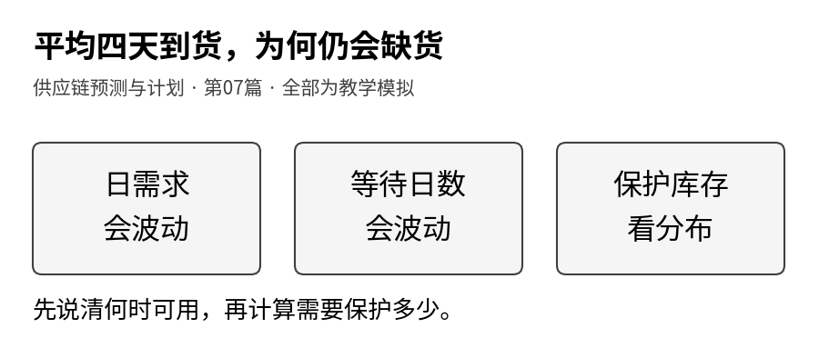
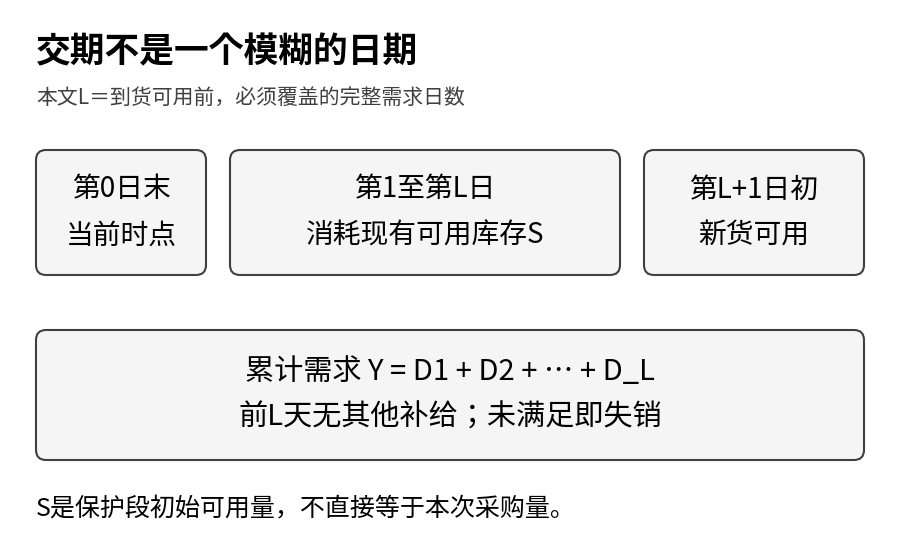
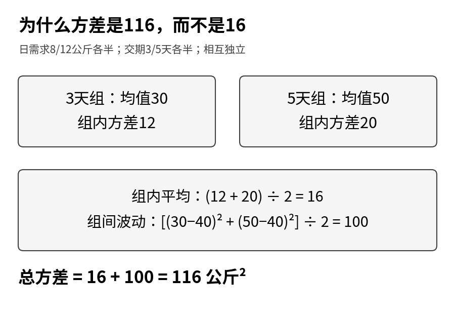
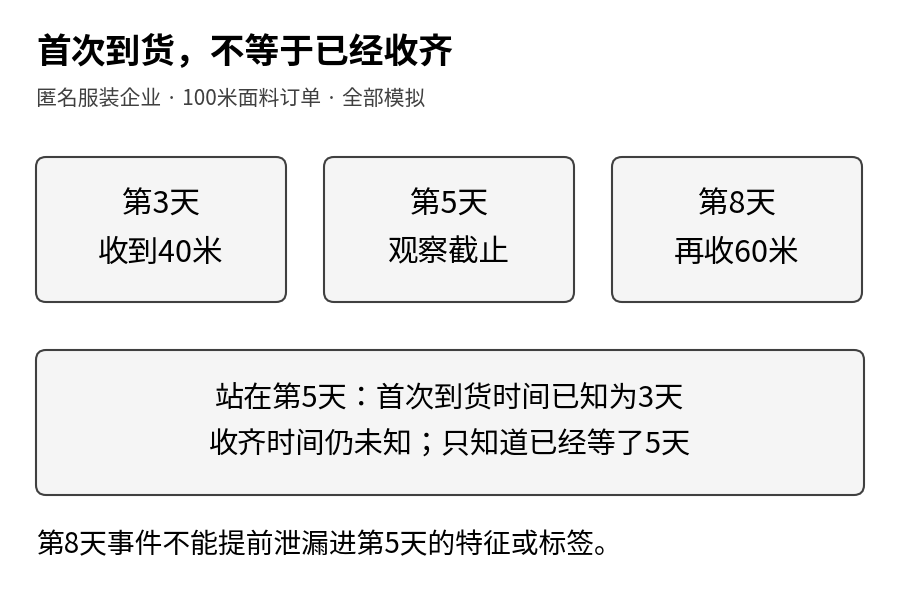

供应链预测与计划 · 第07篇

第六篇把采购、调拨与生产放进同一张候选表，但其中有一条重要前提：进入候选的来源，能够在用货截止之前到齐。现在把这条前提拆开。供应商说“平均四天”，是在说过去交期的平均数，还是承诺这张单在第四天之前可用？到了一小部分，是否就算交付完成？需求旺的时候，供应商会不会也更拥堵？

这些问题会改变补货建议。预测量相同，等待时间不同，库存必须覆盖的需求也不同。只把交期平均数填进系统，可能把原本应当保留的不确定性藏了起来。

本篇承接[第六篇的供给计划](https://12lab.cn/topics/forecasting/06-source-allocation/)，依据[预测课堂的供应商交期章节](https://12lab.cn/forecast/legacy-13/)展开。先用高一数学能跟上的加减、平方、平均和加权求和手算，再让程序列出全部情景。我们还会用匿名服装采购账解释：一张没有收齐的订单，并不等于交期为零，也不能从数据里删除。

<strong>全部供应商、订单、食材、数量、日期与结果均为教学模拟。</strong>禾味保留2家门店、8个食材SKU的背景，数值实验只研究A店SKU01；其余店货组合不参与计算。服装案例只演示一组匿名物料采购订单的收货标签，不使用真实订单、真实供应商绩效或实际收益。本篇不运行采购、调拨、生产或派车，也不把模拟覆盖率当成现实承诺。



## 1 平均四天，不代表第四天一定到

先看两组极小的交期记录，单位都是天：

<div class="regression-table-scroll" role="region" aria-label="可横向滚动的数据表" tabindex="0">

| 来源 | 四次记录 | 平均值 | 最长记录 |
|---|---|---|---|
| 供应商A | 4、4、4、4 | 4 | 4 |
| 供应商B | 2、4、4、6 | 4 | 6 |

</div>

平均值就是总和除以条数。B的平均交期＝(2＋4＋4＋6)÷4＝4天。两者平均值相同，B却有一次等了6天。若每天消耗10公斤，等4天需要40公斤，等6天需要60公斤。不能因为平均相同，就说两者带来的库存风险相同。

怎样描述波动？先让每个数减去平均值，B得到−2、0、0、2。直接相加会互相抵消，所以先平方，得到4、0、0、4，再取平均：方差＝(4＋0＋0＋4)÷4＝2天²。开平方后，标准差约1.414天。标准差恢复了“天”的单位，方差则是“天²”。A的方差和标准差均为0。

这里把四个值当作完整、等概率的教学情景，分母用4。若用历史样本估计总体方差，常用n−1作分母，不能混用。这四条数据只用于手算，远不足以据此评价真实供应商。

平均数适合回答中心大约在哪里；分位数适合回答某个比例的情况不超过多少。它们都必须与数据范围、时间起点和事件定义一起使用。

## 2 先约定一条时间线，再写交期公式

“3天交期”有多种业务含义：三个自然日、三个工作日、三个完整需求日桶，结果可能不同。本篇固定一种口径：在第0天结束时做决策，已有库存覆盖接下来的L个完整需求日；新货在第L＋1天日初验收可用。因此L＝3时，库存覆盖第1、2、3天，新货在第4天日初可用。

这与“第3天早晨就到”的定义不是同一件事。真实系统需要记录下单时点、业务日历、到货时点、验收时点及当天需求发生顺序，不能用一个模糊的日期相减代替所有规则。

用D₁表示第1天需求，D₂表示第2天需求。等待期间总需求Y，就是这些天需求的和：

<strong>Y＝D₁＋D₂＋…＋D_L。</strong>

下标只是天的编号，不是乘法。省略号表示按同样方式继续相加，直到第L天。L变长，就要多加几天；每天需求又会变化，因此Y同时受“每天消耗多少”和“等多久”影响。

本篇检查的是到货前的保护库存阈值S。它不是自动生成的采购量。即使算出应覆盖56公斤，也还要核对现存、已有在途、库容、箱规和效期，才能形成执行建议。这里不允许中途追加或调拨，缺少的需求按失销记录，不能用后来的到货倒填。

[](images/01-timeline.png)

## 3 禾味：把随机交期需求拆成两层波动

设禾味A店SKU01每天需求可能为8或12公斤，各占一半；不同天彼此独立。交期L可能为3或5个完整需求日，各占一半；先假定交期与所有日需求独立。

一天需求的平均值是10公斤；相对10的偏差是−2、2，平方后均为4，因此日需求方差是4公斤²。交期的平均值是4天，方差是1天²。

先把交期固定住来看：

<div class="regression-table-scroll" role="region" aria-label="可横向滚动的数据表" tabindex="0">

| 已知条件 | 等待需求平均值 | 等待需求方差 |
|---|---:|---:|
| 等3天 | 3×10＝30公斤 | 3×4＝12公斤² |
| 等5天 | 5×10＝50公斤 | 5×4＝20公斤² |

</div>

为什么方差也能相加？这里用到了“不同天需求相互独立”的前提。若连续几天一起旺或一起淡，就会出现额外的关联项，不能简单做3×4或5×4。

现在不预先知道交期是哪一种。总体平均需求是30×1/2＋50×1/2＝40公斤。总体波动可以分成两份：

- 每组内部还有日需求波动，平均组内方差＝12×1/2＋20×1/2＝16。
- 两组的中心30和50也在波动。它们相对总中心40分别差−10和10，平均平方偏差＝100。

因此总方差＝16＋100＝116公斤²，标准差＝√116≈10.77公斤。无需先掌握微积分，只要先看清“组内还有波动，组间中心也不同”。

把这些数写成通用形式，就是：

<strong>交期需求方差＝平均交期×日需求方差＋日需求均值²×交期方差。</strong>

它只适用于这里的独立随机和前提：需求按相同日桶计量、各天独立同分布、交期与需求独立，且相应均值与方差存在。公式中的交期数值指多少个完整日桶。不能把按周估计的需求波动和按天计算的交期直接放在一起。

若把交期粗暴固定为4天，平均需求仍是40，但方差只有16。丢掉的是“等多久本身也在变”的100，而不是日需求的那部分。平均数没变，并不意味着风险没变。

[](images/02-variance.png)

## 4 精确枚举：40行并不是每行都占四十分之一

本例足够小，可以不用抽样，直接列出所有路径。等3天时，每天两种需求，共2×2×2＝8条路径；等5天时，有2⁵＝32条路径。两种交期合起来共40行。

但每条3天路径的概率是1/2×(1/2)³＝1/16；每条5天路径的概率是1/2×(1/2)⁵＝1/64。40行的权重不同，不能把它们当成等概率平均。短路径合计8×1/16＝1/2，长路径合计32×1/64＝1/2，总和才等于1。

程序把路径按总需求合并，再从小到大累计概率。P95的定义是：累计概率第一次达到或超过95%时，对应的最小需求值。它不是把40行排序后机械拿第38行，也不是自动使用插值。

本例P50＝36公斤，P90＝52公斤，P95＝56公斤。P50为何不是均值40？因为累计到36公斤时，所有3天路径恰好占一半；36至40之间还有分布空档。均值、中位数与分位数本来就不必相同。

用S＝56公斤保护库存：仅当5天每天都是12公斤，即总需求60公斤时，才会少4公斤。该路径概率为1/64。因此：

- 情景不缺货概率＝63/64＝98.4375%。
- 期望失销＝4×1/64＝0.0625公斤。
- 数量满足率＝1－期望失销÷期望需求＝1－0.0625÷40＝99.84375%。

98.4375%大于95%不是计算错误。离散分布会跳跃，最小合格阈值可能超过目标覆盖。数量满足率使用“按概率加权的满足数量除以加权需求数量”，不是把每行情景满足率简单平均，更不是订单满足率。这里的覆盖率是给定模拟分布内的精确值，不是历史样本验证成绩或未来服务保证。

如果额外采用正态近似，会得到40＋1.645×√116≈57.72公斤。1.645来自标准正态分布的单侧95%分位数，不能换成双侧95%区间常见的1.96。正态近似多加了一条形状假设；本例已经可以精确枚举，应优先看真实离散情景，而不是把近似结果包装得更“高级”。

## 5 需求旺时也更堵：独立公式在哪里失效

相关性不是把两个标准差再随便加一次。应该先列出“哪些需求路径会与哪些交期一起发生”，再在联合情景中累计Y。

下文用一组严格配对对照：保留各个5日需求路径的概率，也保留交期3天与5天各一半，仅改变交期与需求路径之间的配对规则。这样可以把变化归因于联合关系，而不是同时偷偷换了销量分布。

严格对照的规则是：先等概率生成同样的32条五日需求路径，再规定首日需求为8时交期3天，首日为12时交期5天。各天需求的无条件联合分布不变，交期仍各半，只改变二者如何配对。它是假定的事前联合情景，不是看到未来再下单。

<div class="regression-table-scroll" role="region" aria-label="可横向滚动的数据表" tabindex="0">

|指标|独立|严格配对依赖|
|---|---:|---:|
|累计需求均值（公斤）|40|40|
|方差（公斤²）|116|156|
|P90（公斤）|52|56|
|S=52时覆盖概率|90.625%|84.375%|
|S=52时期望失销（公斤）|0.4375|0.75|

</div>

配对后短交期组均值28、方差8；长交期组均值52、方差16。组内平均方差为12，组间均值波动为144，加起来156。平均需求没变，固定52公斤的保护效果却下降。这是同样的边际分布并不足够的具体证据。

配套另列“3天每天8、5天每天12”的共同冲击情景，均值42、方差324。它同时改变跨日需求关系，不能把全部差异都归因于交期与需求相关。

这不是在证明现实里的某个供应商有这种关联，而是在演示独立假设一旦不成立会怎样。实际项目要调查旺季、共同假期、产能拥堵等信息，并在预测时点真正可获得的数据上估计联合关系。需求与交期分别预测后，把P90需求和P90交期直接相加，也不能得到总风险的P90：它们单位不同，保护期还会改变累计范围。

## 6 匿名服装：没收齐的单，不能直接删掉

前面的禾味实验假设交期情景已经给定。服装企业往往还面临更早的一步：如何从采购账里得到可信的交期标签。

同一张100米面料采购单，第3天收到40米，第8天收到60米。首次到货交期是3天，收齐交期是8天。如果生产必须等整批面料验收合格才能开工，这两个指标不能互换。若允许分批开工，则应建立分批物料与产能计划，而不是把“收齐”偷偷换成“首到”。

现在把观察截止时点设为第5天。我们知道已经收到40米、尚欠60米，但不知道未来第8天会收齐。正确记录是“截至5天尚未收齐”，不是交期5天，更不是0天。第8天记录是截止之后才出现的事实，不得拿来构造第5天当时的特征或完成标签。

这类信息叫右删失：只能知道目标事件发生在观察时点之后，精确发生时间暂时未知。它不是异常值删除规则。NIST的删失说明讨论的是可靠性事件，本篇借用同一种统计结构解释订单收齐，业务事件仍需要单独定义。

配套8张模拟订单中，截至固定观察日，5张已收齐，平均收齐时间6天；6张已首次到货，平均首次到货时间4天；3张尚未收齐，保留右删失标记及已等待天数。两项均值样本不同，不能相减就说“分批到货平均多花2天”。完整账保留订单数量、累计已收数量、首次及收齐事件、观察截止日。测试会证明：截止日之后新增收货，不得改变原来的历史快照。

只对已完成订单求平均或P90，会把长期未完结的订单排除在分母之外，可能让供应商看起来过于快。也不能直接拿“当前等待天数”冒充最终交期，因为那只是下界。取消、退单、改量和无法追踪的失访也不一定是普通行政删失，需要另设状态及口径。

本篇练习包只完成截止时点截取、部分收货守恒、首次到货与收齐标签以及删失标记。它不训练交期回归，也不实现Kaplan–Meier估计或供应商排名。需要继续学习的读者可以进入[PO：部分收货、KM和P90边界](https://12lab.cn/forecast/po-full/)，尤其注意：曲线未达到90%时，P90应留空，不能填最大观察日冒充估计。

[](images/03-po.png)

## 7 把风险写进计划卡，而不是只展示一个天数

经过上面的计算，一张面向计划人员的建议卡至少应回答五件事：

1. 事件：预测的是首到、收齐，还是验收可用？交期从哪个时点开始？
2. 输入：采用哪个需求版本、哪个交期版本，数据在什么时候可用？
3. 关系：采用独立假设还是联合情景？为什么？
4. 结果：平均交期需求、目标分位数、覆盖分母、期望失销和数量满足率分别是多少？
5. 执行限制：现存与在途、箱规、库容、效期、分批生产和审批是否已检查？

对禾味，增加保护库存不能忽略易腐性。本篇没有批次、到期日或报废成本，不能据此说56公斤就应该采购，甚至不能认定仓库放得下。对服装，收齐也不保证质检合格或产能充足。预测目标应尽量贴近真正限制业务的事件，而不是选择最容易计算的日期。

本篇不重新比较第六篇的来源报价，也不把单次交期保护试验当成完整多周期补货回放。它补上的，是那张来源选择表中“能够及时可用”的证据和不确定性。真实决策还要把本篇输出送回第五篇的执行约束与第六篇的候选比较。

## 8 两小时小项目：复算，再挑战一个假设

完整包提供独立的practice目录。Python标准库即可运行，不联网、不连接任何业务系统。先读README，再运行代码和测试；更改输入时复制一份，输出到新目录，避免覆盖原始结果。

解压完整包，进入practice目录，使用Python 3.10及以上：

```sh
python3 run.py --output-dir my-results
python3 -m unittest discover -s . -p 'test_*.py' -v
```

计算仅依赖Python标准库，Windows可用py替代python3。输出74行情景、18行指标、8行订单快照及运行清单。重复使用相同结果目录会覆盖四个同名结果文件，练习时请新建目录。CSV分数列如29/32应按文本导入，不能让表格软件当作日期。

- 20分钟：手算供应商A/B的均值和波动，再算禾味16＋100＝116。每个数写出单位。
- 35分钟：复算全部路径概率、P50/P90/P95和56公斤的三项指标，核对概率总和为1。
- 30分钟：比较独立与联合情景。不要只看阈值是否相同，还要看均值、方差、覆盖率和期望失销。
- 20分钟：把服装观察截止时点前后移动，检查收齐标签如何出现，确保未来收货不会进入早期快照。
- 15分钟：写一张建议卡，列出一个结论、一个证据和一个仍未建模的限制，再跑测试。

练习一：若每天确定消耗10公斤，L仍取3或5各半，总需求为30或50，平均40、方差100，P95是50。此时不应再保留日需求方差项16。

练习二：若L固定为4，各天8/12独立等概率，总需求为32、36、40、44、48；P95为48。平均40没有变化，但保护需求分布变了。

练习三：若计划页面只有“交期4天”，请补上时间起点、日历、目标事件和可用时点，至少写出一种会改变答案的业务解释。

练习四：若有未收齐采购单，能否把已完成单的P90称为“所有订单90%可收齐的时间”？不能。先检查完整分母、观察长度与删失，数据不足时明确报告不可估。

## 9 完成标准与不适用范围

- 同一输入重复运行，结果一致；每个分布的概率和为1，分位数满足自己的累计概率定义。
- 缺口按max(需求－S,0)计算，即取括号内两者较大值，需求不超过库存时缺口为零；满足量＋失销量＝需求；三项服务指标各自保留分母。
- 采购单任一快照都满足订购＝累计有效收货＋未收；未来收货不出现在早期标签中。
- 正文主要实验数字都能回到输出表，其余例题可按正文手算；不把独立假设带入有关联的场景，不把模拟结果包装成现实效果。

这篇没有完成2000张采购单的回归项目、删失模型训练、供应商风险评级或多周期联合优化。180天112／28／40的预测协议没有被更改，本篇的有限枚举与事件账是独立教学材料，不是新增预测测试集，也不重新调D19/D20策略。

当有人说“平均四天到货”，现在可以继续问：<strong>四天从哪里算到哪里？未完成订单有没有算进去？需求旺的时候，等待时间是否也会变长？</strong>把这三件事讲清，才有依据把交期预测接到库存和计划。

## 参考与配套

- [预测课堂：供应商交期](https://12lab.cn/forecast/legacy-13/)：均值与波动、随机和、未收齐订单。本文是便于手算的独立文章实验，不冒充整个课程工程。
- [PO：部分收货、KM和P90边界](https://12lab.cn/forecast/po-full/)：继续学习删失分母和不可估尾部，本篇未实现KM。
- [MIT概率课第8周资料](https://ocw.mit.edu/courses/6-041-probabilistic-systems-analysis-and-applied-probability-spring-2006/resources/week08/)：分布、卷积与变换的延伸材料。本文随机和公式通过分组手算解释，不要求读者先读高等概率论。
- [NIST：Censoring](https://www.itl.nist.gov/div898/handbook/apr/section1/apr131.htm)：右删失概念参考，采购收齐是本文自行定义的业务事件。

配套包含全文Markdown、内嵌图片HTML、可编辑图形与绘图源文件、模拟输入、全部情景及事件输出、复算代码和测试。全文仅供学习及原型验证。

- [下载完整文章与可复现实验](downloads/forecasting-07-complete.zip)
- [下载独立实践包](downloads/forecasting-07-practice.zip)
