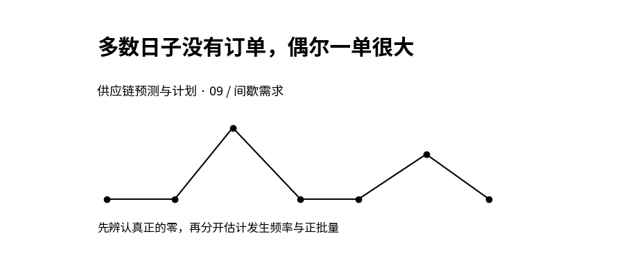
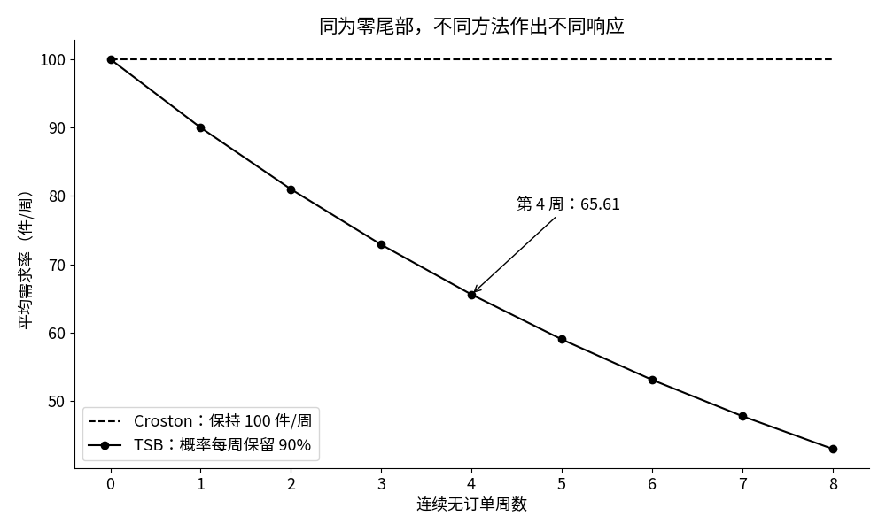
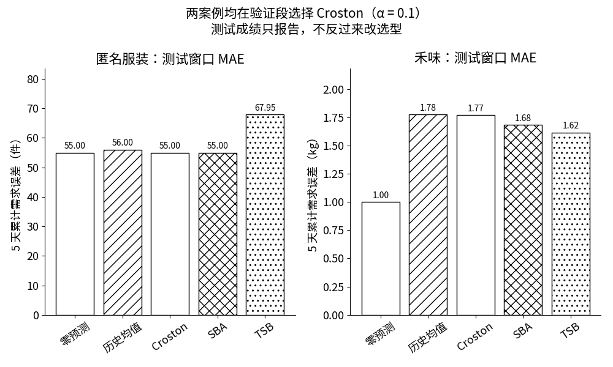
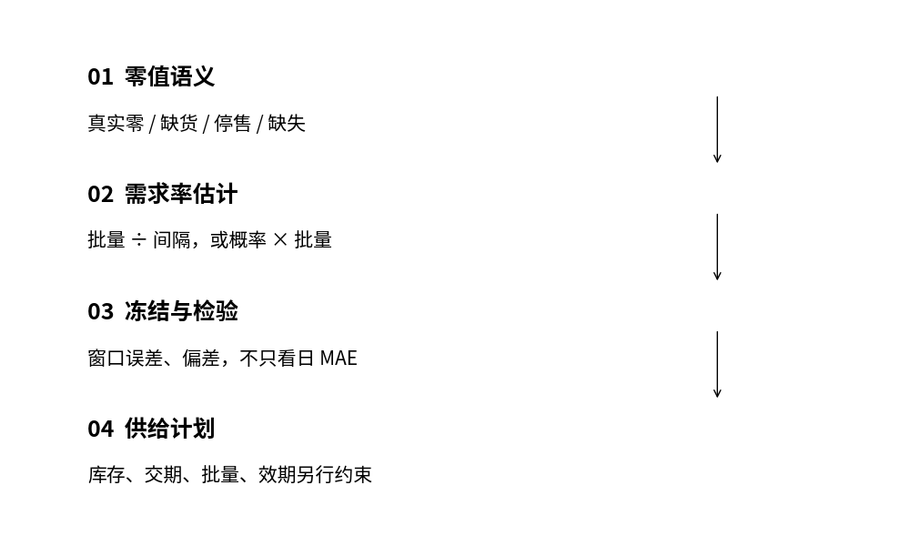

供应链预测与计划 · 第9篇

[第8篇](../08-hierarchical-reconciliation/)解决了“总部和门店的数字怎样加得起来”。但把口径协调一致之后，底层数据可能仍然很难看：一款特殊颜色尺码，十几天没有补单，突然出现120件；一道低频菜使用的原料，好几天不消耗，某天又用了4公斤。

把这些序列画成曲线，大部分位置贴着零，少数位置竖起高峰。直接套平滑模型不是绝对错误，但首先应该问：这些零究竟是什么？我们要预测的又是每天的订单，还是未来一段时间的总需求？

本文从“零”的业务含义出发，手算 Croston、SBA 和 TSB，再用两个可复现的模拟序列做比较。重点不在找一个永远获胜的算法，而在理解：**平均需求率不是订单日历，误差低也不等于缺货少。**

> 本文全部数量和结果为教学模拟，不连接真实系统，不构成采购或排产建议。服装企业匿名；禾味为虚构品牌。本篇只生成两个单序列各180天，并非完整的两店、8食材SKU面板；原有14天样本只是系列背景。算法由本文用Python标准库教学实现，不宣称复刻某个商业软件。



## 一、先分类零，再选择模型

<div class="regression-table-scroll" role="region" aria-label="可横向滚动的数据表" tabindex="0">

| 观测状态 | 服装例子 | 禾味例子 | 应怎样处理 |
|---|---|---|---|
| 真实零需求 | 有货可售，但没有补单 | 正常供应却无人点单 | 可以作为零需求观测 |
| 供给受限 | 缺面料导致零出货 | 原料缺货导致零销售 | 不能直接代表零需求 |
| 计划不供应 | 款式下架 | 当天菜单不供应 | 使用生命周期或菜单日历 |
| 数据缺失 | 接口漏传订单 | 门店尚未上传记录 | 标记缺失，不悄悄补零 |

</div>


预测目标应是“确认后的需求数量”，不能把发货数量当需求。否则模型可能将生产能力不足学成市场不再需要。

禾味的菜单尤其重要。如果未来哪天供应某道菜已经确定，优先利用已知日历，并对供应日的需求建模；没有必要让间歇模型重新猜日历。本文的实验只比较**不使用日历特征的需求率方法**，不声称它优于日历模型。

## 二、两个描述数：多久来一次，一次有多大

先看8期需求 `[0, 2, 0, 0, 4, 0, 0, 0]`，单位为件。总共8期，只有2期为正。

**ADI = 观察期数 ÷ 非零期数 = 8 ÷ 2 = 4期/次。**

它描述这一段数据的稀疏程度，不是承诺以后严格每4期来一次。首尾截断会影响它；它也不一定等于直接把两次事件间的间隔取平均。

再只看非零批量 `[2, 4]`：均值是3件。本文用样本方差：

**s² = [(2−3)² + (4−3)²] ÷ (2−1) = 2件²。**

分母是样本数减1，因此这里只有1。再除以均值的平方：

**CV² = s² ÷ 均值² = 2 ÷ 9 ≈ 0.222。**

CV²没有单位，衡量正批量的相对波动。它不包含零日期，否则就和我们要描述的东西不同了。只有一个正值时，样本方差无法按这一定义计算；全零时，ADI与CV²都记为“不适用”，不是无穷大或零。

日数据稀疏，按周加总后可能连续。因此这里不使用固定阈值自动决定模型。先确定决策周期，再把这些数作为候选模型的线索。

## 三、Croston：批量除以间隔

设 z 是对非零批量的估计，a 是对事件间隔的估计。平均每期需求率为：

**r = z ÷ a。**

如果 z=400件/次、a=3周/次，则r约为133.3件/周。单位相除后，“次”抵消，留下“件/周”。这不是下一周一定有133件订单，而是把不规则批次折成平均速度。

新来一笔600件订单，距离上一笔5周。设平滑参数 α=0.2，也就是新信息占20%、旧估计占80%：

- 新z = 0.2×600 + 0.8×400 = 440件。
- 新a = 0.2×5 + 0.8×3 = 3.4周。
- 新r = 440÷3.4 ≈129.41件/周。

这次订单更大，但间隔也拉长，所以平均需求率反而略降。只盯着600件这个峰值，会漏掉后一半信息。

Croston通常只在非零事件出现时更新z和a。连续零需求期间，r保持不变。该机制适合表达“还在等待下一笔订单”，却不擅长应对真实的持续衰退。其比率估计也存在偏差问题。[原始研究对这些限制的讨论](https://doi.org/10.1016/j.ejor.2011.05.018)

## 四、SBA与TSB，不是同一件事的两个名字

### SBA：给比率做近似偏差校正

本篇采用批量与间隔共用α的版本：

**r_SBA = (1−α/2) × z/a。**

α=0.2时，校正系数为0.9。上面的129.41件/周乘0.9，得到116.47件/周。“近似校正”不等于每条有限样本都更准，也不等于消除了所有偏差。它仍然不会在连续零期间逐步衰减。

### TSB：每期更新发生概率

TSB把间隔换成发生概率p。记I为本期是否有正需求：有则I=1，无则I=0。设概率参数β=0.1：

**新p = β×I + (1−β)×旧p。**

无需求时I=0，所以新p=0.9×旧p；有需求时加上0.1。正批量z仍只在有需求时平滑更新。最终：

**r_TSB = p × z。**

例如p=0.25、z=400件，原需求率为100件/周。连续4周无单后，p=0.25×0.9⁴=0.164025，r=65.61件/周。每一步的“0.9”表示保留90%的旧概率。

[](images/02-zero-tail.png)

这里的p是自适应估计，不是经过概率校准检验的保证。正常的长间隔也会让TSB下调；已确认停售时，应由明确的业务状态停止供给，而不是等模型慢慢猜。

## 五、从手算到实验：先冻结比较规则

实验有两个独立序列：匿名服装单个款色码的日补单件数，以及禾味一家店一个低频原料的日需求公斤数。禾味不是直接把菜销量当原料需求，假定此处已按固定净料口径换算，实验不模拟损耗。

生成器用固定算术规则制造稀疏事件，不调用随机数：服装约每11天有单，前段叠加少量其他订单；禾味前段约每7天有需求，后段降低频率。**这些规则只是构造可重复的教学情景，不是拟合出的真实规律。**如果这些日历已知，日历模型应成为额外基线，本实验没有做那一比较。

按180天划分：前112天训练，第113—140天验证，第141—180天测试。训练段服装有13个正需求日，ADI约8.62；禾味有16个，ADI为7。CV²分别约0.0482和0.1088，都是按非零批量样本方差算出。

每次预测未来5天总需求，每5天向前滚一次，使用当时已发生的数据重算状态：

- 验证目标窗口为113—117、118—122、123—127、128—132、133—137，共5个；138—140不计入验证评分，避免跨到测试段。
- 测试目标窗口为141—145起，到176—180止，共8个，不跨边界。
- 测试开始时可以使用截至140天已经发生的需求；之后也可以更新模型状态，但不能重新选择参数或方法。

零预测和历史均值做基线；Croston、SBA、TSB各比较α=0.1、0.3。TSB为限制教学搜索量，设β=α，并未独立优化两个参数。均值使用截至预测时点的全部历史，不是“非零日均值”。

初始化也会改变结果：第一次正需求位于第k天时，令z等于该批量、a=k、p=1/k；首次正值之前统一预测0。每个预测原点从可见历史按同一规则重放。全零分支只代表缺少正需求证据，不构成对未来必为零的证明。

## 六、指标一换，胜负就会变

主要选择指标是5天累计需求的平均绝对误差：

**窗口MAE = 各窗口 |预测总量−实际总量| 之和 ÷ 窗口数。**

另报告平均偏差，定义为“预测−实际”，正数代表平均高估；还报告日MAE，把每个窗口内的恒定日预测率分别与5天实际量比较。一个是窗口总量，一个是每天，不应混用单位和解释。

验证时，两案例均选中Croston、α=0.1。下面列出所有预先定义的方法在测试段的表现；其他平滑方法的α也只根据各自验证成绩选定，均为0.1。**展示测试排名不是在测试集重新选型。**

<div class="regression-table-scroll" role="region" aria-label="可横向滚动的数据表" tabindex="0">

| 案例与方法 | 5天窗口MAE | 平均偏差 | 日MAE |
|---|---:|---:|---:|
| 服装·零预测 |55.00|−55.00|11.00|
| 服装·历史均值 |56.00|7.57|21.05|
| 服装·Croston（冻结选择） |55.00|11.89|21.70|
| 服装·SBA |55.00|8.55|21.17|
| 服装·TSB |67.95|−4.72|19.56|
| 禾味·零预测 |1.00|−1.00|0.20|
| 禾味·历史均值 |1.78|1.36|0.60|
| 禾味·Croston（冻结选择） |1.77|1.40|0.61|
| 禾味·SBA |1.68|1.28|0.58|
| 禾味·TSB |1.62|0.49|0.46|

</div>


服装前三列数量单位为件，禾味为kg；MAE不是百分比，不跨案例直接相加。表格四舍五入到两位，原始精度保留在CSV/JSON。

[](images/03-errors.png)

服装的零预测、Croston、SBA窗口MAE并列，但偏差完全不同。禾味的零预测甚至赢了两种MAE，因为后段事件更少。这个结果不能藏起来，也不能据此声称“以后都不备货”。零预测意味着所有正需求都被预测为零；测试段禾味累计实际需求仍是8kg，服装为440件。

这里没有库存、交期、缺货损失或报废成本回放，所以不能把误差改进翻译成库存节省，也不能证明某个模型最适合补货。真正选择供给策略，要回到第5—7篇的保护期、库存位置、批次和服务约束。

MAPE在实际值为零时无法直接计算，本篇不用它。WAPE在整个评估段总需求为零时也无正常定义，不能给分母偷偷加一个极小值，再拿结果做业务排名。

## 七、落地前，产品需要保留哪些证据

[](images/04-workflow.png)

建议在预测结果里同时保存：目标对象、单位、时间粒度、零值状态、历史可见截止日、初始化方式、模型与参数、训练/验证/测试边界、原始预测率和业务处理后的数量。

原始率可以是小数。若下游只能整件下单，应在库存净额、采购批量与约束阶段取整，不要在算法中每天先把0.4件变成0，从而损失累计量。概率×正批量也只是条件均值，不能直接当P90或安全库存。

AI Agent可以帮助检查字段、生成对照图、解释异常；计算仍由确定性脚本执行。遇到“缺货”“停售”“缺失”时应输出待核对原因，而不是自作主张补零。预测工具不应拥有采购或排产写入权限。

## 八、自己复现与反证

实验包包含data.json、run.py、test_run.py、results.json、predictions.csv、说明和审查报告。Python 3.10以上，无第三方运行依赖。运行：

```bash
cd practice
python run.py
python -m unittest -v
```

脚本会在practice目录重建模拟数据和结果文件，请在副本上实验。先复算一个窗口，再把测试段改成全零：验证选型应保持不变，第一次测试预测也不应提前知道被修改的未来。下面这段代码直接在内存中修改数据，不会被生成器覆盖，也不改已保存的结果文件：

```bash
python - <<'PYTEST'
from run import generate, experiment, evaluate
original = generate()
baseline, _ = experiment(original)
changed = {k: v[:] for k, v in original.items()}
changed['apparel'][140:] = [0] * 40
rerun, _ = experiment(changed)
assert baseline['apparel']['frozen_selection'] == rerun['apparel']['frozen_selection']
_, old = evaluate(original['apparel'], 140, 180, 'croston', .1)
_, new = evaluate(changed['apparel'], 140, 180, 'croston', .1)
assert old[0]['forecast_5'] == new[0]['forecast_5']
print('未来扰动检查通过')
PYTEST
```

随后可以改变α，观察零尾部响应，记住此时是新的探索，不能覆盖已冻结成绩。

本篇回答的是“已有历史，但大部分期为零”。下一篇将转向另一种困难：新品、新店连足够的历史都没有，第一版预测要从哪里获得信息。两者都不能靠把没有观察到的东西写成零来解决。

## 参考与边界

- [Teunter、Syntetos、Babai，2011：间歇需求与库存淘汰](https://doi.org/10.1016/j.ejor.2011.05.018)：用于方法机制与偏差限制；本文不是论文仿真实验复刻。
- [StatsForecast：Croston Classic](https://nixtlaverse.nixtla.io/statsforecast/docs/models/crostonclassic.html)、[SBA](https://nixtlaverse.nixtla.io/statsforecast/docs/models/crostonsba.html)、[TSB](https://nixtlaverse.nixtla.io/statsforecast/docs/models/tsb.html)：可用于对照库实现；本篇不依赖这些库，也不保证初始化逐位相同。
- 本文生成器、手算示例、代码与图均为原创教学材料。有限的两个序列和少量验证窗口不能支撑行业泛化结论，更不能证明实际经营收益。

## 配套资料

- [图文阅读与文章源码包](/downloads/p09-intermittent-demand-article.zip)
- [Python实验、模拟数据与逐窗结果](/downloads/p09-intermittent-demand-practice.zip)
- [配图包](/downloads/p09-intermittent-demand-images.zip)
