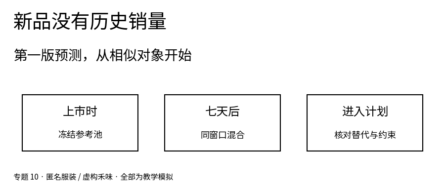
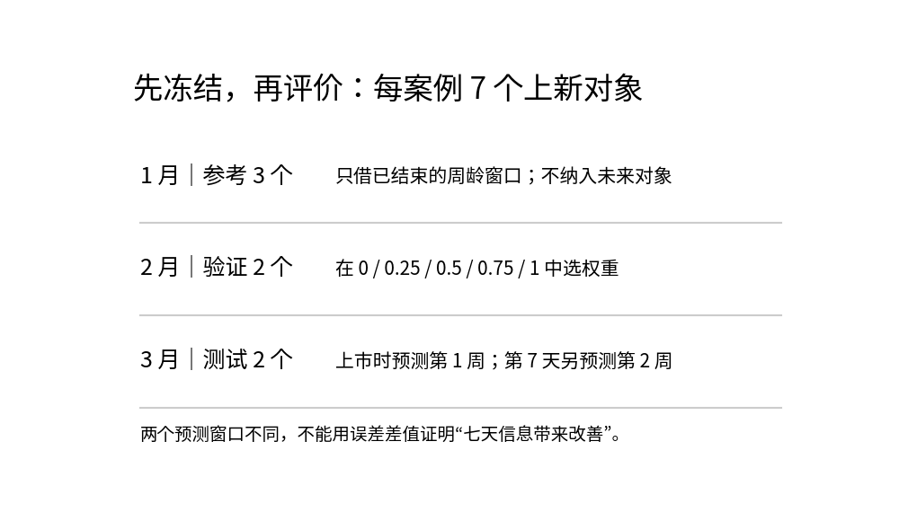
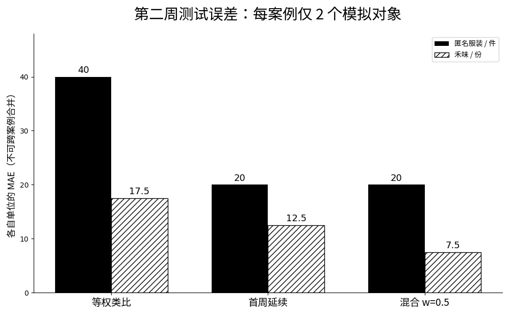
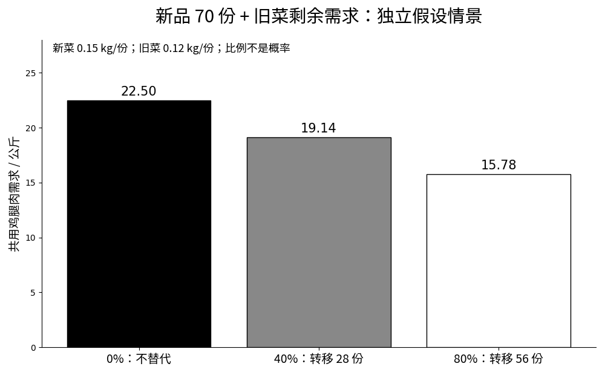

供应链预测与计划 · 第10篇

[第9篇](../09-intermittent-demand/)讨论了长期零需求夹杂少数订单的商品。新品则面临另一种缺口：连零销量的历史都还没有。销售给出首发目标200件，采购希望今天确定备料量，算法却要求至少一年的历史。三方都在等待一个实际上不存在的输入。

此时仍然可以做预测，但需要把依据写清楚：借用了哪些老款的经验，哪些商业条件已知，哪些只是试验假设，以及什么时候允许新证据改变判断。本篇先做一个能手算、能审计的类比基线，再用上市第一周的数据更新第二周预测。

> 本文全部产品、日期、数量与结果均为教学模拟。匿名服装企业及虚构“禾味”没有真实收益声明。本篇是专题第10篇，不是每日课程 D10。实验只有两类业务各7个模拟上新对象，不是已验证的完整门店×SKU×180天需求面板；不连接真实采购或生产系统。



## 一、先把“没有历史”拆成三个问题

**新款进入熟悉的业务。** 品类、价格带、渠道和覆盖范围基本不变，可以参考早先上新的相似款。比如同价格带基础上衣，或同两家门店的鸡肉午餐。

**已经卖了七天。** 有观测，但还不能确定这七天代表稳定需求。首发活动、缺货、周末、试吃都会改变销量。此时应该保留原预测，并新增一版有短历史条件的预测。

**进入完全不同的市场。** 新渠道、新顾客群、不同价位或者销售方式，旧款很可能没有可迁移的经验。透明的情景、小规模试销和人工复核，比包装成一个高精度预测更可靠。

[FPP3 的判断预测章节](https://otexts.com/fpp3/judgmental.html)介绍了类比、新品判断和情景方法，并强调结构化记录与评估。本文只借用这些原则，下面的日期、数据、筛选规则和计算全部是独立教学设计，不是教材给出的模型或实证结论。

## 二、相似款要在看到新品结果以前选好

先定义预测任务：**一个上新对象，在固定覆盖范围内，上市第1周或第2周的总需求。** 第1周是上市日开始连续7天，第2周是接下来的7天，不能把自然周与上市周龄混用。

匿名服装案例按件计数，覆盖固定两渠道、同款全尺码合计；不把它冒充单色单码预测。禾味按菜品份数计数，覆盖固定两门店合计，随后通过配方转成其中一个食材的公斤数。两个案例的单位不同，误差不能加在一起平均。

我们给相似对象设三个硬条件：同品类、同价格带、同覆盖范围。进入参考池的产品必须属于预先冻结的参考组，且要预测的周龄窗口在当时已经结束。失败的老款和不卖座的老菜也不能因结果不好被删掉。

<div class="regression-table-scroll" role="region" aria-label="可横向滚动的数据表" tabindex="0">

| 检查 | 正确处理 | 常见泄漏或混淆 |
|---|---|---|
| 截止时点 | 上市时只能用已知信息 | 看完新品销量再选最像的老款 |
| 生命周期 | 第2周对第2周 | 第2周对成熟期均值 |
| 规模 | 固定两渠道／两店合计 | 20店老品直接对2店新品 |
| 可观测性 | 分清真实需求与受限销量 | 缺货后的低销量当低需求 |
| 业务条件 | 保存价位、促销、季节 | 属性相似就假定没有季节差异 |

</div>

本实验故意冻结参考池，不让验证组和测试组的后续结果自动进入参考池。这不是唯一合理的生产方案，但使“用了什么”一目了然。现实系统可以滚动更新，不过每次都必须重新检查信息可用日期。

## 三、零历史第一版：先借三位“前辈”的经验

匿名服装的三个历史模拟对象 A1、A2、A3 已完整经历前两周：

<div class="regression-table-scroll" role="region" aria-label="可横向滚动的数据表" tabindex="0">

| 参考对象 | 上市第1周需求／件 | 上市第2周需求／件 |
|---|---:|---:|
| A1 | 80 | 100 |
| A2 | 100 | 120 |
| A3 | 120 | 140 |

</div>

新品尚未销售时，最简单的基线是三个相似对象等权平均。

**第1周类比预测 = (80＋100＋120) ÷ 3 = 100件。**

括号里的数是同一周龄、同一覆盖范围的需求，先相加再除以对象数量，得到“每个对象的平均周需求”。不是把三个款的需求都分配给新品。

**第2周类比预测 = (100＋120＋140) ÷ 3 = 120件。**

不能因为新品首周没卖过，就把它的需求预测记成0；也不能把销售部门的200件目标直接写入模型。目标可以保留在另一列，用于显示目标与预测之间的差距。

为什么不用最畅销的 A3？因为这会把“相似”变成“最符合愿望”。为什么先不用复杂属性权重？因为仅三个样本不足以可靠学习许多权重。等权不是最优保证，而是一个简单、可审计的起点。将来若引入价格距离、面料、季节和渠道相似权重，权重也应在历史上新批次上验证，而不是凭新品测试成绩调整。

## 四、卖了七天以后，不能把两个窗口相加

假设新品 A6 首周观测80件，第二周类比预测120件。为了比较两种信息，我们定义一个很朴素的短历史基线：**下一周需求先按首周总需求80件估计。** 它假设两周长度与覆盖相同，且没有已知促销、营业日或生命周期变化；这是假设，不是事实。

用一个0到1之间的权重 w 混合：

**第二周混合预测 = w × 首周延续估计 ＋ (1−w) × 第二周类比预测。**

w 没有单位，表示给短历史基线多少权重；1−w 是类比基线的权重，两者相加为1。w=0完全沿用类比，w=1完全采用首周延续。

若 w=0.5，则预测 = 0.5×80＋0.5×120 = 40＋60 = **100件**。输入两项都已经解释为“第二周需求的估计”，因此才可以混合。80件首周真实需求不能再作为已发生需求加到第二周计划中。

这是加权平均，不是完整贝叶斯模型，没有自动给出概率区间。三个参考对象的最小值和最大值也不是校准过的 P10、P90。如果需要概率预测，应回到专题第4篇，另做分布假设、覆盖率检验及分位数评估。

[](images/02-timeline.png)

## 五、权重在验证对象上选，不用测试新品倒推

附带实验按上新对象和日期分组，而不是把同一个新品的前后记录随机打散。

<div class="regression-table-scroll" role="region" aria-label="可横向滚动的数据表" tabindex="0">

| 组别 | 每案例对象数 | 模拟上市日期 | 用途 |
|---|---:|---|---|
| 参考组 | 3 | 1月1日、8日、15日 | 提供周龄1和2的类比需求 |
| 验证组 | 2 | 2月1日、8日 | 比较五个权重 |
| 测试组 | 2 | 3月1日、8日 | 权重固定后评价新对象 |

</div>

所有日期为2026年。第2周标签在上市14天后可用，最后一个验证对象于2月22日成熟，早于第一个测试对象3月1日上市。预测目标窗口采用左闭右开：3月1日上市，第1周为[3月1日,3月8日)，3月8日更新第2周[3月8日,3月15日)的预测。

本篇是“按上新批次分组”的独立教学设计，不沿用成熟时间序列的112／28／40天划分；不是偷偷改变旧实验的划分口径。预测函数只依赖截至当时的参考数据与首周特征，测试第2周标签只进入评分。

预先设定候选 w 为0、0.25、0.5、0.75、1，用验证对象的第二周 MAE 选最小值。MAE是平均绝对误差：每个对象的预测减实际，去掉正负号，再除以对象数。若并列，选择较小 w，这也是预先写明的规则。

服装验证对象 A4 的首周／第二周为60／90件，A5为100／110件。类比第二周均为120件。五个权重的验证 MAE 依次为20、10、0、10、20件，所以冻结 w=0.5。这个刻意简单的模拟恰好在验证组得到0误差，**不意味着真实业务可以做到零误差**。

禾味参考组的第二周均值为70份，两个验证对象的首周／第二周分别为20／40份、60／60份。五个候选权重的验证 MAE 依次为20、12.5、5、5、10份；0.5与0.75并列，按事先固定的规则选择较小的0.5，不用测试结果打破平局。

## 六、测试结果：混合不是每次都赢

<div class="regression-table-scroll" role="region" aria-label="可横向滚动的数据表" tabindex="0">

| 案例／对象 | 第二周类比 | 首周延续 | 混合 w=0.5 | 第二周实际 |
|---|---:|---:|---:|---:|
| 服装 A6／件 | 120 | 80 | 100 | 100 |
| 服装 A7／件 | 120 | 160 | 140 | 180 |
| 禾味 H6／份 | 70 | 40 | 55 | 45 |
| 禾味 H7／份 | 70 | 100 | 85 | 80 |

</div>

服装两个测试对象：类比 MAE=40件，首周延续=20件，混合=20件。A6混合恰好正确，但A7混合误差40件，反而高于首周延续的20件。两对象平均下来，混合只与简单基线持平。

禾味两个测试对象：类比 MAE=17.5份，首周延续=12.5份，混合=7.5份。这只是固定小样本上的结果，不能推广成“混合方法降低了多少企业成本”。没有库存、损耗、利润或缺货成本回放，便没有收益结论。

零历史第1周预测也保存在 `predictions.csv`：服装 A6/A7均预测100件，实际80/160；禾味 H6/H7均预测60份，实际40/100。它与七天后预测第2周的任务窗口不同，不能将两组误差相减后宣称“看七天数据提高了准确率”。若要研究信息增加的价值，应在同一目标窗口、同一对象上比较不同截止时点的预测。

[](images/03-errors.png)

## 七、禾味上新一道菜，不能把新菜全部加到原采购上

禾味仍保持虚构的两店、八个食材 SKU 框架。本篇只演示两店合计的一道新鸡肉菜和一道旧鸡肉菜，以及其中一个共用食材“鸡腿肉”，没有声称重建八种食材的全量历史。菜品份数和食材 SKU 数量不能混为一谈。

另设一个独立的下一周计划情景：新品预测70份，旧菜在没有新品时预计100份。新菜每份耗用鸡腿肉0.15公斤，旧菜每份0.12公斤，配方均假定为采购口径毛用量，不再重复除以出成率。这里的70份是情景输入，不是宣称上述测试中已选中的最终混合预测。

如果完全没有替代，共用食材需求 = 70×0.15＋100×0.12 = **22.5公斤**。

若假设新品销量中40%来自旧菜转移，则替代量 = 70×0.4 = 28份，旧菜剩余需求 = 100−28 = 72份。

总食材需求 = 70×0.15＋72×0.12 = 10.5＋8.64 = **19.14公斤**。

<div class="regression-table-scroll" role="region" aria-label="可横向滚动的数据表" tabindex="0">

| 假设的替代比例 | 旧菜剩余／份 | 共用鸡腿肉／公斤 |
|---|---:|---:|
| 0% | 100 | 22.50 |
| 40% | 72 | 19.14 |
| 80% | 44 | 15.78 |

</div>

替代比例不是模型学出来的，也不是三种概率。它只是让管理者看见假设的后果，不能把三个结果简单平均当作有统计依据的期望。代码要求替代量不能超过原旧菜需求，而不是默默截断成0。

这仍是需求推演，尚未扣现存、计入及时在途、校验效期、采购规格和厨房产能。把它变成可执行补货，应接回专题第5篇的库存位置及约束逻辑，而不是直接下单19.14公斤。

[](images/04-substitution.png)

## 八、上线产品时，最值得保留的不是一个数

建议在预测版本中保存：对象与覆盖、目标起止、预测截止时点、上市周龄、候选参考对象及排除原因、特征快照、模型与权重版本、原始预测、人工调整及理由、需求是否可观测、计划采用值及审批记录。

相似对象一个都没有时，实验代码直接报错，转人工情景，不自动填0。首周缺货时也拒绝把受限销量用于更新。真实系统还需要识别营业中断、首发促销、异常曝光、预售取消和价格变化。它们不会被一条加权平均公式自动解决。

如果已经有30件确认订单，而预测120件指同一窗口的总需求，不能再加30得到150。只有预测目标明确为“尚未确认的剩余需求”时，才按去重规则与确认订单合并。信息字段再齐全，也需要检查两者是否覆盖同一批需求。

AI Agent 可以帮助整理可追溯的属性、提出候选类比、调用确定性计算、解释异常和生成复盘草稿；不应自己补造缺失销量、偷偷更换测试样本，或把预测直接变成采购承诺。人为调整要独立留版本，之后评估是否真正改善，而不是覆写原预测。

## 九、把实验跑起来，再故意破坏它

实践包无需第三方运行依赖，Python 3.10及以上即可：

```bash
cd practice
python run.py
python -m unittest -v
```

`data/cases.json`保存14个对象、两个周龄需求与分组日期；`outputs/results.json`保存输入指纹、验证分数、冻结权重、测试预测和替代情景；`outputs/predictions.csv`便于逐行复算。图形再生成另需 matplotlib，文章阅读不依赖它。

先改变测试对象第二周实际需求，确认权重和预测不跟着变；再把参考对象上市日期移到未来，检查它被排除；把首周标记为不可完整观测，应进入异常而非继续更新；最后将替代比例写成120%，应拒绝计算。

建议再做两个扩展：增加更早的完整上新批次，分别按品类报告误差；在不同季节和渠道上测试参考规则是否失效。扩展时不能为了得到更漂亮的结果反复改同一测试集。测试集一旦参与选择，就已经是开发资料，需要另留新的时间和对象做最终评价。

**新品预测的起点可以很简单，证据边界不能含糊。** 第一版需要说清借用了谁的经验，更新版需要说清新增了什么信息，计划版需要说清还欠哪些约束。本实验的意义是让这三件事能够被复核，不是承诺一条公式解决所有上新风险。

## 参考资料与范围

- [FPP3 第6章 Judgmental forecasts](https://otexts.com/fpp3/judgmental.html)：结构化类比、新品判断与情景思路；本篇具体实验为原创教学设计。
- 本专题第4篇：概率与取消；第5篇：受约束补货；第8篇：层级协调；第9篇：间歇需求。新品与间歇需求可能交叠，但“没有历史”与“历史大多为零”仍需区分。
- 实验不宣称混合权重为普遍最优、不提供校准区间，不证明因果替代效应；数据均为模拟。


## 配套下载

- [完整实践包：数据、代码与测试](/downloads/p10-new-product-cold-start-practice.zip)
- [图文阅读包：离线HTML与Markdown](/downloads/p10-new-product-cold-start-article.zip)
- [配图包：4张PNG与绘图源码](/downloads/p10-new-product-cold-start-images.zip)
