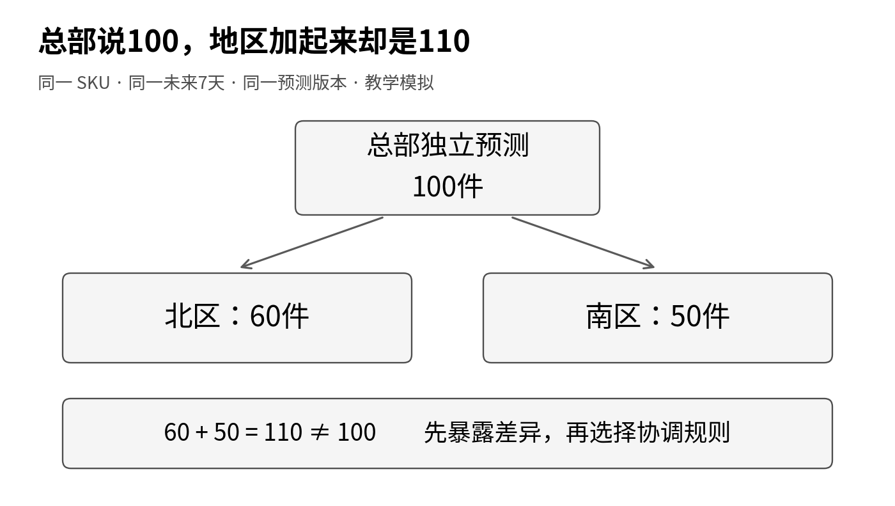
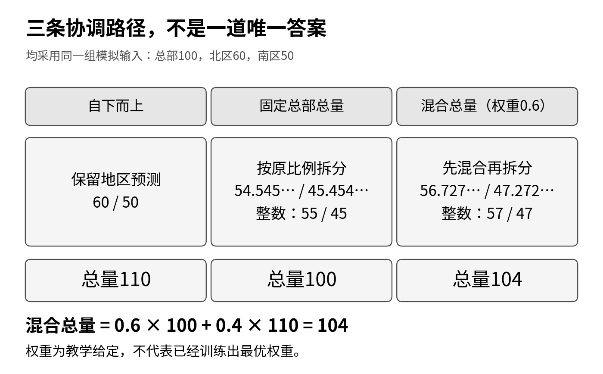
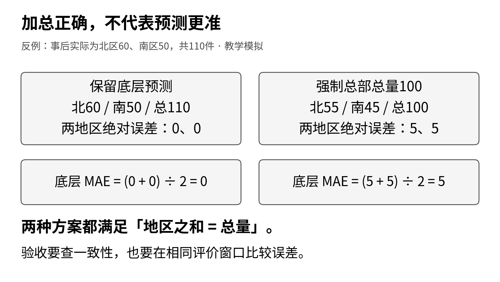
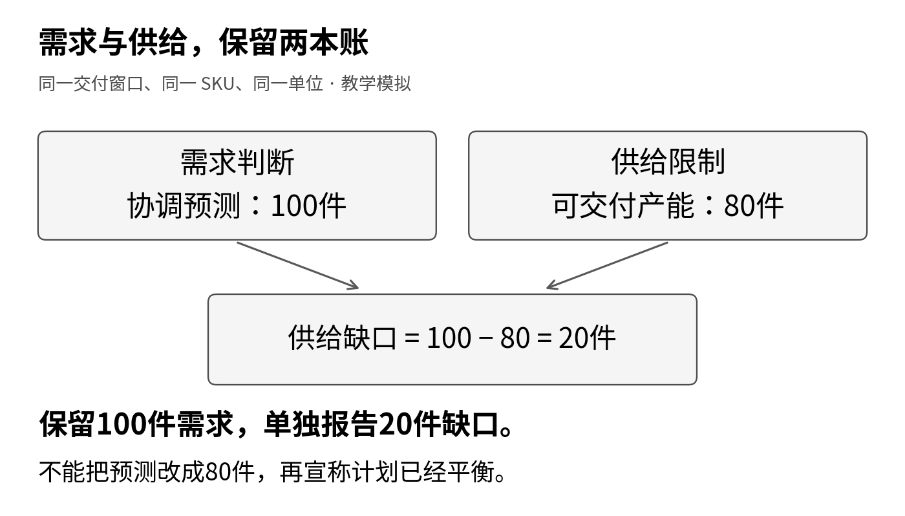

# 总部说卖100件，门店却要110件：预测怎样先对齐，再进入计划

供应链预测与计划 · 第8篇

上一篇讨论了供应商到货时间的不确定性。这一篇先往前退一步：即使交期都已确定，需求端也可能拿着几张互相矛盾的表。总部预计下周卖100件，两个地区分别预计60件和50件。采购按100件准备，地区按110件申请，到底应听谁的？

把两边改成同一个数字不难。难的是说明改了什么、为什么改，以及改完之后有没有更接近未来。

本文从加减乘除开始，做三种可复算的协调规则，再把需求和供给分开。你不需要先学矩阵。读完应能回答：**哪些数可以相加、哪一层需要调整、整数怎么分、为什么加起来正确还不代表预测准确。**

> 所有企业、需求、库存、权重和结果均为教学模拟。服装案例采用匿名企业；“禾味”为虚构餐饮品牌。本篇是协调规则实验，不是新训练的预测模型，也不是实际采购、生产或配送建议。第8篇属于预测专题，不是每日课程D22。



## 一、先查口径，不要一看到差额就分摊

两张表都写着“销量”，不代表它们在说同一件事。

| 要核对的字段 | 本篇服装手算口径 | 容易混入的另一种口径 |
|---|---|---|
| 对象 | 同一款黑色M码成衣 | 全款所有颜色尺码 |
| 目标期间 | 同一个未来7天 | 本自然周或未来30天 |
| 数量单位 | 件 | 箱、金额、米布 |
| 指标 | 不受供应限制的需求数量预测 | 实际可发货量、销售目标 |
| 预测版本 | 同一截止时点形成的版本 | 一张今天更新、一张上周更新 |
| 覆盖范围 | 北区与南区互不重叠，覆盖全部目标地区 | 同一订单在两个渠道重复记账 |

先统一这些条件，才有“总部应等于两地区之和”的关系。如果总部100是预算目标、地区110是需求预测，两者可以不相等。应该显示10件差距，而不是把预测改到符合预算。

这里用一棵小树：总部下面是北区与南区。对于同一SKU、同一期间，真实需求总量等于两个互斥地区的真实需求之和。独立预测却不一定满足这个等式。这就是需要协调的地方。[FPP3第11章：层级与分组时间序列](https://otexts.com/fpp3/hierarchical-forecasting.html)介绍了这类加总结构。

颜色、尺码、地区同时存在时，并非只有一棵树。可以先按地区再按尺码，也可以先按尺码再按地区。两个视图共享同一批底层明细，不应当作两批订单相加。本文先做两地区的最小问题，不声称解决全部交叉层级。

## 二、三个方法，分别相信谁

记总部原预测为T，北区为A，南区为B。字母只是给数字起短名字，不改变单位：

- T=100件；A=60件；B=50件。
- S=A+B=110件。S表示底层合计，不是新的一批需求。
- 当前冲突是S−T=10件。正号表示底层合计大于总部。

### 方法1：从下往上加，总部改成110

保留A=60、B=50，把总部协调值设为110。通常称为自下而上，或bottom-up。

优点是保留地区差异，也不需要强行修改每个地区。局限是底层新品、低频商品可能有很多噪声，逐项相加不保证总量最准。**这是一个基线，不是“门店永远比总部懂市场”的宣言。**

### 方法2：保留总部100，按底层比例缩放

先问两个地区各占原合计多少：

北区份额=60÷110=6/11，约54.545%；南区份额=50÷110=5/11，约45.455%。

然后用总部100乘各自份额：

- 北区协调值=100×60÷110≈54.545件。
- 南区协调值=100×50÷110≈45.455件。
- 两者之和=100件。

通用写法为“某地区协调值=目标总量×该地区原预测÷所有地区原预测之和”。乘法中的份额没有单位，目标总量以件计，所以结果仍然是件。

本篇把它称为**固定总量的比例协调**。这里用的是同一时点的底层预测份额，不是另外估计的历史销量份额。不要把它误写成一种已经训练好的最优算法。

如果底层全为0、总部却为100，就没有可用的比例。不能靠加一个极小数躲开除零，更不能默默平均分。应该提示需要人工指定份额或另建冷启动规则。若总部与底层全为0，结果才可全部为0。

### 方法3：两层各占一些权重，先定总量再拆分

假设讨论后给总部权重w=0.6，底层合计权重1−w=0.4。权重取0到1之间，两个权重相加为1。

**协调总量C=w×T+(1−w)×S。**

逐步代入：C=0.6×100+0.4×110=60+44=104件。

这里的60和44是两个预测的加权贡献，不是两个地区。再按6/11与5/11拆回地区：北区104×6/11≈56.727件，南区104×5/11≈47.273件。

w=1时完全采用总部总量；w=0时回到自下而上。0.6是本实验**给定的教学参数**，不是用数据拟合得到的可信度，更不能解释为“总部正确的概率是60%”。以后若要选w，必须在验证数据上比较，冻结后再测试；不能看完测试答案才挑权重。



## 三、不能订54.545件衣服，整数怎样保住总量

预测可以保留小数，因为它表达平均水平；成衣分配通常要整数。把每一行都向上取整，会悄悄增加总量。

固定总部100的结果是54.545和45.455：

1. 先各自向下取整，得到54与45，合计99。
2. 剩余100−99=1件。
3. 比较刚才舍去的小数：北区0.545，南区0.455。余下1件给北区。
4. 最终55与45，合计仍为100。

这叫最大余数法。混合总量104同理：先取56与47，少1件；北区余数较大，最终57与47。

如果余数相同，按预先固定的地区ID顺序分，不依赖CSV行的排列顺序。目标总量本身必须已确定为整数；若混合出来104.4，应先明确总量取整规则，再进行明细分配，不由程序暗中选一种。实验对非整数成衣总量直接报错。

**最大余数法只解决整数合计，不解决整箱MOQ、产能和尺码最低陈列量。** 一个地区分到55件，不代表工厂允许生产55件。数量约束要进入下一张计划表，而不是伪装成预测方法。

## 四、匿名服装企业：把需求差额留下来，而不是擦掉

设这家匿名服装企业正在协调同一款黑色M码的北区和南区需求。需求协调会输出三种可比较版本，但生产人员还要核对可用成衣、已确认到货及生产能力。

用固定总量100的整数结果继续手算。假设北区有可用库存20件、期间内确认到货10件；南区有库存15件、确认到货5件。这里库存已经扣除其他订单占用，全部为合格可售成衣，避免同一库存被重复使用。

北区净需求=max(0,55−20−10)=25件；南区净需求=max(0,45−15−5)=25件。max(0,x)表示在0和x之间取较大值，防止库存多时输出负采购数量。

总净需求50件。如果工厂在目标交付日以前只有40件可用产能，应显示“净需求50、可行供给40、剩余缺口10”，而不是把预测从100改成90来让报表好看。具体10件缺口如何在地区之间分配，还需要承诺优先级、调拨路线与服务目标，本篇不替业务决策者作出分配。

这个顺序也解释了为什么不能先把全网库存相减，再按比例摊回地区：北区富余的库存不一定能及时运到南区。库存不自动跨地点可用。成衣也不自动跨颜色、尺码可替代。若扩展12个“地区×颜色×尺码”组合，应在底层扣各自库存，再汇总需要的工单；不能拿黑色M码的库存去抵白色S码。

需求协调、材料展开和生产排程是三层工作。本文不把一件成衣直接视为一米布，也不再重复上一专题文章的三来源优化。

## 五、禾味：8种原料要各算各的，两家店才是可加的层级

禾味有两家门店与8个食材SKU：椰浆、牛奶、咖啡豆、红茶叶、糖浆、柠檬、珍珠、燕麦奶。实验交付2×8×14=224行日明细，每行都是模拟的“某日、某店、某食材”。各SKU分别协调，结果不把牛奶与咖啡豆混成一个可替代需求池。

即使都换算成千克，1千克牛奶也不能替代1千克咖啡豆。跨SKU重量和可用于运力分析，但不能据此判断每种原料是否够用。本文的协调层级是：**同一天、同一种原料协调后的总部总量，等于两家店该原料的协调值之和。原总部预测仍单独保留。**

先借一个单日牛奶截面练习：总部30千克，两店18与14千克，合计32。给总部权重0.6，协调总量=0.6×30+0.4×32=30.8千克。

A店份额18÷32=56.25%，协调值30.8×56.25%=17.325千克；B店为13.475千克。两店合计30.8千克。原预测18与14不能被覆盖，应和协调值并排保存，才能看到A调低0.675、B调低0.525。

换一个独立的柠檬加工手算：净料需要30.8千克，给定出品率80%，毛料需要30.8÷0.8=38.5千克。牛奶截面的数值不是牛奶加工损耗假设。反向检查38.5×0.8=30.8。不能再额外扣20%损耗，也不能把所有8种原料都套一个出品率。实验的日面板使用同一可用原料kg口径，80%毛净转换作为独立手算；包内只给柠檬设0.8，其余SKU设1，都是教学假设，不往牛奶、咖啡豆上硬套。

如果A店未来三天的新信号显著上升，把后面日子硬压低来保持月总量，只能叫“固定月目标的计划情景”，不能说消费者会自动少买。这也是教程生鲜月度与门店短期协调一课特别区分的边界。

## 六、一个反例：协调之后更整齐，却预测得更差

假设未来实际发生的是北区60、南区50，总计110。原底层预测恰好正确。强制总部100后，整数结果55、45，两地都少了5件。

定义本例底层平均绝对误差MAE：先算每个地区“预测减实际”的差，取绝对值，再除以地区数。绝对值就是不管方向，只看相距多远。

原底层MAE=(|60−60|+|50−50|)÷2=0件；固定总量后MAE=(|55−60|+|45−50|)÷2=5件。

它通过了“子项和等于总量”的一致性检查，却没有通过“比原来更准确”的比较。反过来，如果实际是55、45，固定总量版本会赢。这两个手算情景说明，方法胜负依赖实际需求，不能只展示偏爱某个方法的答案。脚本另输出`accuracy_counterexamples.csv`的两组反例：实际60/50时三方法MAE分别为0/5/3；实际55/45时分别为5/0/2，单位均为件。包内面板特意把actual设为原底层预测，专门构造第一种反例，不作为方法排名或盲测证据。



准确性要逐层看：既检查总量误差，也看门店或地区误差；还要看是否长期低估。不能把总部与子项混在一起当成三条独立需求，因为总部已经包含下面两条。若业务确实需要综合评分，应明确各层权重，而不是用重复计算形成一个看似精确的平均数。

此外，某店P90需求加上另一店P90需求，一般不等于全网P90。分位数不是普通加法；两店同时旺或一旺一淡会影响全网风险。本篇只协调点预测，不输出“协调后的P90保证”，也不实现MinT或概率层级协调。

## 七、产品界面应留下哪些信息

建议将输出拆成两张并排的卡，而不是只保留最终“建议量”。

**需求卡**：目标日、地点、SKU、单位、预测截止时点、原版本、协调规则、权重来源、原预测、协调后预测、调整差额、加总检查。

**供给卡**：合格可用库存、已占用数量、到期前确认在途、整箱/最小起订量、产能/仓容、可行数量、未满足缺口、需要人工处理的原因。



图中100与80是另一个最小示意，不是上文服装扣库存后的50与40。无论用哪组数，原则相同：**受限供应是计划事实，不是需求变小的证据。**

异常要明确失败：负数、非数值、重复主键、缺失门店、单位不一致、底层全零却要分正总量，都不应静默填补。在生产系统还要保存审批、版本和权限。本包只有本地文件与输入校验，不具备真实审批、跨系统幂等或自动下单权限。

## 八、两小时小项目：亲自证明“一致”与“准确”是两件事

实验用Python标准库，生成输入与重算分开。包内已经附上原始模拟CSV，不需要联网或安装预测框架。

1. **20分钟**：先手算100、60、50的三种规则，写出100/110/104各自代表什么。
2. **30分钟**：运行脚本，查看协调前后CSV，验证每个“日期×SKU”的两店合计，而不是只核对整份文件的总和。
3. **30分钟**：运行测试和两个准确性反例；把一份CSV行顺序打乱，确认结果不变。修改副本，不覆盖原输入。
4. **20分钟**：沿服装案例把需求、库存、在途、产能分开，列出仍未解决的10件缺口。
5. **20分钟**：写150字结论，至少包含一致性结果、准确性局限和下一步验证设计。

解压进入practice目录后执行：

```sh
python run.py
python -m unittest -v
```

输入包含236行底层记录（服装12行、禾味224行），输出`outputs/reconciled.csv`的708行协调结果、`outputs/group_checks.csv`的354行逐组核验及6行双反例比较。服装day=1表示一个未来7天目标期间的标签，不是每日销量；禾味day=1…14才表示14个单日。服装6个颜色尺码SKU刻意使用同一模板，覆盖完整键与分组计算，不声称刻画真实尺码分布。包内容量示例为零库存、无在途的另一截面：北区需求55、产能50，缺口5。上文带库存与在途的25+25净需求例子是独立手算，不假装已包含在该CSV流程中。完整字段与范围见README。

14天禾味面板是规则演算和回归测试，不是外部有效性评估，不代表在14天上选出的最佳预测方法。若进一步训练或比较预测方法，回到课程180天的112/28/40训练、验证、测试划分，5天评价窗口不得跨块；在验证段选择方法或权重，测试段不得反复调参。

验收不只看“脚本正常结束”：

- 每个独立协调组子项合计等于协调总量，服装整数分配不多一件、不少一件。
- 保留原预测，能解释底层从110改为100或104的每一步。
- 至少有一个“更一致但更不准”的可复算反例；供给受限时仍保留需求与缺口。

## 九、接着读什么

本篇基于已经核对的教程模块展开，但案例数值与代码是为本篇另制的模拟，不冒充原教程完整工程或真实模型训练结果。

- [全国预测和分仓预测不一致：层级协调与补货分配](https://12lab.cn/forecast/fmcg-04/)：比例协调、最大余数法、净需求及边界检查。
- [生鲜基地月度与门店短期协调](https://12lab.cn/forecast/industry-hierarchy-fresh/)：固定权重、毛净转换与月日目标冲突。
- [地区颜色尺码与测款追单贯通](https://12lab.cn/forecast/industry-apparel-region-chain/)：多维底层、预售与零售边界、分地区库存。
- [Forecasting: Principles and Practice，第11章](https://otexts.com/fpp3/hierarchical-forecasting.html)：先读11.1和11.2；11.3作后续阅读。本篇没有实现该节的MinT。

前七篇已经从数学和数据口径走到回归、概率、补货、供给来源和交期。本篇补上“多个预测怎么放进同一张计划表”的问题。先让加总关系可核对，再证明预测值有用，最后才讨论执行。三个步骤不能用一个“协调成功”代替。
